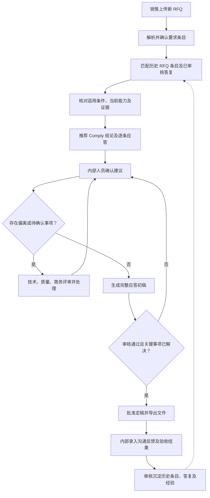
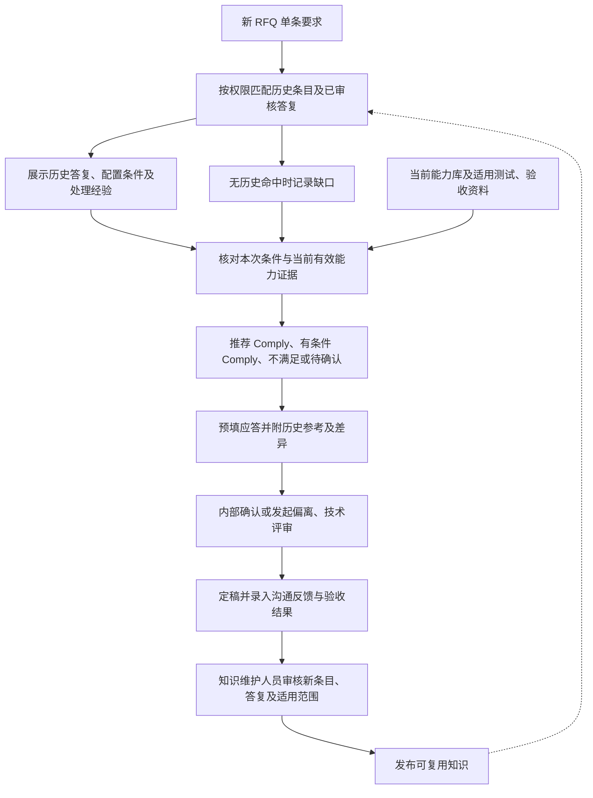
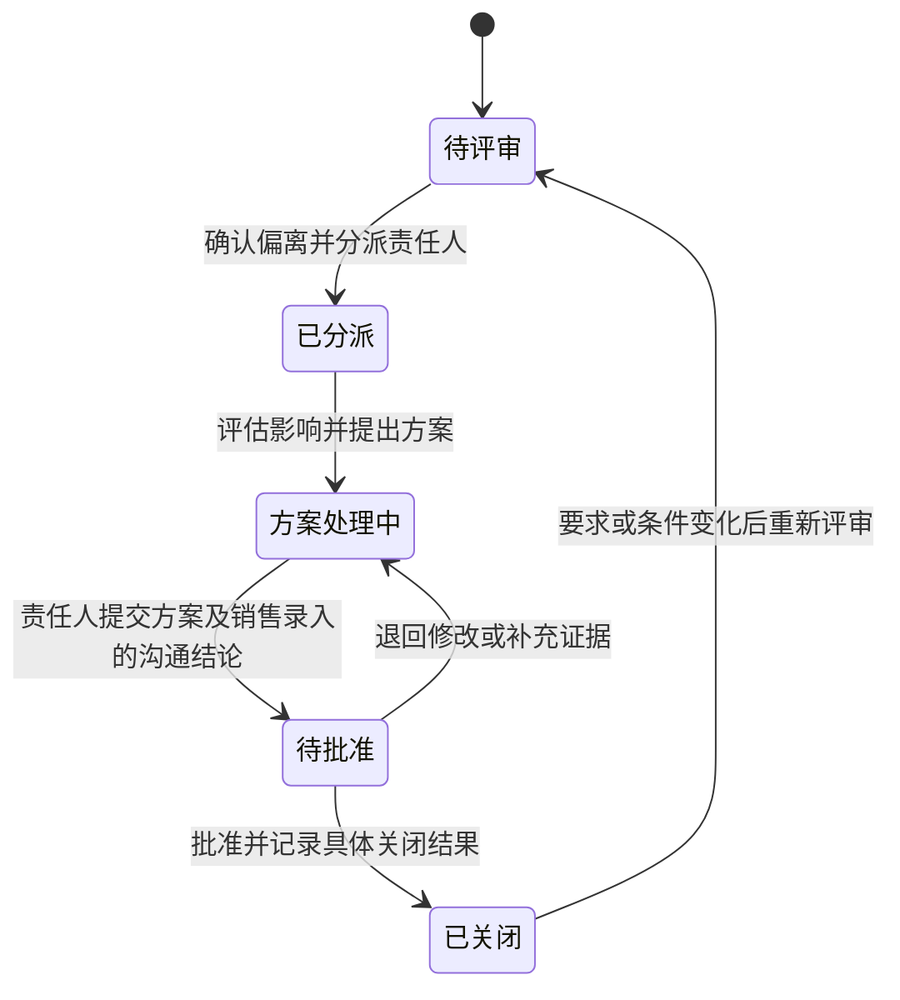

# FEP 销售 RFQ 提效 Agent 产品需求文档

| 项目 | 内容 |
| --- | --- |
| 文档版本 | v0.1 |
| 文档状态 | 内部评审草案 |
| 编制日期 | 2026-10-20 |
| 试点组织 | FEP 事业部 |
| 部署要求 | 完全内网部署 |

## 1. 背景与产品定位

面向半导体制造相关业务的销售 RFQ 应答场景，结合客户 RFQ、当前产品能力和历史项目经验，完成要求解析、智能比对、偏离协同、应答初稿生成与知识沉淀。

核心比对场景是：将新 RFQ 的要求逐条匹配历史 RFQ 条目及已审核答复，核对适用条件和当前能力，快速推荐 Comply 结论及可复用应答。新旧版本差异检查属于辅助能力。

整体业务面向设备、制造服务等场景，首期以 FEP 事业部设备销售 RFQ 为试点。FEP 不作未经确认的全称展开；具体设备范围在试点启动时配置。

### 1.1 产品目标

- 缩短销售整理 RFQ 和准备应答初稿的时间。
- 减少客户要求遗漏、无依据答复及偏离漏报。
- 提升历史答复、评审结论和交付经验的复用效率。
- 建立可追溯、可审核、持续更新的 RFQ 知识资产。

### 1.2 用户角色

| 角色 | 主要职责 |
| --- | --- |
| 销售／项目负责人 | 创建项目、收集资料、组织评审、汇总应答并导出 |
| 技术人员 | 确认性能、配置、工艺能力、技术偏离及证据 |
| 质量人员 | 确认质量、认证、测试和验收要求 |
| 商务人员 | 确认价格、付款、交期等商务条款 |
| 审批负责人 | 批准关键承诺、偏离方案和最终应答 |
| 知识维护人员 | 审核知识、维护适用范围、版本和有效状态 |
| 系统管理员 | 管理部署、权限、配置、审计和备份 |

## 2. 已确认范围与设计假设

### 2.1 已确认事项

- 业务方向为销售侧 RFQ 应答提效。
- 核心能力包括自动化解析、智能比对、偏离管理、初稿生成和知识沉淀。
- 比对以新 RFQ 条目匹配历史条目、历史答复及沉淀经验为主，结合当前能力判断是否可以 Comply。
- 以 FEP 事业部为试点。
- 系统完全内网部署。
- 其余采用本草案的默认方案。

### 2.2 默认方案

| 项目 | 首期范围 |
| --- | --- |
| 业务 | 设备销售 RFQ 应答 |
| 输入 | PDF、Word、Excel，包括扫描件及附件 |
| 输出 | Excel 逐条应答矩阵、偏离表、澄清清单；Word 应答初稿 |
| 历史资料 | 历史 RFQ、最终答复、设备规格、评审记录、偏离记录、测试及验收资料 |
| 接入方式 | 人工上传、批量导入；后续评估内部系统对接 |
| 对外提交 | 人员审核、导出并提交 |

历史资料暂按“分散文件与专家经验并存”设计，不代表已确认企业现状。资料数量、质量、覆盖范围和权限在盘点后记录。

### 2.3 首期边界

首期交付从客户资料导入到经审核应答文件导出的闭环。自动定价、自动对外承诺、自动提交客户及复杂内部系统集成不纳入首期。

## 3. 核心业务流程

销售创建项目并上传新 RFQ → 解析并确认要求条目 → 匹配历史条目及已审核答复 → 核对适用条件与当前能力 → 推荐 Comply 结论及逐条应答 → 内部确认、处理偏离及待确认事项 → 生成并审核应答初稿 → 导出定稿 → 内部录入反馈及交付结果 → 审核沉淀知识。

系统仅供 FEP 内部人员使用。销售在系统外接收 RFQ、沟通澄清和发送答复，再将资料及沟通结果录入系统；外部采购方不登录或操作本系统。

每个项目保留文件版本、要求版本、评审记录和应答版本，支持追溯。销售上传同一项目的新版资料时，可使用辅助版本检查功能，识别变化并提示重新确认；该功能不作为核心历史条目比对流程的前置条件。

### 3.1 业务流程图

图示为定稿主流程；未关闭事项可先生成带标记的内部草稿，但不能绕过定稿审批。

以下 A—M 对应图中的节点。涉及的解析、检索、模型及数据组件均在内网运行；组件名称描述所需能力，具体软件和模型选型通过样本验证确定。

#### A. 销售上传新 RFQ

- **谁来做、输入什么：** 销售创建项目，填写项目名称、所属产品线、设备型号或待选范围、截止时间和负责人，上传 RFQ 正文、规格附件和应答模板。
- **具体怎么做：** 系统检查文件格式、可读性和重复情况；按项目保存原文件及上传记录，区分要求来源与需要填写的模板。销售确认资料清单；缺少被引用附件时列出缺项。
- **用哪些东西：** 项目表单、文件上传服务、内网文件存储、文件指纹去重、项目权限及资料清单。
- **输出什么：** 带项目编号、文件编号、版本及权限的资料包。无法读取、加密或损坏的文件提示处理，不静默跳过。

#### B. 解析并确认要求条目

- **谁来做、输入什么：** 系统处理资料包，销售或指定人员核对解析结果。
- **具体怎么做：** Word、Excel 优先读取段落、表格和单元格；PDF 提取文本及版面，扫描页使用本地 OCR。按原始条款编号拆分要求，提取参数、单位、上下限、条件、强制性和要求类别；复合条款拆为子要求，同时保留父条款及原文关系。发现图纸、公式或表格无法可靠识别时，转人工补录或确认。
- **用哪些东西：** 文档解析器、表格及版面识别、本地 OCR、内网语言模型、结构化字段模板和原文对照界面。
- **输出什么：** 经人工确认的要求清单。每条具备唯一编号、原文、页码或单元格位置及解析状态；低可信项单独列出，不凭模型自报的置信度认定正确。

#### C. 匹配历史 RFQ 条目及已审核答复

- **谁来做、输入什么：** 系统接收已确认的新要求，查询预先整理并获准使用的历史知识。
- **具体怎么做：** 先过滤访问权限、审核状态和有效状态，再结合产品类别、型号、术语及参数检索。使用关键词检索匹配精确术语和数值，同时使用语义检索寻找不同措辞的相似要求；合并候选后重新排序。按条目召回，而非仅返回整份历史文件。
- **用哪些东西：** 历史条目库、已审核答复库、元数据过滤、关键词索引、内网向量模型及向量索引、候选重排能力。
- **输出什么：** 新要求对应的历史候选卡片，包含历史原文、答复、项目、型号配置、来源和匹配理由。找不到历史记录时标记“无历史命中”，仍进入 D 核对当前能力。

#### D. 核对适用条件、当前能力及证据

- **谁来做、输入什么：** 系统使用新要求、历史候选以及当前有效能力资料；无法判断的部分交责任人。
- **具体怎么做：** 对照设备型号、配置、材料、厚度、工艺条件、指标定义、测试方法和验收口径。统一可换算的单位，用规则比较上下限、范围和容差；使用模型辅助识别“典型值／保证值”“选配／标配”等语义差异。到当前能力库及测试、验收资料中核对支持证据，保留来源与有效版本。历史 Comply 不直接继承。
- **用哪些东西：** 产品及配置库、能力规格、测试与验收报告、单位及参数规则、条件差异对照、内网模型与证据检索。
- **输出什么：** 条件差异表及支持／反驳／缺失证据。资料冲突、单位不清或测试条件不适用时列出具体原因，供 E 推荐待确认或其他适当结论。

#### E. 推荐 Comply 结论及逐条应答

- **谁来做、输入什么：** 系统依据 D 的证据与差异生成建议。
- **具体怎么做：** 区分 Comply、有条件 Comply、不满足、待确认和不适用；不适用需说明范围依据。对可复用条目，基于已审核历史答复调整本次参数和范围；有条件满足时写清选配及限制；证据不足时生成待确认说明。推荐结论、理由、来源及建议答复分别存储。
- **用哪些东西：** 判定规则、历史答复模板、结构化生成、内网语言模型、引用及参数一致性检查。
- **输出什么：** 预填的逐条应答矩阵。界面显示“系统推荐，待内部确认”，不得写成已经批准的对外承诺。

#### F. 内部人员确认建议

- **谁来做、输入什么：** 销售查看全部结果，按技术、质量、商务类别将条目分派给有权限的责任人。
- **具体怎么做：** 界面并排展示新要求、历史参考、条件差异、证据及推荐答复。人员可采纳、修改或转评审，修改记录原因。对依据和条件一致的条目允许批量确认，但需展示批次范围、排除异常项并逐条保留操作记录；关键承诺仍按审批规则处理。
- **用哪些东西：** 应答矩阵工作台、原文及证据查看、人员分派、权限校验、确认记录和操作日志。
- **输出什么：** 经内部确认的结论及答复，或带责任人和原因的评审任务。系统推荐与最终人工结论分开保存。

#### G. 判断是否存在偏离或待确认事项

- **谁来做、输入什么：** 系统读取逐条结论、审核状态及缺失信息，人员确认事项分类。
- **具体怎么做：** 证据表明不能满足的条目进入偏离；证据不足、冲突或仍待专业判断的条目进入待确认。有条件 Comply 的条件尚未确认时，形成处理任务。经确认不适用的条目保留理由。不能仅因匹配分数低而认定偏离。
- **用哪些东西：** 状态规则、缺项检查、条件确认记录和任务清单。
- **输出什么：** 有待处理事项则进入 H，否则进入 I；保留内部草稿提前生成入口，定稿另受 J 检查。

#### H. 技术、质量、商务评审并处理

- **谁来做、输入什么：** 对应专业责任人处理偏离及待确认任务，销售协调所需沟通。
- **具体怎么做：** 参考类似偏离的处理经验，补充证据、安排测试、确认选配、修改方案或提出澄清问题，记录成本、交期及质量影响。需要对外澄清时，系统生成问题清单，由销售在系统外沟通并录入回复及附件。方案按权限审批后回到 F 重新确认。
- **用哪些东西：** 偏离台账、历史处理案例、评审任务、澄清模板、测试附件、审批及内部待办。
- **输出什么：** 经确认的处理结论、批准条件和证据；未解决项继续留在待办中。拒绝承接的事项也需有明确结果。

#### I. 生成完整应答初稿

- **谁来做、输入什么：** 销售发起生成，系统读取要求清单、已确认答复、偏离结论及本次模板。
- **具体怎么做：** 按原条款编号和顺序填充逐条应答，汇总偏离及澄清项。优先使用已确认内容，模型辅助整理措辞，不自行补写指标或批准条件。未确认条目生成醒目标记。草稿修改如影响已确认结论或承诺，应退回对应责任人复核。
- **用哪些东西：** 已确认应答矩阵、Word／Excel 模板及字段映射、文档生成组件、内网模型和条款覆盖检查。
- **输出什么：** Word 应答草稿、Excel 应答矩阵及偏离、澄清清单，记录所依据的项目、模板和数据版本。

#### J. 检查审核是否通过且关键事项已解决

- **谁来做、输入什么：** 专业负责人及最终审批人审核草稿，系统执行规则检查。
- **具体怎么做：** 检查要求是否全部有明确处置、关键事项是否解决、附加条件是否保留、证据及附件是否齐全，核对参数、审批版本及提交格式。需要分标时检查技术标中的价格内容。审核失败返回 F，并指出条目与原因；确认后的条目或文件被修改时，相关批准状态失效并重新审核。
- **用哪些东西：** 审核清单、完整性与数值规则、附件检查、分标检查、审批流和版本关联。
- **输出什么：** 通过记录或退回清单。自动检查通过不能替代人员批准；不承接或不适用等结果经确认后可作为明确处置，不强制全部条目都为 Comply。

#### K. 批准定稿并导出文件

- **谁来做、输入什么：** 获授权的审批人批准指定版本，销售导出。
- **具体怎么做：** 固定本次批准的数据及文件版本，核实导出权限，生成定稿文件和附件清单，记录导出人员及时间。后续修改形成新版本，不覆盖已批准文件。销售在系统外发送应答，可回填发送状态。
- **用哪些东西：** 审批记录、版本快照、文件导出、权限校验和审计日志。
- **输出什么：** 可追溯的定稿包及导出记录。系统首期不自动向外发送。

#### L. 内部录入沟通反馈及验收结果

- **谁来做、输入什么：** 销售录入沟通结果，交付或质量人员录入测试和验收结果及原始附件。
- **具体怎么做：** 按项目和条目关联接受、拒绝、补充要求、实际性能和问题原因，区分沟通接受与实际验收通过；允许后续逐次补充。没有结果的记录标记未知，不能推定成功。
- **用哪些东西：** 反馈表单、验收记录、证据附件、条目关联和结果分类。
- **输出什么：** 可核验的反馈及验收记录，形成经验候选。该节点可在定稿后异步推进，不阻塞已完成项目；定稿答复可先送 M 审核，后续反馈再增补。

#### M. 审核沉淀历史条目、答复及经验

- **谁来做、输入什么：** 知识维护人员审核已批准答复及后续结果，专业负责人核对能力类知识。
- **具体怎么做：** 系统提取“要求—答复—条件—依据—结果”，与已有知识去重；人员核对适用型号、配置、有效期及权限，剔除项目特例或明确标记限制。通过后发布新版本并更新检索索引，撤销及过期状态同步生效。项目验收结果不能未经批准就升级为通用能力。
- **用哪些东西：** 知识审核工作台、条目及来源库、去重能力、版本管理、权限标签及索引更新任务。
- **输出什么：** 下次 RFQ 可检索的历史条目、标准答复和处理经验。未审核内容留在候选区，不作为已审核知识参与 Comply 推荐。

#### 3.1.1 首期需要准备的资料与系统能力

| 准备项 | 具体内容 | 对应节点 |
| --- | --- | --- |
| 历史条目与答复 | 从历史 RFQ 和最终应答中整理成对条目，补充审核状态、型号、条件、来源和权限 | C、E、M |
| 当前能力与配置 | 有效设备规格、标配与选配、工艺边界、质量认证及适用范围 | D、H |
| 测试及项目结果 | 测试条件、报告、交付验收记录及已知问题，区分已验证和未验证 | D、L、M |
| 标准模板及术语 | 应答模板、偏离表、澄清清单、产品术语、参数单位及 Comply 用语 | B、D、E、I |
| 内部职责配置 | 项目角色、专业责任人、审批关系、关键要求及知识权限 | A、F、G、H、J、K、M |
| 解析与生成组件 | 文档读取、OCR、表格定位、结构化抽取、Word／Excel 读写与导出 | A、B、E、I、K |
| 检索与模型组件 | 关键词索引、向量模型及索引、候选重排、内网语言模型；独立核查数值和适用条件 | C、D、E、M |
| 业务与存储组件 | 内部工作台、项目及条目数据库、文件存储、任务及审批、版本与审计 | 全流程 |

先用脱敏样本验证上述能力，再确定具体组件及硬件。首期不要求现有 CRM、PLM 或其他系统已完成对接，资料可经授权批量导入。

## 4. 核心功能需求

| 编号 | 模块 | 功能要求 | 验收要点 |
| --- | --- | --- | --- |
| FR-01 | 项目与资料管理 | 创建项目，记录客户、设备范围、截止时间和负责人；上传资料并识别版本、重复文件和附件关系 | 项目资料可查；更新保留历史版本 |
| FR-02 | 自动化解析 | 识别技术、质量、交付、商务、资质和提交要求；拆分复合条款；保留表格关系、单位、条件及原文位置 | 每条要求可定位原文；低可信解析及无法读取的内容显式提示 |
| FR-03 | 一致性检查 | 识别跨文件参数冲突、名称不一致、缺失附件及模糊条件 | 展示冲突双方及出处，生成待澄清事项 |
| FR-04 | 历史条目匹配与 Comply 推荐 | 将新 RFQ 要求匹配历史条目及已审核答复，核对型号、配置、工艺条件及当前能力，推荐 Comply 结论与可复用应答；未命中时检索当前能力并进入必要评审 | 展示新旧条目、历史答复、条件差异、当前证据和推荐结论；不以文字相似或历史 Comply 直接判定本次满足 |
| FR-05 | 偏离管理 | 建立偏离台账，分派责任人，记录影响、方案、审批及客户反馈 | 每项偏离有责任人和处理记录；关闭时注明结果 |
| FR-06 | 初稿生成 | 根据已审核结论和模板生成逐条答复、偏离说明及澄清问题；草稿中的未审核内容保留标记 | 关键答复有依据；待确认内容明确标记；遵循客户格式要求 |
| FR-07 | 知识沉淀 | 从定稿、客户反馈和交付验收中提取可复用知识 | 入库内容经过审核，包含适用范围、版本及来源 |
| FR-08 | 版本影响分析（辅助） | 同一项目上传新版资料时，可识别变化并关联受影响的要求、结论、偏离和初稿；不属于核心历史匹配流程 | 过往批准结论不自动沿用到已变化的要求 |

### 4.1 逐条应答矩阵

每条客户要求至少包含以下字段：

- 要求编号、所属项目及版本。
- 客户原文、来源文件、页码／工作表／单元格等定位信息。
- 要求类别、强制性、参数、单位、条件及适用范围。
- 匹配的历史要求、历史答复、历史项目及配置条件。
- 本次与历史条目的差异、当前能力依据、推荐 Comply 结论及应答。
- 内部确认后的最终结论，与系统推荐分别记录。
- 偏离说明、澄清事项、责任人及审核状态。
- 最终答复、证据引用和批准记录。

解析结果支持人工修改；修改保留人员、时间和变更记录。

### 4.2 单条要求的快速处理

| 处理路径 | 判断依据 | 系统输出及内部动作 |
| --- | --- | --- |
| 可复用 Comply | 历史已审核答复适用，当前有效证据支持本次要求 | 推荐 Comply 并预填应答，内部人员确认后采用 |
| 有条件 Comply | 明确配置、选配或适用限制后可满足 | 列出必要条件，生成条件应答并交责任人确认 |
| 偏离 | 有效证据表明当前能力不能满足 | 推荐不满足并建立偏离事项，参考历史处理经验 |
| 待确认 | 无匹配、证据不足、条件不同或资料冲突，且当前资料无法完成判断 | 展示缺口及建议动作，转责任人评审 |

匹配不到历史条目时仍可基于当前有效资料判断；不得因未命中直接判定不满足。历史匹配结果需展示来源及差异，供内部人员快速确认。

## 5. 历史知识与经验复用

### 5.1 比对来源

| 来源 | 用途 | 预期输出 |
| --- | --- | --- |
| 当前产品及能力库 | 判断当前设备、配置及工艺能力 | 满足情况及适用条件 |
| 历史 RFQ 及最终应答 | 查找类似要求及已审核答复 | 可参考答复、相似点及差异 |
| 历史偏离及处理记录 | 查找类似差距的处理路径 | 替代方案、附加条件、客户接受情况 |
| 测试及交付验收资料 | 核查历史承诺是否得到实际验证 | 验证依据、已知限制及风险 |
| 专家评审经验 | 补充易遗漏事项和处理方法 | 检查项、澄清建议及评审建议 |

### 5.2 历史参考卡片

每条要求可展示：

- 参考项目、时间、设备型号和配置。
- 历史要求、最终答复及审核状态。
- 本次与历史案例在材料、厚度、工艺条件、指标或验收方式上的差异。
- 历史处理方案、适用条件及证据。
- 客户接受、拒绝、待确认或实际验收结果。
- 建议动作：复用、修改后复用、发起专家评审或向客户澄清。

结果未知时标记“未记录”，不得自动视为成功经验。

### 5.3 知识使用规则

1. 当前有效且经批准的能力资料作为当前能力判断依据。
2. 历史答复提供参考；特殊配置、客户特批和限用条件必须展示。
3. 历史答复与当前资料冲突时，进入人工确认并保留双方证据。
4. 未查到依据时进入“待确认”，不得直接判定满足或不满足。
5. 历史客户接受过偏离，不代表本次客户已接受。
6. 过期、撤销或被替代的知识保留追溯记录，默认不作为新应答依据。
7. 专家经验结构化保存“问题—条件—处理方案—结果”，经审核后进入可复用知识。
8. 跨客户复用检查权限及适用范围，不得向其他客户应答中带入受限信息。

### 5.4 结果回流

| 时间点 | 沉淀内容 |
| --- | --- |
| 应答定稿后 | 已批准答复、技术依据、偏离方案及批准条件 |
| 客户反馈后 | 接受、拒绝、要求补充及已知原因 |
| 交付验收后 | 实际性能、验收结果、额外投入和出现的问题 |

### 5.5 历史知识比对与回流图

“证据适用且充分”不等于满足客户要求：充分证据也可能支持“不满足”。缺少证据或资料冲突时进入待确认；AI 比对建议须经责任人评审。

## 6. 判断状态与偏离评审

### 6.1 比对结论

| 结论 | 含义 |
| --- | --- |
| 满足（Comply） | 有适用、有效的证据支持；可参考经核对适用的历史条目及答复 |
| 有条件满足（有条件 Comply） | 在明确配置或限制条件下满足，应答必须保留条件 |
| 不满足 | 已确认存在差距 |
| 待确认 | 证据不足、资料冲突或需要专家判断 |
| 不适用 | 经确认不属于本次范围 |

### 6.2 偏离闭环

偏离类型与处理状态分开记录。类型包括技术、质量、交付、商务等；处理状态包括待评审、已分派、方案处理中、待批准、已关闭。

每项偏离记录客户要求、内部能力差异、成本／交期／质量影响、处理方案、责任人、批准人、客户反馈及最终依据。关闭时明确为内部解决、客户接受、不承接等具体结果。

系统根据历史案例推荐可参考的方案，如增加选配、调整适用条件、样品测试、分阶段交付或替代指标。推荐展示依据与限制，由责任人确认。

关闭结果须注明内部解决、客户接受、不承接等情况。需要客户接受的方案，在取得客户确认后才可按“客户接受”关闭。

### 6.3 审核与定稿

- 按要求类别配置责任人和审批关系。
- 客户要求、内部事实及 AI 建议分别展示。
- 关键性能、价格、交期及其他对外承诺由对应人员批准。
- 未关闭事项可生成带标记的内部草稿。
- 存在未解决的关键要求时，阻止将文件标记为“已批准定稿”。关键要求由项目负责人及相关专业负责人确认。
- 客户要求技术标与价格标分离时，导出前检查技术标是否包含价格内容。

## 7. 完全内网部署与权限要求

1. 文件存储、OCR、模型推理、知识检索、索引、数据库、日志和备份均在内网运行。
2. 业务运行不依赖公网模型 API 或外部服务，不向外发送客户资料、提示词、向量或日志。
3. 模型、依赖及升级包通过受控离线方式导入。
4. 按事业部、项目、客户及角色控制访问；检索、生成和导出均执行权限检查。
5. 销售上传的外部 RFQ 文件作为待分析资料处理，其中的文字不得改变系统权限或审批规则。
6. 记录资料访问、知识修改、评审、生成和导出操作，支持审计、备份恢复。
7. 解析或生成失败时保留已完成工作，提示失败原因并支持重试，不将失败结果标记为完成。
8. 模型、硬件、文件容量、并发和响应时间指标依据样本规模及试运行结果确定，正式试点验收前补入基线。

### 7.1 内网逻辑部署架构图

下图描述逻辑职责，不指定服务器数量、产品选型或微服务拆分方式。所有组件均部署于企业内网。

图中数据存储及模型调用同样执行权限约束；索引不绕过原始资料权限。业务运行不依赖公网服务，离线升级包通过受控流程导入。

## 8. 验收方案

选择有完整应答记录的脱敏历史 RFQ，由业务专家建立参考结果。测试集与用于复用的历史资料明确区分，避免用已入库的同一项目答复替代效果验证。

| 维度 | 衡量方式 |
| --- | --- |
| 效率 | 完成同等可审核初稿所需的人工时间，与现有流程比较 |
| 解析完整性 | 对照人工标注，检查要求提取及关键条件保留情况 |
| 比对质量 | 检查 Comply 推荐、证据及适用条件是否一致，重点检查历史满足但本次不适用的误判 |
| 偏离识别 | 检查重大偏离及资料冲突的发现情况，并记录误报 |
| 历史复用 | 检查历史条目匹配相关性、答复可复用性、条件差异识别及不适用知识拦截情况 |
| 初稿质量 | 统计可直接采用、轻微修改及需重写的条目 |
| 权限与内网 | 验证越权访问拦截，以及断开公网后的完整业务运行 |

数值门槛在样本基线测试后确定，由业务与技术负责人确认，作为正式验收前必填项。本草案不将尚未测试的准确率或提效比例作为承诺。

## 9. 实施阶段

| 阶段 | 主要工作 | 交付物 |
| --- | --- | --- |
| 资料与基线准备 | 确定设备范围；盘点历史资料；确认权威能力资料、权限和审批关系；建立标注样本 | 资料清单、角色配置、标注样本及当前流程基线 |
| 最小闭环验证 | 打通解析、比对、偏离、初稿、知识审核；完成内网部署 | 可运行系统、样本验证结果及问题清单 |
| FEP 业务试点 | 在真实项目中使用，收集评审、客户反馈与交付结果 | 试点报告、验收结果及后续改进范围 |

具体设备范围、资料覆盖、硬件规格及数值验收门槛属于启动与验证阶段的落地项，不阻碍基于本草案展开需求评审。

## 10. 公开 RFQ 参考案例

### 10.1 样本来源

- 发布方：Bharat Heavy Electricals Limited（BHEL），电子事业部。
- RFQ 编号：IKCCAP0034。
- 日期：2018 年 1 月 10 日，属于历史案例。
- 设备：用于半导体二极管、晶闸管硅晶圆加工的激光切割设备。
- 文件：43 页，包含 RFQ、报价格式、技术规格及通用商务条款。
- 官方原文件：[BHEL RFQ PDF](https://www.bhel.com/sites/default/files/rfq-ikccap0034-laser-cutting_merged-1515663096.pdf)。

该文件要求技术商务标与价格标分开，并明确列出偏离，适合作为流程及模板验证样本。其中技术附件封面名称与正文设备描述不一致，部分条款出现 1 mm 与 1.2 mm 厚度表述，可用于一致性检查测试。上述内容参见原 PDF 第 1—9 页；具体历史采购条款不作为 FEP 当前业务规则。

### 10.2 模拟比对场景

以下是产品验证用模拟数据，不代表 FEP 的真实能力或历史项目：

客户要求最大切缝宽度不超过 50 μm。模拟历史案例在特定材料、厚度和选配条件下达到该指标，但当前标准配置资料缺少对应测试结果。

预期系统输出：当前结论为“待确认”；展示历史案例及条件差异；建议技术人员确认配置并安排对应条件的样品测试。测试确认前，初稿保留条件说明，不生成确定性满足承诺。

公开 RFQ 仅作为客户输入样本。真实智能比对效果需配合经授权的内部能力及历史资料验证。
