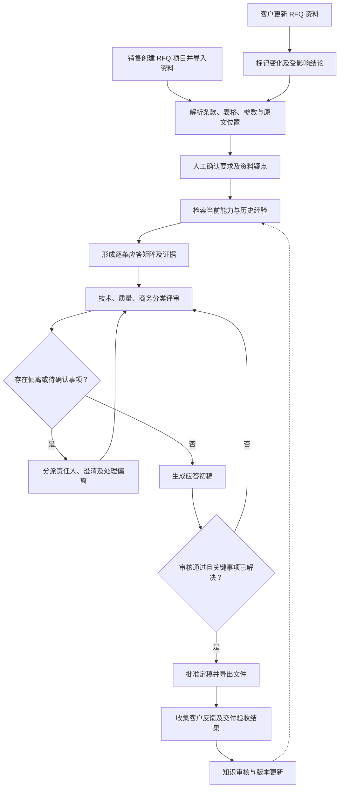
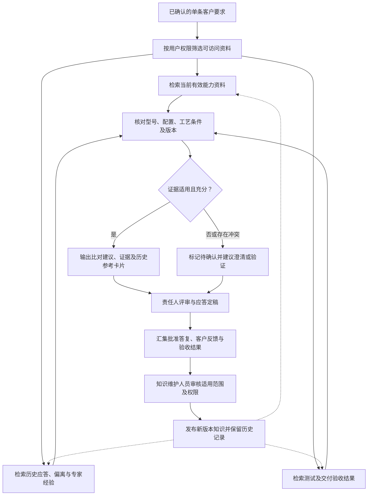
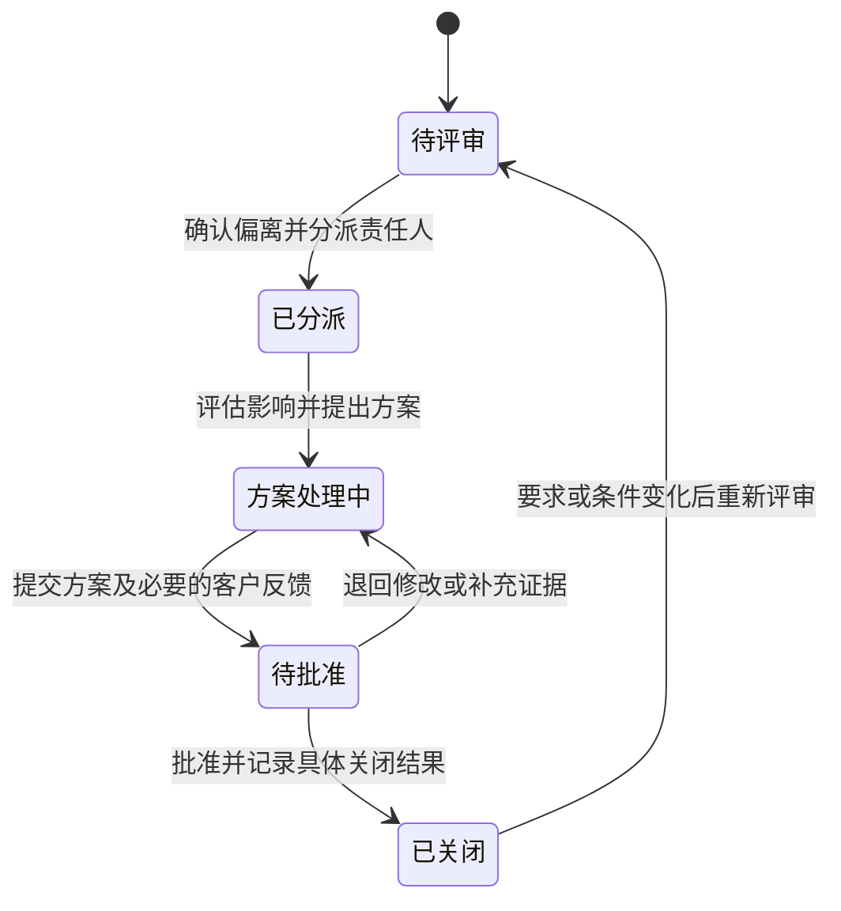
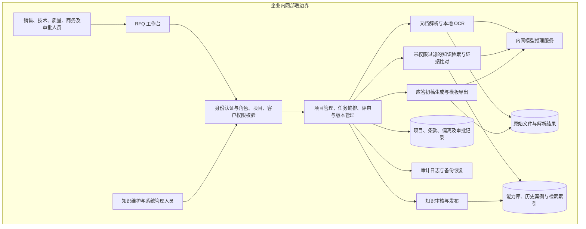

# FEP 销售 RFQ 提效 Agent 产品需求文档

| 项目 | 内容 |
| --- | --- |
| 文档版本 | v0.1 |
| 文档状态 | 内部评审草案 |
| 编制日期 | 2026-10-20 |
| 试点组织 | FEP 事业部 |
| 部署要求 | 完全内网部署 |

## 1. 背景与产品定位

面向半导体制造相关业务的销售 RFQ 应答场景，结合客户 RFQ、当前产品能力和历史项目经验，完成要求解析、智能比对、偏离协同、应答初稿生成与知识沉淀。

整体业务面向设备、制造服务等场景，首期以 FEP 事业部设备销售 RFQ 为试点。FEP 不作未经确认的全称展开；具体设备范围在试点启动时配置。

### 1.1 产品目标

- 缩短销售整理 RFQ 和准备应答初稿的时间。
- 减少客户要求遗漏、无依据答复及偏离漏报。
- 提升历史答复、评审结论和交付经验的复用效率。
- 建立可追溯、可审核、持续更新的 RFQ 知识资产。

### 1.2 用户角色

| 角色 | 主要职责 |
| --- | --- |
| 销售／项目负责人 | 创建项目、收集资料、组织评审、汇总应答并导出 |
| 技术人员 | 确认性能、配置、工艺能力、技术偏离及证据 |
| 质量人员 | 确认质量、认证、测试和验收要求 |
| 商务人员 | 确认价格、付款、交期等商务条款 |
| 审批负责人 | 批准关键承诺、偏离方案和最终应答 |
| 知识维护人员 | 审核知识、维护适用范围、版本和有效状态 |
| 系统管理员 | 管理部署、权限、配置、审计和备份 |

## 2. 已确认范围与设计假设

### 2.1 已确认事项

- 业务方向为销售侧 RFQ 应答提效。
- 核心能力包括自动化解析、智能比对、偏离管理、初稿生成和知识沉淀。
- 比对需结合历史知识库及历史沉淀经验。
- 以 FEP 事业部为试点。
- 系统完全内网部署。
- 其余采用本草案的默认方案。

### 2.2 默认方案

| 项目 | 首期范围 |
| --- | --- |
| 业务 | 设备销售 RFQ 应答 |
| 输入 | PDF、Word、Excel，包括扫描件及附件 |
| 输出 | Excel 逐条应答矩阵、偏离表、澄清清单；Word 应答初稿 |
| 历史资料 | 历史 RFQ、最终答复、设备规格、评审记录、偏离记录、测试及验收资料 |
| 接入方式 | 人工上传、批量导入；后续评估内部系统对接 |
| 对外提交 | 人员审核、导出并提交 |

历史资料暂按“分散文件与专家经验并存”设计，不代表已确认企业现状。资料数量、质量、覆盖范围和权限在盘点后记录。

### 2.3 首期边界

首期交付从客户资料导入到经审核应答文件导出的闭环。自动定价、自动对外承诺、自动提交客户及复杂内部系统集成不纳入首期。

## 3. 核心业务流程

创建 RFQ 项目 → 导入客户资料 → 解析并确认要求 → 检索当前能力与历史经验 → 生成比对结果 → 分派偏离及待确认事项 → 完成评审 → 生成并审核应答初稿 → 导出定稿 → 回收客户反馈与交付结果。

每个项目保留文件版本、要求版本、评审记录和应答版本，支持追溯。客户资料更新后，识别新增、修改和删除的要求，并标记受影响的比对、评审和应答，提示重新确认。

### 3.1 业务流程图

图示为定稿主流程；未关闭事项可先生成带标记的内部草稿，但不能绕过定稿审批。

## 4. 核心功能需求

| 编号 | 模块 | 功能要求 | 验收要点 |
| --- | --- | --- | --- |
| FR-01 | 项目与资料管理 | 创建项目，记录客户、设备范围、截止时间和负责人；上传资料并识别版本、重复文件和附件关系 | 项目资料可查；更新保留历史版本 |
| FR-02 | 自动化解析 | 识别技术、质量、交付、商务、资质和提交要求；拆分复合条款；保留表格关系、单位、条件及原文位置 | 每条要求可定位原文；低可信解析及无法读取的内容显式提示 |
| FR-03 | 一致性检查 | 识别跨文件参数冲突、名称不一致、缺失附件及模糊条件 | 展示冲突双方及出处，生成待澄清事项 |
| FR-04 | 智能比对 | 比对当前产品能力、标准条款、历史应答和项目经验 | 输出结论、证据、适用条件及差异，不以相似度代替满足判定 |
| FR-05 | 偏离管理 | 建立偏离台账，分派责任人，记录影响、方案、审批及客户反馈 | 每项偏离有责任人和处理记录；关闭时注明结果 |
| FR-06 | 初稿生成 | 根据已审核结论和模板生成逐条答复、偏离说明及澄清问题；草稿中的未审核内容保留标记 | 关键答复有依据；待确认内容明确标记；遵循客户格式要求 |
| FR-07 | 知识沉淀 | 从定稿、客户反馈和交付验收中提取可复用知识 | 入库内容经过审核，包含适用范围、版本及来源 |
| FR-08 | 版本影响分析 | 对更新资料进行差异识别，关联受影响的要求、结论、偏离和初稿 | 过往批准结论不自动沿用到已变化的要求 |

### 4.1 逐条应答矩阵

每条客户要求至少包含以下字段：

- 要求编号、所属项目及版本。
- 客户原文、来源文件、页码／工作表／单元格等定位信息。
- 要求类别、强制性、参数、单位、条件及适用范围。
- 当前能力依据、历史参考和比对结论。
- 偏离说明、澄清事项、责任人及审核状态。
- 最终答复、证据引用和批准记录。

解析结果支持人工修改；修改保留人员、时间和变更记录。

## 5. 历史知识与经验复用

### 5.1 比对来源

| 来源 | 用途 | 预期输出 |
| --- | --- | --- |
| 当前产品及能力库 | 判断当前设备、配置及工艺能力 | 满足情况及适用条件 |
| 历史 RFQ 及最终应答 | 查找类似要求及已审核答复 | 可参考答复、相似点及差异 |
| 历史偏离及处理记录 | 查找类似差距的处理路径 | 替代方案、附加条件、客户接受情况 |
| 测试及交付验收资料 | 核查历史承诺是否得到实际验证 | 验证依据、已知限制及风险 |
| 专家评审经验 | 补充易遗漏事项和处理方法 | 检查项、澄清建议及评审建议 |

### 5.2 历史参考卡片

每条要求可展示：

- 参考项目、时间、设备型号和配置。
- 历史要求、最终答复及审核状态。
- 本次与历史案例在材料、厚度、工艺条件、指标或验收方式上的差异。
- 历史处理方案、适用条件及证据。
- 客户接受、拒绝、待确认或实际验收结果。
- 建议动作：复用、修改后复用、发起专家评审或向客户澄清。

结果未知时标记“未记录”，不得自动视为成功经验。

### 5.3 知识使用规则

1. 当前有效且经批准的能力资料作为当前能力判断依据。
2. 历史答复提供参考；特殊配置、客户特批和限用条件必须展示。
3. 历史答复与当前资料冲突时，进入人工确认并保留双方证据。
4. 未查到依据时进入“待确认”，不得直接判定满足或不满足。
5. 历史客户接受过偏离，不代表本次客户已接受。
6. 过期、撤销或被替代的知识保留追溯记录，默认不作为新应答依据。
7. 专家经验结构化保存“问题—条件—处理方案—结果”，经审核后进入可复用知识。
8. 跨客户复用检查权限及适用范围，不得向其他客户应答中带入受限信息。

### 5.4 结果回流

| 时间点 | 沉淀内容 |
| --- | --- |
| 应答定稿后 | 已批准答复、技术依据、偏离方案及批准条件 |
| 客户反馈后 | 接受、拒绝、要求补充及已知原因 |
| 交付验收后 | 实际性能、验收结果、额外投入和出现的问题 |

### 5.5 历史知识比对与回流图

“证据适用且充分”不等于满足客户要求：充分证据也可能支持“不满足”。缺少证据或资料冲突时进入待确认；AI 比对建议须经责任人评审。

## 6. 判断状态与偏离评审

### 6.1 比对结论

| 结论 | 含义 |
| --- | --- |
| 满足 | 有适用、有效的证据支持 |
| 有条件满足 | 在明确配置或限制条件下满足 |
| 不满足 | 已确认存在差距 |
| 待确认 | 证据不足、资料冲突或需要专家判断 |
| 不适用 | 经确认不属于本次范围 |

### 6.2 偏离闭环

偏离类型与处理状态分开记录。类型包括技术、质量、交付、商务等；处理状态包括待评审、已分派、方案处理中、待批准、已关闭。

每项偏离记录客户要求、内部能力差异、成本／交期／质量影响、处理方案、责任人、批准人、客户反馈及最终依据。关闭时明确为内部解决、客户接受、不承接等具体结果。

系统根据历史案例推荐可参考的方案，如增加选配、调整适用条件、样品测试、分阶段交付或替代指标。推荐展示依据与限制，由责任人确认。

关闭结果须注明内部解决、客户接受、不承接等情况。需要客户接受的方案，在取得客户确认后才可按“客户接受”关闭。

### 6.3 审核与定稿

- 按要求类别配置责任人和审批关系。
- 客户要求、内部事实及 AI 建议分别展示。
- 关键性能、价格、交期及其他对外承诺由对应人员批准。
- 未关闭事项可生成带标记的内部草稿。
- 存在未解决的关键要求时，阻止将文件标记为“已批准定稿”。关键要求由项目负责人及相关专业负责人确认。
- 客户要求技术标与价格标分离时，导出前检查技术标是否包含价格内容。

## 7. 完全内网部署与权限要求

1. 文件存储、OCR、模型推理、知识检索、索引、数据库、日志和备份均在内网运行。
2. 业务运行不依赖公网模型 API 或外部服务，不向外发送客户资料、提示词、向量或日志。
3. 模型、依赖及升级包通过受控离线方式导入。
4. 按事业部、项目、客户及角色控制访问；检索、生成和导出均执行权限检查。
5. 客户上传文件作为待分析资料处理，其中的文字不得改变系统权限或审批规则。
6. 记录资料访问、知识修改、评审、生成和导出操作，支持审计、备份恢复。
7. 解析或生成失败时保留已完成工作，提示失败原因并支持重试，不将失败结果标记为完成。
8. 模型、硬件、文件容量、并发和响应时间指标依据样本规模及试运行结果确定，正式试点验收前补入基线。

### 7.1 内网逻辑部署架构图

下图描述逻辑职责，不指定服务器数量、产品选型或微服务拆分方式。所有组件均部署于企业内网。

图中数据存储及模型调用同样执行权限约束；索引不绕过原始资料权限。业务运行不依赖公网服务，离线升级包通过受控流程导入。

## 8. 验收方案

选择有完整应答记录的脱敏历史 RFQ，由业务专家建立参考结果。测试集与用于复用的历史资料明确区分，避免用已入库的同一项目答复替代效果验证。

| 维度 | 衡量方式 |
| --- | --- |
| 效率 | 完成同等可审核初稿所需的人工时间，与现有流程比较 |
| 解析完整性 | 对照人工标注，检查要求提取及关键条件保留情况 |
| 比对质量 | 检查结论、证据、版本及适用条件是否一致 |
| 偏离识别 | 检查重大偏离及资料冲突的发现情况，并记录误报 |
| 历史复用 | 检查案例相关性、差异识别及不适用知识拦截情况 |
| 初稿质量 | 统计可直接采用、轻微修改及需重写的条目 |
| 权限与内网 | 验证越权访问拦截，以及断开公网后的完整业务运行 |

数值门槛在样本基线测试后确定，由业务与技术负责人确认，作为正式验收前必填项。本草案不将尚未测试的准确率或提效比例作为承诺。

## 9. 实施阶段

| 阶段 | 主要工作 | 交付物 |
| --- | --- | --- |
| 资料与基线准备 | 确定设备范围；盘点历史资料；确认权威能力资料、权限和审批关系；建立标注样本 | 资料清单、角色配置、标注样本及当前流程基线 |
| 最小闭环验证 | 打通解析、比对、偏离、初稿、知识审核；完成内网部署 | 可运行系统、样本验证结果及问题清单 |
| FEP 业务试点 | 在真实项目中使用，收集评审、客户反馈与交付结果 | 试点报告、验收结果及后续改进范围 |

具体设备范围、资料覆盖、硬件规格及数值验收门槛属于启动与验证阶段的落地项，不阻碍基于本草案展开需求评审。

## 10. 公开 RFQ 参考案例

### 10.1 样本来源

- 发布方：Bharat Heavy Electricals Limited（BHEL），电子事业部。
- RFQ 编号：IKCCAP0034。
- 日期：2018 年 1 月 10 日，属于历史案例。
- 设备：用于半导体二极管、晶闸管硅晶圆加工的激光切割设备。
- 文件：43 页，包含 RFQ、报价格式、技术规格及通用商务条款。
- 官方原文件：[BHEL RFQ PDF](https://www.bhel.com/sites/default/files/rfq-ikccap0034-laser-cutting_merged-1515663096.pdf)。

该文件要求技术商务标与价格标分开，并明确列出偏离，适合作为流程及模板验证样本。其中技术附件封面名称与正文设备描述不一致，部分条款出现 1 mm 与 1.2 mm 厚度表述，可用于一致性检查测试。上述内容参见原 PDF 第 1—9 页；具体历史采购条款不作为 FEP 当前业务规则。

### 10.2 模拟比对场景

以下是产品验证用模拟数据，不代表 FEP 的真实能力或历史项目：

客户要求最大切缝宽度不超过 50 μm。模拟历史案例在特定材料、厚度和选配条件下达到该指标，但当前标准配置资料缺少对应测试结果。

预期系统输出：当前结论为“待确认”；展示历史案例及条件差异；建议技术人员确认配置并安排对应条件的样品测试。测试确认前，初稿保留条件说明，不生成确定性满足承诺。

公开 RFQ 仅作为客户输入样本。真实智能比对效果需配合经授权的内部能力及历史资料验证。
