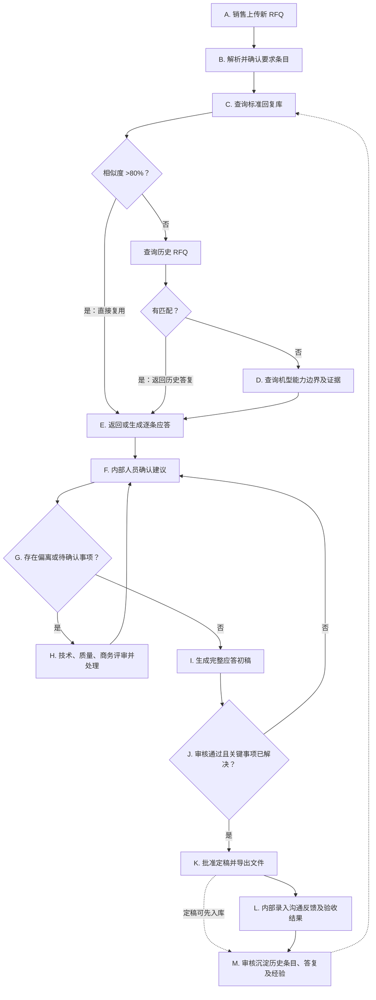
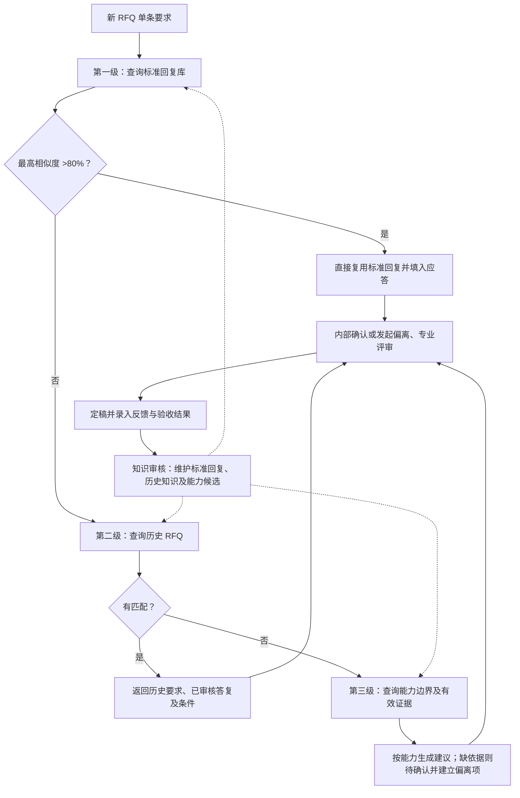
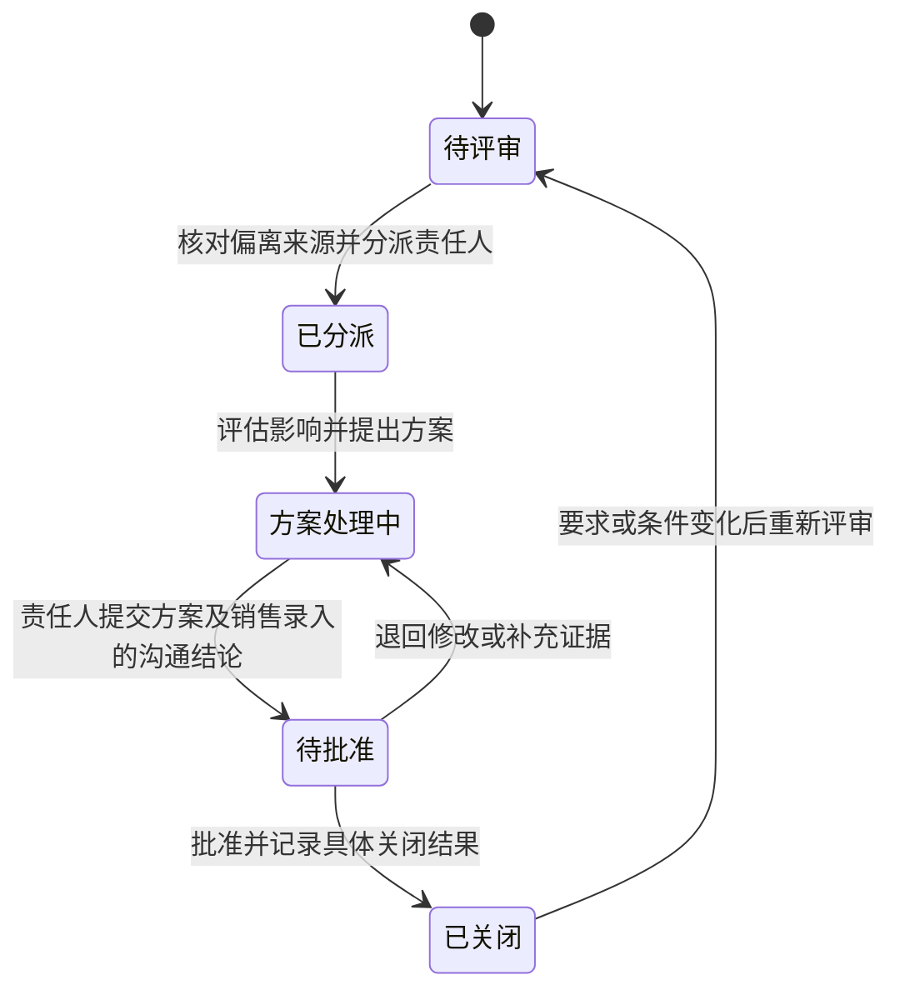

# FEP 销售 RFQ 提效 Agent 产品需求文档

| 项目 | 内容 |
| --- | --- |
| 文档版本 | v0.2 |
| 文档状态 | 内部评审草案 |
| 编制日期 | 2026-10-20 |
| 试点组织 | FEP 事业部 |
| 部署要求 | 完全内网部署 |

本版补齐用户操作、页面、业务规则、状态、异常及验收用例，用于业务和研发评审；不代表已批准开发。文件名与正文版本统一为 v0.2。

本次补充“机型能力边界”模块：统一维护机型信息、配置、条件化能力及审核证据，并参与 RFQ 逐条比对和 Comply 推荐。

## 1. 背景与产品定位

面向半导体制造相关业务的销售 RFQ 应答场景，结合客户 RFQ、当前产品能力和历史项目经验，完成要求解析、智能比对、偏离协同、应答初稿生成与知识沉淀。

核心比对场景是：对新 RFQ 的每条要求依次查询标准回复库、历史 RFQ、机型能力边界。标准回复相似度大于 80% 时直接复用；否则查询历史 RFQ，有匹配就返回；仍无匹配才查询能力边界，形成建议结论及应答。前一级命中即停止后续自动检索，保留来源及版本。新旧版本差异检查属于辅助能力。

整体业务面向设备、制造服务等场景，首期以 FEP 事业部设备销售 RFQ 为试点。FEP 不作未经确认的全称展开；具体设备范围在试点启动时配置。

### 1.1 产品目标

- 缩短销售整理 RFQ 和准备应答初稿的时间。
- 减少客户要求遗漏、无依据答复及偏离漏报。
- 提升历史答复、评审结论和交付经验的复用效率。
- 建立可追溯、可审核、持续更新的 RFQ 知识资产。

### 1.2 用户角色

| 角色 | 主要职责 |
| --- | --- |
| 销售／项目负责人 | 创建项目、收集资料、组织评审、汇总应答并导出 |
| 技术人员 | 确认性能、配置、工艺能力、技术偏离及证据 |
| 质量人员 | 确认质量、认证、测试和验收要求 |
| 商务人员 | 确认价格、付款、交期等商务条款 |
| 审批负责人 | 批准关键承诺、偏离方案和最终应答 |
| 知识维护人员 | 审核知识、维护适用范围、版本和有效状态 |
| 系统管理员 | 管理部署、权限、配置、审计和备份 |

## 2. 已确认范围与设计假设

### 2.1 已确认事项

- 业务方向为销售侧 RFQ 应答提效。
- 核心能力包括自动化解析、智能比对、偏离管理、初稿生成和知识沉淀。
- 比对按标准回复库（>80% 直接复用）→ 历史 RFQ（有匹配即返回）→ 能力边界逐级执行，前一级命中即停止后续自动检索。
- 以 FEP 事业部为试点。
- 系统完全内网部署。
- 其余采用本草案的默认方案。

### 2.2 默认方案

| 项目 | 首期范围 |
| --- | --- |
| 业务 | 设备销售 RFQ 应答 |
| 输入 | PDF、Word、Excel，包括扫描件及附件 |
| 输出 | Excel 逐条应答矩阵、偏离表、澄清清单；Word 应答初稿 |
| 历史资料 | 历史 RFQ、最终答复、设备规格、评审记录、偏离记录、测试及验收资料 |
| 接入方式 | 人工上传、批量导入；后续评估内部系统对接 |
| 对外提交 | 人员审核、导出并提交 |

历史资料暂按“分散文件与专家经验并存”设计，不代表已确认企业现状。资料数量、质量、覆盖范围和权限在盘点后记录。

### 2.3 首期边界

首期交付从客户资料导入到经审核应答文件导出的闭环。自动定价、自动对外承诺、自动提交客户及复杂内部系统集成不纳入首期。

### 2.4 交付优先级

P0 为首期验收必需，P1 为后续改进。P1 不构成首期完成的前提。

| 优先级 | 功能范围 | 首期交付边界 |
| --- | --- | --- |
| P0 | 项目、资料及解析确认 | 人工创建与上传；支持既定三类文件；解析失败可补录；逐条追溯来源 |
| P0 | 机型能力边界 | 维护机型、版本、标配／选配及条件化能力；支持 Excel 上传、历史 RFQ 自动抽取及比对中手动补充；经审核发布后参与 RFQ 比对，保留来源、证据及引用版本 |
| P0 | 历史知识准备 | 批量导入历史条目与答复、审核发布、关联适用条件和证据 |
| P0 | 三级顺序比对与应答 | 标准回复库 >80% 直接复用，否则查历史 RFQ，有匹配即返回，否则查能力边界；展示命中来源及条件，支持单条确认与受限批量确认 |
| P0 | 专业评审及偏离 | 内部待办、责任人分派、方案及依据、退回和关闭 |
| P0 | 草稿、审批及导出 | 首期内置 Word／Excel 模板；可配置列映射，不承诺任意复杂模板自动适配 |
| P0 | 权限、版本与审计 | 项目及知识访问控制、内部审批、批准快照、变更复核、离线业务运行 |
| P0 | 结果反馈及知识回流 | 内部人工录入，审核后发布，允许定稿后异步补充 |
| P1 | 同项目新版文件自动差异及影响识别 | 首期可人工选择受影响条目并触发复核，不自动沿用旧批准 |
| P1 | 扩展接入及展示 | 内部业务系统集成、任意模板适配、高级统计与自动提醒策略 |

下文涉及 P1 的描述保留为后续方向，不计入 P0 验收；FR-08 对应 P1。

### 2.5 典型使用任务

| 用户任务 | 完成标准 |
| --- | --- |
| 销售快速形成第一版应答 | 可看到全部已确认要求的建议与缺口，并导出有明确待确认标记的草稿 |
| 技术判断本次是否能 Comply | 可同时查看本次要求、历史答复、配置差异和当前证据，保存确认或转评审结论 |
| 负责人控制对外承诺 | 审批绑定具体应答版本，阻止遗漏、未处理关键事项和修改后的旧批准复用 |
| 知识人员复用已验证经验 | 可审核发布适用范围明确的知识，并撤销不再有效的版本 |

## 3. 核心业务流程

销售创建项目并上传新 RFQ → 解析并确认要求条目 → 查标准回复库（相似度 >80% 直接复用）→ 未命中查历史 RFQ（有匹配即返回）→ 仍未命中查能力边界 → 返回或生成逐条应答 → 内部确认、处理偏离及待确认事项 → 生成并审核应答初稿 → 导出定稿 → 内部录入反馈及交付结果 → 审核沉淀知识。

系统仅供 FEP 内部人员使用。销售在系统外接收 RFQ、沟通澄清和发送答复，再将资料及沟通结果录入系统；外部采购方不登录或操作本系统。

每个项目保留文件版本、要求版本、评审记录和应答版本，支持追溯。销售上传同一项目的新版资料时，可使用辅助版本检查功能，识别变化并提示重新确认；该功能不作为核心历史条目比对流程的前置条件。

### 3.1 业务流程图

图示为定稿主流程；未关闭事项可先生成带标记的内部草稿，但不能绕过定稿审批。

以下 A—M 对应图中的节点。本节说明操作与结果，所需资料和组件见附录 A。所有能力均在内网运行，具体选型通过样本验证确定。

#### A. 销售上传新 RFQ

- **谁来做、输入什么：** 销售创建项目，填写项目名称、所属产品线、设备型号或待选范围、截止时间和负责人，上传 RFQ 正文、规格附件和应答模板。
- **具体怎么做：** 系统检查文件格式、可读性和重复情况；按项目保存原文件及上传记录，区分要求来源与需要填写的模板。销售确认资料清单；缺少被引用附件时列出缺项。
- **所需资料与系统能力：** 见附录 A 的 A 节点对应项；输入资料及操作结果见本节点说明。
- **输出什么：** 带项目编号、文件编号、版本及权限的资料包。无法读取、加密或损坏的文件提示处理，不静默跳过。

#### B. 解析并确认要求条目

- **谁来做、输入什么：** 系统处理资料包，销售或指定人员核对解析结果。
- **具体怎么做：** Word、Excel 优先读取段落、表格和单元格；PDF 提取文本及版面，扫描页使用本地 OCR。按原始条款编号拆分要求，提取参数、单位、上下限、条件、强制性和要求类别；复合条款拆为子要求，同时保留父条款及原文关系。发现图纸、公式或表格无法可靠识别时，转人工补录或确认。
- **所需资料与系统能力：** 见附录 A 的 B 节点对应项；输入资料及操作结果见本节点说明。
- **输出什么：** 经人工确认的要求清单。每条具备唯一编号、原文、页码或单元格位置及解析状态；低可信项单独列出，不凭模型自报的置信度认定正确。

#### C. 顺序查询标准回复库与历史 RFQ

- **谁来做、输入什么：** 系统接收已确认的新要求，先按权限、审核和有效状态过滤可用记录。
- **具体怎么做：** 第一步查询标准回复库，最高匹配相似度大于 80% 时直接复用该标准回复并返回，不再查询历史 RFQ 和能力边界；相似度等于或小于 80%、或无可用标准回复时，进入第二步查询历史 RFQ。历史 RFQ 有匹配即返回对应条目及已审核答复，不自动继续查询能力边界；无匹配才进入 D。两级均按条目检索，保留适用范围、条件及来源；历史 RFQ 匹配判定单独配置，不自动套用标准回复的 80% 阈值。
- **所需资料与系统能力：** 见附录 A 的 C 节点对应项。
- **输出什么：** 命中来源、记录编号及版本、相似度或匹配依据、回复与原有条件，以及各级检索状态。直接复用指自动填入应答草稿，仍保留既有内部确认和定稿审批；已有人工作业时不自动覆盖。

#### D. 历史 RFQ 无匹配后查询能力边界

- **谁来做、输入什么：** 仅在标准回复库未达到复用阈值、历史 RFQ 也无匹配后，由系统查询适用于本项目机型、版本和配置的已发布有效能力。
- **具体怎么做：** 对照设备型号、配置、材料、工艺条件、指标定义、测试方法和验收口径。统一可可靠换算的单位，比较客户要求与能力范围、上下限和容差，区分保证值／典型值、标配／选配；保留能力与证据版本。能力信息不足、冲突或不适用时，显示缺口并转人工确认。商务等非机型要求无适用能力边界时，按对应资料进入评审。
- **所需资料与系统能力：** 见附录 A 的 D 节点对应项。
- **输出什么：** 要求与能力边界对照、条件差异、支持／反驳／缺失证据，供 E 生成建议答复；三级均无可用依据时推荐待确认并建立关联偏离项，不直接判为不满足。

#### E. 推荐 Comply 结论及逐条应答

- **谁来做、输入什么：** 系统接收 C 返回的标准回复／历史答复，或依据 D 的能力证据生成建议。
- **具体怎么做：** 区分 Comply、有条件 Comply、不满足、待确认和不适用；不适用需说明范围依据。标准回复相似度大于 80% 时直接填入原标准回复；历史 RFQ 命中时返回历史答复及条件；仅能力边界兜底时按当前能力生成答复。人工可修改并保留记录；有条件满足时写清选配及限制；证据不足时生成待确认说明。推荐结论、理由、来源及建议答复分别存储。
- **所需资料与系统能力：** 见附录 A 的 E 节点对应项；输入资料及操作结果见本节点说明。
- **输出什么：** 预填的逐条应答矩阵。界面显示“系统推荐，待内部确认”，不得写成已经批准的对外承诺。

#### F. 内部人员确认建议

- **谁来做、输入什么：** 销售查看全部结果，按技术、质量、商务类别将条目分派给有权限的责任人。
- **具体怎么做：** 界面并排展示新要求、历史参考、条件差异、证据及推荐答复。人员可采纳、修改或转评审，修改记录原因。对依据和条件一致的条目允许批量确认，但需展示批次范围、排除异常项并逐条保留操作记录；关键承诺仍按审批规则处理。
- **所需资料与系统能力：** 见附录 A 的 F 节点对应项；输入资料及操作结果见本节点说明。
- **输出什么：** 经内部确认的结论及答复，或带责任人和原因的评审任务。系统推荐与最终人工结论分开保存。

#### G. 判断是否存在偏离或待确认事项

- **谁来做、输入什么：** 系统读取逐条结论、审核状态及缺失信息，人员确认事项分类。
- **具体怎么做：** 偏离项有三个来源：知识库中没有、匹配结果用户未接受、置信度低。“知识库中没有”须在三级检索成功完成且均无可用结果后判断，单级未命中只进入下一级。满足任一条件即进入偏离项管理，记录来源并交责任人评审；进入偏离项管理不等于已判定不满足。证据不足、冲突或仍待专业判断时，应答结论保留待确认；有效证据表明不能满足时推荐不满足。有条件 Comply 的条件尚未确认时，形成处理任务。经确认不适用的条目保留理由。
- **所需资料与系统能力：** 见附录 A 的 G 节点对应项；输入资料及操作结果见本节点说明。
- **输出什么：** 有待处理事项则进入 H，否则进入 I；保留内部草稿提前生成入口，定稿另受 J 检查。

#### H. 技术、质量、商务评审并处理

- **谁来做、输入什么：** 对应专业责任人处理偏离及待确认任务，销售协调所需沟通。
- **具体怎么做：** 参考类似偏离的处理经验，补充证据、安排测试、确认选配、修改方案或提出澄清问题，记录成本、交期及质量影响。需要对外澄清时，系统生成问题清单，由销售在系统外沟通并录入回复及附件。方案按权限审批后回到 F 重新确认。
- **所需资料与系统能力：** 见附录 A 的 H 节点对应项；输入资料及操作结果见本节点说明。
- **输出什么：** 经确认的处理结论、批准条件和证据；未解决项继续留在待办中。拒绝承接的事项也需有明确结果。

#### I. 生成完整应答初稿

- **谁来做、输入什么：** 销售发起生成，系统读取要求清单、已确认答复、偏离结论及本次模板。
- **具体怎么做：** 按原条款编号和顺序填充逐条应答，汇总偏离及澄清项。优先使用已确认内容，模型辅助整理措辞，不自行补写指标或批准条件。未确认条目生成醒目标记。草稿修改如影响已确认结论或承诺，应退回对应责任人复核。
- **所需资料与系统能力：** 见附录 A 的 I 节点对应项；输入资料及操作结果见本节点说明。
- **输出什么：** Word 应答草稿、Excel 应答矩阵及偏离、澄清清单，记录所依据的项目、模板和数据版本。

#### J. 检查审核是否通过且关键事项已解决

- **谁来做、输入什么：** 专业负责人及最终审批人审核草稿，系统执行规则检查。
- **具体怎么做：** 检查要求是否全部有明确处置、关键事项是否解决、附加条件是否保留、证据及附件是否齐全，核对参数、审批版本及提交格式。需要分标时检查技术标中的价格内容。审核失败返回 F，并指出条目与原因；确认后的条目或文件被修改时，相关批准状态失效并重新审核。
- **所需资料与系统能力：** 见附录 A 的 J 节点对应项；输入资料及操作结果见本节点说明。
- **输出什么：** 通过记录或退回清单。自动检查通过不能替代人员批准；不承接或不适用等结果经确认后可作为明确处置，不强制全部条目都为 Comply。

#### K. 批准定稿并导出文件

- **谁来做、输入什么：** 获授权的审批人批准指定版本，销售导出。
- **具体怎么做：** 固定本次批准的数据及文件版本，核实导出权限，生成定稿文件和附件清单，记录导出人员及时间。后续修改形成新版本，不覆盖已批准文件。销售在系统外发送应答，可回填发送状态。
- **所需资料与系统能力：** 见附录 A 的 K 节点对应项；输入资料及操作结果见本节点说明。
- **输出什么：** 可追溯的定稿包及导出记录。系统首期不自动向外发送。

#### L. 内部录入沟通反馈及验收结果

- **谁来做、输入什么：** 销售录入沟通结果，交付或质量人员录入测试和验收结果及原始附件。
- **具体怎么做：** 按项目和条目关联接受、拒绝、补充要求、实际性能和问题原因，区分沟通接受与实际验收通过；允许后续逐次补充。没有结果的记录标记未知，不能推定成功。
- **所需资料与系统能力：** 见附录 A 的 L 节点对应项；输入资料及操作结果见本节点说明。
- **输出什么：** 可核验的反馈及验收记录，形成经验候选。该节点可在定稿后异步推进，不阻塞已完成项目；定稿答复可先送 M 审核，后续反馈再增补。

#### M. 审核沉淀历史条目、答复及经验

- **谁来做、输入什么：** 知识维护人员审核已批准答复及后续结果，专业负责人核对能力类知识。
- **具体怎么做：** 系统提取“要求—答复—条件—依据—结果”，与已有知识去重；人员核对适用型号、配置、有效期及权限，剔除项目特例或明确标记限制。通过后发布新版本并更新检索索引，撤销及过期状态同步生效。项目验收结果不能未经批准就升级为通用能力。
- **所需资料与系统能力：** 见附录 A 的 M 节点对应项；输入资料及操作结果见本节点说明。
- **输出什么：** 下次 RFQ 可检索的历史条目、标准答复和处理经验。未审核内容留在候选区，不作为已审核知识参与 Comply 推荐。

所需资料和技术能力汇总见附录 A；具体产品行为、权限与验收以第 4、6、8 节为准。

## 4. 核心功能需求

| 编号 | 模块 | 功能要求 | 验收要点 |
| --- | --- | --- | --- |
| FR-01 | 项目与资料管理 | 创建项目，记录客户、设备范围、截止时间和负责人；上传资料并识别版本、重复文件和附件关系 | 项目资料可查；更新保留历史版本 |
| FR-02 | 自动化解析 | 识别技术、质量、交付、商务、资质和提交要求；拆分复合条款；保留表格关系、单位、条件及原文位置 | 每条要求可定位原文；低可信解析及无法读取的内容显式提示 |
| FR-03 | 一致性检查 | 识别跨文件参数冲突、名称不一致、缺失附件及模糊条件 | 展示冲突双方及出处，生成待澄清事项 |
| FR-04 | 三级顺序比对与应答 | 先查标准回复库，相似度 >80% 直接复用；否则查历史 RFQ，有匹配即返回；仍无匹配才查能力边界并生成建议 | 展示三级执行状态、相似度、命中来源及版本、原有条件和应答；前一级命中即停止后续自动检索；直接复用不等于人工确认或定稿批准 |
| FR-05 | 偏离管理 | 将知识库中没有、匹配结果用户未接受、置信度低的条目纳入偏离台账，分派责任人，记录影响、方案、审批及客户反馈 | 三类来源均可触发并追溯，同一条目同一工作版本合并来源；每项偏离有责任人和处理记录，关闭时注明结果；不自动判为不满足 |
| FR-06 | 初稿生成 | 根据已审核结论和模板生成逐条答复、偏离说明及澄清问题；草稿中的未审核内容保留标记 | 关键答复有依据；待确认内容明确标记；遵循客户格式要求 |
| FR-07 | 知识沉淀 | 从定稿、客户反馈和交付验收中提取可复用知识 | 入库内容经过审核，包含适用范围、版本及来源 |
| FR-08 | 版本影响分析（辅助） | 同一项目上传新版资料时，可识别变化并关联受影响的要求、结论、偏离和初稿；不属于核心历史匹配流程 | 过往批准结论不自动沿用到已变化的要求 |
| FR-09 | 机型能力边界 | 在同一模块维护机型信息、版本、配置及条件化能力；通过 Excel 上传、历史 RFQ 自动抽取及比对中手动添加形成候选，保留来源、去重并关联证据审核发布；根据项目机型和配置参与 RFQ 逐条比对，输出满足情况、条件、差距和依据 | 能区分同机型不同版本／配置／工艺条件；仅采用获授权的已发布有效能力；证据缺失或冲突进入待确认；变更触发引用复核 |

### 4.1 逐条应答矩阵

每条客户要求至少包含以下字段：

- 要求编号、所属项目及版本。
- 客户原文、来源文件、页码／工作表／单元格等定位信息。
- 要求类别、强制性、参数、单位、条件及适用范围。
- 匹配的历史要求、历史答复、历史项目及配置条件。
- 本次与历史条目的差异、当前能力依据、推荐 Comply 结论及应答。
- 本次适用的机型、机型版本、配置基线、能力编号与版本、证据版本，以及客户要求与能力边界的逐项比较。
- 内部确认后的最终结论，与系统推荐分别记录。
- 偏离说明、澄清事项、责任人及审核状态。
- 最终答复、证据引用和批准记录。

解析结果支持人工修改；修改保留人员、时间和变更记录。

### 4.2 单条要求的快速处理

#### 4.2.1 比对结论

| 结论 | 含义 |
| --- | --- |
| 满足（Comply） | 有适用、有效的证据支持；可参考经核对适用的历史条目及答复 |
| 有条件满足（有条件 Comply） | 在明确配置或限制条件下满足，应答必须保留条件 |
| 不满足 | 已确认存在差距 |
| 待确认 | 证据不足、资料冲突或需要专家判断 |
| 不适用 | 经确认不属于本次范围 |

#### 4.2.2 处理路径

| 处理路径 | 判断依据 | 系统输出及内部动作 |
| --- | --- | --- |
| 可复用 Comply | 历史已审核答复适用，当前有效证据支持本次要求 | 推荐 Comply 并预填应答，内部人员确认后采用 |
| 有条件 Comply | 明确配置、选配或适用限制后可满足 | 列出必要条件，生成条件应答并交责任人确认 |
| 偏离项管理 | 知识库中没有、匹配结果用户未接受、置信度低，任一来源触发 | 建立偏离项并记录来源，交责任人补证或评审；应答结论另行判断，不直接设为不满足 |
| 待确认 | 证据不足、条件不同或资料冲突，且当前资料无法完成判断 | 展示缺口及建议动作，转责任人评审；已触发偏离项的条目在同一事项中处理 |

匹配不到历史条目时仍可基于当前有效资料判断；知识库无可用知识时建立偏离项，但不得因未命中直接判定不满足。有效证据表明不能满足时推荐不满足，并在关联评审事项中处理；仅在触发 4.7 规定的三类来源之一时建立偏离项，不因“不满足”结论单独建单。历史匹配结果需展示来源及差异，供内部人员快速确认。

### 4.3 页面与操作定义

页面布局、线框图、导航、详情、弹窗及通用交互已独立整理至 [《交互设计》](FEP销售RFQ提效Agent_交互设计_v0.2.md)。该文档保留原 4.3 及子节编号，供需求与验收用例引用。

### 4.4 业务规则

| 编号 | 规则 | 可观察行为 |
| --- | --- | --- |
| BR-01 | 业务结论与处理状态分开 | Comply 建议可以仍处于待确认；系统建议不能直接写入批准状态 |
| BR-02 | 适用性不由文本相似度决定 | 型号、配置、材料、工艺、指标或验收口径不同必须展示差异，不能仅凭匹配分数自动确认 |
| BR-03 | 资料不足和冲突不等于不满足 | 推荐待确认，列明缺口／冲突；当前权威资料已明确解决冲突时，展示被采用依据及原因 |
| BR-04 | 单条确认需满足条件 | Comply 有适用的有效证据；有条件 Comply 保留条件且条件已确认；不满足有差距依据；不适用有范围理由；待确认不能作为最终确认结论 |
| BR-05 | 批量确认只用于简单可复用条目 | 仅限推荐 Comply、无关键标记、无未解决差异、证据有效、无未结事项、要求已确认且操作者有确认权的条目；有条件 Comply 和不适用均逐条确认 |
| BR-06 | 人员确认不代替最终审批 | 每项技术、质量、商务要求指定确认责任人；关键承诺由对应专业批准，项目指定最终审批人批准定稿 |
| BR-07 | 自动处理不得覆盖人工结果 | 重新检索或生成保留人工编辑；主动采用新建议需明确操作；更新引用条件后重新确认 |
| BR-08 | 提交审批及正式导出的门槛 | 要求来源文件已处理、全部有效条目有最终处置且已确认、无未结事项、所需条件与附件齐全、关键承诺已专业批准、分标检查完成；正式导出还需最终批准及引用有效性检查 |
| BR-09 | 相关修改触发复核 | 要求、适用配置、结论、答复、批准条件或引用证据变化／失效，使相关条目进入待复核，旧确认和工作版本审批失效；已导出历史快照保留并提示影响，由负责人确认是否需重新对外发送 |
| BR-10 | 首期以人工标记关键要求为准 | 强制性要求、核心性能、价格、交期、付款、质保及验收承诺默认进入关键标记；专业负责人确认或修改并记录原因；配置缺失时不允许批量确认或提交审批 |
| BR-11 | 权限覆盖完整使用链路 | 候选、证据、模型输入输出、条目确认及导出均校验；保存或导出前重新核对权限，不以先前能看到作为当前授权 |
| BR-12 | 已批准与已验证分开 | 经内部批准的答复不是已验收能力；反馈未知明确标注；需要额外能力确认的历史知识不直接支持无条件 Comply |
| BR-13 | 有依据的偏离可形成定稿 | 不要求全部条目 Comply；偏离已批准、答复明确且按本项目需要取得的确认齐备时可以定稿，不将“已关闭”解释为已经满足 |
| BR-14 | 并发修改检查版本 | 保存、确认、批准和发布携带所读取的版本；过期版本拒绝覆盖，展示最新记录并由人员重新确认 |
| BR-15 | 机型与能力按适用条件关联 | 同机型不同版本、配置和条件的能力不得混用；依赖尚未确认的选配时推荐待确认，已确认满足的选配条件必须写入有条件 Comply 答复 |
| BR-16 | 能力发布与引用受控 | 仅已发布、有效且有可用证据的能力参与正式推荐；典型值或单次测试值不自动支持保证承诺；能力／机型版本及配置变化按 4.9、BR-09 处理引用，不覆盖历史批准 |
| BR-17 | 偏离项按三个来源进入 | 知识库中没有、匹配结果用户未接受、置信度低，任一触发即建立偏离项；多来源合并并保留记录。偏离来源不代替应答结论，处理及关闭规则见 4.7 |

### 4.5 异常与恢复

| 场景 | 系统显示与恢复操作 | 已有工作处理 |
| --- | --- | --- |
| 加密、损坏或不支持的文件 | 显示文件级失败原因，允许替换或重试 | 保留其他成功文件，要求来源缺项未解决前不得定稿 |
| 扫描页／图纸无法可靠识别 | 显示原页和待核对标记，允许人工录入及专业确认 | 不生成虚构条目，不将未识别页当作无要求 |
| 处理超时或内网服务不可用 | 显示失败阶段和重试入口；任务未完成不显示“无历史命中” | 保留已完成步骤及人工内容，重试不重复创建条目或任务 |
| 没有历史候选 | 明示无历史命中，继续核对当前能力或转评审 | 不自动判定不满足 |
| 多个历史答复冲突 | 同时显示可访问的冲突记录和条件，待专业人员核对当前证据 | 不按最新日期或最高分自动选为满足 |
| 证据过期、撤销或权限收回 | 受影响项进入待复核，提示补证或替换依据；不向无权限人员披露原文 | 保留审计记录，阻止该项批量确认及相关正式导出 |
| 用户编辑与后台更新同时发生 | 提示版本冲突，允许查看差异并重新提交 | 不覆盖已保存的人工作业 |
| 模板缺列、格式不支持或生成失败 | 提示具体映射／生成问题，允许修正模板或使用内置模板重试 | 保留已确认应答，失败不产生定稿状态 |
| 单位含义不清或无法换算 | 显示原始值、单位及问题，转待确认 | 不作数值等价推断 |
| 已批准后新增资料／修改范围 | 项目生成新工作版本，销售明确影响条目；未完成影响确认前不得批准新版本 | 旧快照只读保留，首期不依赖自动影响识别 |

### 4.6 历史知识匹配与回流

本节定义 PG-03 的三级顺序比对与 PG-06 的知识维护、结果回流规则；界面入口和操作见 [《交互设计》4.3 节](FEP销售RFQ提效Agent_交互设计_v0.2.md)，知识版本状态统一见 5.2。

#### 4.6.1 三级顺序检索与比对来源

| 顺序 | 查询来源 | 命中后处理 | 继续条件 |
| --- | --- | --- | --- |
| 1 | 标准回复库 | 最高匹配相似度 >80%：直接复用并填入应答，返回来源及版本，停止自动检索 | 无可用回复或相似度 ≤80% 时查历史 RFQ |
| 2 | 历史 RFQ 及已审核答复 | 有匹配就返回历史要求、答复、条件及来源，停止自动检索 | 无匹配时查能力边界；匹配标准单独配置，不沿用 80% 阈值 |
| 3 | 机型能力边界 | 比较本次要求与适用能力、条件及证据，生成建议答复 | 无可用依据或无法判断时进入待确认／评审 |

每级查询前过滤权限、审核与有效状态。相似度是标准回复复用阈值，不等同于推荐置信度或最终批准。直接复用保留回复原有条件，不自动改为无条件 Comply。前一级命中后，不要求再查后两级才能返回；已知冲突仍保留并提示处理。检索失败显示失败及重试入口，不冒充未命中。

标准回复库维护经审核发布、可复用的标准问题／回复、适用范围、条件、来源与版本；历史 RFQ 答复须经知识审核明确发布为标准回复后才进入第一级。

| 来源 | 用途 | 预期输出 |
| --- | --- | --- |
| 标准回复库（第一级） | 优先查找可直接复用的标准回复 | 相似度、标准回复、适用条件及引用版本 |
| 历史 RFQ 及最终应答（第二级） | 第一级未命中后查找类似要求及已审核答复 | 可参考答复、相似点及差异 |
| 机型能力边界（第三级） | 前两级未命中后按机型版本、配置及工艺条件判断当前能力 | 满足情况、条件差异、限制及能力／证据版本 |
| 历史偏离及处理记录 | 查找类似差距的处理路径 | 替代方案、附加条件、客户接受情况 |
| 测试及交付验收资料 | 核查历史承诺是否得到实际验证 | 验证依据、已知限制及风险 |
| 专家评审经验 | 补充易遗漏事项和处理方法 | 检查项、澄清建议及评审建议 |

#### 4.6.2 历史参考卡片

每条要求可展示：

- 参考项目、时间、设备型号和配置。
- 历史要求、最终答复及审核状态。
- 本次与历史案例在材料、厚度、工艺条件、指标或验收方式上的差异。
- 历史处理方案、适用条件及证据。
- 客户接受、拒绝、待确认或实际验收结果。
- 建议动作：复用、修改后复用、发起专家评审或向客户澄清。

结果未知时标记“未记录”，不得自动视为成功经验。

#### 4.6.3 知识使用规则

1. 严格按标准回复库 → 历史 RFQ → 能力边界顺序检索，前一级命中即返回；当前有效且经批准的能力资料用于第三级能力判断。
2. 历史答复提供参考；特殊配置、客户特批和限用条件必须展示。
3. 历史答复与当前资料冲突时，进入人工确认并保留双方证据。
4. 知识库中没有可用知识时建立偏离项，未查到依据时应答结论保留“待确认”，不得直接判定满足或不满足；用户未接受匹配结果或置信度低同样进入偏离项管理，统一按 4.7 处理。
5. 历史客户接受过偏离，不代表本次客户已接受。
6. 过期、撤销或被替代的知识保留追溯记录，默认不作为新应答依据。
7. 专家经验结构化保存“问题—条件—处理方案—结果”，经审核后进入可复用知识。
8. 跨客户复用检查权限及适用范围，不得向其他客户应答中带入受限信息。

#### 4.6.4 结果回流

| 时间点 | 沉淀内容 |
| --- | --- |
| 应答定稿后 | 已批准答复、技术依据、偏离方案及批准条件 |
| 客户反馈后 | 接受、拒绝、要求补充及已知原因 |
| 交付验收后 | 实际性能、验收结果、额外投入和出现的问题 |

#### 4.6.5 历史知识比对与回流图

系统分别输出建议结论、理由和证据，充分证据也可能支持“不满足”；缺少证据或未解决的资料冲突进入待确认。AI 建议须经内部人员确认，不直接获得批准状态。

### 4.7 偏离与待确认事项评审

本节对应 PG-04。偏离项是需要人工处理的事项，来源固定为以下三类；来源、应答结论和处理状态分别记录。权限与对象状态统一见第 5 章。

| 偏离来源 | 触发条件 | 初始处理 |
| --- | --- | --- |
| 知识库中没有 | 三级检索均成功完成，标准回复未达到 >80% 阈值、历史 RFQ 无匹配且能力边界无可用依据；单级未命中不触发本来源 | 记录知识缺口，结合当前资料补证或发起专业评审 |
| 匹配结果用户未接受 | 用户明确拒绝本条匹配结果，记录不接受的原因；仅拒绝某个候选、尚未操作或尚未确认不视为拒绝本条结果 | 保留匹配结果及拒绝原因，转人工处理 |
| 置信度低 | 本条匹配／推荐置信度低于配置阈值 | 展示置信度、阈值及判断依据，转人工复核；阈值由业务与技术负责人确认，不使用模型自报分数直接认定正确 |

满足任一来源即建立偏离项。“不满足”是应答结论，不单独作为偏离触发来源；未触发上述三类来源时，通过专业评审任务处理差距及批准。已有偏离项的条目在原事项中处理。同一条目同一工作版本命中多个来源时，合并为一个事项并保留全部来源；重复检测不重复建单。检索失败、权限不足不伪装为“知识库中没有”。

进入偏离项管理不等于已判定不满足。评审后可形成 Comply、有条件 Comply、不满足或不适用结论；依据不足时仍为待确认并继续处理。待确认是应答结论，可与偏离项并存；其他补证或澄清任务可关联同一条目。

偏离类型与处理状态分开记录。类型包括技术、质量、交付、商务等；处理状态包括待评审、已分派、方案处理中、待批准、已关闭。

每项偏离记录来源及触发时间、关联匹配／推荐版本、客户要求、已知差异或待核实问题、拒绝原因或置信度与阈值（按来源填写）、成本／交期／质量影响、处理方案、责任人、批准人、客户反馈及最终依据。关闭时明确为补证后满足、内部解决、客户接受、不适用、不承接等具体结果，保留原始触发来源。

系统根据历史案例推荐可参考的方案，如增加选配、调整适用条件、样品测试、分阶段交付或替代指标。推荐展示依据与限制，由责任人确认。

关闭结果须注明内部解决、客户接受、不承接等情况。需要客户接受的方案，在取得客户确认后才可按“客户接受”关闭。

### 4.8 应答审核与定稿

本节对应 PG-05。提交审批及正式导出的完整门槛以 BR-08 为准；快照、审批与导出交互见 [《交互设计》PG-05](FEP销售RFQ提效Agent_交互设计_v0.2.md#pg-05-导出文档)，独立批准权限见 5.1。

- 按要求类别配置责任人和审批关系。
- 客户要求、内部事实及 AI 建议分别展示。
- 关键性能、价格、交期及其他对外承诺由对应人员批准。
- 未关闭事项可生成带标记的内部草稿。
- 存在未解决的关键要求时，阻止将文件标记为“已批准定稿”。关键要求由项目负责人及相关专业负责人确认。
- 客户要求技术标与价格标分离时，导出前检查技术标是否包含价格内容。

### 4.9 机型能力边界

#### 4.9.1 机型、配置与能力的关系

机型信息用于确定“哪一款、哪个版本、什么配置”；能力边界用于说明“在指定条件下能做到什么”。一个机型版本可关联多条能力，同一指标可因配置和工艺条件不同具有多条边界，不能简化成机型上的单个最大值。能力首期显式关联适用机型版本，不默认继承产品系列或相邻版本的能力。

| 对象 | 首期字段与约束 |
| --- | --- |
| 机型信息 | 唯一机型编码、名称、产品系列、机型版本、生命周期（在售／停产／历史）、维护责任人、访问范围及审核记录；停产不自动代表技术能力失效，交付可用性另经商务确认 |
| 配置定义 | 配置编码与版本、所属机型版本、标配、可选模块及已知依赖／互斥；项目保存明确配置基线，未选与未知分开记录；未维护的组合不得推断可用 |
| 能力条目 | 能力编号与版本、指标名称与定义、适用机型版本、必需配置、比较运算符、数值／范围及边界是否包含、单位、值类型（保证值／典型值／单次测试值）、适用条件、已知限制、责任人、访问范围、有效起止日期（允许无固定失效日）、来源类型（Excel 上传／历史 RFQ 自动抽取／手动补充）、来源定位、创建人／任务及审核状态 |
| 适用条件 | 按指标记录材料、尺寸／厚度、工艺配方／环境、测试方法和验收口径；不适用的条件显式标注并说明，未知不能视为无限制；多个指标同时承诺时须核对可同时满足的条件 |
| 证据关联 | 文件编号、版本、页码／表格位置、支持的指标与条件、验证状态及确认人；审核发布校验证据有效且覆盖拟发布能力，不把上传或审核自动当作实测通过 |

机型／配置档案可先以草稿保存；供项目正式引用的版本须审核发布。机型档案发布不代表其中所有能力均已批准；能力逐条审核并引用明确机型／配置版本。配置版本更新不静默迁移原能力或项目基线。首期能力来源包括 Excel 上传、历史 RFQ 自动抽取及比对中手动补充，统一形成可审核候选；不包含未经审核自动发布能力、复杂配置求解或自动实验外推。

#### 4.9.2 RFQ 比对与建议

本节自动能力查询仅在标准回复库未达到复用阈值且历史 RFQ 无匹配后执行，前两级已命中时不自动执行本级。

1. 项目建立设备项并选择机型版本与配置基线；每条机型相关要求关联具体设备项，涉及多个设备项时分别比较，不将一台设备的能力套用到另一台。尚未选型或归属不明时允许继续解析和检索，相关技术要求推荐待确认。
2. 系统先按权限、发布及有效状态过滤，再按机型版本、必需配置和条件筛选能力。指标名称相似仅用于找候选，不能代替指标定义及条件一致性核查。
3. 在单位可可靠换算、定义和值类型适用时比较客户要求与能力范围、上下限、容差及边界；展示原始值、换算值和规则。不得把多个不同工况下各自最优的指标组合为一个可保证的工况。
4. 有效保证能力及证据覆盖本次要求，且配置、条件已确认时可推荐 Comply；满足依赖额外选配或限制且条件已明确时推荐有条件 Comply，并写入条件。选配未确认、仅有典型值／单次测试值支撑保证要求、条件缺失、能力冲突或单位不清时推荐待确认。
5. 适用且有效的能力证据明确不能满足时推荐不满足并转专业评审；仅在触发 4.7 规定的三类来源之一时建立或关联偏离项；无能力记录、超出资料覆盖范围或没有历史命中本身不等于不满足。不适用须另有明确范围依据。可经专业评审补充并审核有效依据，不能凭人工改结论跳过 BR-04。
6. 输出能力编号及版本、机型／配置基线、要求与边界对照、条件差异、支持或反驳证据、缺口及推荐理由；系统建议与人工确认分开。能力维护审批不替代项目应答和定稿审批。

#### 4.9.3 审核、版本及影响处理

- 维护人录入并提交，指定能力批准人核对机型／配置适用性、指标定义、条件和证据后发布；同一版本不得自审。发布后修订产生新草稿，审核期间原有效版本仍可使用，除非已撤销或过期。
- 新发布的补充能力不自动覆盖项目既有判断；同一适用范围存在有效冲突时显示双方并转待确认，不能按最近日期或更优数值自动选择。替代版本必须明确被替代关系，不默认新版本适用于所有旧配置。
- 机型／配置基线修改、被引用能力替代／撤销／过期、能力证据失效使相关应答进入待复核，阻止旧确认或工作版本批准沿用。首期按已记录的精确引用定位影响，并由负责人补充核对潜在影响范围；不要求自动识别全部语义影响。
- 应答及批准快照保留机型、配置、能力与证据版本。历史快照只读；导出时再次校验当前引用有效性。已导出文件保留记录并提示影响，由负责人确认是否重新提交客户。
- PG-14 维护结构化机型及能力；PG-10 管理原始证据；PG-06 管理历史应答与经验。历史验收结果可作为补充证据或能力修订候选，经审核后才更新能力，不能自动将某客户的接受结果发布为通用保证能力。

#### 4.9.4 能力来源与持续补充

| 来源 | 入口与处理 | 保留的来源与结果 |
| --- | --- | --- |
| Excel 上传 | PG-14“Excel 上传”，使用固定模板录入或批量上传已有能力；逐行校验机型、配置、指标、单位、条件与证据，支持修正重试 | 上传文件及版本、工作表／行／单元格、上传人和任务；生成能力候选，合格后提交审核 |
| 历史 RFQ 自动抽取 | 对获授权导入的历史 RFQ 及其配套最终应答自动发起抽取，也可在 PG-14 选定历史范围重跑；结合技术评审、偏离及测试附件，提取实际能力、限制和适用配置，展示候选与原文对照 | 历史项目、要求与最终应答版本、文件及页码／单元格、抽取任务和待核对项；生成候选，无法确定的条件保留缺项 |
| 比对中手动补充 | PG-03 比对发现能力缺口时点击“补充能力边界”，预填机型、配置和条目来源；用户填入实际能力、适用条件及依据，保存即回流 PG-14；PG-14 也可直接手动添加 | 原项目及条目版本、录入人、时间、补充理由及证据；形成新候选或关联已有能力的修订候选，保留原应答 |

- 客户要求与设备实际能力分别保存，不能把客户指标直接复制成已具备能力；历史 Comply、客户接受偏离及单次测试结果均需保留其原始性质。只有历史要求而无实际能力依据时，仅形成待补充候选或提示缺口，不自动得出能力上限。
- 三种来源共用候选、核对、审核及发布流程，未经审核不能作为其他 RFQ 的有效保证能力。允许先保存不完整候选，明确缺项及责任人；提交发布仍校验机型、配置、条件、证据和独立批准权。
- 系统按机型版本、配置、指标定义及条件检查已有记录；同一输入和来源重复处理不重复建档，疑似重复展示关联或合并建议，冲突保留双方来源并交人员处理，不自动覆盖已发布能力。一次候选可保留多项来源。
- 用户在比对中补充的有效专业依据仍可按现有权限支持本项目人工评审，但保存候选本身不等于应答确认或跨项目能力批准。能力发布后，本项目须明确重新比对／采用并完成必要复核，不能静默改写人工结论。
- 来源权限贯穿抽取、候选、审核及使用；源历史项目受限时不得自动扩大能力及证据的可见范围。自动抽取失败明确显示任务失败和重试入口，不得显示为无可抽取能力。

## 5. 权限、核心对象与状态

本章集中定义跨页面共用的授权职责、业务对象及状态，供第四章各功能和页面共同引用。

### 5.1 权限与职责

权限绑定项目和数据范围，不因岗位名称自动获得全部项目访问权。同一人可被分配多个角色，但每次操作记录实际身份及职责。表中“批准人”须由项目明确配置，不允许以“系统推荐通过”代替。

| 操作 | 项目销售／负责人 | 专业确认人 | 指定批准人 | 知识维护人／知识批准人 | 系统管理员 |
| --- | --- | --- | --- | --- | --- |
| 创建项目、上传和组织条目 | 项目范围内允许 | 有分配权限可补充资料 | 可查看授权项目 | 不默认允许 | 不默认允许 |
| 编辑、确认应答 | 可编辑草稿；只确认分配给本人且有确认权的类别 | 只确认所分配类别和范围 | 按所分配专业确认权执行 | 不默认允许 | 不默认允许 |
| 分派、处理事项 | 项目负责人可分派／改派 | 处理分配给本人的事项 | 批准或退回授权事项 | 不默认允许 | 不默认允许 |
| 专业批准与最终批准 | 只有另行获得对应批准角色才允许 | 只有另行获得批准角色才允许 | 仅批准授权专业／项目；最终批准人不得批准本人提交的同一版本 | 不默认允许 | 不默认允许 |
| 导出 | 项目导出授权内可导出草稿或已批准定稿 | 有导出权限才允许 | 有导出权限才允许 | 无项目授权不允许 | 不默认允许 |
| 维护／发布机型能力 | 可按授权查询或提出修订候选 | 另获机型／能力维护授权时可编辑提交 | 另获能力批准角色时可批准发布／撤销；同版本不自审 | 知识角色不自动获得能力批准权；需独立授权 | 不默认允许 |
| 发布知识 | 可提出候选 | 可核对专业内容 | 无知识批准角色不允许 | 维护人编辑提交，知识批准人批准发布／撤销；同一版本不自审 | 不默认允许 |
| 系统配置与运维 | 不允许 | 不允许 | 不允许 | 按授权维护知识配置 | 可维护技术配置；不自动授予业务阅读、确认或批准权限 |

审批人员未配置或缺少独立批准人时提示配置缺项，允许保存工作，但阻止对应批准操作。

### 5.2 核心对象与状态

| 对象 | 业务唯一标识及关联 | 必须区分的信息 |
| --- | --- | --- |
| RFQ 项目 | 项目编号、工作版本、所属范围、成员与批准人 | 进行中的工作版本与已批准快照 |
| 原始文件 | 文件编号、版本、用途、项目及来源定位 | 原件、替换版本、解析状态及资料是否齐备 |
| 要求条目 | 内部条目编号、原条款编号、父子关系及来源 | 原文、人工修订、型号条件、关键标记及条目版本 |
| 匹配建议 | 条目版本、候选知识版本及证据版本 | 系统推荐、匹配理由、差异、置信度及所用阈值、用户接受／拒绝及原因，不当作人工结论 |
| 人工应答 | 条目版本、结论、答复、条件及证据引用 | 编辑草稿、确认版本、专业批准及确认人 |
| 处理事项 | 事项编号、所属条目及工作版本、类型及责任人 | 偏离来源（三类，可多选）、触发记录、应答结论与处理状态分别保存，保留方案、结果及关闭依据 |
| 应答快照 | 快照编号、项目版本、条目和附件版本、模板 | 内部草稿、待审批及批准文件，不覆盖历史快照 |
| 知识条目 | 知识编号、版本、原项目、条件、证据及权限 | 已审核、有效性、可复用范围、反馈及实际验证结果 |
| 机型／配置档案 | 机型编码、机型版本、配置编码与版本；关联项目设备项 | 生命周期、标配／选配、依赖／互斥、项目配置基线及发布状态 |
| 能力条目 | 能力编号与版本、适用机型／配置版本、条件、证据及权限 | 指标范围、保证／典型／测试值、已知限制、发布及有效性状态 |
| 能力比对记录 | 要求版本、设备项、项目配置基线、能力及证据版本 | 参数比较、条件差异、系统建议、人工采用记录及复核状态 |

不同状态独立维护，不能用一个“完成”覆盖所有阶段：

| 状态维度 | 首期状态 | 触发与操作约束 |
| --- | --- | --- |
| 要求解析 | 待解析 → 处理中 → 待核对 → 已确认；失败可重试 | 已确认要求修改后回到待核对，相应建议及人工确认需要复核 |
| 系统建议任务 | 待处理 → 处理中 → 已完成／失败 | 只有成功完成才显示建议或无命中；失败和无命中分开 |
| 人工应答 | 待确认 → 编辑中／评审中 → 已确认；变化后待复核 | 待复核重新处理后才可确认；专业批准额外记录，不由确认自动获得 |
| 偏离／待确认事项 | 待评审 → 已分派 → 方案处理中 → 待批准 → 已关闭 | 退回转方案处理中；条件变化可重开，图见 4.7 |
| 应答快照 | 草稿 → 待审批 → 已批准／已退回 | 退回后生成新草稿版本；批准版本只读，修改生成新工作版本 |
| 知识 | 候选 → 待审核 → 已发布；审核可退回候选 | 已发布知识可过期、撤销或被新版本替代，旧版本保留追溯，不参与有效推荐 |
| 机型／配置及能力审核 | 草稿 → 待审核 → 已发布；退回转草稿并保留意见 | 机型档案与能力分别审核；修改已发布内容生成新草稿，同版本不自审 |
| 能力有效性 | 有效／过期／撤销／被替代，与审核状态独立 | 待生效日期不参与有效推荐；仅已发布且在有效期内、未撤销／替代并有有效证据的能力可用，失效引用触发复核 |

系统任何阶段不得把“没有待办”直接等同于“已经批准”；只有满足 BR-08 且获授权人员批准的指定快照才是定稿。

## 6. 完全内网部署与权限要求

1. 文件存储、OCR、模型推理、知识检索、索引、数据库、日志和备份均在内网运行。
2. 业务运行不依赖公网模型 API 或外部服务，不向外发送客户资料、提示词、向量或日志。
3. 模型、依赖及升级包通过受控离线方式导入。
4. 按事业部、项目、客户及角色控制访问；检索、生成和导出均执行权限检查。
5. 销售上传的外部 RFQ 文件作为待分析资料处理，其中的文字不得改变系统权限或审批规则。
6. 记录资料访问、知识修改、评审、生成和导出操作，支持审计、备份恢复。
7. 解析或生成失败时保留已完成工作，提示失败原因并支持重试，不将失败结果标记为完成。
8. 模型、硬件、文件容量、并发和响应时间指标依据样本规模及试运行结果确定，并记录于基线。

### 6.1 部署边界

全部运行时依赖在内网可用；部署逻辑示意见附录 B。该示意不指定产品、服务器数量或微服务拆分，不替代技术设计及资源测算。

## 7. 验收方案

### 7.1 验收方式与通过条件

业务行为与模型效果分开验收。下列 P0 行为用例全部通过、权限及批准绕过问题全部解决，方可进入业务试点；匹配效果和性能数值门槛由业务与技术负责人确认，缺少这些门槛时不得宣称试点正式验收通过。

选择有完整应答记录的脱敏历史 RFQ，由业务专家建立参考结果。测试集与用于复用的历史资料明确区分，避免用已入库的同一项目答复替代效果验证。

| 维度 | 衡量方式 |
| --- | --- |
| 效率 | 完成同等可审核初稿所需的人工时间，与现有流程比较 |
| 解析完整性 | 对照人工标注，检查要求提取及关键条件保留情况 |
| 比对质量 | 检查 Comply 推荐、证据及适用条件是否一致，重点检查历史满足但本次不适用的误判 |
| 偏离识别 | 检查重大偏离及资料冲突的发现情况，并记录误报 |
| 历史复用 | 检查历史条目匹配相关性、答复可复用性、条件差异识别及不适用知识拦截情况 |
| 初稿质量 | 统计可直接采用、轻微修改及需重写的条目 |
| 权限与内网 | 验证越权访问拦截，以及断开公网后的完整业务运行 |

数值门槛参考样本基线测试结果，由业务与技术负责人确认并记录。本草案不将尚未测试的准确率或提效比例作为承诺。

### 7.2 效果指标口径

| 指标 | 统计口径 |
| --- | --- |
| 初稿人工耗时 | 相同资料范围和完成标准下，从创建项目到可审核草稿的人员实际操作时间；等待耗时另计，报告中位数和长耗时样本 |
| 要求提取召回率 | 正确提取的人工标注要求数／全部人工标注要求数；重复抽取单列，参数和条件丢失不算完整提取 |
| 历史检索命中率（前 3 条） | 实际进入第二级历史 RFQ 检索且存在适用历史参考的测试条目中，前 3 个候选含专家认可参考的条目比例；第一级已命中、第二级未执行及无可用历史参考的条目不进入分母 |
| Comply 推荐精确率 | 经专家确认可无条件满足的推荐 Comply 条目数／全部推荐 Comply 条目数；同时报告推荐覆盖率，避免全部待确认带来虚假高分 |
| 重大偏离召回率 | 找出的专家标注重大偏离数／全部重大偏离数，同时统计误报 |
| 证据准确率 | 引用支持结论且版本、条件和权限均有效的抽查答复数／抽查答复数 |
| 应答可用率 | 可直接采用或仅需措辞修改的答复数／抽查答复数；涉及结论、参数或条件更正计为实质修改 |

推荐覆盖率按“推荐 Comply 的有效测试条目数／全部有效测试条目数”统计；分母为零的指标记为不适用并说明样本缺口，不记为满分。样本应覆盖不同格式、配置差异、无历史命中、资料冲突、过期证据及已知偏离，不只选择容易复用的案例。测试 RFQ 自身的最终答复不进入可检索知识；允许使用独立历史项目验证真实复用能力。

### 7.3 P0 行为验收用例

所有案例使用脱敏或模拟数据，逐项保存输入、操作、实际结果及通过结论。自动比对用例均遵循三级顺序和命中停止规则：标准回复 >80% 时停止；否则进入历史 RFQ，有匹配时停止；仍无匹配才查询能力边界。未执行级不要求产生候选或比对结论。

| 编号 | 前提／输入 | 操作 | 预期结果 | 对应需求 |
| --- | --- | --- | --- | --- |
| AC-01 | 上传一个正常 PDF、一个加密文件及一个扫描附件 | 发起解析 | 逐文件显示状态；加密文件失败有原因；扫描附件需核对；其他成功内容保留，缺项未解决不得定稿 | PG-02、FR-02 |
| AC-02 | 同一文件同一版本已导入 | 再次上传或重试解析 | 提示重复，不静默创建重复条目；重试保留人工修改 | FR-01、4.5 |
| AC-03 | 一个条款含两个指标及适用条件 | 拆分、修正并确认 | 子要求保留父条款和原文定位，条件不丢失；能跳回来源 | FR-02、PG-02 |
| AC-04 | 标准回复未达到复用阈值；历史答复已批准、型号和条件一致且当前证据有效 | 匹配并采纳建议 | 显示候选、条件及依据，预填 Comply；采纳后仍待内部确认 | FR-04、BR-01 |
| AC-05 | 标准回复未达到复用阈值，历史 RFQ 有匹配；历史 Comply 依赖选配，本次未确认是否配置 | 匹配并尝试批量确认 | 展示选配差异，进入条件待确认，不能无条件 Comply 或批量确认 | BR-02、BR-05 |
| AC-06 | 标准回复未达到复用阈值、历史 RFQ 无匹配，已发布有效能力及所关联的当前有效报告支持要求 | 完成比对 | 显示无历史命中但可给出基于当前证据的 Comply 建议 | FR-04、4.2 |
| AC-07 | 检索成功完成，知识库无可用知识且当前证据不足 | 完成比对 | 建立来源为“知识库中没有”的偏离项；推荐待确认并指出缺口，不自动推荐不满足 | FR-05、BR-03、BR-17 |
| AC-08 | 标准回复未达到复用阈值；历史资料对相同指标给出冲突答复，尚无当前权威证据消解 | 查看建议 | 展示冲突和差异，待确认；不按最高相似度自动满足 | BR-03、4.5 |
| AC-09 | 上限分别为 50 μm 和 0.05 mm，其他条件相同 | 核对参数 | 识别数值等价；典型值改为保证值时仍标记实质差异 | FR-04、BR-02 |
| AC-10 | 标准回复未达到复用阈值、历史 RFQ 无匹配；适用的已发布有效能力证据明确不能达到要求，且未触发 4.7 三类偏离来源 | 比对并评审 | 推荐不满足，创建专业评审任务，不因不满足单独建立偏离项；差距处置、答复及所需批准齐备后可按规则定稿；若另触发 4.7 来源则建立或关联偏离项，不强行改为 Comply | 4.7、4.9.2、BR-13 |
| AC-11 | 批次含普通 Comply、关键条目、证据过期及有条件条目 | 选择批量确认 | 展示可处理范围及逐项排除理由，仅符合 BR-05 的条目被确认 | PG-03、BR-05 |
| AC-12 | 技术条目分配给技术确认人，销售无该确认权 | 销售尝试确认 | 操作被拒绝；可编辑草稿或转评审；直接接口操作同样被拒绝 | 5.1、BR-06 |
| AC-13 | 应答已有人工编辑 | 重新匹配或切换条目 | 不覆盖编辑；未保存内容提示；切换候选需明确采纳才替换 | BR-07、PG-03 |
| AC-14 | 引用资料过期、撤销或权限收回 | 再次确认或正式导出 | 受影响项待复核，阻止该项确认及相关正式导出；不展示越权原文 | BR-09、BR-11 |
| AC-15 | 部分要求待确认、有一个未结偏离 | 导出草稿后提交审批 | 草稿有待确认标记；提交审批失败，列明条目、事项和跳转入口 | PG-05、BR-08 |
| AC-16 | 全部条目已明确处置，条件、附件及专业批准齐备 | 独立最终批准人批准并导出 | 导出绑定快照；包含附加条件，定稿包与已批准内容一致 | PG-05、BR-08 |
| AC-17 | 已批准版本存在，修改一条性能答复 | 保存并尝试沿用批准 | 形成新工作版本，相关条目待复核，新版审批失效；旧快照只读保留 | BR-09、5.2 |
| AC-18 | 历史项目名称、内部成本和评审意见存在 | 按默认模板导出外发文件 | 外发文件及隐藏表格、批注、修订内容不带内部信息；只包含已批准的对外字段和附件 | PG-05、BR-11 |
| AC-19 | 两人基于同一版本编辑同条应答 | 后保存者提交 | 拒绝过期覆盖，显示冲突及最新版本，允许核对后重新保存 | BR-14 |
| AC-20 | 同一人提交并被配置为最终批准人 | 尝试批准本人提交版本 | 拒绝自审并提示需独立批准人；无批准人不能静默通过 | 5.1 |
| AC-21 | 项目定稿，沟通及验收结果尚未知 | 提交知识候选并审核发布 | 未审核前不参与有效推荐；发布保留结果未知及条件，不伪造验收成功 | FR-07、BR-12 |
| AC-22 | 导入历史表格，部分行缺少条件或来源 | 提交批量导入 | 逐行反馈；不合格行留候选区或退回修正，不自动发布 | PG-06 |
| AC-23 | 内网模型或检索服务不可用 | 匹配并重试 | 显示失败，保留内容，恢复后可重试；不把失败写为无命中 | 4.5 |
| AC-24 | 公网断开，内网依赖全部就绪 | 上传到批准导出、知识发布的完整操作 | 全链路可运行；不依赖公网推理、下载、身份验证或外部遥测 | 第 6 章 |
| AC-25 | 用户未登录、会话过期或项目权限被收回 | 打开列表、待办对象直达地址或附件 | 内网认证可用；认证后仍校验对象权限，列表、计数、详情及附件不泄露受限内容 | PG-08、BR-11 |
| AC-26 | 新项目缺专业确认人或独立最终批准人 | 在项目设置中保存，随后尝试确认／审批 | 可保存配置草稿，清楚列出缺项并阻止对应操作；补齐授权人员后可继续 | PG-09、5.1 |
| AC-27 | 已确认应答引用一份有效证据 | 在资料页撤销／替换证据后再次确认或导出 | 保留旧资料及引用记录，受影响项进入待复核，正式导出受阻；越权引用信息不展示 | PG-10、BR-09 |
| AC-28 | 项目已有批准快照，销售上传新版要求 | 人工核对影响，选择受影响条目并复核 | 核对未完成不能批准新版；旧快照只读，新版不沿用旧批准；无需依赖自动差异识别 | PG-11、DL-13 |
| AC-29 | 技术管理员无项目阅读及业务批准权 | 进入配置与审计页，尝试查看业务原文或批准 | 可执行获授权技术管理；不能阅读受限业务内容或批准，授权变更与拒绝事件可追溯 | PG-12、PG-13、5.1 |
| AC-30 | 待办存在多个任务，表单有未保存编辑，部分任务服务失败 | 筛选并进入详情，切换页面、保存失败后重试 | 待办跳转正确对象版本；可保存／放弃／取消离开；失败保留输入，重试不重复建单；无数据和失败分开 | PG-08、[交互设计 4.3.5](FEP销售RFQ提效Agent_交互设计_v0.2.md#435-所有页面的通用状态与交互) |
| AC-31 | 标准回复未达到复用阈值、历史 RFQ 无匹配；同机型标准配置指标保证上限 10 μm，选配 X 为 5 μm；客户要求 ≤6 μm，测试条件一致 | 分别选择标准、选配待确认、选配已确认进行比较 | 标准配置推荐不满足；选配待确认推荐待确认；选配已确认推荐有条件 Comply，答复列明 X；均展示能力和证据版本 | FR-09、BR-15、4.9 |
| AC-32 | 标准回复未达到复用阈值、历史 RFQ 无匹配；同一机型不同版本／材料／工艺具有不同能力，或两个指标只能在不同工况达到 | 发起逐条及组合条件核对 | 不跨版本或条件套用，不拼接不同工况最佳值；缺少适用或同时满足依据时待确认 | FR-09、4.9.2 |
| AC-33 | 标准回复未达到复用阈值、历史 RFQ 无匹配；客户要求保证值，但记录仅有典型值／单次测试值；另有缺证据和冲突能力 | 尝试发布缺证据能力并执行 RFQ 比对 | 缺证据版本不得发布；典型值不能直接支持保证承诺；冲突展示双方，推荐待确认 | BR-16、4.9 |
| AC-34 | 维护人提交能力草稿，同一人兼具能力批准角色 | 尝试自审，随后由独立能力批准人审核发布 | 自审被拒绝；独立批准后有效能力才参与推荐；知识批准权和管理员身份不能代替能力批准权 | PG-14、5.1 |
| AC-35 | 项目应答已引用有效能力并形成批准快照 | 替代／撤销能力，或修改项目机型／配置基线后尝试导出 | 原引用及快照保留；相关应答待复核，阻止旧批准沿用及正式导出；已导出记录提示影响 | BR-09、BR-16、4.9.3 |
| AC-36 | 项目未选型、条目设备归属不明、跨设备项或当前用户无能力数据权限 | 解析、检索并尝试确认机型相关技术要求 | 可继续整理；缺选型／归属的要求待确认；不同设备分别比较；受限名称、摘要与证据不泄露 | PG-09、PG-14、BR-11、4.9.2 |
| AC-37 | 导入机型能力模板，部分行缺条件、引用不存在配置或数据重复 | 预检、修正并重试 | 逐行指出错误；成功行只生成草稿，重试不重复建档；正式发布仍校验条件、证据和独立批准 | PG-14、SV-19 |
| AC-38 | 历史 RFQ 包含客户要求、带选配限制的最终应答及受限附件 | 自动抽取并查看候选；重复执行 | 保留实际能力、选配、条件和原文定位；不把客户指标或历史 Comply 直接发布为保证能力；不泄露受限来源，重跑不重复建档 | FR-09、4.9.4 |
| AC-39 | 用户比对时发现能力缺口，已有未保存应答 | 打开“补充能力边界”，补录实际能力并保存 | 预填机型配置与要求来源；生成关联候选并返回原条目，保留人工应答及当前结论；缺证据候选不得发布或直接支持跨项目 Comply | PG-03、SV-20、DL-16 |
| AC-40 | 三种来源产生疑似重复或相互冲突的能力 | 核对来源并审核，发布后回到原项目 | 保留来源，重复可关联或合并，冲突须人工处理；发布不静默改变原应答，明确重新比对／采用后复核 | PG-14、BR-07、4.9.4 |
| AC-41 | 已展示匹配结果，用户未采纳或仅拒绝某个候选 | 随后明确拒绝本条匹配结果并填写原因 | 前两种操作不按“用户未接受”建单；明确拒绝后建立对应来源的偏离项，保留结果与原因，不自动改为不满足 | PG-03、BR-17 |
| AC-42 | 匹配／推荐置信度低于配置阈值；另一条等于阈值 | 完成比对 | 低于阈值的条目建立来源为“置信度低”的偏离项，显示分数、阈值和依据；等于阈值不因该来源触发；两者均不直接决定是否满足 | FR-05、BR-17、4.7 |
| AC-43 | 标准回复相似度分别为 81%、80%、79% | 执行逐条比对 | 81% 直接复用并填入应答，历史 RFQ／能力边界显示未执行；80%、79% 继续查询历史 RFQ | 4.6.1、PG-03 |
| AC-44 | 标准回复未达阈值，历史 RFQ 有匹配 | 执行逐条比对 | 返回历史要求、已审核答复、条件和来源；能力边界不自动查询，单级未命中不建立知识缺口偏离 | 4.6.1、4.7 |
| AC-45 | 标准回复未达阈值，历史 RFQ 无匹配 | 执行逐条比对 | 自动查询能力边界；有适用证据则生成建议，无可用依据则待确认并建立知识缺口偏离；任一级检索失败均明确显示失败 | 4.6.1、4.9.2 |

| AC-43 | 同一条目同一工作版本先低置信度，随后用户拒绝匹配结果 | 拒绝后重复检测，再补证并评审关闭 | 同一事项保留两个来源，不重复建单；可在有效证据及所需批准齐备后按满足结论关闭，保留原始来源与处理记录 | BR-04、BR-17、4.7 |

### 7.4 待确认的试点参数

以下属于受控待定项，不应由研发自行猜测：FEP 具体试点设备及样本范围、角色及独立批准人名单、有效能力资料清单、机型／配置基线及能力指标字典、能力维护人和独立批准人、关键要求配置、匹配／推荐置信度的计算口径及低置信度阈值、支持文件大小／页数／并发、响应时间目标及 7.2 各项效果门槛。由业务负责人和技术负责人共同确认；不影响按本文审查功能规则，但会阻止无条件宣称正式验收通过。

## 8. 实施阶段

| 阶段 | 主要工作 | 交付物 |
| --- | --- | --- |
| 资料与基线准备 | 确定设备范围及机型／配置基线，整理能力指标与适用条件；盘点历史资料；确认权威能力资料、权限和审批关系；建立标注样本 | 资料清单、角色配置、标注样本及当前流程基线 |
| 最小闭环验证 | 打通机型能力维护与审核、解析、比对、偏离、初稿、知识审核；完成内网部署 | 可运行系统、样本验证结果及问题清单 |
| FEP 业务试点 | 在真实项目中使用，收集评审、客户反馈与交付结果 | 试点报告、验收结果及后续改进范围 |

具体设备范围、资料覆盖、硬件规格及数值验收门槛由业务与技术负责人共同确认，不阻碍基于本草案展开需求评审。

## 9. 公开 RFQ 参考案例

### 9.1 样本来源

- 发布方：Bharat Heavy Electricals Limited（BHEL），电子事业部。
- RFQ 编号：IKCCAP0034。
- 日期：2018 年 1 月 10 日，属于历史案例。
- 设备：用于半导体二极管、晶闸管硅晶圆加工的激光切割设备。
- 文件：43 页，包含 RFQ、报价格式、技术规格及通用商务条款。
- 官方原文件：[BHEL RFQ PDF](https://www.bhel.com/sites/default/files/rfq-ikccap0034-laser-cutting_merged-1515663096.pdf)。

该文件要求技术商务标与价格标分开，并明确列出偏离，适合作为流程及模板验证样本。其中技术附件封面名称与正文设备描述不一致，部分条款出现 1 mm 与 1.2 mm 厚度表述，可用于一致性检查测试。上述内容参见原 PDF 第 1—9 页；具体历史采购条款不作为 FEP 当前业务规则。

### 9.2 模拟比对场景

以下是产品验证用模拟数据，不代表 FEP 的真实能力或历史项目：

客户要求最大切缝宽度不超过 50 μm。模拟历史案例在特定材料、厚度和选配条件下达到该指标，但当前标准配置资料缺少对应测试结果。

预期系统输出：当前结论为“待确认”；展示历史案例及条件差异；建议技术人员确认配置并安排对应条件的样品测试。测试确认前，初稿保留条件说明，不生成确定性满足承诺。

公开 RFQ 仅作为客户输入样本。真实智能比对效果需配合经授权的内部能力及历史资料验证。

## 附录 A：节点所需资料与系统能力参考

本附录承接原节点中的“用哪些东西”，用于研发评估和资料准备，不规定具体软件品牌、模型或实现架构。正文规则与行为验收优先，技术实现不得绕过权限与批准要求。

### A.1 节点能力对应表

| 节点 | 业务步骤 | 所需资料与系统能力 |
| --- | --- | --- |
| A | 销售上传新 RFQ | 项目表单、文件上传服务、内网文件存储、文件指纹去重、项目权限及资料清单。 |
| B | 解析并确认要求条目 | 文档解析器、表格及版面识别、本地 OCR、内网语言模型、结构化字段模板和原文对照界面。 |
| C | 顺序查询标准回复库与历史 RFQ | 标准回复库、>80% 复用阈值、历史条目及已审核答复、权限和有效状态过滤、关键词／语义检索、相似度评分与候选排序、顺序检索及命中停止控制。 |
| D | 前两级未命中后查询能力边界及证据 | 机型能力边界模块、机型／配置与能力版本、测试与验收报告、单位及参数规则、条件差异对照、内网模型与证据检索。 |
| E | 推荐 Comply 结论及逐条应答 | 判定规则、历史答复模板、结构化生成、内网语言模型、引用及参数一致性检查。 |
| F | 内部人员确认建议 | 应答矩阵工作台、原文及证据查看、人员分派、权限校验、确认记录和操作日志。 |
| G | 判断是否存在偏离或待确认事项 | 状态规则、缺项检查、条件确认记录和任务清单。 |
| H | 技术、质量、商务评审并处理 | 偏离台账、历史处理案例、评审任务、澄清模板、测试附件、审批及内部待办。 |
| I | 生成完整应答初稿 | 已确认应答矩阵、Word／Excel 模板及字段映射、文档生成组件、内网模型和条款覆盖检查。 |
| J | 检查审核是否通过且关键事项已解决 | 审核清单、完整性与数值规则、附件检查、分标检查、审批流和版本关联。 |
| K | 批准定稿并导出文件 | 审批记录、版本快照、文件导出、权限校验和审计日志。 |
| L | 内部录入沟通反馈及验收结果 | 反馈表单、验收记录、证据附件、条目关联和结果分类。 |
| M | 审核沉淀历史条目、答复及经验 | 知识审核工作台、条目及来源库、去重能力、版本管理、权限标签及索引更新任务。 |

### A.2 首期资料与能力准备

| 准备项 | 具体内容 | 对应节点 |
| --- | --- | --- |
| 历史条目与答复 | 从历史 RFQ 和最终应答中整理成对条目，补充审核状态、型号、条件、来源和权限 | C、E、M |
| 当前能力与配置 | 机型编码与版本、标配与选配基线、条件化能力指标与保证／典型值、有效规格和证据、工艺边界、质量认证及适用范围 | D、H |
| 测试及项目结果 | 测试条件、报告、交付验收记录及已知问题，区分已验证和未验证 | D、L、M |
| 标准模板及术语 | 应答模板、偏离表、澄清清单、产品术语、参数单位及 Comply 用语 | B、D、E、I |
| 内部职责配置 | 项目角色、专业责任人、审批关系、关键要求及知识权限 | A、F、G、H、J、K、M |
| 解析与生成组件 | 文档读取、OCR、表格定位、结构化抽取、Word／Excel 读写与导出 | A、B、E、I、K |
| 检索与模型组件 | 关键词索引、向量模型及索引、候选重排、内网语言模型；独立核查数值和适用条件 | C、D、E、M |
| 业务与存储组件 | 内部工作台、项目及条目数据库、文件存储、任务及审批、版本与审计 | 全流程 |

先用脱敏样本验证上述能力，再确定具体组件及硬件。首期不要求现有 CRM、PLM 或其他系统已完成对接，资料可经授权批量导入。

## 附录 B：内网逻辑架构参考

下图描述逻辑职责，不指定服务器数量、产品选型或微服务拆分方式。所有组件均部署于企业内网。

图中数据存储及模型调用同样执行权限约束；索引不绕过原始资料权限。业务运行不依赖公网服务，离线升级包通过受控流程导入。
