# FEP 销售 RFQ 提效 Agent 产品需求文档

| 项目 | 内容 |
| --- | --- |
| 文档版本 | v0.2 |
| 文档状态 | 内部评审草案 |
| 编制日期 | 2026-10-20 |
| 试点组织 | FEP 事业部 |
| 部署要求 | 完全内网部署 |

本版补齐用户操作、页面、业务规则、状态、异常及验收用例，用于业务和研发评审；不代表已批准开发。文件名与正文版本统一为 v0.2。

本次补充“机型能力边界”模块：统一维护机型信息、配置、条件化能力及审核证据，并参与 RFQ 逐条比对和 Comply 推荐。

## 1. 背景与产品定位

面向半导体制造相关业务的销售 RFQ 应答场景，结合客户 RFQ、当前产品能力和历史项目经验，完成要求解析、智能比对、偏离协同、应答初稿生成与知识沉淀。

核心比对场景是：将新 RFQ 的要求逐条匹配历史 RFQ 条目及已审核答复，核对适用条件和当前能力，快速推荐 Comply 结论及可复用应答。新旧版本差异检查属于辅助能力。

整体业务面向设备、制造服务等场景，首期以 FEP 事业部设备销售 RFQ 为试点。FEP 不作未经确认的全称展开；具体设备范围在试点启动时配置。

### 1.1 产品目标

- 缩短销售整理 RFQ 和准备应答初稿的时间。
- 减少客户要求遗漏、无依据答复及偏离漏报。
- 提升历史答复、评审结论和交付经验的复用效率。
- 建立可追溯、可审核、持续更新的 RFQ 知识资产。

### 1.2 用户角色

| 角色 | 主要职责 |
| --- | --- |
| 销售／项目负责人 | 创建项目、收集资料、组织评审、汇总应答并导出 |
| 技术人员 | 确认性能、配置、工艺能力、技术偏离及证据 |
| 质量人员 | 确认质量、认证、测试和验收要求 |
| 商务人员 | 确认价格、付款、交期等商务条款 |
| 审批负责人 | 批准关键承诺、偏离方案和最终应答 |
| 知识维护人员 | 审核知识、维护适用范围、版本和有效状态 |
| 系统管理员 | 管理部署、权限、配置、审计和备份 |

## 2. 已确认范围与设计假设

### 2.1 已确认事项

- 业务方向为销售侧 RFQ 应答提效。
- 核心能力包括自动化解析、智能比对、偏离管理、初稿生成和知识沉淀。
- 比对以新 RFQ 条目匹配历史条目、历史答复及沉淀经验为主，结合当前能力判断是否可以 Comply。
- 以 FEP 事业部为试点。
- 系统完全内网部署。
- 其余采用本草案的默认方案。

### 2.2 默认方案

| 项目 | 首期范围 |
| --- | --- |
| 业务 | 设备销售 RFQ 应答 |
| 输入 | PDF、Word、Excel，包括扫描件及附件 |
| 输出 | Excel 逐条应答矩阵、偏离表、澄清清单；Word 应答初稿 |
| 历史资料 | 历史 RFQ、最终答复、设备规格、评审记录、偏离记录、测试及验收资料 |
| 接入方式 | 人工上传、批量导入；后续评估内部系统对接 |
| 对外提交 | 人员审核、导出并提交 |

历史资料暂按“分散文件与专家经验并存”设计，不代表已确认企业现状。资料数量、质量、覆盖范围和权限在盘点后记录。

### 2.3 首期边界

首期交付从客户资料导入到经审核应答文件导出的闭环。自动定价、自动对外承诺、自动提交客户及复杂内部系统集成不纳入首期。

### 2.4 交付优先级

P0 为首期验收必需，P1 为后续改进。P1 不构成首期完成的前提。

| 优先级 | 功能范围 | 首期交付边界 |
| --- | --- | --- |
| P0 | 项目、资料及解析确认 | 人工创建与上传；支持既定三类文件；解析失败可补录；逐条追溯来源 |
| P0 | 机型能力边界 | 维护机型、版本、标配／选配及条件化能力；经审核发布后参与 RFQ 比对，保留证据及引用版本 |
| P0 | 历史知识准备 | 批量导入历史条目与答复、审核发布、关联适用条件和证据 |
| P0 | 历史匹配与 Comply 建议 | 展示候选、条件差异、有效证据及推荐答复，支持单条确认与受限批量确认 |
| P0 | 专业评审及偏离 | 内部待办、责任人分派、方案及依据、退回和关闭 |
| P0 | 草稿、审批及导出 | 首期内置 Word／Excel 模板；可配置列映射，不承诺任意复杂模板自动适配 |
| P0 | 权限、版本与审计 | 项目及知识访问控制、内部审批、批准快照、变更复核、离线业务运行 |
| P0 | 结果反馈及知识回流 | 内部人工录入，审核后发布，允许定稿后异步补充 |
| P1 | 同项目新版文件自动差异及影响识别 | 首期可人工选择受影响条目并触发复核，不自动沿用旧批准 |
| P1 | 扩展接入及展示 | 内部业务系统集成、任意模板适配、高级统计与自动提醒策略 |

下文涉及 P1 的描述保留为后续方向，不计入 P0 验收；FR-08 对应 P1。

### 2.5 典型使用任务

| 用户任务 | 完成标准 |
| --- | --- |
| 销售快速形成第一版应答 | 可看到全部已确认要求的建议与缺口，并导出有明确待确认标记的草稿 |
| 技术判断本次是否能 Comply | 可同时查看本次要求、历史答复、配置差异和当前证据，保存确认或转评审结论 |
| 负责人控制对外承诺 | 审批绑定具体应答版本，阻止遗漏、未处理关键事项和修改后的旧批准复用 |
| 知识人员复用已验证经验 | 可审核发布适用范围明确的知识，并撤销不再有效的版本 |

## 3. 核心业务流程

销售创建项目并上传新 RFQ → 解析并确认要求条目 → 匹配历史条目及已审核答复 → 核对适用条件与当前能力 → 推荐 Comply 结论及逐条应答 → 内部确认、处理偏离及待确认事项 → 生成并审核应答初稿 → 导出定稿 → 内部录入反馈及交付结果 → 审核沉淀知识。

系统仅供 FEP 内部人员使用。销售在系统外接收 RFQ、沟通澄清和发送答复，再将资料及沟通结果录入系统；外部采购方不登录或操作本系统。

每个项目保留文件版本、要求版本、评审记录和应答版本，支持追溯。销售上传同一项目的新版资料时，可使用辅助版本检查功能，识别变化并提示重新确认；该功能不作为核心历史条目比对流程的前置条件。

### 3.1 业务流程图

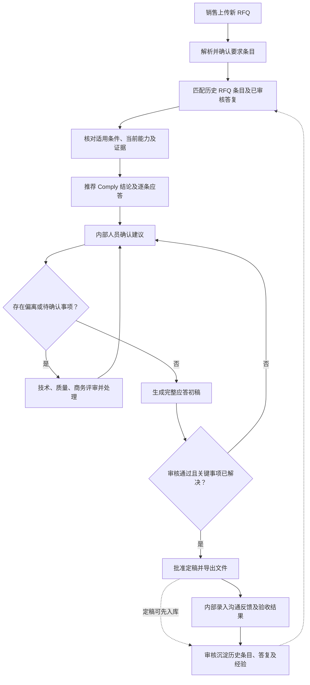

图示为定稿主流程；未关闭事项可先生成带标记的内部草稿，但不能绕过定稿审批。

以下 A—M 对应图中的节点。本节说明操作与结果，所需资料和组件见附录 A。所有能力均在内网运行，具体选型通过样本验证确定。

#### A. 销售上传新 RFQ

- **谁来做、输入什么：** 销售创建项目，填写项目名称、所属产品线、设备型号或待选范围、截止时间和负责人，上传 RFQ 正文、规格附件和应答模板。
- **具体怎么做：** 系统检查文件格式、可读性和重复情况；按项目保存原文件及上传记录，区分要求来源与需要填写的模板。销售确认资料清单；缺少被引用附件时列出缺项。
- **所需资料与系统能力：** 见附录 A 的 A 节点对应项；输入资料及操作结果见本节点说明。
- **输出什么：** 带项目编号、文件编号、版本及权限的资料包。无法读取、加密或损坏的文件提示处理，不静默跳过。

#### B. 解析并确认要求条目

- **谁来做、输入什么：** 系统处理资料包，销售或指定人员核对解析结果。
- **具体怎么做：** Word、Excel 优先读取段落、表格和单元格；PDF 提取文本及版面，扫描页使用本地 OCR。按原始条款编号拆分要求，提取参数、单位、上下限、条件、强制性和要求类别；复合条款拆为子要求，同时保留父条款及原文关系。发现图纸、公式或表格无法可靠识别时，转人工补录或确认。
- **所需资料与系统能力：** 见附录 A 的 B 节点对应项；输入资料及操作结果见本节点说明。
- **输出什么：** 经人工确认的要求清单。每条具备唯一编号、原文、页码或单元格位置及解析状态；低可信项单独列出，不凭模型自报的置信度认定正确。

#### C. 匹配历史 RFQ 条目及已审核答复

- **谁来做、输入什么：** 系统接收已确认的新要求，查询预先整理并获准使用的历史知识。
- **具体怎么做：** 先过滤访问权限、审核状态和有效状态，再结合产品类别、型号、术语及参数检索。使用关键词检索匹配精确术语和数值，同时使用语义检索寻找不同措辞的相似要求；合并候选后重新排序。按条目召回，而非仅返回整份历史文件。
- **所需资料与系统能力：** 见附录 A 的 C 节点对应项；输入资料及操作结果见本节点说明。
- **输出什么：** 新要求对应的历史候选卡片，包含历史原文、答复、项目、型号配置、来源和匹配理由。找不到历史记录时标记“无历史命中”，仍进入 D 核对当前能力。

#### D. 核对适用条件、当前能力及证据

- **谁来做、输入什么：** 系统使用新要求、历史候选以及“机型能力边界”模块中适用于本项目机型、版本和配置的已发布有效能力；无法判断的部分交责任人。
- **具体怎么做：** 对照设备型号、配置、材料、厚度、工艺条件、指标定义、测试方法和验收口径。统一可换算的单位，用规则比较上下限、范围和容差；使用模型辅助识别“典型值／保证值”“选配／标配”等语义差异。先按项目机型、版本、配置及材料／工艺条件筛选能力，再比较客户指标与能力范围；逐项展示所需选配、保证值／典型值、已知限制及证据。到关联规格、测试和验收资料中核对支持证据，保留机型、能力及证据的引用版本。历史 Comply 不直接继承；机型相同也不代表条件自动适用。
- **所需资料与系统能力：** 见附录 A 的 D 节点对应项；输入资料及操作结果见本节点说明。
- **输出什么：** 条件差异表及支持／反驳／缺失证据。资料冲突、单位不清或测试条件不适用时列出具体原因，供 E 推荐待确认或其他适当结论。

#### E. 推荐 Comply 结论及逐条应答

- **谁来做、输入什么：** 系统依据 D 的证据与差异生成建议。
- **具体怎么做：** 区分 Comply、有条件 Comply、不满足、待确认和不适用；不适用需说明范围依据。对可复用条目，基于已审核历史答复调整本次参数和范围；有条件满足时写清选配及限制；证据不足时生成待确认说明。推荐结论、理由、来源及建议答复分别存储。
- **所需资料与系统能力：** 见附录 A 的 E 节点对应项；输入资料及操作结果见本节点说明。
- **输出什么：** 预填的逐条应答矩阵。界面显示“系统推荐，待内部确认”，不得写成已经批准的对外承诺。

#### F. 内部人员确认建议

- **谁来做、输入什么：** 销售查看全部结果，按技术、质量、商务类别将条目分派给有权限的责任人。
- **具体怎么做：** 界面并排展示新要求、历史参考、条件差异、证据及推荐答复。人员可采纳、修改或转评审，修改记录原因。对依据和条件一致的条目允许批量确认，但需展示批次范围、排除异常项并逐条保留操作记录；关键承诺仍按审批规则处理。
- **所需资料与系统能力：** 见附录 A 的 F 节点对应项；输入资料及操作结果见本节点说明。
- **输出什么：** 经内部确认的结论及答复，或带责任人和原因的评审任务。系统推荐与最终人工结论分开保存。

#### G. 判断是否存在偏离或待确认事项

- **谁来做、输入什么：** 系统读取逐条结论、审核状态及缺失信息，人员确认事项分类。
- **具体怎么做：** 证据表明不能满足的条目进入偏离；证据不足、冲突或仍待专业判断的条目进入待确认。有条件 Comply 的条件尚未确认时，形成处理任务。经确认不适用的条目保留理由。不能仅因匹配分数低而认定偏离。
- **所需资料与系统能力：** 见附录 A 的 G 节点对应项；输入资料及操作结果见本节点说明。
- **输出什么：** 有待处理事项则进入 H，否则进入 I；保留内部草稿提前生成入口，定稿另受 J 检查。

#### H. 技术、质量、商务评审并处理

- **谁来做、输入什么：** 对应专业责任人处理偏离及待确认任务，销售协调所需沟通。
- **具体怎么做：** 参考类似偏离的处理经验，补充证据、安排测试、确认选配、修改方案或提出澄清问题，记录成本、交期及质量影响。需要对外澄清时，系统生成问题清单，由销售在系统外沟通并录入回复及附件。方案按权限审批后回到 F 重新确认。
- **所需资料与系统能力：** 见附录 A 的 H 节点对应项；输入资料及操作结果见本节点说明。
- **输出什么：** 经确认的处理结论、批准条件和证据；未解决项继续留在待办中。拒绝承接的事项也需有明确结果。

#### I. 生成完整应答初稿

- **谁来做、输入什么：** 销售发起生成，系统读取要求清单、已确认答复、偏离结论及本次模板。
- **具体怎么做：** 按原条款编号和顺序填充逐条应答，汇总偏离及澄清项。优先使用已确认内容，模型辅助整理措辞，不自行补写指标或批准条件。未确认条目生成醒目标记。草稿修改如影响已确认结论或承诺，应退回对应责任人复核。
- **所需资料与系统能力：** 见附录 A 的 I 节点对应项；输入资料及操作结果见本节点说明。
- **输出什么：** Word 应答草稿、Excel 应答矩阵及偏离、澄清清单，记录所依据的项目、模板和数据版本。

#### J. 检查审核是否通过且关键事项已解决

- **谁来做、输入什么：** 专业负责人及最终审批人审核草稿，系统执行规则检查。
- **具体怎么做：** 检查要求是否全部有明确处置、关键事项是否解决、附加条件是否保留、证据及附件是否齐全，核对参数、审批版本及提交格式。需要分标时检查技术标中的价格内容。审核失败返回 F，并指出条目与原因；确认后的条目或文件被修改时，相关批准状态失效并重新审核。
- **所需资料与系统能力：** 见附录 A 的 J 节点对应项；输入资料及操作结果见本节点说明。
- **输出什么：** 通过记录或退回清单。自动检查通过不能替代人员批准；不承接或不适用等结果经确认后可作为明确处置，不强制全部条目都为 Comply。

#### K. 批准定稿并导出文件

- **谁来做、输入什么：** 获授权的审批人批准指定版本，销售导出。
- **具体怎么做：** 固定本次批准的数据及文件版本，核实导出权限，生成定稿文件和附件清单，记录导出人员及时间。后续修改形成新版本，不覆盖已批准文件。销售在系统外发送应答，可回填发送状态。
- **所需资料与系统能力：** 见附录 A 的 K 节点对应项；输入资料及操作结果见本节点说明。
- **输出什么：** 可追溯的定稿包及导出记录。系统首期不自动向外发送。

#### L. 内部录入沟通反馈及验收结果

- **谁来做、输入什么：** 销售录入沟通结果，交付或质量人员录入测试和验收结果及原始附件。
- **具体怎么做：** 按项目和条目关联接受、拒绝、补充要求、实际性能和问题原因，区分沟通接受与实际验收通过；允许后续逐次补充。没有结果的记录标记未知，不能推定成功。
- **所需资料与系统能力：** 见附录 A 的 L 节点对应项；输入资料及操作结果见本节点说明。
- **输出什么：** 可核验的反馈及验收记录，形成经验候选。该节点可在定稿后异步推进，不阻塞已完成项目；定稿答复可先送 M 审核，后续反馈再增补。

#### M. 审核沉淀历史条目、答复及经验

- **谁来做、输入什么：** 知识维护人员审核已批准答复及后续结果，专业负责人核对能力类知识。
- **具体怎么做：** 系统提取“要求—答复—条件—依据—结果”，与已有知识去重；人员核对适用型号、配置、有效期及权限，剔除项目特例或明确标记限制。通过后发布新版本并更新检索索引，撤销及过期状态同步生效。项目验收结果不能未经批准就升级为通用能力。
- **所需资料与系统能力：** 见附录 A 的 M 节点对应项；输入资料及操作结果见本节点说明。
- **输出什么：** 下次 RFQ 可检索的历史条目、标准答复和处理经验。未审核内容留在候选区，不作为已审核知识参与 Comply 推荐。

所需资料和技术能力汇总见附录 A；具体产品行为、权限与验收以第 4、6、8 节为准。

## 4. 核心功能需求

| 编号 | 模块 | 功能要求 | 验收要点 |
| --- | --- | --- | --- |
| FR-01 | 项目与资料管理 | 创建项目，记录客户、设备范围、截止时间和负责人；上传资料并识别版本、重复文件和附件关系 | 项目资料可查；更新保留历史版本 |
| FR-02 | 自动化解析 | 识别技术、质量、交付、商务、资质和提交要求；拆分复合条款；保留表格关系、单位、条件及原文位置 | 每条要求可定位原文；低可信解析及无法读取的内容显式提示 |
| FR-03 | 一致性检查 | 识别跨文件参数冲突、名称不一致、缺失附件及模糊条件 | 展示冲突双方及出处，生成待澄清事项 |
| FR-04 | 历史条目匹配与 Comply 推荐 | 将新 RFQ 要求匹配历史条目及已审核答复，核对型号、配置、工艺条件及当前能力，推荐 Comply 结论与可复用应答；未命中时检索当前能力并进入必要评审 | 展示本次与历史条目、历史答复、条件差异、当前证据和推荐结论；不以文字相似或历史 Comply 直接判定本次满足 |
| FR-05 | 偏离管理 | 建立偏离台账，分派责任人，记录影响、方案、审批及客户反馈 | 每项偏离有责任人和处理记录；关闭时注明结果 |
| FR-06 | 初稿生成 | 根据已审核结论和模板生成逐条答复、偏离说明及澄清问题；草稿中的未审核内容保留标记 | 关键答复有依据；待确认内容明确标记；遵循客户格式要求 |
| FR-07 | 知识沉淀 | 从定稿、客户反馈和交付验收中提取可复用知识 | 入库内容经过审核，包含适用范围、版本及来源 |
| FR-08 | 版本影响分析（辅助） | 同一项目上传新版资料时，可识别变化并关联受影响的要求、结论、偏离和初稿；不属于核心历史匹配流程 | 过往批准结论不自动沿用到已变化的要求 |
| FR-09 | 机型能力边界 | 在同一模块维护机型信息、版本、配置及条件化能力，关联证据并审核发布；根据项目机型和配置参与 RFQ 逐条比对，输出满足情况、条件、差距和依据 | 能区分同机型不同版本／配置／工艺条件；仅采用获授权的已发布有效能力；证据缺失或冲突进入待确认；变更触发引用复核 |

### 4.1 逐条应答矩阵

每条客户要求至少包含以下字段：

- 要求编号、所属项目及版本。
- 客户原文、来源文件、页码／工作表／单元格等定位信息。
- 要求类别、强制性、参数、单位、条件及适用范围。
- 匹配的历史要求、历史答复、历史项目及配置条件。
- 本次与历史条目的差异、当前能力依据、推荐 Comply 结论及应答。
- 本次适用的机型、机型版本、配置基线、能力编号与版本、证据版本，以及客户要求与能力边界的逐项比较。
- 内部确认后的最终结论，与系统推荐分别记录。
- 偏离说明、澄清事项、责任人及审核状态。
- 最终答复、证据引用和批准记录。

解析结果支持人工修改；修改保留人员、时间和变更记录。

### 4.2 单条要求的快速处理

#### 4.2.1 比对结论

| 结论 | 含义 |
| --- | --- |
| 满足（Comply） | 有适用、有效的证据支持；可参考经核对适用的历史条目及答复 |
| 有条件满足（有条件 Comply） | 在明确配置或限制条件下满足，应答必须保留条件 |
| 不满足 | 已确认存在差距 |
| 待确认 | 证据不足、资料冲突或需要专家判断 |
| 不适用 | 经确认不属于本次范围 |

#### 4.2.2 处理路径

| 处理路径 | 判断依据 | 系统输出及内部动作 |
| --- | --- | --- |
| 可复用 Comply | 历史已审核答复适用，当前有效证据支持本次要求 | 推荐 Comply 并预填应答，内部人员确认后采用 |
| 有条件 Comply | 明确配置、选配或适用限制后可满足 | 列出必要条件，生成条件应答并交责任人确认 |
| 偏离 | 有效证据表明当前能力不能满足 | 推荐不满足并建立偏离事项，参考历史处理经验 |
| 待确认 | 无匹配、证据不足、条件不同或资料冲突，且当前资料无法完成判断 | 展示缺口及建议动作，转责任人评审 |

匹配不到历史条目时仍可基于当前有效资料判断；不得因未命中直接判定不满足。历史匹配结果需展示来源及差异，供内部人员快速确认。

### 4.3 页面与操作定义

本节定义首期 13 个页面级界面及其详情、标签页、弹窗与通用状态；完整清单见 4.3.1。线框图用于表达页面布局、主要按钮和状态；均为模拟数据，不是已实现界面。按钮是否可用取决于用户权限、条目状态及 4.4 的规则，具体交互以图下文字为准。

#### PG-01 项目列表

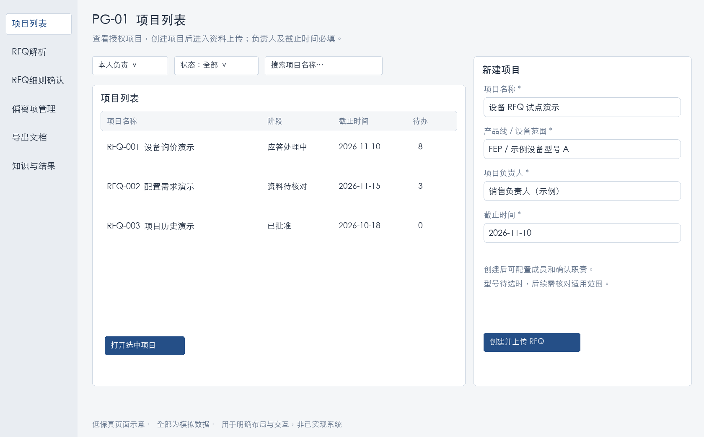

[查看可缩放 SVG](docs/wireframes/pg01-projects.svg)

- 列表显示有权访问项目的编号、名称、设备范围、负责人、截止时间、当前阶段及待办数；支持按负责人、状态和截止时间筛选。
- “新建项目”必填项目名称、产品线或设备范围、负责人、截止时间；范围不明确可填写“待选”，但后续适用性核对不能据此假定型号相同。
- 项目可关联一个或多个设备项，每个设备项选择机型、机型版本及配置基线；选配区分已选、未选和待确认。尚未选型可保存项目，但依赖机型的技术条目不能确认或无条件推荐 Comply。
- 创建后进入资料页。项目负责人可配置成员及职责；未分派专业责任人的要求可以保存，但不能确认或完成审批。

#### PG-02 RFQ解析

[查看可缩放 SVG](docs/wireframes/pg02-documents.svg)

- 上传后逐文件显示排队中、处理中、待核对、完成或失败，失败显示具体原因及重试入口。
- 销售指定文件用途为要求来源、补充附件或应答模板；仅要求来源触发条目解析，其他文件供关联使用。
- 原文与解析条目并排显示；选中条目可定位页码／工作表／单元格。支持修改、拆分、合并及补录，保留原文与修改记录。
- “确认并匹配”只作用于已确认的条目。未确认条目留在列表并计入项目缺项；不因部分处理成功隐藏其他条目或失败文件。

#### PG-03 RFQ细则确认（三栏主页面）

比对结论及处理路径见 4.2，历史知识匹配规则见 4.6。

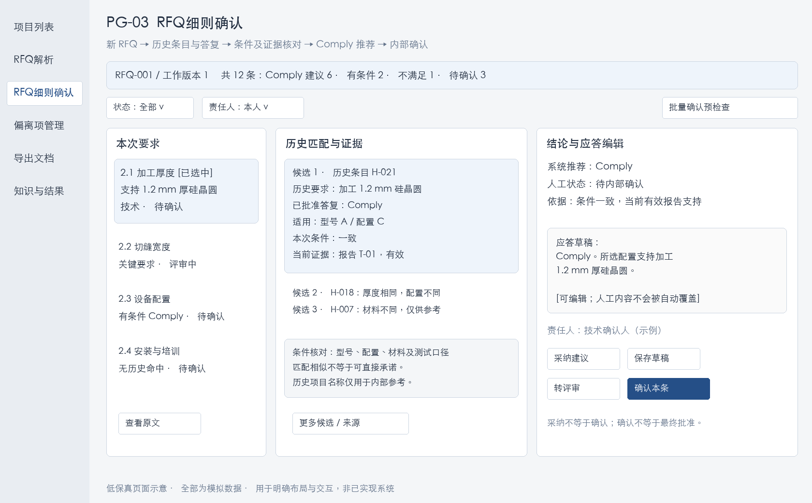

[查看可缩放 SVG](docs/wireframes/pg03-response-workbench.svg)

| 区域 | 默认显示 | 用户操作与系统响应 |
| --- | --- | --- |
| 顶部 | 项目及版本、总条目数、各类结论及处理状态计数 | 按类别、责任人、状态、无历史命中、条件差异或关键要求筛选；计数与条目明细一致 |
| 左栏：本次要求 | 条款编号、原文摘要、类别、关键标记及处理状态 | 选择条目，联动刷新中、右栏；查看原文；有权限时修正要求，触发受影响建议及确认失效 |
| 中栏：历史匹配与证据 | 默认展示排名前 3 条可访问候选及匹配理由；不足 3 条按实际展示；提供继续查看入口 | 展开历史原文、已批准答复、型号配置、条件、结果及来源；选用或拒绝候选，记录理由；切换候选不自动覆盖右栏人工编辑内容 |
| 右栏：结论与应答 | 系统推荐及依据、条件差异、证据、可编辑答复、责任人及最终确认状态 | 采纳建议、修改后确认、保存草稿或转评审；系统推荐和人工结论分开展示 |
| 底部／侧栏 | 当前条目的偏离、附件、操作记录及确认版本 | 查看变更者、时间、理由，打开评审任务；确认后可跳转下一未处理项 |

关键交互规则：

1. 切换条目前若存在未保存内容，提示保存、放弃或取消切换，不静默丢失。
2. “采纳建议”填入结论及答复，不等于确认；确认时校验权限、必要依据和条件。
3. “修改后确认”要求填写修改原因；结论为不适用时填写范围依据；有条件 Comply 必须填写适用条件。
4. “重新匹配”默认只刷新历史候选与系统建议；保留人工答复并提示差异，不直接覆盖确认结果。来源失效等情况按 BR-09 转待复核。
5. “转评审”必选问题类别、责任人和问题说明，可附证据；任务提交后显示跟踪入口。
6. 批量确认先显示选中范围、符合条件及被排除条目和原因，执行后逐条反馈结果。禁止将当前页以外的条目隐式加入批次。
7. 无历史候选、无权限和检索失败分别显示；权限不足不展示受限来源名称或摘要。
8. 中栏增加“机型能力”标签页：显示条目所属设备项、机型／配置基线、能力范围、值类型、条件、限制、证据及引用版本；与客户要求并排比较，可按权限进入 PG-14。无历史命中仍可使用有效能力；商务等非机型条目按对应资料评审。

#### PG-04 偏离项管理

偏离与待确认事项的业务处理规则见 4.7。

[查看可缩放 SVG](docs/wireframes/pg04-reviews.svg)

- 列表显示条目、事项类型、影响、责任人、截止时间、状态及批准条件；支持按本人待办、类别、状态筛选。
- 详情展示本次要求、差距、证据、历史处理经验、处理方案、成本／交期／质量影响及沟通记录。
- 责任人可补证据、修改方案、提交批准；批准人可退回或批准关闭，退回填写理由。重新分派保留原责任人和原因，原处理记录不得删除。
- 沟通结果由销售录入；沟通接受与验收通过使用不同字段。待确认问题经补证后可更新结论，不强制转为偏离。

#### PG-05 导出文档

应答审核与定稿规则见 4.8，提交与导出门槛见 BR-08。

[查看可缩放 SVG](docs/wireframes/pg05-export.svg)

- 销售选择内置模板，核对字段映射，生成前预览将包含的条目及缺项。
- 可随时生成内部草稿，未确认内容显式标记；导出草稿与“批准定稿”使用不同按钮和状态。
- “提交审批”运行 BR-08 检查，失败逐条列出原因及跳转入口；通过后冻结待审批快照。
- 审批人查看具体快照及变更记录，批准或退回并填写意见；源数据后续修改产生新工作版本，不改变既有快照。
- 正式导出只读取已批准且通过当前有效性检查的快照，生成文件包及附件清单；审批中不允许正式导出。
- 默认对外文件只包含本次要求、最终答复、必要条件及批准附件；历史项目名称、内部评审、成本、批注与内部检索引用不自动带出。内部证据与对外附件分别管理。

#### PG-06 知识与结果维护

知识使用、结果回流及复用规则见 4.6。

[查看可缩放 SVG](docs/wireframes/pg06-knowledge.svg)

- 历史知识可通过首期固定 Excel 模板批量导入，必填历史要求、最终答复、来源、审核信息、产品范围及访问范围；缺失数据进入候选区，逐行反馈导入错误，不默认发布。
- 项目定稿生成知识候选，可补充反馈及验收结果；维护人员去重、修订适用条件并提交审核。
- 知识发布或撤销由指定知识审批人操作；系统管理员不因技术管理身份获得业务批准权。
- 项目成员可按权限补充反馈；已经发布的知识不得直接覆盖，修改产生新版本，经审核再发布。

#### PG-08 个人工作台与待办

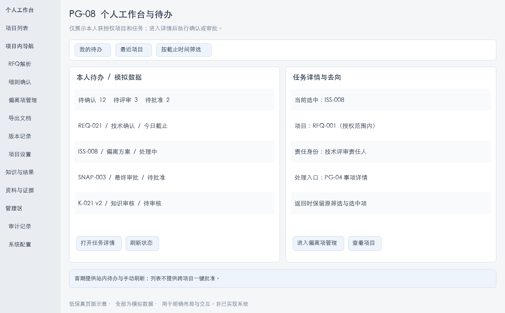

[查看可缩放 SVG](docs/wireframes/pg08-workbench.svg)

- **入口与对象**：系统默认落地页、全局“我的待办”；所有业务角色按本人权限访问。
- **布局**：顶部为待确认、待评审、待批准、待复核数量；中间为本人待办列表，包含类型、授权项目、对象编号、责任身份、截止时间、状态和最近更新时间；侧栏为最近访问的授权项目。
- **筛选与跳转**：按项目、任务类型、状态及截止时间筛选。要求确认／复核进入 PG-03；事项处理／专业批准进入 PG-04；最终审批进入 PG-05 的具体快照；知识审核进入 PG-06 的具体知识版本。保留返回待办及原筛选条件的入口。
- **操作规则**：列表不提供跨项目一键批准；进入详情后重新核对权限和版本。任务随业务对象状态更新，同一任务不因刷新或重试重复生成；任务失效显示已处理或权限变化。
- **边界**：首期采用站内待办与手动刷新；邮件、即时通信推送、自动催办及高级统计属于 P1。待办为空仅表示本人当前无待处理任务。

#### PG-09 项目设置、成员与审批配置

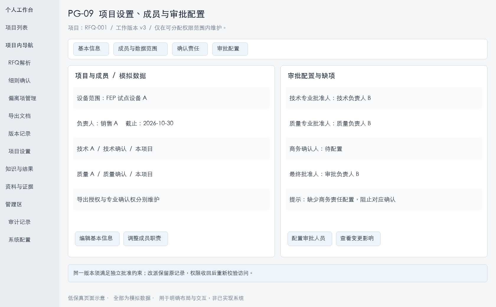

[查看可缩放 SVG](docs/wireframes/pg09-project-settings.svg)

- **入口与对象**：PG-01 项目行及项目内“项目设置”；项目负责人按项目管理授权维护，其他成员按权限只读。全局账号与授权策略从 PG-13 管理，项目负责人不能突破其可分配范围。
- **布局**：基本信息、成员与数据范围、确认责任、审批配置四个标签页。基本信息包含名称、客户、产品线／设备范围、设备项及其机型版本／配置基线、负责人、截止时间及项目工作版本；成员表包含身份、职责、可访问范围、确认／导出授权及生效状态。
- **确认与审批配置**：按技术、质量、商务等类别明确确认人、关键承诺专业批准人及项目最终批准人；知识批准人由知识授权配置，不因项目批准身份自动获得。允许一人兼任角色，但必须满足 5.1 的同版本独立审批约束。
- **操作与反馈**：新增／调整／移除成员、改派职责和配置审批人均先展示影响范围，填写原因并保留变更记录；必填项或责任配置缺失逐项提示，允许保存未完成配置，阻止对应确认、批量确认或审批。
- **影响处理**：设备范围或适用配置变化按 BR-09 触发相关复核；权限收回按 BR-11 立即重新校验访问和后续操作；负责人／审批人改派保留原处理记录，未完成任务转给新责任人，不伪造其确认或批准。

#### PG-10 资料与证据管理

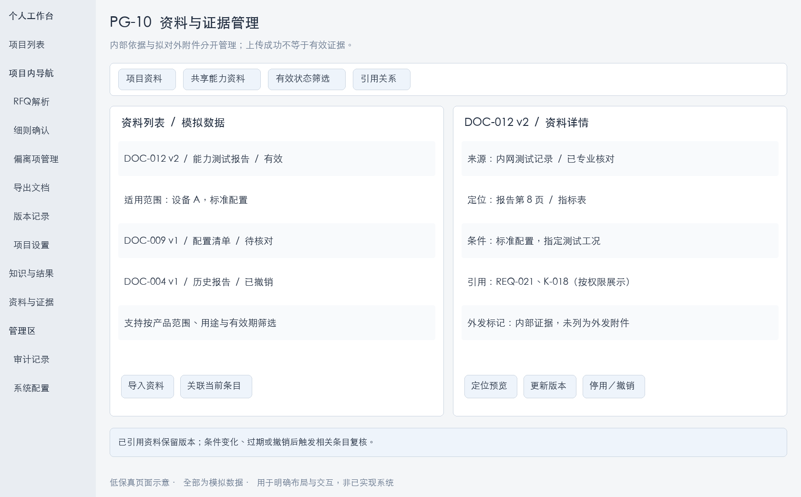

[查看可缩放 SVG](docs/wireframes/pg10-evidence.svg)

- **入口与对象**：全局“资料与证据”及 PG-02、PG-03、PG-04、PG-06 的关联资料入口。项目资料受项目授权控制，共享能力资料受其独立数据范围控制；页面只显示用户可访问的记录。
- **布局**：资料列表与详情预览，按项目资料／共享能力资料、用途、产品范围、有效状态及是否被引用筛选。列表包含编号、名称、版本、用途、维护人、来源日期、有效期及可见范围。
- **资料详情**：展示原件及页码／工作表定位、型号配置、工艺或适用条件、来源与确认记录、关联要求／知识及版本；无法预览时显示文件信息并在有权时下载原件，不把无法预览等同于无内容。
- **操作与用途**：项目上传沿用 PG-02 的要求来源、补充附件、应答模板分类；共享资料由获授权维护人导入。关联、替换、更新版本、停用／撤销均记录原因。上传成功仅代表存储成功，须由获授权专业人员核对来源、条件和有效性后才能作为有效证据；不新增独立的资料审批流程。
- **引用与外发**：内部证据与拟对外附件使用不同标记；标为对外附件不等于获准发送，仍须 PG-05 的附件分标检查及快照批准。已引用资料不能直接物理删除或覆盖版本，替换保留旧版追溯。
- **有效性影响**：过期、撤销、条件修订或权限变化列出操作者可访问的受影响对象，按 BR-09 触发复核；无法访问的对象不披露名称或摘要，其处理由对应获授权责任人完成。确认或正式导出时再次校验证据。

#### PG-11 项目版本、变更与快照记录

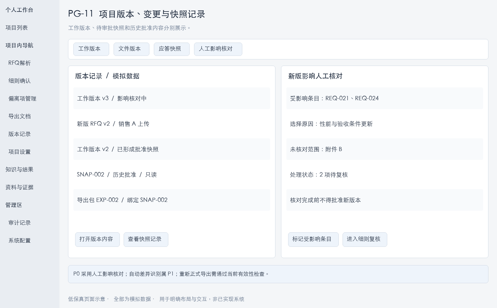

[查看可缩放 SVG](docs/wireframes/pg11-versions.svg)

- **入口与对象**：项目顶部版本入口，以及 PG-02 的文件版本、PG-03 的变更记录、PG-05 的快照历史；仅限授权项目。
- **布局**：工作版本、文件版本、应答快照三个标签页。记录编号、来源、创建人／时间、状态、关联条目、审批人及导出记录；选中后展示只读内容和事件时间线。审批与导出记录绑定实际版本。
- **首期新版处理**：上传新版要求或修改范围后建立新工作版本，负责人手工选择受影响条目，记录原因、未识别范围及核对结果；未完成影响核对不得批准新版本。可查看旧版／新版内容供人工对照，自动差异识别与影响推荐仍属 P1。
- **复核与跳转**：查看受影响条目及复核进度，跳转 PG-03／PG-04 处理；工作版本变更不覆盖已冻结的待审批快照及历史批准内容，旧批准不得沿用为新工作版本批准。旧快照的当前可导出性需独立展示，不用“已批准”替代有效性检查。
- **历史文件**：有权查看、下载已生成历史文件用于追溯时，显示其版本及当前失效／影响提示；重新生成正式文件必须经 PG-05 当前有效性检查。对于已对外发送内容，负责人记录是否需重新发送及处理结果，系统不自动向客户发送。

#### PG-12 审计记录

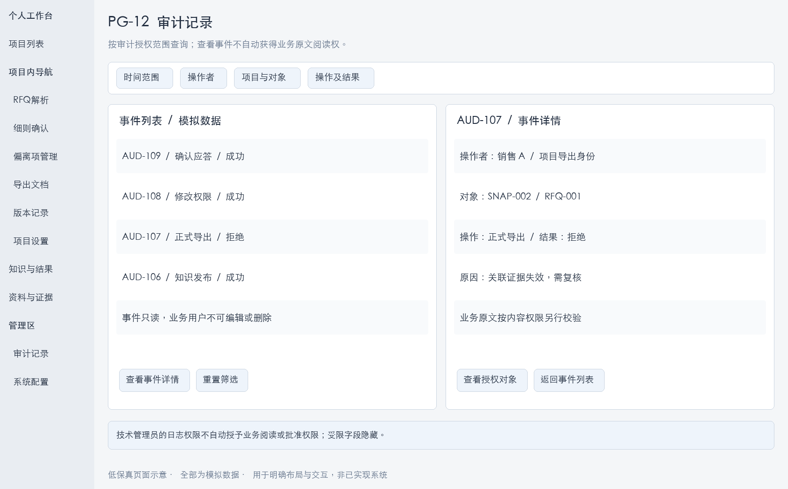

[查看可缩放 SVG](docs/wireframes/pg12-audit.svg)

- **入口与对象**：项目内“操作记录”及管理区“审计记录”。项目负责人查看其授权项目记录，获审计授权人员按范围查询；管理员的技术日志权限不自动包含业务内容阅读权限。
- **布局**：按时间、操作者、项目、对象类型、操作及成功／失败筛选；列表显示事件编号、对象及版本、操作时间、实际职责、结果及原因。详情显示可访问的变更前后内容、相关审批／导出快照及来源事件。
- **记录范围**：资料访问、上传与替换、解析修订、匹配及人工采纳、确认、分派、批准／退回、知识发布／撤销、权限变更、生成及导出均有可追溯记录；失败或拒绝事件不伪装为成功。
- **约束**：业务用户不能编辑或删除审计事件。越权字段隐藏；即使有权检索事件，也须另行具备业务内容权限才能展开原文。首期支持查询与定位，不增加通用业务数据批量导出入口。

#### PG-13 系统配置与运维

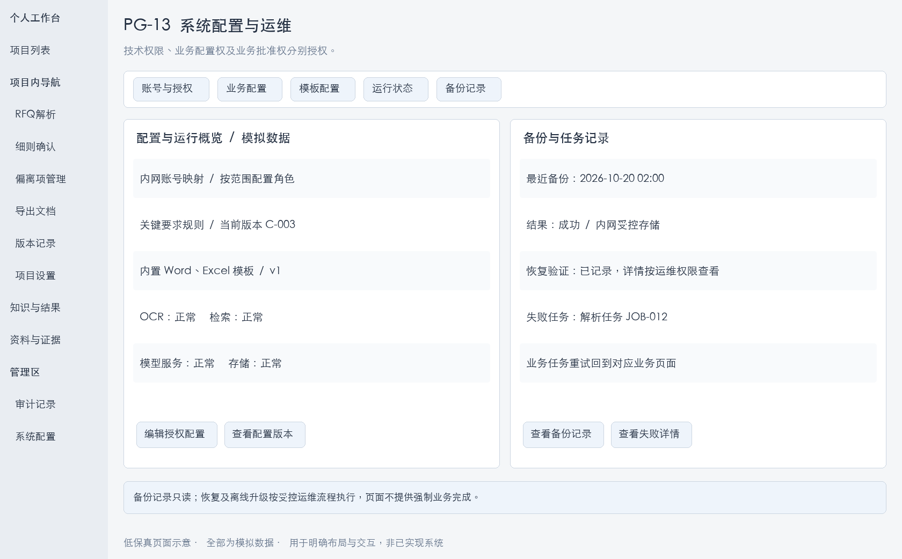

[查看可缩放 SVG](docs/wireframes/pg13-admin.svg)

- **入口与对象**：仅对获技术管理授权人员显示管理区；业务配置按对应管理授权开放。系统管理员维护账号、授权策略及技术配置，不因该身份获得项目阅读或业务批准权；授权变更记录实际操作者。
- **布局**：账号与授权、业务配置、模板配置、运行状态、备份记录五个标签页。业务配置包含分类、关键要求规则及试点设备范围；模板配置展示首期内置模板版本和列映射默认值；运行状态包含 OCR、检索、模型、存储及任务失败状态。
- **账号与授权**：维护内网身份映射、生效状态、角色及数据范围；项目成员分派仍在 PG-09 完成。技术角色、知识维护／批准及业务批准分别授权，缺少配置不得默认放行；权限回收后重新校验访问与任务。
- **配置变更**：有权人员可维护业务配置及模板映射，保存前校验必填项、适用范围和版本，展示受影响范围并记录原因。项目所用配置和模板版本须可追溯；影响既有结论、条件或证据有效性的变更按 BR-09 处理。审批中及已批准快照不被新配置改写。
- **运行与恢复**：显示失败阶段、最近成功时间及可访问的错误摘要；业务任务重试回到 PG-02／PG-03／PG-05 对应任务，不提供绕过业务校验的强制完成操作。备份页只读展示备份时间、范围、结果及最近恢复验证记录，恢复由获授权运维人员按受控流程执行，记录审计。
- **首期边界**：离线模型／依赖升级由运维流程完成，页面仅显示当前版本及健康状态；不包含公网下载、任意模型编排、模板可视化设计器或在线恢复按钮。

#### PG-14 机型能力边界

- **入口与对象**：全局“机型能力边界”，项目设置和 RFQ 细则确认提供关联入口。统一模块内设置机型信息、配置与能力、证据与版本、审核与引用四个标签页；不另建独立机型元数据模块。
- **列表与详情**：左侧按产品系列、机型、版本、生命周期及发布状态筛选；右侧展示机型资料、标配／选配和能力清单。选中能力后展开指标、范围、适用条件、证据、审核记录及有权查看的项目引用。示例数据不能作为实际设备能力。
- **维护操作**：获授权维护人新建、修订机型和能力、关联 PG-10 证据、保存草稿及提交审核；指定能力批准人批准发布、退回或撤销，同一版本不得自审。机型与能力均保留版本，已发布内容修订产生新草稿，不覆盖旧版。
- **RFQ 使用**：从项目进入时带入设备项及配置基线，按权限展示适用能力；切换查看其他机型不修改项目配置。应用不同机型／配置须回 PG-09 明确修改、填写原因并触发相关复核。
- **导入与错误**：首期支持人工录入和固定 Excel 模板导入机型、配置及能力；提供字段预检、逐行错误与成功记录，重试不重复建档。导入仅生成草稿，缺条件、证据或批准人时列出原因并阻止发布。
- **状态与影响**：草稿、待审核、已发布及退回意见清楚展示；有效性另列有效、过期、撤销、被替代。发布、替代或撤销前展示可访问的影响及原因；按 4.9 处理受影响引用，保留历史版本。无权限引用不披露名称或摘要。

#### 4.3.1 页面清单、层级与导航

PG-01～06 为核心业务页面，PG-08～13 补齐协同、资料及管理界面，PG-14 承载机型能力边界。以下为本版 P0 的完整页面级清单；各页内的详情、标签页及弹窗按 4.3.2～4.3.3 实现，不再另计独立一级页面。线框为代表状态，未逐张绘制所有详情与弹窗；PG-14 本次以文字定义布局与操作，完整操作要求以本节文字为准。

| 编号 | 页面 | 所属层级／入口 | 主要访问者与去向 |
| --- | --- | --- | --- |
| PG-08 | 个人工作台与待办 | 全局导航 | 全部业务角色；跳转本人有权处理的对象详情 |
| PG-01 | 项目列表 | 全局导航 | 授权项目用户；新建后 PG-02，继续处理进入项目业务页 |
| PG-02 | RFQ解析 | 项目导航 | 销售及获授权专业人员；确认后 PG-03 |
| PG-03 | RFQ细则确认 | 项目导航 | 销售、专业确认人；转 PG-04 或 PG-05 |
| PG-04 | 偏离项管理 | 项目导航 | 事项责任人及批准人；回到关联条目或 PG-05 |
| PG-05 | 导出文档 | 项目导航 | 销售及独立最终批准人；定稿后可进入 PG-06 回流 |
| PG-06 | 知识与结果维护 | 全局导航，支持项目筛选 | 知识维护／批准人及有反馈权限的项目成员 |
| PG-09 | 项目设置、成员与审批配置 | 项目导航 | 项目负责人；成员按权限只读 |
| PG-10 | 资料与证据管理 | 全局导航，支持项目筛选 | 授权资料使用者、维护人及专业确认人 |
| PG-11 | 项目版本、变更与快照记录 | 项目导航／版本入口 | 授权项目用户；跳转对应条目、审批或导出 |
| PG-12 | 审计记录 | 项目操作记录／管理区 | 获相应范围审计权限者 |
| PG-13 | 系统配置与运维 | 管理区 | 获技术管理或对应业务配置权限者 |
| PG-14 | 机型能力边界 | 全局导航；PG-09／PG-03 关联入口 | 授权销售及专业人员查询；机型／能力维护人和指定能力批准人维护、审核 |

- 全局导航包含个人工作台、项目列表、机型能力边界、知识与结果、资料与证据；管理区按权限显示。项目内固定显示项目名称及工作版本，提供解析、细则确认、偏离项管理、导出文档、版本记录及项目设置入口。
- 原 PG-01～06 线框保留其业务布局；全局入口及新增导航统一按本表补齐，不以旧图中未显示某入口理解为没有该功能。
- 全局进入知识／资料页时仅展示授权范围；从项目进入时默认带入项目筛选，切换项目后重新校验权限。待办计数、列表和详情使用相同权限与状态口径。
- 首期不新增独立统计大屏、客户门户、自动报价页或系统集成中心。身份认证由内网统一入口承接，不单独设计登录页面；业务页面仍执行权限校验。

#### 4.3.2 详情、标签页与子视图

| 编号 | 所属页面／入口 | 承载形式 | 必须展示与支持的操作 |
| --- | --- | --- | --- |
| SV-01 | PG-01 新建／项目摘要 | 新建弹窗；摘要区 | 录入客户及必填项；创建成功仅生成一个项目；摘要显示缺项与流程入口，配置进入 PG-09 |
| SV-02 | PG-02 文件行 | 文件详情及版本标签页 | 原件预览、文件用途、解析状态／错误、附件关系、缺页或低可信标记；替换和重试保留历史版本 |
| SV-03 | PG-02 条目编辑 | 编辑抽屉 | 修订、拆分、合并、补录；保留父子关系、条件和来源定位，保存后显示受影响状态 |
| SV-04 | PG-03 历史候选 | 候选详情抽屉 | 历史原文／答复、条件差异、批准与验证结果、证据及来源；继续查看候选按实际权限加载 |
| SV-05 | PG-03 原文／证据链接 | 定位预览侧栏 | 回到页码、工作表或单元格；资料详情进入 PG-10，返回保留当前要求及未保存内容 |
| SV-06 | PG-04 事项行或 PG-08 待办 | 事项详情子页 | 要求与差距、方案、成本／交期／质量影响、证据、分派与沟通记录；提交、退回、批准关闭及条件变化后重开 |
| SV-07 | PG-05 生成草稿 | 模板与映射标签页 | 内置模板选择、必要列映射、条目预览、条件／附件清单及分标检查，缺项定位回业务页面 |
| SV-08 | PG-05 审批任务 | 只读快照审批子页 | 固定快照编号、内容、关键承诺专业批准、附件及变更记录；批准／退回意见；与当前工作版本明确区分 |
| SV-09 | PG-05 导出记录 | 文件包详情 | 快照、生成时间、模板版本、文件及附件清单、失败原因、有效性提示；允许时下载或重试 |
| SV-10 | PG-06 批量导入 | 导入任务子视图 | 下载固定模板、上传、字段预检、逐行错误、成功候选及重试；修正重试不重复创建已成功记录 |
| SV-11 | PG-06 知识行／待办 | 知识详情及审核子页 | 来源、要求／答复、适用范围、证据、可见范围、版本、审核意见；修订、提交、批准发布、退回、撤销，不允许同版本自审 |
| SV-12 | PG-06 项目结果 | 反馈与验收标签页 | 沟通结果、接受条件、实际交付／验收、日期、录入人及依据；未知单列，修改已发布知识产生新版本候选 |
| SV-13 | PG-09 成员及审批配置 | 成员编辑抽屉／配置标签页 | 人员、职责、数据及确认范围、导出权、批准角色；配置缺项与独立性校验 |
| SV-14 | PG-10 资料行 | 资料详情及引用标签页 | 预览、条件与有效性、版本、可见范围、可访问引用；有效性变更展示影响及复核入口 |
| SV-15 | PG-11 版本行 | 内容查看与人工核对标签页 | 旧版／新版原文、人工影响标记、核对结论及处理记录；首期不要求自动生成差异 |
| SV-16 | PG-12 事件行 | 只读详情抽屉 | 事件、身份、对象版本、可访问变更及结果，跳转有权查看的业务对象 |
| SV-17 | PG-13 配置／运行记录 | 配置编辑抽屉／只读任务详情 | 必填校验、适用范围、配置版本；错误摘要、备份及恢复验证结果，不展示密钥或连接口令 |
| SV-18 | PG-14 机型／能力行 | 信息、配置能力、证据版本及审核引用标签页 | 机型与能力字段、配置适用性、证据定位、版本、状态及授权引用；新建、修订、提交、批准、退回、撤销及影响确认 |
| SV-19 | PG-14 批量导入 | 导入任务子视图 | 下载模板、字段预检、机型／配置关联校验、逐行结果与重试；成功项仅为草稿，重试不重复创建 |

详情子页支持由待办或对象链接直接打开；每次打开均校验权限。抽屉／侧栏保留所属列表及筛选上下文，独立子页提供明确返回入口。

#### 4.3.3 弹窗与操作确认

| 编号 | 触发位置／动作 | 内容与校验 | 提交结果与取消行为 |
| --- | --- | --- | --- |
| DL-01 | PG-01 新建项目 | 项目名称、客户、产品线／设备范围、负责人、截止时间；名称、范围、负责人及截止时间必填 | 成功进入 PG-02；失败保留输入；取消不创建 |
| DL-02 | PG-02／PG-10 上传或替换资料 | 用途、版本、关联对象及可见范围；重复文件提示，替换填写原因 | 分文件显示结果；失败可重试；取消未提交任务不影响已存资料 |
| DL-03 | PG-02 拆分／合并／补录 | 预览条目、父子关系、来源定位和条件；合并不得丢失多个来源 | 保存修订记录并回到待核对；取消不改变条目 |
| DL-04 | PG-03 转评审／PG-04 分派、改派 | 问题类型、说明、责任人、截止时间、证据；改派填写原因 | 创建或更新同一事项及待办；重复提交不重复建单 |
| DL-05 | PG-03 单条确认／修改后确认 | 展示最终结论、答复、条件、依据；按 BR-04 校验，修改后确认填写原因 | 成功绑定条目版本；失败保留草稿并列原因 |
| DL-06 | PG-03 批量确认 | 展示明确选中范围、可处理数、排除项及原因；提交时再次校验 BR-05 | 逐条反馈成功／失败，不隐式包含其他页；取消不确认任何条目 |
| DL-07 | PG-04／PG-05／PG-06 提交、批准、退回 | 展示对象与版本、操作类型、检查结果及意见；退回必填理由，审批校验独立性 | 保存处理记录并更新待办；失败不能进入批准／发布状态 |
| DL-08 | PG-05 正式导出 | 展示批准快照、对外字段、条件、附件及分标检查结果，执行 BR-08、BR-11 | 成功生成可追溯文件包；失败列原因和修正入口，不生成成功记录 |
| DL-09 | PG-06 发布／撤销；PG-10 停用／替换证据 | 展示对象版本、范围、原因和可访问影响；发布校验证据及知识批准权 | 保留旧版与审计，必要时触发待复核；取消不改变有效性 |
| DL-10 | PG-09／PG-13 权限、责任或配置变更 | 展示变更前后、适用范围及受影响任务；原因必填，校验可分配权限 | 成功后按新权限生效并刷新任务，保留既有记录；失败保留原配置 |
| DL-11 | 离开有未保存内容的页面／条目 | 保存、放弃、取消离开三选一；保存时执行正常校验 | 保存成功才离开；失败留在原处；放弃只丢弃本次未保存编辑 |
| DL-12 | 保存、确认、批准或发布发生版本冲突 | 展示本人输入及可访问的最新版本／变更，提供返回核对入口 | 拒绝过期覆盖；人工核对后基于最新版本重提，不提供强制覆盖批准 |
| DL-13 | PG-11 新版影响核对 | 展示新版资料、受影响条目选择、选择原因及未核对范围；确认核对结论 | 建立复核范围并保留记录；未完成核对时阻止新版批准 |
| DL-14 | PG-04 条件变化重开事项 | 展示原关闭结果、新条件、重开原因及责任人 | 保留原关闭记录并重新进入评审，相关应答按 BR-09 复核 |
| DL-15 | PG-14 提交、批准发布、退回、替代或撤销 | 展示机型／能力版本、配置条件、证据、意见与可访问影响；发布校验字段、证据有效性及独立批准权，退回／替代／撤销必填原因 | 失败保留草稿及原有效状态；成功保留审核与审计，按 4.9 触发相关复核；取消不改变发布状态 |

#### 4.3.4 首期功能与页面覆盖

| 已有需求 | 页面与子视图 | 页面验收重点 |
| --- | --- | --- |
| FR-01 项目与资料 | PG-01、PG-02、PG-09、PG-10、PG-11 | 创建、文件用途与版本、成员分派、原件追溯 |
| FR-02 解析与人工修订 | PG-02、SV-02～03 | 原文定位、拆分合并、失败补录及重试 |
| FR-03 冲突与澄清 | PG-03、PG-04、SV-06 | 冲突双方与出处、待澄清事项及责任人，缺资料不判不满足 |
| FR-04 历史匹配与应答 | PG-03、PG-10、SV-04～05 | 候选与条件、当前证据、系统建议与人工确认分开 |
| FR-05 偏离评审 | PG-04、PG-08、SV-06 | 分派、方案、专业批准、沟通结果及重开 |
| FR-06 草稿与定稿 | PG-05、PG-11、SV-07～09 | 映射、缺项检查、只读快照、独立审批及正式导出 |
| FR-07 知识沉淀 | PG-06、PG-10、SV-10～12 | 导入、结果录入、去重修订、审核发布与撤销 |
| FR-09 机型能力边界 | PG-14、PG-09、PG-03、SV-18～19、DL-15 | 机型配置关联、条件化能力、证据审核、RFQ 比较及变更复核 |
| P0 权限、版本、审计及运维 | PG-08～13 | 授权、待办、人工影响核对、审计及恢复记录 |
| FR-08 自动版本影响分析 | PG-11 的 P1 扩展 | 不纳入首期；P0 以人工影响核对完成相应闭环 |

#### 4.3.5 所有页面的通用状态与交互

- **加载与空态**：加载中、无数据、筛选无结果、无权限、服务失败分别展示；无数据时按权限提供创建／上传入口，筛选无结果提供清除筛选，服务失败提供重试，不把失败显示成空列表或零待办。
- **保存与重复提交**：表单明确显示未保存、保存中、已保存或保存失败；提交期间防止重复操作，后台重试不得重复产生项目、条目、事项、知识候选或导出成功记录。
- **离开与中断**：正常切换时执行 DL-11。会话失效或临时故障时，页面尚保留的未保存内容在重新认证及权限、版本校验后允许继续核对保存；权限撤销时不继续展示受限业务内容。浏览器关闭／崩溃不承诺恢复未保存输入，已保存草稿及后台成功任务可重新进入查看。
- **错误定位**：字段错误定位到字段；业务门槛失败列出对象、原因及获授权修正入口；长任务显示排队、处理中、成功或失败，并保留任务编号及最近状态。刷新页面仍可查询后台任务结果。
- **并发与权限**：任何保存、确认、批准、发布及导出均重新校验版本与权限；导航隐藏不能替代服务端校验。权限变化后列表、计数、详情和附件同步按最新范围返回。
- **返回与只读**：详情返回保留筛选、分页及选中对象；已冻结快照、历史版本及审计记录明确标识只读，修改进入对应工作版本，不在只读页直接改写。

### 4.4 业务规则

| 编号 | 规则 | 可观察行为 |
| --- | --- | --- |
| BR-01 | 业务结论与处理状态分开 | Comply 建议可以仍处于待确认；系统建议不能直接写入批准状态 |
| BR-02 | 适用性不由文本相似度决定 | 型号、配置、材料、工艺、指标或验收口径不同必须展示差异，不能仅凭匹配分数自动确认 |
| BR-03 | 资料不足和冲突不等于不满足 | 推荐待确认，列明缺口／冲突；当前权威资料已明确解决冲突时，展示被采用依据及原因 |
| BR-04 | 单条确认需满足条件 | Comply 有适用的有效证据；有条件 Comply 保留条件且条件已确认；不满足有差距依据；不适用有范围理由；待确认不能作为最终确认结论 |
| BR-05 | 批量确认只用于简单可复用条目 | 仅限推荐 Comply、无关键标记、无未解决差异、证据有效、无未结事项、要求已确认且操作者有确认权的条目；有条件 Comply 和不适用均逐条确认 |
| BR-06 | 人员确认不代替最终审批 | 每项技术、质量、商务要求指定确认责任人；关键承诺由对应专业批准，项目指定最终审批人批准定稿 |
| BR-07 | 自动处理不得覆盖人工结果 | 重新检索或生成保留人工编辑；主动采用新建议需明确操作；更新引用条件后重新确认 |
| BR-08 | 提交审批及正式导出的门槛 | 要求来源文件已处理、全部有效条目有最终处置且已确认、无未结事项、所需条件与附件齐全、关键承诺已专业批准、分标检查完成；正式导出还需最终批准及引用有效性检查 |
| BR-09 | 相关修改触发复核 | 要求、适用配置、结论、答复、批准条件或引用证据变化／失效，使相关条目进入待复核，旧确认和工作版本审批失效；已导出历史快照保留并提示影响，由负责人确认是否需重新对外发送 |
| BR-10 | 首期以人工标记关键要求为准 | 强制性要求、核心性能、价格、交期、付款、质保及验收承诺默认进入关键标记；专业负责人确认或修改并记录原因；配置缺失时不允许批量确认或提交审批 |
| BR-11 | 权限覆盖完整使用链路 | 候选、证据、模型输入输出、条目确认及导出均校验；保存或导出前重新核对权限，不以先前能看到作为当前授权 |
| BR-12 | 已批准与已验证分开 | 经内部批准的答复不是已验收能力；反馈未知明确标注；需要额外能力确认的历史知识不直接支持无条件 Comply |
| BR-13 | 有依据的偏离可形成定稿 | 不要求全部条目 Comply；偏离已批准、答复明确且按本项目需要取得的确认齐备时可以定稿，不将“已关闭”解释为已经满足 |
| BR-14 | 并发修改检查版本 | 保存、确认、批准和发布携带所读取的版本；过期版本拒绝覆盖，展示最新记录并由人员重新确认 |
| BR-15 | 机型与能力按适用条件关联 | 同机型不同版本、配置和条件的能力不得混用；依赖尚未确认的选配时推荐待确认，已确认满足的选配条件必须写入有条件 Comply 答复 |
| BR-16 | 能力发布与引用受控 | 仅已发布、有效且有可用证据的能力参与正式推荐；典型值或单次测试值不自动支持保证承诺；能力／机型版本及配置变化按 4.9、BR-09 处理引用，不覆盖历史批准 |

### 4.5 异常与恢复

| 场景 | 系统显示与恢复操作 | 已有工作处理 |
| --- | --- | --- |
| 加密、损坏或不支持的文件 | 显示文件级失败原因，允许替换或重试 | 保留其他成功文件，要求来源缺项未解决前不得定稿 |
| 扫描页／图纸无法可靠识别 | 显示原页和待核对标记，允许人工录入及专业确认 | 不生成虚构条目，不将未识别页当作无要求 |
| 处理超时或内网服务不可用 | 显示失败阶段和重试入口；任务未完成不显示“无历史命中” | 保留已完成步骤及人工内容，重试不重复创建条目或任务 |
| 没有历史候选 | 明示无历史命中，继续核对当前能力或转评审 | 不自动判定不满足 |
| 多个历史答复冲突 | 同时显示可访问的冲突记录和条件，待专业人员核对当前证据 | 不按最新日期或最高分自动选为满足 |
| 证据过期、撤销或权限收回 | 受影响项进入待复核，提示补证或替换依据；不向无权限人员披露原文 | 保留审计记录，阻止该项批量确认及相关正式导出 |
| 用户编辑与后台更新同时发生 | 提示版本冲突，允许查看差异并重新提交 | 不覆盖已保存的人工作业 |
| 模板缺列、格式不支持或生成失败 | 提示具体映射／生成问题，允许修正模板或使用内置模板重试 | 保留已确认应答，失败不产生定稿状态 |
| 单位含义不清或无法换算 | 显示原始值、单位及问题，转待确认 | 不作数值等价推断 |
| 已批准后新增资料／修改范围 | 项目生成新工作版本，销售明确影响条目；未完成影响确认前不得批准新版本 | 旧快照只读保留，首期不依赖自动影响识别 |

### 4.6 历史知识匹配与回流

本节定义 PG-03 的历史匹配与 PG-06 的知识维护、结果回流规则；界面入口和操作见 4.3，知识版本状态统一见 5.2。

#### 4.6.1 比对来源

| 来源 | 用途 | 预期输出 |
| --- | --- | --- |
| 机型能力边界 | 按机型版本、配置及工艺条件判断当前能力，关联有效规格与测试证据 | 满足情况、条件差异、限制及能力／证据版本 |
| 历史 RFQ 及最终应答 | 查找类似要求及已审核答复 | 可参考答复、相似点及差异 |
| 历史偏离及处理记录 | 查找类似差距的处理路径 | 替代方案、附加条件、客户接受情况 |
| 测试及交付验收资料 | 核查历史承诺是否得到实际验证 | 验证依据、已知限制及风险 |
| 专家评审经验 | 补充易遗漏事项和处理方法 | 检查项、澄清建议及评审建议 |

#### 4.6.2 历史参考卡片

每条要求可展示：

- 参考项目、时间、设备型号和配置。
- 历史要求、最终答复及审核状态。
- 本次与历史案例在材料、厚度、工艺条件、指标或验收方式上的差异。
- 历史处理方案、适用条件及证据。
- 客户接受、拒绝、待确认或实际验收结果。
- 建议动作：复用、修改后复用、发起专家评审或向客户澄清。

结果未知时标记“未记录”，不得自动视为成功经验。

#### 4.6.3 知识使用规则

1. 当前有效且经批准的能力资料作为当前能力判断依据。
2. 历史答复提供参考；特殊配置、客户特批和限用条件必须展示。
3. 历史答复与当前资料冲突时，进入人工确认并保留双方证据。
4. 未查到依据时进入“待确认”，不得直接判定满足或不满足。
5. 历史客户接受过偏离，不代表本次客户已接受。
6. 过期、撤销或被替代的知识保留追溯记录，默认不作为新应答依据。
7. 专家经验结构化保存“问题—条件—处理方案—结果”，经审核后进入可复用知识。
8. 跨客户复用检查权限及适用范围，不得向其他客户应答中带入受限信息。

#### 4.6.4 结果回流

| 时间点 | 沉淀内容 |
| --- | --- |
| 应答定稿后 | 已批准答复、技术依据、偏离方案及批准条件 |
| 客户反馈后 | 接受、拒绝、要求补充及已知原因 |
| 交付验收后 | 实际性能、验收结果、额外投入和出现的问题 |

#### 4.6.5 历史知识比对与回流图

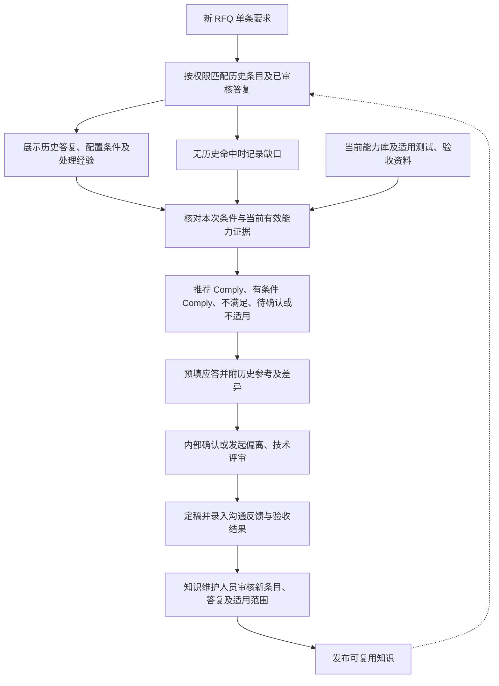

系统分别输出建议结论、理由和证据，充分证据也可能支持“不满足”；缺少证据或未解决的资料冲突进入待确认。AI 建议须经内部人员确认，不直接获得批准状态。

### 4.7 偏离与待确认事项评审

本节对应 PG-04。待确认事项用于补证或澄清，证据尚不足时不强制转为偏离；以下闭环图描述已确认偏离的处理流程。权限与对象状态统一见第 5 章。

偏离类型与处理状态分开记录。类型包括技术、质量、交付、商务等；处理状态包括待评审、已分派、方案处理中、待批准、已关闭。

每项偏离记录客户要求、内部能力差异、成本／交期／质量影响、处理方案、责任人、批准人、客户反馈及最终依据。关闭时明确为内部解决、客户接受、不承接等具体结果。

系统根据历史案例推荐可参考的方案，如增加选配、调整适用条件、样品测试、分阶段交付或替代指标。推荐展示依据与限制，由责任人确认。

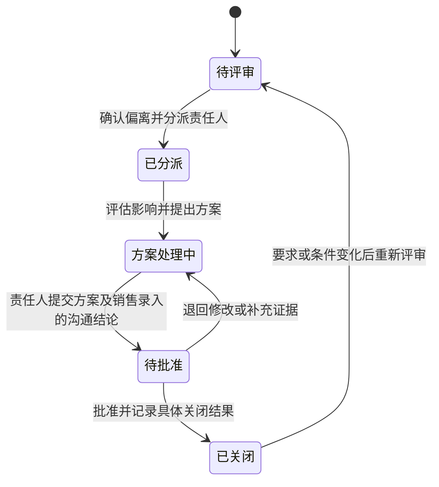

关闭结果须注明内部解决、客户接受、不承接等情况。需要客户接受的方案，在取得客户确认后才可按“客户接受”关闭。

### 4.8 应答审核与定稿

本节对应 PG-05。提交审批及正式导出的完整门槛以 BR-08 为准；快照、审批与导出交互见 PG-05，独立批准权限见 5.1。

- 按要求类别配置责任人和审批关系。
- 客户要求、内部事实及 AI 建议分别展示。
- 关键性能、价格、交期及其他对外承诺由对应人员批准。
- 未关闭事项可生成带标记的内部草稿。
- 存在未解决的关键要求时，阻止将文件标记为“已批准定稿”。关键要求由项目负责人及相关专业负责人确认。
- 客户要求技术标与价格标分离时，导出前检查技术标是否包含价格内容。

### 4.9 机型能力边界

#### 4.9.1 机型、配置与能力的关系

机型信息用于确定“哪一款、哪个版本、什么配置”；能力边界用于说明“在指定条件下能做到什么”。一个机型版本可关联多条能力，同一指标可因配置和工艺条件不同具有多条边界，不能简化成机型上的单个最大值。能力首期显式关联适用机型版本，不默认继承产品系列或相邻版本的能力。

| 对象 | 首期字段与约束 |
| --- | --- |
| 机型信息 | 唯一机型编码、名称、产品系列、机型版本、生命周期（在售／停产／历史）、维护责任人、访问范围及审核记录；停产不自动代表技术能力失效，交付可用性另经商务确认 |
| 配置定义 | 配置编码与版本、所属机型版本、标配、可选模块及已知依赖／互斥；项目保存明确配置基线，未选与未知分开记录；未维护的组合不得推断可用 |
| 能力条目 | 能力编号与版本、指标名称与定义、适用机型版本、必需配置、比较运算符、数值／范围及边界是否包含、单位、值类型（保证值／典型值／单次测试值）、适用条件、已知限制、责任人、访问范围、有效起止日期（允许无固定失效日）及审核状态 |
| 适用条件 | 按指标记录材料、尺寸／厚度、工艺配方／环境、测试方法和验收口径；不适用的条件显式标注并说明，未知不能视为无限制；多个指标同时承诺时须核对可同时满足的条件 |
| 证据关联 | 文件编号、版本、页码／表格位置、支持的指标与条件、验证状态及确认人；审核发布校验证据有效且覆盖拟发布能力，不把上传或审核自动当作实测通过 |

机型／配置档案可先以草稿保存；供项目正式引用的版本须审核发布。机型档案发布不代表其中所有能力均已批准；能力逐条审核并引用明确机型／配置版本。配置版本更新不静默迁移原能力或项目基线。首期以人工维护和固定模板导入为主，不包含自动从规格书发布能力、复杂配置求解或自动实验外推。

#### 4.9.2 RFQ 比对与建议

1. 项目建立设备项并选择机型版本与配置基线；每条机型相关要求关联具体设备项，涉及多个设备项时分别比较，不将一台设备的能力套用到另一台。尚未选型或归属不明时允许继续解析和检索，相关技术要求推荐待确认。
2. 系统先按权限、发布及有效状态过滤，再按机型版本、必需配置和条件筛选能力。指标名称相似仅用于找候选，不能代替指标定义及条件一致性核查。
3. 在单位可可靠换算、定义和值类型适用时比较客户要求与能力范围、上下限、容差及边界；展示原始值、换算值和规则。不得把多个不同工况下各自最优的指标组合为一个可保证的工况。
4. 有效保证能力及证据覆盖本次要求，且配置、条件已确认时可推荐 Comply；满足依赖额外选配或限制且条件已明确时推荐有条件 Comply，并写入条件。选配未确认、仅有典型值／单次测试值支撑保证要求、条件缺失、能力冲突或单位不清时推荐待确认。
5. 适用且有效的能力证据明确不能满足时推荐不满足并转偏离；无能力记录、超出资料覆盖范围或没有历史命中本身不等于不满足。不适用须另有明确范围依据。可经专业评审补充并审核有效依据，不能凭人工改结论跳过 BR-04。
6. 输出能力编号及版本、机型／配置基线、要求与边界对照、条件差异、支持或反驳证据、缺口及推荐理由；系统建议与人工确认分开。能力维护审批不替代项目应答和定稿审批。

#### 4.9.3 审核、版本及影响处理

- 维护人录入并提交，指定能力批准人核对机型／配置适用性、指标定义、条件和证据后发布；同一版本不得自审。发布后修订产生新草稿，审核期间原有效版本仍可使用，除非已撤销或过期。
- 新发布的补充能力不自动覆盖项目既有判断；同一适用范围存在有效冲突时显示双方并转待确认，不能按最近日期或更优数值自动选择。替代版本必须明确被替代关系，不默认新版本适用于所有旧配置。
- 机型／配置基线修改、被引用能力替代／撤销／过期、能力证据失效使相关应答进入待复核，阻止旧确认或工作版本批准沿用。首期按已记录的精确引用定位影响，并由负责人补充核对潜在影响范围；不要求自动识别全部语义影响。
- 应答及批准快照保留机型、配置、能力与证据版本。历史快照只读；导出时再次校验当前引用有效性。已导出文件保留记录并提示影响，由负责人确认是否重新提交客户。
- PG-14 维护结构化机型及能力；PG-10 管理原始证据；PG-06 管理历史应答与经验。历史验收结果可作为补充证据或能力修订候选，经审核后才更新能力，不能自动将某客户的接受结果发布为通用保证能力。

## 5. 权限、核心对象与状态

本章集中定义跨页面共用的授权职责、业务对象及状态，供第四章各功能和页面共同引用。

### 5.1 权限与职责

权限绑定项目和数据范围，不因岗位名称自动获得全部项目访问权。同一人可被分配多个角色，但每次操作记录实际身份及职责。表中“批准人”须由项目明确配置，不允许以“系统推荐通过”代替。

| 操作 | 项目销售／负责人 | 专业确认人 | 指定批准人 | 知识维护人／知识批准人 | 系统管理员 |
| --- | --- | --- | --- | --- | --- |
| 创建项目、上传和组织条目 | 项目范围内允许 | 有分配权限可补充资料 | 可查看授权项目 | 不默认允许 | 不默认允许 |
| 编辑、确认应答 | 可编辑草稿；只确认分配给本人且有确认权的类别 | 只确认所分配类别和范围 | 按所分配专业确认权执行 | 不默认允许 | 不默认允许 |
| 分派、处理事项 | 项目负责人可分派／改派 | 处理分配给本人的事项 | 批准或退回授权事项 | 不默认允许 | 不默认允许 |
| 专业批准与最终批准 | 只有另行获得对应批准角色才允许 | 只有另行获得批准角色才允许 | 仅批准授权专业／项目；最终批准人不得批准本人提交的同一版本 | 不默认允许 | 不默认允许 |
| 导出 | 项目导出授权内可导出草稿或已批准定稿 | 有导出权限才允许 | 有导出权限才允许 | 无项目授权不允许 | 不默认允许 |
| 维护／发布机型能力 | 可按授权查询或提出修订候选 | 另获机型／能力维护授权时可编辑提交 | 另获能力批准角色时可批准发布／撤销；同版本不自审 | 知识角色不自动获得能力批准权；需独立授权 | 不默认允许 |
| 发布知识 | 可提出候选 | 可核对专业内容 | 无知识批准角色不允许 | 维护人编辑提交，知识批准人批准发布／撤销；同一版本不自审 | 不默认允许 |
| 系统配置与运维 | 不允许 | 不允许 | 不允许 | 按授权维护知识配置 | 可维护技术配置；不自动授予业务阅读、确认或批准权限 |

审批人员未配置或缺少独立批准人时提示配置缺项，允许保存工作，但阻止对应批准操作。

### 5.2 核心对象与状态

| 对象 | 业务唯一标识及关联 | 必须区分的信息 |
| --- | --- | --- |
| RFQ 项目 | 项目编号、工作版本、所属范围、成员与批准人 | 进行中的工作版本与已批准快照 |
| 原始文件 | 文件编号、版本、用途、项目及来源定位 | 原件、替换版本、解析状态及资料是否齐备 |
| 要求条目 | 内部条目编号、原条款编号、父子关系及来源 | 原文、人工修订、型号条件、关键标记及条目版本 |
| 匹配建议 | 条目版本、候选知识版本及证据版本 | 系统推荐、匹配理由及差异，不当作人工结论 |
| 人工应答 | 条目版本、结论、答复、条件及证据引用 | 编辑草稿、确认版本、专业批准及确认人 |
| 处理事项 | 事项编号、所属条目、类型及责任人 | 偏离与待确认分开，保留方案、结果及关闭依据 |
| 应答快照 | 快照编号、项目版本、条目和附件版本、模板 | 内部草稿、待审批及批准文件，不覆盖历史快照 |
| 知识条目 | 知识编号、版本、原项目、条件、证据及权限 | 已审核、有效性、可复用范围、反馈及实际验证结果 |
| 机型／配置档案 | 机型编码、机型版本、配置编码与版本；关联项目设备项 | 生命周期、标配／选配、依赖／互斥、项目配置基线及发布状态 |
| 能力条目 | 能力编号与版本、适用机型／配置版本、条件、证据及权限 | 指标范围、保证／典型／测试值、已知限制、发布及有效性状态 |
| 能力比对记录 | 要求版本、设备项、项目配置基线、能力及证据版本 | 参数比较、条件差异、系统建议、人工采用记录及复核状态 |

不同状态独立维护，不能用一个“完成”覆盖所有阶段：

| 状态维度 | 首期状态 | 触发与操作约束 |
| --- | --- | --- |
| 要求解析 | 待解析 → 处理中 → 待核对 → 已确认；失败可重试 | 已确认要求修改后回到待核对，相应建议及人工确认需要复核 |
| 系统建议任务 | 待处理 → 处理中 → 已完成／失败 | 只有成功完成才显示建议或无命中；失败和无命中分开 |
| 人工应答 | 待确认 → 编辑中／评审中 → 已确认；变化后待复核 | 待复核重新处理后才可确认；专业批准额外记录，不由确认自动获得 |
| 偏离／待确认事项 | 待评审 → 已分派 → 方案处理中 → 待批准 → 已关闭 | 退回转方案处理中；条件变化可重开，图见 4.7 |
| 应答快照 | 草稿 → 待审批 → 已批准／已退回 | 退回后生成新草稿版本；批准版本只读，修改生成新工作版本 |
| 知识 | 候选 → 待审核 → 已发布；审核可退回候选 | 已发布知识可过期、撤销或被新版本替代，旧版本保留追溯，不参与有效推荐 |
| 机型／配置及能力审核 | 草稿 → 待审核 → 已发布；退回转草稿并保留意见 | 机型档案与能力分别审核；修改已发布内容生成新草稿，同版本不自审 |
| 能力有效性 | 有效／过期／撤销／被替代，与审核状态独立 | 待生效日期不参与有效推荐；仅已发布且在有效期内、未撤销／替代并有有效证据的能力可用，失效引用触发复核 |

系统任何阶段不得把“没有待办”直接等同于“已经批准”；只有满足 BR-08 且获授权人员批准的指定快照才是定稿。

## 6. 完全内网部署与权限要求

1. 文件存储、OCR、模型推理、知识检索、索引、数据库、日志和备份均在内网运行。
2. 业务运行不依赖公网模型 API 或外部服务，不向外发送客户资料、提示词、向量或日志。
3. 模型、依赖及升级包通过受控离线方式导入。
4. 按事业部、项目、客户及角色控制访问；检索、生成和导出均执行权限检查。
5. 销售上传的外部 RFQ 文件作为待分析资料处理，其中的文字不得改变系统权限或审批规则。
6. 记录资料访问、知识修改、评审、生成和导出操作，支持审计、备份恢复。
7. 解析或生成失败时保留已完成工作，提示失败原因并支持重试，不将失败结果标记为完成。
8. 模型、硬件、文件容量、并发和响应时间指标依据样本规模及试运行结果确定，正式试点验收前补入基线。

### 6.1 部署边界

全部运行时依赖在内网可用；部署逻辑示意见附录 B。该示意不指定产品、服务器数量或微服务拆分，不替代技术设计及资源测算。

## 7. 验收方案

### 7.1 验收方式与通过条件

业务行为与模型效果分开验收。下列 P0 行为用例全部通过、权限及批准绕过问题全部解决，方可进入业务试点；匹配效果和性能数值门槛在基线测试后签字确认，缺少这些门槛时不得宣称试点正式验收通过。

选择有完整应答记录的脱敏历史 RFQ，由业务专家建立参考结果。测试集与用于复用的历史资料明确区分，避免用已入库的同一项目答复替代效果验证。

| 维度 | 衡量方式 |
| --- | --- |
| 效率 | 完成同等可审核初稿所需的人工时间，与现有流程比较 |
| 解析完整性 | 对照人工标注，检查要求提取及关键条件保留情况 |
| 比对质量 | 检查 Comply 推荐、证据及适用条件是否一致，重点检查历史满足但本次不适用的误判 |
| 偏离识别 | 检查重大偏离及资料冲突的发现情况，并记录误报 |
| 历史复用 | 检查历史条目匹配相关性、答复可复用性、条件差异识别及不适用知识拦截情况 |
| 初稿质量 | 统计可直接采用、轻微修改及需重写的条目 |
| 权限与内网 | 验证越权访问拦截，以及断开公网后的完整业务运行 |

数值门槛在样本基线测试后确定，由业务与技术负责人确认，作为正式验收前必填项。本草案不将尚未测试的准确率或提效比例作为承诺。

### 7.2 效果指标口径

| 指标 | 统计口径 |
| --- | --- |
| 初稿人工耗时 | 相同资料范围和完成标准下，从创建项目到可审核草稿的人员实际操作时间；等待耗时另计，报告中位数和长耗时样本 |
| 要求提取召回率 | 正确提取的人工标注要求数／全部人工标注要求数；重复抽取单列，参数和条件丢失不算完整提取 |
| 历史检索命中率（前 3 条） | 存在适用历史参考的测试条目中，前 3 个候选含专家认可参考的条目比例；无可用参考条目不进入分母 |
| Comply 推荐精确率 | 经专家确认可无条件满足的推荐 Comply 条目数／全部推荐 Comply 条目数；同时报告推荐覆盖率，避免全部待确认带来虚假高分 |
| 重大偏离召回率 | 找出的专家标注重大偏离数／全部重大偏离数，同时统计误报 |
| 证据准确率 | 引用支持结论且版本、条件和权限均有效的抽查答复数／抽查答复数 |
| 应答可用率 | 可直接采用或仅需措辞修改的答复数／抽查答复数；涉及结论、参数或条件更正计为实质修改 |

推荐覆盖率按“推荐 Comply 的有效测试条目数／全部有效测试条目数”统计；分母为零的指标记为不适用并说明样本缺口，不记为满分。样本应覆盖不同格式、配置差异、无历史命中、资料冲突、过期证据及已知偏离，不只选择容易复用的案例。测试 RFQ 自身的最终答复不进入可检索知识；允许使用独立历史项目验证真实复用能力。

### 7.3 P0 行为验收用例

所有案例使用脱敏或模拟数据，逐项保存输入、操作、实际结果及通过结论。

| 编号 | 前提／输入 | 操作 | 预期结果 | 对应需求 |
| --- | --- | --- | --- | --- |
| AC-01 | 上传一个正常 PDF、一个加密文件及一个扫描附件 | 发起解析 | 逐文件显示状态；加密文件失败有原因；扫描附件需核对；其他成功内容保留，缺项未解决不得定稿 | PG-02、FR-02 |
| AC-02 | 同一文件同一版本已导入 | 再次上传或重试解析 | 提示重复，不静默创建重复条目；重试保留人工修改 | FR-01、4.5 |
| AC-03 | 一个条款含两个指标及适用条件 | 拆分、修正并确认 | 子要求保留父条款和原文定位，条件不丢失；能跳回来源 | FR-02、PG-02 |
| AC-04 | 历史答复已批准、型号和条件一致且当前证据有效 | 匹配并采纳建议 | 显示候选、条件及依据，预填 Comply；采纳后仍待内部确认 | FR-04、BR-01 |
| AC-05 | 历史 Comply 依赖选配，本次未确认是否配置 | 匹配并尝试批量确认 | 展示选配差异，进入条件待确认，不能无条件 Comply 或批量确认 | BR-02、BR-05 |
| AC-06 | 无历史候选，当前有效报告支持要求 | 完成比对 | 显示无历史命中但可给出基于当前证据的 Comply 建议 | FR-04、4.2 |
| AC-07 | 无历史候选且当前证据不足 | 完成比对 | 推荐待确认并指出缺口，不自动推荐不满足 | BR-03 |
| AC-08 | 历史资料对相同指标给出冲突答复，尚无当前权威证据消解 | 查看建议 | 展示冲突和差异，待确认；不按最高相似度自动满足 | BR-03、4.5 |
| AC-09 | 上限分别为 50 μm 和 0.05 mm，其他条件相同 | 核对参数 | 识别数值等价；典型值改为保证值时仍标记实质差异 | FR-04、BR-02 |
| AC-10 | 有效证据明确不能达到要求 | 比对并评审 | 推荐不满足，建立偏离；批准偏离并明确答复后可按规则定稿，不强行改为 Comply | FR-05、BR-13 |
| AC-11 | 批次含普通 Comply、关键条目、证据过期及有条件条目 | 选择批量确认 | 展示可处理范围及逐项排除理由，仅符合 BR-05 的条目被确认 | PG-03、BR-05 |
| AC-12 | 技术条目分配给技术确认人，销售无该确认权 | 销售尝试确认 | 操作被拒绝；可编辑草稿或转评审；直接接口操作同样被拒绝 | 5.1、BR-06 |
| AC-13 | 应答已有人工编辑 | 重新匹配或切换条目 | 不覆盖编辑；未保存内容提示；切换候选需明确采纳才替换 | BR-07、PG-03 |
| AC-14 | 引用资料过期、撤销或权限收回 | 再次确认或正式导出 | 受影响项待复核，阻止该项确认及相关正式导出；不展示越权原文 | BR-09、BR-11 |
| AC-15 | 部分要求待确认、有一个未结偏离 | 导出草稿后提交审批 | 草稿有待确认标记；提交审批失败，列明条目、事项和跳转入口 | PG-05、BR-08 |
| AC-16 | 全部条目已明确处置，条件、附件及专业批准齐备 | 独立最终批准人批准并导出 | 导出绑定快照；包含附加条件，定稿包与已批准内容一致 | PG-05、BR-08 |
| AC-17 | 已批准版本存在，修改一条性能答复 | 保存并尝试沿用批准 | 形成新工作版本，相关条目待复核，新版审批失效；旧快照只读保留 | BR-09、5.2 |
| AC-18 | 历史项目名称、内部成本和评审意见存在 | 按默认模板导出外发文件 | 外发文件及隐藏表格、批注、修订内容不带内部信息；只包含已批准的对外字段和附件 | PG-05、BR-11 |
| AC-19 | 两人基于同一版本编辑同条应答 | 后保存者提交 | 拒绝过期覆盖，显示冲突及最新版本，允许核对后重新保存 | BR-14 |
| AC-20 | 同一人提交并被配置为最终批准人 | 尝试批准本人提交版本 | 拒绝自审并提示需独立批准人；无批准人不能静默通过 | 5.1 |
| AC-21 | 项目定稿，沟通及验收结果尚未知 | 提交知识候选并审核发布 | 未审核前不参与有效推荐；发布保留结果未知及条件，不伪造验收成功 | FR-07、BR-12 |
| AC-22 | 导入历史表格，部分行缺少条件或来源 | 提交批量导入 | 逐行反馈；不合格行留候选区或退回修正，不自动发布 | PG-06 |
| AC-23 | 内网模型或检索服务不可用 | 匹配并重试 | 显示失败，保留内容，恢复后可重试；不把失败写为无命中 | 4.5 |
| AC-24 | 公网断开，内网依赖全部就绪 | 上传到批准导出、知识发布的完整操作 | 全链路可运行；不依赖公网推理、下载、身份验证或外部遥测 | 第 6 章 |
| AC-25 | 用户未登录、会话过期或项目权限被收回 | 打开列表、待办对象直达地址或附件 | 内网认证可用；认证后仍校验对象权限，列表、计数、详情及附件不泄露受限内容 | PG-08、BR-11 |
| AC-26 | 新项目缺专业确认人或独立最终批准人 | 在项目设置中保存，随后尝试确认／审批 | 可保存配置草稿，清楚列出缺项并阻止对应操作；补齐授权人员后可继续 | PG-09、5.1 |
| AC-27 | 已确认应答引用一份有效证据 | 在资料页撤销／替换证据后再次确认或导出 | 保留旧资料及引用记录，受影响项进入待复核，正式导出受阻；越权引用信息不展示 | PG-10、BR-09 |
| AC-28 | 项目已有批准快照，销售上传新版要求 | 人工核对影响，选择受影响条目并复核 | 核对未完成不能批准新版；旧快照只读，新版不沿用旧批准；无需依赖自动差异识别 | PG-11、DL-13 |
| AC-29 | 技术管理员无项目阅读及业务批准权 | 进入配置与审计页，尝试查看业务原文或批准 | 可执行获授权技术管理；不能阅读受限业务内容或批准，授权变更与拒绝事件可追溯 | PG-12、PG-13、5.1 |
| AC-30 | 待办存在多个任务，表单有未保存编辑，部分任务服务失败 | 筛选并进入详情，切换页面、保存失败后重试 | 待办跳转正确对象版本；可保存／放弃／取消离开；失败保留输入，重试不重复建单；无数据和失败分开 | PG-08、4.3.5 |
| AC-31 | 同机型标准配置指标保证上限 10 μm，选配 X 为 5 μm；客户要求 ≤6 μm，测试条件一致 | 分别选择标准、选配待确认、选配已确认进行比较 | 标准配置推荐不满足；选配待确认推荐待确认；选配已确认推荐有条件 Comply，答复列明 X；均展示能力和证据版本 | FR-09、BR-15、4.9 |
| AC-32 | 同一机型不同版本／材料／工艺具有不同能力，或两个指标只能在不同工况达到 | 发起逐条及组合条件核对 | 不跨版本或条件套用，不拼接不同工况最佳值；缺少适用或同时满足依据时待确认 | FR-09、4.9.2 |
| AC-33 | 客户要求保证值，但记录仅有典型值／单次测试值；另有缺证据和冲突能力 | 尝试发布缺证据能力并执行 RFQ 比对 | 缺证据版本不得发布；典型值不能直接支持保证承诺；冲突展示双方，推荐待确认 | BR-16、4.9 |
| AC-34 | 维护人提交能力草稿，同一人兼具能力批准角色 | 尝试自审，随后由独立能力批准人审核发布 | 自审被拒绝；独立批准后有效能力才参与推荐；知识批准权和管理员身份不能代替能力批准权 | PG-14、5.1 |
| AC-35 | 项目应答已引用有效能力并形成批准快照 | 替代／撤销能力，或修改项目机型／配置基线后尝试导出 | 原引用及快照保留；相关应答待复核，阻止旧批准沿用及正式导出；已导出记录提示影响 | BR-09、BR-16、4.9.3 |
| AC-36 | 项目未选型、条目设备归属不明、跨设备项或当前用户无能力数据权限 | 解析、检索并尝试确认机型相关技术要求 | 可继续整理；缺选型／归属的要求待确认；不同设备分别比较；受限名称、摘要与证据不泄露 | PG-09、PG-14、BR-11、4.9.2 |
| AC-37 | 导入机型能力模板，部分行缺条件、引用不存在配置或数据重复 | 预检、修正并重试 | 逐行指出错误；成功行只生成草稿，重试不重复建档；正式发布仍校验条件、证据和独立批准 | PG-14、SV-19 |

### 7.4 评审前需签定的试点参数

以下属于受控待定项，不应由研发自行猜测：FEP 具体试点设备及样本范围、角色及独立批准人名单、有效能力资料清单、机型／配置基线及能力指标字典、能力维护人和独立批准人、关键要求配置、支持文件大小／页数／并发、响应时间目标及 7.2 各项效果门槛。由业务负责人和技术负责人在基线验证后共同确认；不影响按本文审查功能规则，但会阻止无条件宣称正式验收通过。

## 8. 实施阶段

| 阶段 | 主要工作 | 交付物 |
| --- | --- | --- |
| 资料与基线准备 | 确定设备范围及机型／配置基线，整理能力指标与适用条件；盘点历史资料；确认权威能力资料、权限和审批关系；建立标注样本 | 资料清单、角色配置、标注样本及当前流程基线 |
| 最小闭环验证 | 打通机型能力维护与审核、解析、比对、偏离、初稿、知识审核；完成内网部署 | 可运行系统、样本验证结果及问题清单 |
| FEP 业务试点 | 在真实项目中使用，收集评审、客户反馈与交付结果 | 试点报告、验收结果及后续改进范围 |

具体设备范围、资料覆盖、硬件规格及数值验收门槛属于启动与验证阶段的落地项，不阻碍基于本草案展开需求评审。

## 9. 公开 RFQ 参考案例

### 9.1 样本来源

- 发布方：Bharat Heavy Electricals Limited（BHEL），电子事业部。
- RFQ 编号：IKCCAP0034。
- 日期：2018 年 1 月 10 日，属于历史案例。
- 设备：用于半导体二极管、晶闸管硅晶圆加工的激光切割设备。
- 文件：43 页，包含 RFQ、报价格式、技术规格及通用商务条款。
- 官方原文件：[BHEL RFQ PDF](https://www.bhel.com/sites/default/files/rfq-ikccap0034-laser-cutting_merged-1515663096.pdf)。

该文件要求技术商务标与价格标分开，并明确列出偏离，适合作为流程及模板验证样本。其中技术附件封面名称与正文设备描述不一致，部分条款出现 1 mm 与 1.2 mm 厚度表述，可用于一致性检查测试。上述内容参见原 PDF 第 1—9 页；具体历史采购条款不作为 FEP 当前业务规则。

### 9.2 模拟比对场景

以下是产品验证用模拟数据，不代表 FEP 的真实能力或历史项目：

客户要求最大切缝宽度不超过 50 μm。模拟历史案例在特定材料、厚度和选配条件下达到该指标，但当前标准配置资料缺少对应测试结果。

预期系统输出：当前结论为“待确认”；展示历史案例及条件差异；建议技术人员确认配置并安排对应条件的样品测试。测试确认前，初稿保留条件说明，不生成确定性满足承诺。

公开 RFQ 仅作为客户输入样本。真实智能比对效果需配合经授权的内部能力及历史资料验证。

## 附录 A：节点所需资料与系统能力参考

本附录承接原节点中的“用哪些东西”，用于研发评估和资料准备，不规定具体软件品牌、模型或实现架构。正文规则与行为验收优先，技术实现不得绕过权限与批准要求。

### A.1 节点能力对应表

| 节点 | 业务步骤 | 所需资料与系统能力 |
| --- | --- | --- |
| A | 销售上传新 RFQ | 项目表单、文件上传服务、内网文件存储、文件指纹去重、项目权限及资料清单。 |
| B | 解析并确认要求条目 | 文档解析器、表格及版面识别、本地 OCR、内网语言模型、结构化字段模板和原文对照界面。 |
| C | 匹配历史 RFQ 条目及已审核答复 | 历史条目库、已审核答复库、元数据过滤、关键词索引、内网向量模型及向量索引、候选重排能力。 |
| D | 核对适用条件、当前能力及证据 | 机型能力边界模块、机型／配置与能力版本、测试与验收报告、单位及参数规则、条件差异对照、内网模型与证据检索。 |
| E | 推荐 Comply 结论及逐条应答 | 判定规则、历史答复模板、结构化生成、内网语言模型、引用及参数一致性检查。 |
| F | 内部人员确认建议 | 应答矩阵工作台、原文及证据查看、人员分派、权限校验、确认记录和操作日志。 |
| G | 判断是否存在偏离或待确认事项 | 状态规则、缺项检查、条件确认记录和任务清单。 |
| H | 技术、质量、商务评审并处理 | 偏离台账、历史处理案例、评审任务、澄清模板、测试附件、审批及内部待办。 |
| I | 生成完整应答初稿 | 已确认应答矩阵、Word／Excel 模板及字段映射、文档生成组件、内网模型和条款覆盖检查。 |
| J | 检查审核是否通过且关键事项已解决 | 审核清单、完整性与数值规则、附件检查、分标检查、审批流和版本关联。 |
| K | 批准定稿并导出文件 | 审批记录、版本快照、文件导出、权限校验和审计日志。 |
| L | 内部录入沟通反馈及验收结果 | 反馈表单、验收记录、证据附件、条目关联和结果分类。 |
| M | 审核沉淀历史条目、答复及经验 | 知识审核工作台、条目及来源库、去重能力、版本管理、权限标签及索引更新任务。 |

### A.2 首期资料与能力准备

| 准备项 | 具体内容 | 对应节点 |
| --- | --- | --- |
| 历史条目与答复 | 从历史 RFQ 和最终应答中整理成对条目，补充审核状态、型号、条件、来源和权限 | C、E、M |
| 当前能力与配置 | 机型编码与版本、标配与选配基线、条件化能力指标与保证／典型值、有效规格和证据、工艺边界、质量认证及适用范围 | D、H |
| 测试及项目结果 | 测试条件、报告、交付验收记录及已知问题，区分已验证和未验证 | D、L、M |
| 标准模板及术语 | 应答模板、偏离表、澄清清单、产品术语、参数单位及 Comply 用语 | B、D、E、I |
| 内部职责配置 | 项目角色、专业责任人、审批关系、关键要求及知识权限 | A、F、G、H、J、K、M |
| 解析与生成组件 | 文档读取、OCR、表格定位、结构化抽取、Word／Excel 读写与导出 | A、B、E、I、K |
| 检索与模型组件 | 关键词索引、向量模型及索引、候选重排、内网语言模型；独立核查数值和适用条件 | C、D、E、M |
| 业务与存储组件 | 内部工作台、项目及条目数据库、文件存储、任务及审批、版本与审计 | 全流程 |

先用脱敏样本验证上述能力，再确定具体组件及硬件。首期不要求现有 CRM、PLM 或其他系统已完成对接，资料可经授权批量导入。

## 附录 B：内网逻辑架构参考

下图描述逻辑职责，不指定服务器数量、产品选型或微服务拆分方式。所有组件均部署于企业内网。

图中数据存储及模型调用同样执行权限约束；索引不绕过原始资料权限。业务运行不依赖公网服务，离线升级包通过受控流程导入。
