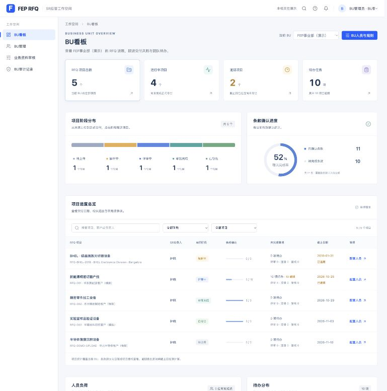
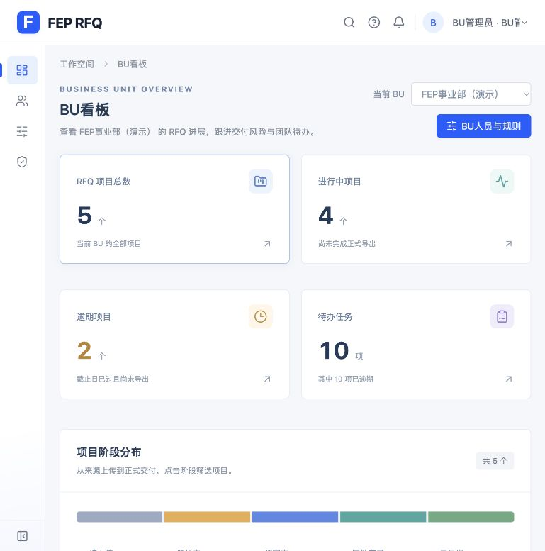
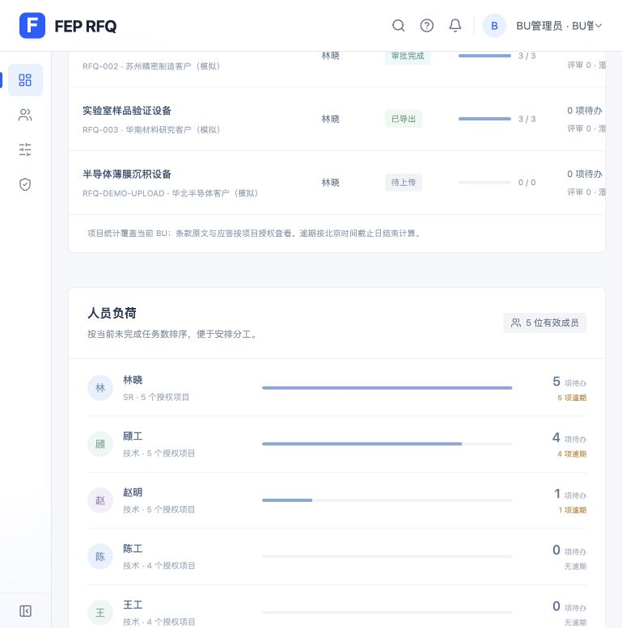
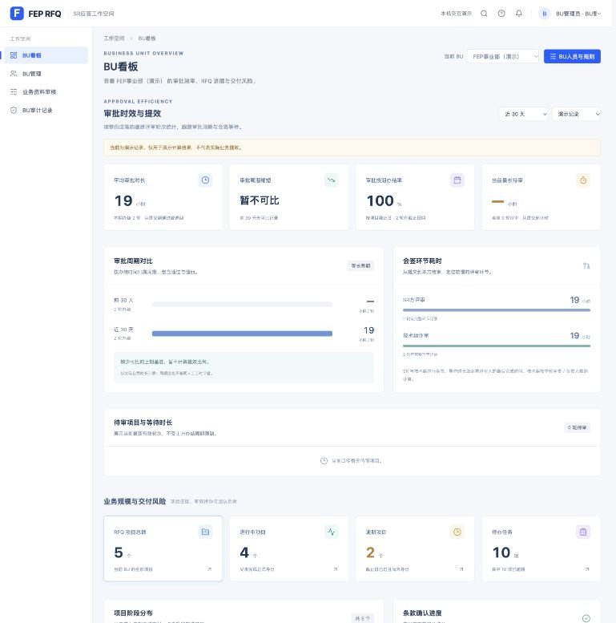
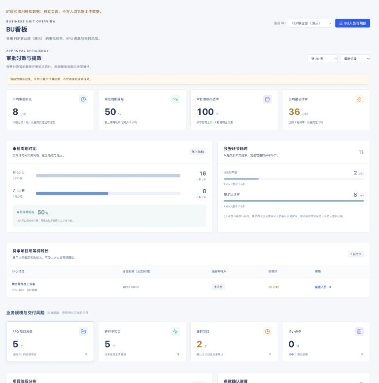
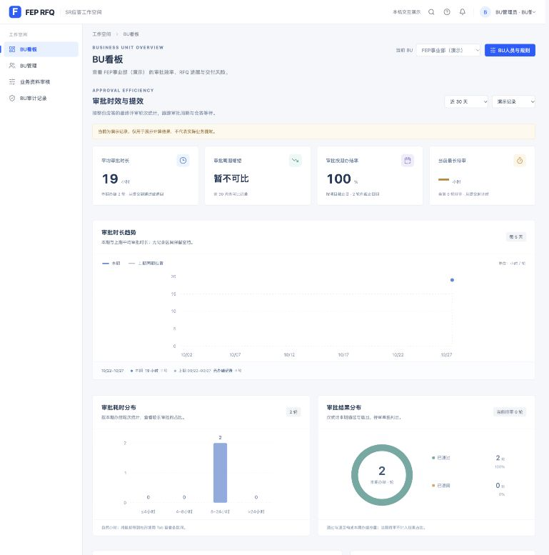
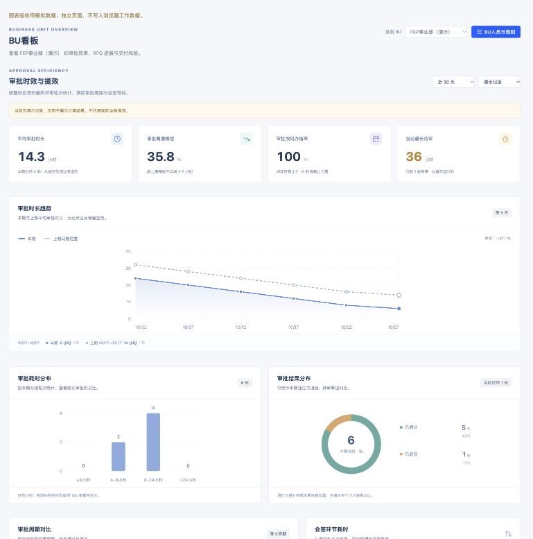
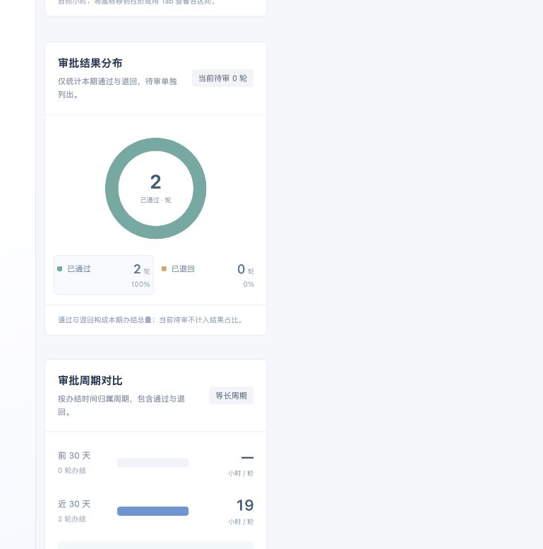

# BU 管理员看板验证

日期：2026-10-27。实现位于现有 `rfq-react-prototype`，未增加依赖。

## 功能

切换为 BU 管理员后，原工作台入口显示为“BU看板”。看板展示当前管理 BU 的 RFQ 总数、进行中项目、逾期项目、有效待办、项目阶段分布、条款确认进度、人员负荷及待办环节分布。支持选择获授权 BU、按项目／客户／负责人搜索、按阶段及关注条件筛选，提供人员配置、业务资料审核和 BU 审计入口。

项目表的“配置人员”跳转后自动选中该项目。BU 管理员只能看到概览元数据和汇总计数；条款原文、应答、快照及业务处理继续使用既有项目权限。

## 自动验证

新增七项汇总测试：

1. 项目、成员、任务只统计当前 BU；汇总不返回条款原文或应答。
2. 未授权 BU、停用管理员和业务角色均不能获取看板数据。
3. 旧管理员状态未保存当前 BU 时，默认显示首个获授权 BU；明确选中的未授权 BU 仍被拒绝。
4. 切换管理 BU 后项目、待办和人员计数重新计算。
5. 空 BU 为零值和空列表，不出现 NaN。
6. 项目与任务均在北京时间截止日结束后才计为逾期。
7. 已导出项目不计入进行中或逾期；应答变化后按当前有效阶段重新统计。

本功能七项测试全部通过。曾执行完整 `npm test`，170 项通过；最终复验时并行机型流程工作新增测试，完整结果为 172 项中 171 项通过，`reimporting a candidate moved to another process never duplicates its identity` 因该并行工作尚未提供 `prepareCapabilityImports` 而失败。该文件不属于看板改动，未改写。`npm run build` 和 `git diff --check` 通过。构建保留已有单包超过 500 kB 的提示。

## 浏览器验证

使用独立的 `127.0.0.1:5180` 存储，未重置用户其他端口的工作数据。

- BU 演示状态显示 5 个项目、4 个进行中、2 个逾期、10 项待办、52% 条款确认率；五种阶段各 1 个项目。
- 点击逾期指标显示 2 / 5 个项目；无匹配搜索显示空态，可清除筛选恢复全部。
- 选择已导出阶段显示 1 / 5 个项目，人员配置入口自动选中 RFQ-003。
- 全局搜索可找到“BU看板”；资料审核与审计跳转正常。
- 刷新后保留 BU 管理员身份；切回 SR 显示原有个人工作台。
- 检查 1440px 桌面容器及约 770px 窄屏布局，项目表通过内部水平滚动查看全部列。
- 多 BU 与空 BU 数据隔离由自动测试验证；浏览器默认演示目录只有一个 BU。

## 独立审查

只读审查发现旧状态缺少 activeBuId 时会误显示无权限。新增回归测试观察失败，再修复默认 BU 解析；七项看板测试全部通过。明确选中的未授权 BU 仍返回空，未放宽管理范围。

## 审批时效与提效补充验收

用户补充要求体现审批时长及提效。看板首屏已增加平均审批时长、相邻周期缩短比例、按期办结率及当前最长待审，支持7／30／90天和真实／演示口径。展示SR与技术组环节耗时、待审项目及等待方，原项目表增加最新审批用时。待审每分钟更新，不受已办结统计周期影响。

按整份应答的一轮最终评审统计连续自然小时；全员会签取最后必需人员意见时间，负责人模式忽略非必需成员；首个必需人员退回即办结。缺失、负时长、未来或无完整会签记录不视为零时长。按期率只使用有项目截止日的记录，按北京时间当天结束判断。周期缩短不等同人工工时节省。

新增9项测试覆盖周期、会签、代表模式、退回、实时待审、异常数据、重复记录及隔离。最终完整测试为 **181项全部通过**，上一轮并行机型导入测试也已恢复通过；生产构建及差异格式检查通过。独立只读审查无材料性问题。

浏览器使用独立模拟页验证：上期16小时、本期8小时显示缩短50%；SR2小时、技术组8小时；当前等待36小时且等待技术组。切换7天后仍保留当前待审。模拟页未写入浏览器工作状态，验证后删除。现有演示数据平均19小时、2轮办结，缺上期显示暂不可比；切到真实记录为空态。

## master 提交前验证

本次仅暂存 BU 看板与审批提效相关文件，保留其他并行修改。将暂存区中的 React 工程导出到独立临时目录运行检查，**175 项测试全部通过，生产构建通过**；与此前工作区的181项之差来自未纳入本次提交的机型工艺测试。

## 审批图表补充验收

新增本期／上期双折线趋势、审批耗时区间柱状图、审批结果环形图。7天逐日、30天每5天、90天每15天聚合；空区间断线，零时长保留有效点。柱形区间为≤4小时、4–8小时、8–24小时及>24小时。环形图只统计本期通过／退回，当前待审另列。图表与指标共用BU、周期和真实／演示口径。

新增6项聚合与坐标测试，完整189项测试通过。浏览器验证节点点击、Tab/Enter/Space读数、空态和筛选联动，1440px、约770px和390px布局通过。独立审查发现图例点击及手机裁切问题，修复后复测通过。独立模拟页显示连续双折线和5轮通过／1轮退回，不写入工作状态；页面已删除。现有工作数据只有一个有记录区间，显示真实单点而不补造历史。

