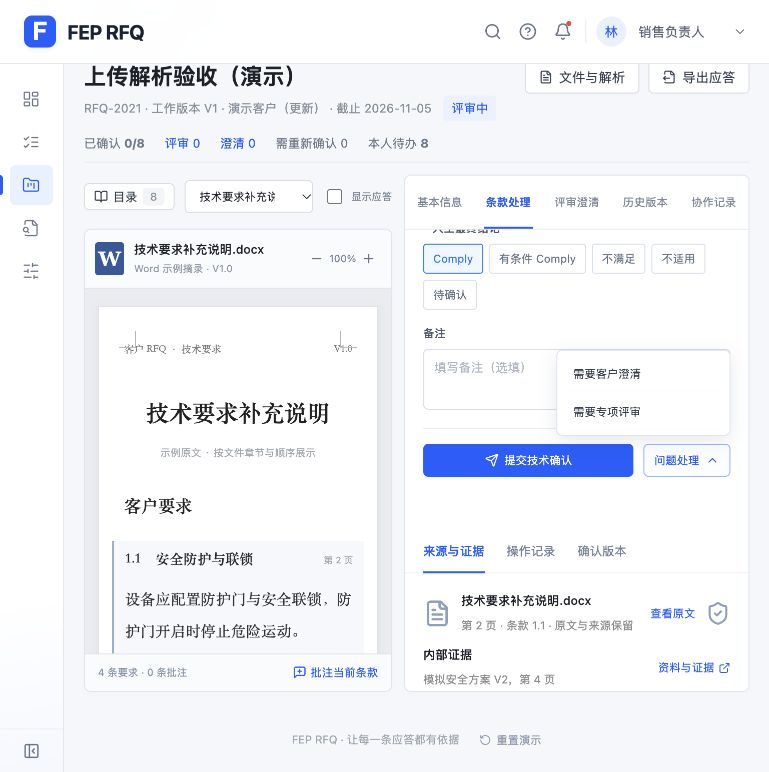

# RFQ 主流程操作收敛验收（2026-10-26）

已按用户批准方案收拢条款操作。

## 页面与交互

- 销售主操作显示：通过
- 销售不显示技术确认按钮：通过
- 澄清默认收起：通过
- 澄清表单不显示内部审批路线：通过
- 澄清表单不显示技术方案：通过
- 专项评审显示审批路线：通过
- 专项评审责任人为技术确认人：通过
- 专项评审类别不混入客户澄清：通过
- 切换条款时问题菜单收起：通过
- 提交后禁止重复提交：通过
- 技术只显示对应主操作：通过
- 技术完成本条确认：通过
- 审批人不出现条款主操作或问题入口：通过
- 审批人直达整份应答审批页：通过
- 澄清实际创建销售跟进事项：通过
- 专项评审实际创建并分派技术：通过
- 未完成专项评审时暂停提交确认：通过
- 销售看到技术已确认并禁止重复提交：通过
- 已确认条款可从问题处理重新专项评审：通过

## 自动验证

- npm test：108/108 通过。
- npm run build：成功；保留已有的单包大于 500 kB 提示。
- git diff --check：通过。

## 数据与截图

交互提交仅使用 localhost 的独立验收项目 RFQ-2019。127.0.0.1 只查看已有项目，未提交条款、澄清或评审。

