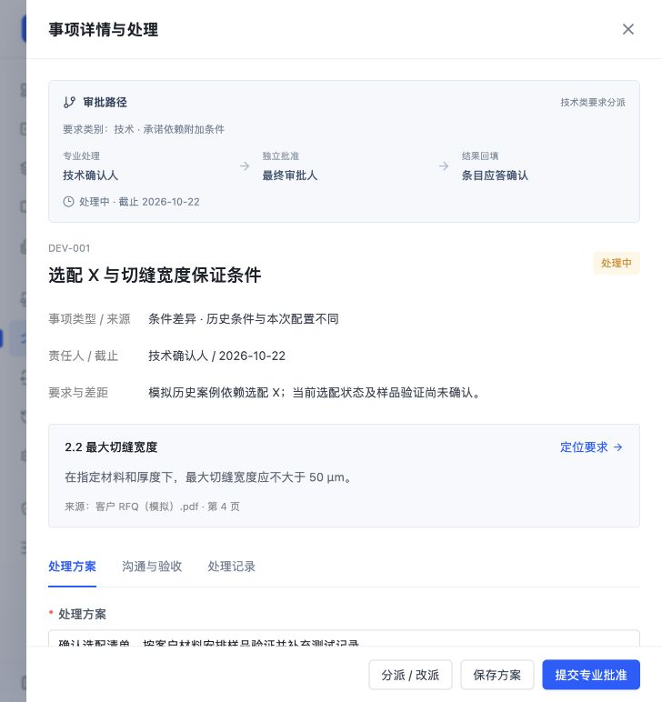
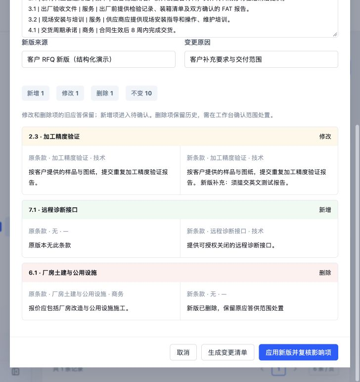

# RFQ 原型优化说明 · 2026-10-22

本次参考 SpotDraft、Concord、SAP／Icertis 的公开官方功能说明，更新 React 交互原型。采用它们的条目审查、条件审批和版本影响思路，结合 RFQ 应答场景重新组织交互，未逐屏复刻第三方界面。

## 优化什么、怎么优化、参考哪个

| 优化什么 | 原来的问题 | 怎么优化 | 参考哪个 |
| --- | --- | --- | --- |
| 条目差距与依据 | 只看结论、相似度和大段答复，不易判断差在哪里 | 在条目内并列展示客户要求值、当前能力值、单位换算、数值差距、适用条件和证据。条件或证据不足保持待澄清，不把数值接近当作满足。当前数值样例覆盖切缝宽度和交货周期。 | [SAP／Icertis：条款偏离和风险识别](https://www.sap.com/products/spend-management/ariba-contract-intelligence-by-icertis/product-tour.html)、[SpotDraft AI](https://www.spotdraft.com/demo-library/spotdraft-ai) |
| 条目内偏离处理 | 查看要求、填写应答、处理偏离需要切换列表 | 当前条目显示关联事项、责任人、截止日期和状态；点击即打开原有事项详情抽屉，直接保存方案、提交、批准或退回。复用原有独立审批和应答回填逻辑，关闭后仍停留当前条目。 | [SpotDraft：Approvals](https://www.spotdraft.com/demo-library/approvals-on-spotdraft)、[Workflow Manager](https://www.spotdraft.com/demo-library/workflow-manager) |
| 条件审批路径 | 责任人和触发原因不直观 | 按技术、商务、质量、服务类别读取项目职责配置，显示触发原因及“专业处理 → 独立批准 → 条目应答确认”。显示截止时间和逾期标识；缺少必要配置阻止提交。新版条款类别变化时同步更新未完成事项的职责。 | [Concord：条件审批、多级步骤、审批职责及提醒](https://www.concord.app/approval-workflows/) |
| 新版 RFQ 影响检查 | 手工勾选受影响条目，容易漏掉已有答复的影响 | 在版本记录新增“比对新版 RFQ”。按编号对齐结构化清单，展示新增、修改、删除、不变及旧／新标题、类别和原文。应用后仅受影响项待复核，保留旧答复及冻结快照；旧匹配失效，未完成评审重新处理。删除项保留历史并要求明确范围处置，恢复条款沿用原编号。 | [SAP／Icertis：版本比较、变更追溯和审批触发](https://www.sap.com/products/spend-management/ariba-contract-intelligence-by-icertis/product-tour.html) |
| 工作台处理入口 | 统计信息重复占用首屏，处理进度难以直接筛选 | 用“全部、待确认、评审处理中、已确认”带计数的处理队列直接筛选，删除原有大面积重复统计卡片；保留三栏和原有检索入口。 | [SpotDraft：分模块工作流和任务管理](https://www.spotdraft.com/demo-library) |

## 如何体验

1. 打开 [RFQ细则比对](http://127.0.0.1:5173/#/response)，选择条款 2.2，查看 50 μm 与 0.06 mm 的换算差距及待澄清条件；选择 4.1，查看 8 周与 12 周的交付差距。
2. 点击“关联偏离与评审”事项或“查看事项”，直接查看审批路径并处理原事项；未保存方案关闭时有保护，应答草稿的保护也保留。
3. 打开 [版本记录](http://127.0.0.1:5173/#/versions)，点击“比对新版 RFQ → 载入新版示例 → 生成变更清单”。初始演示项目会显示新增 1、修改 1、删除 1、不变 10。应用会修改当前浏览器的项目工作版本。
4. 顶部切换演示身份体验专业确认与独立批准。批准偏离不会直接确认对外应答。

## 原型范围与参考核验

- 保留名称“RFQ细则比对”，保留解析自动导入；未恢复解析人工比对、顶部“处理偏离／导出应答”按钮或知识页客户反馈。
- 差距数据与证据为明确标注的模拟样例，未连接实际能力数据库、OCR 或 AI 服务。新版检查接收按编号整理的完整结构化条款，当前不自动读取 PDF／Word。
- 审批条件使用现有项目职责配置；截止提醒为浏览器界面提示，没有发送邮件、短信或其他外部消息。
- SpotDraft 官方库已核验 AI、Approvals、Workflow Manager 模块；Concord 官方说明已核验条件审批、多级步骤、角色及提醒。SAP／Icertis 官方导览正文抓取超时，其公开官方搜索索引可核验偏离识别、版本比较、风险及内容触发审批；本次不声称逐屏完成其交互导览。

## 验证

- 22 项自动化测试通过，覆盖单位换算、条件及证据不足、责任配置、条款增改删、重复编号、空输入、删除恢复、人工应答保留、旧匹配失效、未完成事项重新分派。
- 浏览器验证：条目差距、原位偏离抽屉、审批路径、未保存保护、变更预览，以及独立本地样例环境内应用新版后的 V2 和三条影响记录。
- `npm run build` 与 `git diff --check` 均通过；构建有原型单包体积提示。
- 独立代码复核完成，发现的职责同步问题已修复并通过回归测试。

## 更新实屏

