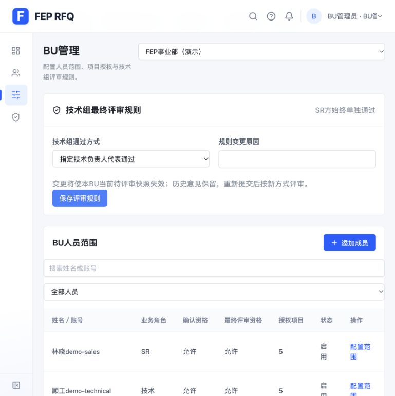
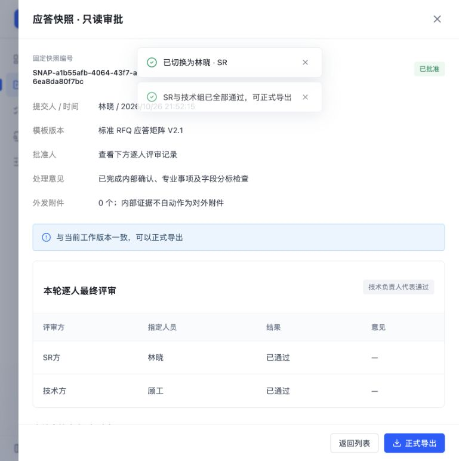

# RFQ 四角色与 BU 人员范围验证

日期：2026-10-26。实现位于现有 `rfq-react-prototype`，沿用React、Vite和本机存储，无新增依赖。工作分支为 `codex/rfq-bu-personnel`，进入任务前已有的导航顺序调整保留。

## 当前功能

- 四种基础角色为后台管理、BU管理员、SR、技术。顶部按具体人员及职责切换，支持多名技术成员；最终评审作为项目流程职责。
- 后台管理维护BU和账号目录，并配置BU管理员的管理范围；管理身份不自动获得业务原文或批准权。
- BU管理员维护本BU成员、启停、SR／技术角色、确认及最终评审资格、知识及能力发布资格、项目访问范围和技术组评审规则。
- 项目设置的“人员与最终评审”按资格选择SR、技术组、组内负责人、各条款确认人及专业事项批准人。
- SR提交快照后，本人仍须显式完成SR方评审；技术组按全员或指定负责人方式完成技术方评审。整份应答满足本轮所有必需人员通过后才开放SR正式导出。
- 必需评审人退回时取消本轮其他未完成任务；新轮次不沿用旧结果。名单、来源、应答、BU规则或资格变化后，当前待评审快照失效。
- 任务转办同步业务对象责任，保留到达时间、截止日期及历史；改派回原人会产生新的有效待办，不恢复或覆盖旧失效记录。
- 项目、草稿知识、客户来源、资料计数、搜索、详情及已删除项目记录按BU和项目范围过滤；共享已发布资料按对应BU范围开放。

## 数据兼容

旧销售身份映射为SR，旧技术及审批演示人员保留人员ID，使用相应技术资格。迁移不替换原项目、失败来源、人工应答或历史签署；旧单人审批不能用于新规则的正式导出，未知归属的项目及删除记录不会自动授予演示账号。

新建演示状态中的完整会签案例明确标为模拟数据，用于保持五种项目状态的演示。读取既有浏览器存储不会用这些模拟签署替换历史快照。缺少真实提交人标识的旧专业方案返回原责任人重新提交，方案和原轮次历史保留。

## 后续页面调整

- 移除应答页底部“当前引用证据、操作记录、确认版本”面板和失效提示，保留实际业务确认及历史数据。
- 评审澄清四项统计及处理状态筛选统一为“总应答项、未处理、已审核、待确认”；沿用实际处理阶段，筛选与计数一致。
- 有条件Comply、不满足、不适用及待确认均按当前条款、条件和备注生成推荐话术；Comply不展示。建议可编辑、重新生成及明确采用，不自动覆盖人工应答。采用的话术随原有提交或确认流程保存。
- 在独立localhost:5175存储中验证四种口径、备注联动、手动编辑、重新生成、采用并提交技术确认；显示应答可看到实际保存的话术，切换条款后不会串用建议。

## 自动验证

基线115项测试通过。当前151项测试全部通过（四角色与范围功能146项，推荐话术新增5项），新增人员范围、双侧评审、技术组两种方式、权限撤销、规则失效、任务转办、循环改派、未知数据迁移及资料隔离等回归。关键用例均先观察失败再实现通过。

生产构建通过，`git diff --check`通过。构建仍有既有的单包超过500 kB提示。

## 浏览器验收

使用独立的 `http://localhost:5174` 演示存储，未重置用户的 `127.0.0.1` 存储。

1. 全员模式：在RFQ-002提交新快照，产生林晓、顾工、王工、陈工四人的独立评审记录。SR及两名技术通过后仍不可正式导出，最后一名技术通过后整份批准。技术不能导出，切回SR后实际生成正式CSV并显示已导出。
2. 代表模式：BU管理员改为负责人代表通过，重新提交的快照只生成SR与顾工两条必需评审。王工不能代替负责人审批；顾工先通过时仍待SR，SR通过后整份批准。
3. 退回重提：指定技术负责人填写原因退回整份快照，SR本轮未完成任务取消；SR重新提交后双方均重新显示待评审，无旧票沿用。
4. 规则变更：待评审期间BU管理员改回全员模式，旧轮次立即显示失效，原通过按钮禁用。
5. 人员及资料范围：将刘工加入BU但不授权任何项目；其看不到RFQ-001草稿知识、DOC-015客户来源及DOC-009项目附件，仍能查看获授权BU的共享资料。项目原文直达地址明确拒绝访问。
6. 新建项目：SR新建“RFQ-2019 四角色新项目验收”并补录条款，BU管理员授权顾工参与，SR按实际人员分派条款确认并配置技术组；顾工确认成功，不依赖旧的专业角色字符串配置。
7. 任务转办：顾工将RFQ-001的确认任务转办王工，王工可以接手，进入条款后确认操作有效；原到达时间和截止日期保留。
8. 跨BU：平台新增第二事业部并分配管理职责，切换BU后人员和项目清单为空，其知识页没有带入FEP的知识、资料及计数。

## 独立复核

独立只读代码复核发现并已修复：未知项目自动授权、旧演示替换历史签署、循环改派没有有效待办、转办未同步责任ID、新建项目依赖旧类别职责、资料越权、移交校验错误目标以及已删除项目名称泄露。各项均有对应的失败后通过回归；完整测试在修复后通过。

实现将纯投票判断放入独立领域模块，保留旧独立辅助接口的兼容行为；当前应用的实际写入统一使用已迁移的人员上下文。分支和修改保留在当前工作目录，方便在现有导航改动基础上审阅。

## 实现边界

这是本机交互原型，账号切换为明确标注的演示身份；企业登录、服务端鉴权、组织同步与多用户共享存储尚未接入。文件解析及运行信息仍遵循现有演示边界。

## 页面截图

