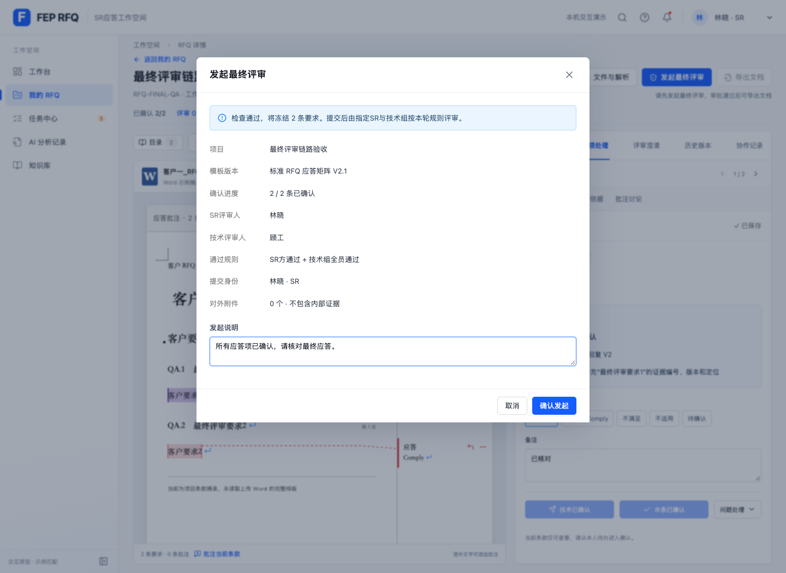
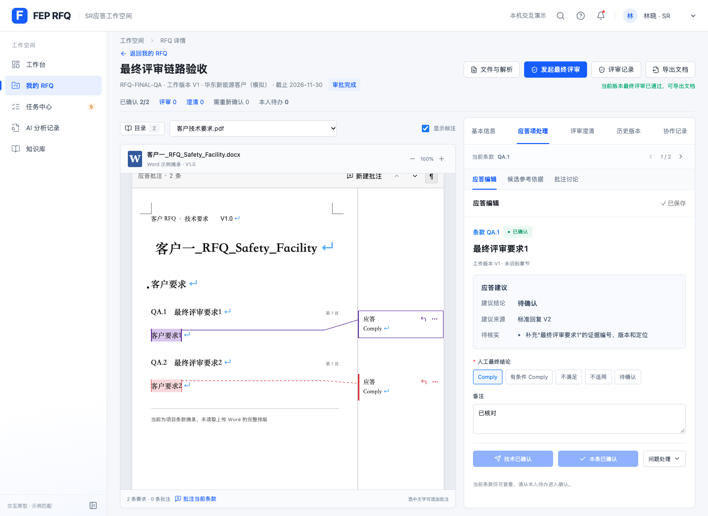

# RFQ 最终评审入口验证

日期：2026-10-27

## 本次交互

- RFQ详情顶部增加「发起最终评审」，在当前应答页面弹窗发起流程。
- 弹窗展示确认进度、SR评审人、技术评审人、通过规则和发起说明；未通过检查时阻止发起并提供定位修正。
- 提交后冻结当前应答并生成指定人员的最终评审待办；顶部可「查看最终评审」。
- 顶部和阶段导航的「导出文档」均在最新有效快照全部通过后启用。应答、来源、模板映射或评审人员变化后重新禁用，退回后也不能沿用旧批准。
- 技术人员仍从评审入口和任务中心审批；文档由SR下载。

## 验证结果

- Node完整测试：216项通过，0失败；新增门禁测试4项。
- Vite构建通过；原有大于500kB的包体积提示仍存在。
- `git diff --check`通过。
- 使用无持久化Chrome上下文和`http://localhost:5173`独立测试项目`RFQ-FINAL-QA`，未修改用户浏览器中已有项目。
- 浏览器验证：未确认阻止发起、取消不创建快照、实际技术确认、弹窗显示评审人员与规则、发起说明保存、生成2条最终评审待办、仅SR通过仍锁定、技术通过待办完成评审、双方通过后SR解锁、刷新后保持有效、实际下载正式CSV、保存应答修改后重新锁定、新轮次退回后锁定。
- 独立审查发现映射修正跳转和同页详情重开两处P2；先用浏览器复现失败，修正后验证映射可修正、详情可反复关闭重开，完整验收无页面错误。

## 截图

本次沿用现有前端原型的评审与导出机制，没有新增后端接口。
