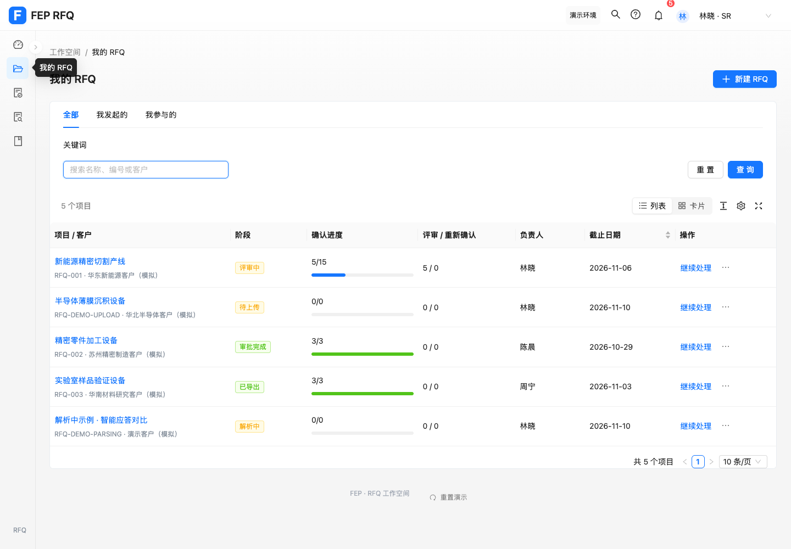
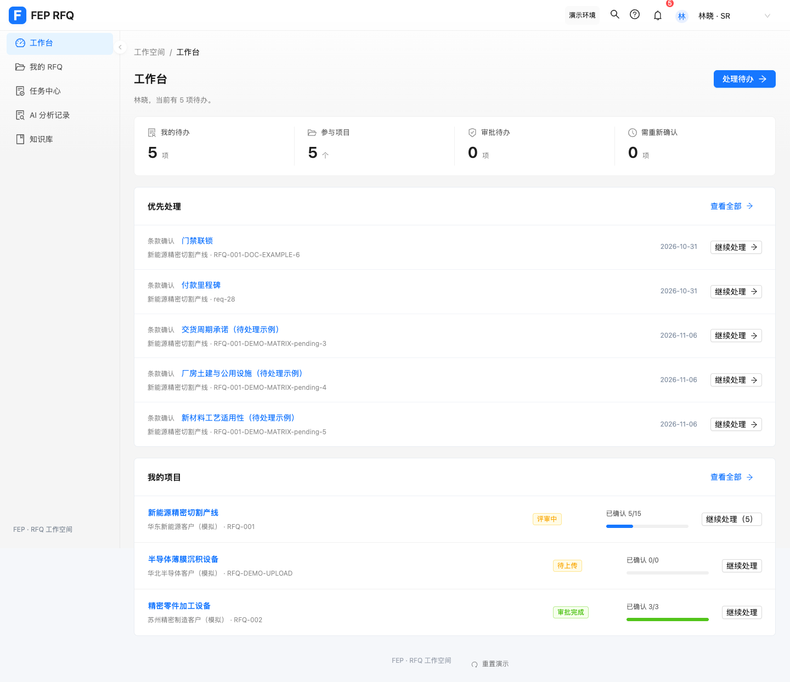

# RFQ 界面层级与切换优化

本次把“AI 味”视为界面编排问题：重复标题与泛化说明、层层同权重卡片、过多同级操作，以及动效与工作节奏不一致。这里记录实际改动和验证，不把审美判断当作用户效率的量化结论。

## 已落地

| 问题 | 调整 |
| --- | --- |
| 知识区先显示“知识管理”，再显示当前页标题 | 保留当前页一个主标题，区域切换使用原生 Tabs。 |
| 统计卡、任务、项目都争抢视觉注意 | 工作台显示实际用户与待办摘要；统计合成一条概览，项目改为紧凑行，保留一个主要行动。 |
| 项目列表工具栏重复，每行四个并列操作 | 合并计数、视图和表格工具；主入口保留，编辑、移交和删除进入原生 Dropdown；权限条件保持原有规则。 |
| 列表和卡片切换缺少连续感 | 原生 Segmented，结果区短距离过渡，切换后焦点回到当前选项。 |
| 查询表单占据过多首屏 | 任务常用三项与查询操作排列一行，“仅逾期”移至表格工具栏；查询保留该条件，重置时清除。 |
| 确认卡片旋转飞出，出入共 780ms | 去掉旋转与大幅位移，改为小幅平移和淡入淡出，出入配置合计 300ms。 |
| 中等窗口时工作台项目操作被裁切 | 根据内容容器宽度切换两列布局；覆盖侧栏展开状态。 |

## 切换规则

| 场景 | 动效配置 |
| --- | --- |
| 侧栏页面 | 180ms，向上 5px 与淡入 |
| 内容 Tab | 150ms，按切换方向平移 8px |
| 列表 / 卡片 | 150–180ms，短距离过渡 |
| 确认应答卡片 | 退出 140ms + 进入 160ms，位移 16px |

内容更新不反复播放入场动效；快速切换会取消旧动效。系统设置“减少动态效果”时跳过自定义动画，确认和下一条流程继续执行。原生弹窗、抽屉、Tabs、下拉菜单沿用 antd 动效。设计参考 [Ant Design 动效规范](https://ant.design/docs/spec/motion/)。

## 验证

- `npm test`：327 项通过，0 失败、0 跳过；新增 3 项动效行为测试。
- `npm run build` 和 `git diff --check`：通过；保留既有的大依赖块提示。
- 浏览器记录到页面、任务 Tab、知识 Tab、视图四类真实动画；减少动态效果时自定义动画调用为零。
- 卡片/列表切换数量一致，切换后焦点保留；移交和删除菜单能打开原有弹窗。
- “仅逾期”经过查询后仍选中，重置后清除。
- 修改人工最终结论后，离开页面触发未保存提示；取消切换与放弃修改正常。
- 900px 侧栏展开、800px、390px 下工作台项目操作未裁切；手机任务页无页面横向溢出。
- 最终浏览器未捕获 page error、console error 或 console warning。
- 独立代码复核发现的布局裁切已复现、修复并通过回归。

## 预览

[切换演示](prototype-updates/2026-10-30-ui-polish.webm) · [优化前项目页](prototype-updates/2026-10-30-ant-content-projects.png)

