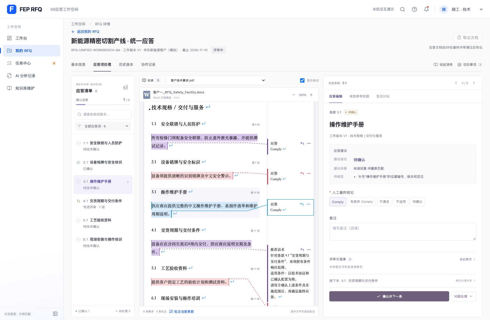

# 统一应答工作台验证

日期：2026-10-28。

- 应答项和评审澄清合并为「应答项处理」。左侧常驻条款队列，搜索及全部／本人待办／评审／澄清／已确认筛选；原文和应答同步定位。
- 条款关联事项以紧凑摘要展示；项目事项集中查看，点击后定位条款并打开原有处理抽屉。旧 reviews 页面和任务链接继续可用。
- 有效的未修改应答可一键确认并进入下一项。编辑过的内容继续要求填写修改原因；SR提交后进入下一待提交项，不计为技术已确认。
- 按当前筛选队列向后查找，队尾最多回找一次，跳过已完成和无本人权限的项。更新当前来源和版本，清除旧任务、评审和动作上下文；保留任务中心返回入口。
- 反馈展示已完成条款、下一项和队列收尾，可返回刚处理的条款核对。该入口不撤销业务确认。
- 保留原文标注、批注、未保存离开拦截、评审建议采用、最终评审和导出门禁；宽屏三栏，窄屏逐区排列。

验证：

- 基线223项测试通过；新增队列与上下文测试10项，最终233项全部通过。
- `npm run build` 成功，保留已有单包大于500 kB提示；`git diff --check`通过。
- 独立Chrome存储内项目 `RFQ-UNIFIED-WORKBENCH-QA`：真实确认及原文定位、旧任务清理、待评审阻断、反馈返回、项目事项选择、修改原因、未保存保护、本人权限过滤、队尾回找、SR提交、旧评审链接、刷新和390／1024／1440／1680宽度检查通过，无页面异常。
- 浏览器脚本 `/private/tmp/rfq-unified-workbench-qa.cjs`。仅隔离会话写入验收数据，未修改用户浏览器已有项目。
- 独立代码审查发现一处P2：从条款待办发起新评审时携带旧任务，事项按钮只读。先用真实浏览器复现失败，修正为进入评审对象上下文，同时保留匹配的评审任务；新增2项上下文单测和浏览器实际保存方案回归通过。
- 同时验证连点防护不会阻止用户明确手动切换后的确认。

