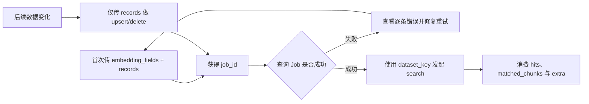
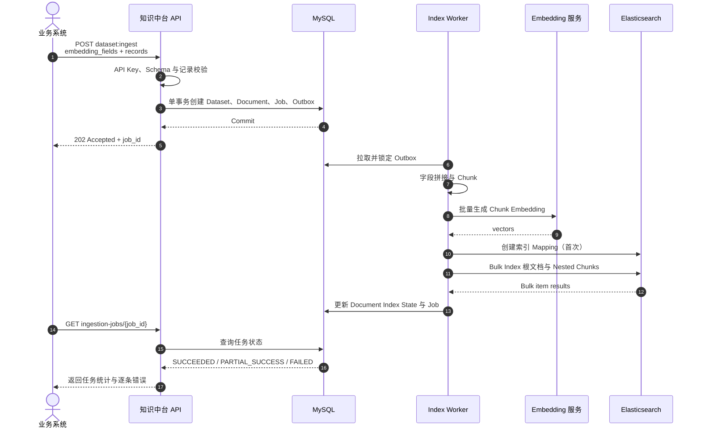
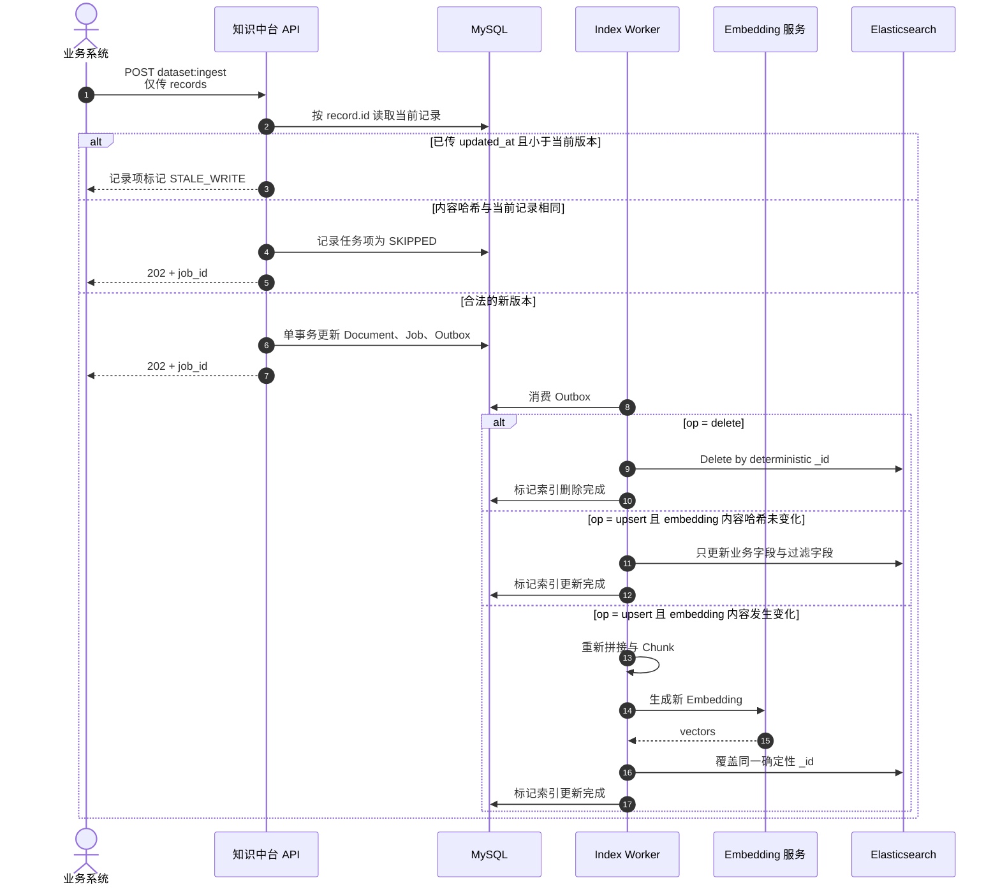
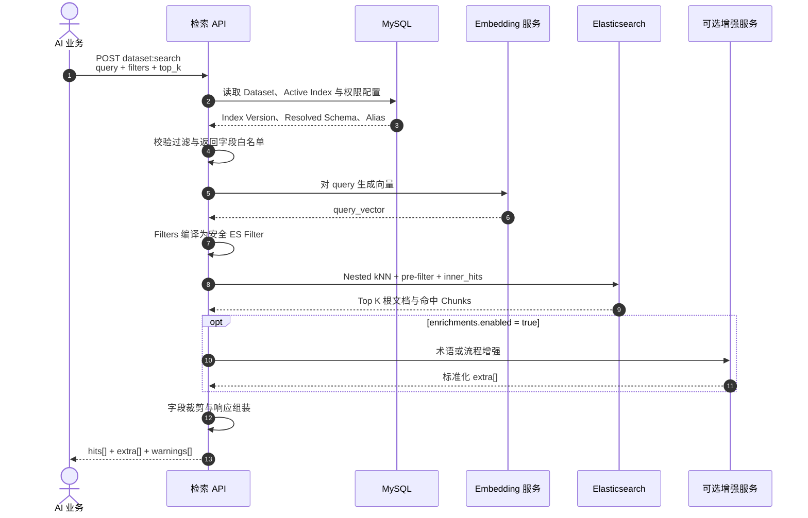
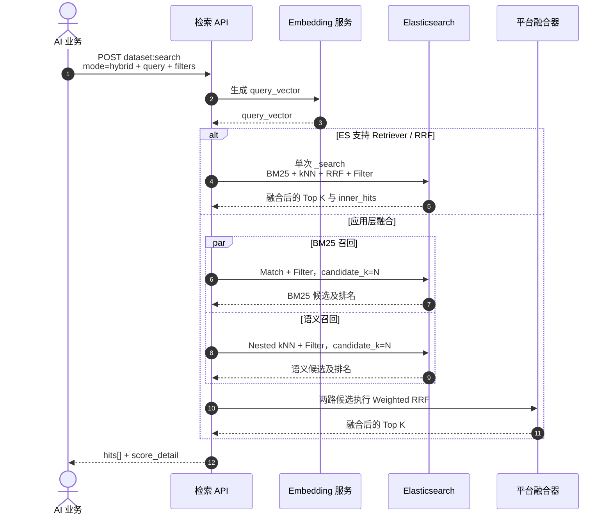
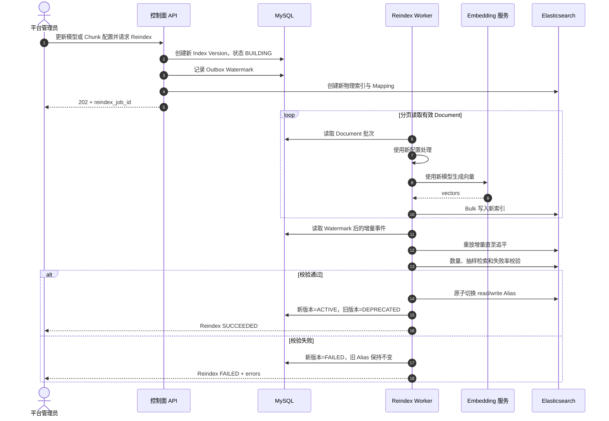

# 知识中台语义存储与检索接口文档（v1）

> 文档用途：提供给业务系统研发和 AI 应用研发，用于接口接入与联调。  
> 技术实现：MySQL + Elasticsearch。  
> 说明：本文只描述对外接口契约和调用时序，不展开内部架构设计。

## 1. 接口概览

### 1.1 核心接口

| 接口 | 方法 | 用途 |
| --- | --- | --- |
| `/api/v1/semantic-datasets/{dataset_key}:ingest` | POST | 首次创建数据集，以及日常新增、更新和删除记录 |
| `/api/v1/semantic-datasets/{dataset_key}:search` | POST | 语义检索、关键词检索、混合检索及字段过滤 |
| `/api/v1/ingestion-jobs/{job_id}` | GET | 查询异步入库任务状态和逐条错误 |

### 1.2 核心概念

| 概念 | 说明 |
| --- | --- |
| `dataset_key` | 数据集稳定标识，例如 `product.requirement`，不要求等于实际数据库表名。 |
| Record | 一条业务记录，通过调用方提供的 `id` 唯一标识。 |
| Document | 平台内部保存的业务记录镜像。 |
| Chunk | 由参与 embedding 的字段内容切分得到的检索单元。 |
| Job | 异步入库任务。收到 `202` 后，通过 `job_id` 查询最终状态。 |

### 1.3 业务调用方最简流程



## 2. 通用约定

### 2.1 Base URL

```text
/api/v1
```

### 2.2 鉴权

所有请求只需携带平台分配的 API Key：

```http
X-API-Key: <api-key>
Content-Type: application/json
```

本版本不设计租户参数。调用方不需要传应用 ID、请求 ID 或幂等键。平台可以自动生成 `request_id` 用于日志排查，但它不是调用方必须管理的字段。

### 2.3 数据格式

- 时间使用 ISO 8601 UTC，例如 `2026-11-05T03:20:00Z`；
- JSON 字段使用 `snake_case`；
- 枚举值使用小写；
- 调用方应忽略响应中无法识别的新增字段，以便保持前向兼容。

### 2.4 标准错误响应

```json
{
  "error": {
    "code": "FILTER_FIELD_NOT_ALLOWED",
    "message": "field 'impact_function' is not in the filter field allowlist",
    "details": [
      {
        "field": "filters.impact_function",
        "reason": "not_filter_field"
      }
    ],
    "request_id": "req_01J..."
  }
}
```

## 3. 数据集入库接口

### 3.1 接口定义

```http
POST /api/v1/semantic-datasets/{dataset_key}:ingest
```

用途：

- 数据集不存在时，根据 `dataset_config` 创建数据集；
- 数据集存在时，批量新增、覆盖或删除业务记录；
- 异步完成字段拼接、chunk、embedding 和 Elasticsearch 索引写入。

`dataset_key` 示例：`product.requirement`。

### 3.2 最简首次调用

首次调用只需要声明参与 embedding 的字段，并提交首批业务记录：

```http
POST /api/v1/semantic-datasets/product.requirement:ingest
X-API-Key: <api-key>
Content-Type: application/json
```

```json
{
  "dataset_config": {
    "display_name": "产品需求",
    "embedding_fields": [
      "requirement_summary",
      "requirement_detail"
    ]
  },
  "records": [
    {
      "id": "REQ-10001",
      "data": {
        "department": "产品部",
        "requirement_source": "客户A",
        "requirement_summary": "支持审批流条件分支",
        "requirement_detail": "不同金额和客户等级应进入不同审批节点。"
      }
    }
  ]
}
```

其中，`id` 是业务唯一主键，例如需求 ID。它不要求再次出现在 `data` 中；检索响应会以 `source_id` 返回该值。

### 3.3 日常增量入库

数据集创建完成后，不再传 `dataset_config`，只传发生变化的完整记录：

```json
{
  "records": [
    {
      "id": "REQ-10001",
      "updated_at": "2026-11-05T03:20:00Z",
      "data": {
        "department": "产品部",
        "requirement_source": "客户A",
        "requirement_summary": "支持审批流条件分支",
        "requirement_detail": "更新后的需求内容。"
      }
    },
    {
      "id": "REQ-10002",
      "data": {
        "department": "解决方案部",
        "requirement_source": "客户B",
        "requirement_summary": "支持审批超时提醒",
        "requirement_detail": "审批节点停留超过两天后自动提醒。"
      }
    }
  ]
}
```

`updated_at` 可选：

- 传入时，平台可以拒绝晚到的旧版本；
- 不传时，按平台实际接收顺序采用最后写入生效；
- 业务侧存在并发更新或消息乱序时，建议传入。

### 3.4 删除记录

```json
{
  "records": [
    {
      "id": "REQ-09999",
      "op": "delete",
      "updated_at": "2026-11-05T03:21:00Z"
    }
  ]
}
```

`op` 省略时默认为 `upsert`。删除操作不需要传 `data`，重复删除视为成功。

### 3.5 请求字段

#### 首次数据集配置

| 字段 | 类型 | 必填 | 说明 |
| --- | --- | --- | --- |
| Path 中的 `dataset_key` | string | 是 | 平台内唯一的稳定逻辑名称。 |
| `dataset_config.embedding_fields` | string[] | 是 | 一个或多个参与 embedding 的字段名。 |
| `dataset_config.display_name` | string | 否 | 数据集展示名称。 |
| `records` | object[] | 是 | 首批业务记录，同时用于解析字段集合和默认类型。 |

#### `records[]`

| 字段 | 类型 | 必填 | 默认值 | 说明 |
| --- | --- | --- | --- | --- |
| `id` | string | 是 | - | 业务唯一主键的字符串表示。 |
| `data` | object | upsert 必填 | - | 需要镜像的业务字段完整快照，不是局部 patch。 |
| `op` | enum | 否 | `upsert` | `upsert` 或 `delete`。 |
| `updated_at` | datetime | 否 | 平台接收时间 | 源记录更新时间，用于防止乱序旧写覆盖新数据。 |

#### `options`

| 字段 | 类型 | 必填 | 默认值 | 说明 |
| --- | --- | --- | --- | --- |
| `on_record_error` | enum | 否 | `continue` | 单条失败后继续处理其他合法记录；可选 `abort`。 |
| `wait_for_completion_ms` | integer | 否 | `0` | 同步等待任务的最长毫秒数，建议最大 30 秒。 |

### 3.6 平台默认规则

调用方未提供高级配置时，平台按以下规则解析：

| 项目 | 默认行为 |
| --- | --- |
| 字段集合 | 由首批 `records[].data` 的字段并集确定。后续出现未知字段时，拒绝该记录并提示更新配置。 |
| Embedding 字段 | 自动按 `text` 处理，参与 BM25 和 embedding，默认不做精确条件过滤。 |
| 其他字符串字段 | 默认按 `keyword` 处理，可进行 `eq`、`in` 等精确过滤。 |
| 整数、浮点、布尔字段 | 自动解析为对应类型，默认可过滤。 |
| 日期字段 | 默认按字符串处理；需要范围查询时，在高级配置中声明为 `datetime`。 |
| 返回字段 | `data` 中的字段默认全部可返回。 |
| 字段拼接 | 按 `字段名：字段值` 和 `embedding_fields` 顺序拼接，跳过空值。 |
| Chunk | `auto`：短文本保留为一个 chunk，超长后按段落、句子和 token 递归切分。 |
| Embedding | 使用平台默认模型和模型默认维度。 |
| 距离算法 | `cosine`。 |
| 关键词索引 | 默认开启，使用平台统一的中文 analyzer。 |

### 3.7 可选高级配置

只有默认规则不满足时才需要提供：

```json
{
  "dataset_config": {
    "display_name": "产品需求",
    "embedding_fields": [
      "requirement_summary",
      "requirement_detail"
    ],
    "advanced": {
      "field_types": {
        "created_at": "datetime",
        "priority": "integer"
      },
      "filter_fields": [
        "department",
        "requirement_source",
        "created_at",
        "priority"
      ],
      "return_fields": [
        "department",
        "requirement_source",
        "requirement_summary",
        "requirement_detail",
        "created_at",
        "priority"
      ],
      "text_template": "需求概述：{{requirement_summary}}\n需求详述：{{requirement_detail}}",
      "chunk": {
        "strategy": "recursive_text",
        "unit": "token",
        "max_size": 512,
        "overlap": 64
      },
      "embedding": {
        "model": "platform-default-embedding",
        "dimension": null
      }
    }
  },
  "records": []
}
```

| 字段 | 说明 |
| --- | --- |
| `field_types` | 覆盖平台推断类型。可选 `keyword`、`text`、`integer`、`number`、`boolean`、`datetime`、`keyword_array`。 |
| `filter_fields` | 显式过滤字段白名单。传入后以该列表为准；记录 `id` 始终可以精确过滤。 |
| `return_fields` | 显式返回字段白名单。未传则默认返回全部业务字段。 |
| `text_template` | 覆盖默认字段标签拼接模板。 |
| `chunk` | 覆盖平台 `auto` chunk 策略。 |
| `embedding` | 选择平台白名单模型；维度通常无需填写。 |

### 3.8 成功响应

异步接收成功：

```http
HTTP/1.1 202 Accepted
```

```json
{
  "request_id": "req_01J...",
  "job_id": "ing_01J...",
  "dataset": {
    "dataset_key": "product.requirement",
    "dataset_id": "ds_01J...",
    "config_version": 1,
    "status": "creating"
  },
  "accepted_count": 1,
  "rejected_count": 0,
  "job_status": "pending",
  "resolved_config": {
    "embedding_model": "platform-default-embedding@2026-09",
    "embedding_dimension": 1024,
    "distance_metric": "cosine",
    "chunk_strategy": "auto",
    "filter_fields": [
      "department",
      "requirement_source"
    ],
    "return_fields": [
      "department",
      "requirement_source",
      "requirement_summary",
      "requirement_detail"
    ]
  },
  "status_url": "/api/v1/ingestion-jobs/ing_01J..."
}
```

若在 `wait_for_completion_ms` 内完成，可返回 `200 OK`，且 `job_status` 为 `succeeded` 或 `partial_success`。

### 3.9 重复请求与一致性

- 调用方不需要传 `Idempotency-Key`；
- `dataset_key + record.id` 唯一，相同记录重复 upsert 的最终状态一致；
- 内容哈希没有变化时，平台跳过重复 chunk 和 embedding；
- 相同请求重复提交可能产生多个 Job，但不会产生多份业务记录；
- 传入 `updated_at` 时，平台拒绝更旧版本；未传时按最后接受写入生效；
- 重复 delete 视为成功；
- `202` 只表示已接收，不表示已可检索；
- Job 为 `succeeded` 后，平台才承诺该批次对查询可见；
- Job 为 `partial_success` 时，仅成功记录可见。

## 4. 入库任务状态接口

### 4.1 接口定义

```http
GET /api/v1/ingestion-jobs/{job_id}
X-API-Key: <api-key>
```

### 4.2 成功响应

```json
{
  "job_id": "ing_01J...",
  "status": "partial_success",
  "total_count": 100,
  "succeeded_count": 98,
  "failed_count": 2,
  "skipped_count": 0,
  "errors": [
    {
      "id": "REQ-10020",
      "code": "FIELD_TYPE_MISMATCH",
      "message": "field 'department' must be a string"
    },
    {
      "id": "REQ-10021",
      "code": "STALE_WRITE",
      "message": "updated_at is older than the stored record"
    }
  ]
}
```

任务状态：

- `pending`
- `running`
- `partial_success`
- `succeeded`
- `failed`
- `cancelled`

## 5. 数据集检索接口

### 5.1 接口定义

```http
POST /api/v1/semantic-datasets/{dataset_key}:search
```

在指定数据集的当前索引版本上执行语义、关键词或混合检索，并可叠加业务字段过滤。

### 5.2 最简调用

只做语义检索时，仅需传查询文本：

```http
POST /api/v1/semantic-datasets/product.requirement:search
X-API-Key: <api-key>
Content-Type: application/json
```

```json
{
  "query": "有没有类似的按客户等级配置审批分支的需求？"
}
```

默认使用 `semantic`，返回 10 条业务记录及每条记录最相关的一个 chunk。

### 5.3 简洁的过滤与混合检索

```json
{
  "query": "有没有类似的按客户等级配置审批分支的需求？",
  "mode": "hybrid",
  "filters": {
    "requirement_source": "客户A",
    "department": [
      "产品部",
      "解决方案部"
    ]
  },
  "top_k": 5
}
```

简洁过滤规则：

- 标量值表示 `eq`；
- 数组值表示 `in`；
- 多个字段之间使用 `and`；
- 更复杂的 `or`、范围和存在性判断使用高级 `filter` DSL。

### 5.4 简洁请求字段

| 字段 | 类型 | 必填 | 默认值 | 说明 |
| --- | --- | --- | --- | --- |
| `query` | string | 是 | - | 查询文本。 |
| `mode` | enum | 否 | `semantic` | `semantic`、`keyword` 或 `hybrid`。 |
| `filters` | object | 否 | 无 | 简洁的等值或列表过滤。 |
| `top_k` | integer | 否 | `10` | 最终返回的业务记录数，建议范围 `1..100`。 |
| `fields` | string[] | 否 | 全部默认返回字段 | 本次希望返回的业务字段子集。 |

### 5.5 可选高级检索配置

```json
{
  "query": "有没有类似的按客户等级配置审批分支的需求？",
  "retrieval": {
    "mode": "hybrid",
    "semantic": {
      "candidate_k": 100
    },
    "keyword": {
      "candidate_k": 100
    },
    "fusion": {
      "method": "rrf",
      "semantic_weight": 0.7,
      "keyword_weight": 0.3
    }
  },
  "filter": {
    "and": [
      {
        "field": "requirement_source",
        "op": "eq",
        "value": "客户A"
      },
      {
        "field": "created_at",
        "op": "gte",
        "value": "2026-01-01T00:00:00Z"
      }
    ]
  },
  "top_k": 5,
  "result_options": {
    "max_chunks_per_hit": 2,
    "return_fields": [
      "requirement_source",
      "requirement_summary",
      "requirement_detail"
    ],
    "include_matched_chunks": true,
    "include_score_detail": true
  },
  "enrichments": {
    "enabled": true,
    "types": [
      "terminology",
      "process_hint"
    ],
    "failure_mode": "ignore"
  }
}
```

`mode` 与 `retrieval` 二选一；`filters` 与 `filter` 二选一。

| 字段 | 默认值 | 说明 |
| --- | --- | --- |
| `retrieval.semantic.candidate_k` | `max(top_k*10, 50)` | 语义初召回候选数。 |
| `retrieval.keyword.candidate_k` | `max(top_k*10, 50)` | 关键词初召回候选数。 |
| `retrieval.fusion.method` | `rrf` | 混合检索融合方法。 |
| `retrieval.fusion.semantic_weight` | `0.5` | 语义召回权重。 |
| `retrieval.fusion.keyword_weight` | `0.5` | 关键词召回权重。 |
| `result_options.max_chunks_per_hit` | `1` | 每条业务记录最多返回的命中 chunk 数。 |
| `result_options.return_fields` | 数据集默认 | 本次返回字段子集。 |
| `result_options.include_matched_chunks` | `true` | 是否返回命中 chunk。 |
| `result_options.include_score_detail` | `false` | 是否返回各路召回分数。 |
| `enrichments.enabled` | `false` | 是否调用术语、流程等增强服务。 |
| `enrichments.failure_mode` | `ignore` | 增强失败是否影响主检索。 |

### 5.6 高级 Filter DSL

```json
{
  "and": [
    { "field": "requirement_source", "op": "eq", "value": "客户A" },
    {
      "or": [
        { "field": "priority", "op": "gte", "value": 3 },
        { "field": "created_at", "op": "gte", "value": "2026-01-01T00:00:00Z" }
      ]
    }
  ]
}
```

| 操作符 | 适用类型 | 说明 |
| --- | --- | --- |
| `eq`, `neq` | 全部标量 | 相等或不等 |
| `in`, `not_in` | 全部标量 | 值在或不在列表中 |
| `gt`, `gte`, `lt`, `lte` | number、integer、datetime | 范围比较 |
| `exists` | 全部 | 字段是否存在且非 null |
| `contains_any`, `contains_all` | keyword_array | 数组包含 |

约束：

- 只能使用平台解析后的过滤字段白名单；
- 值必须符合字段类型；
- 不接受 SQL、脚本、正则表达式或 Elasticsearch DSL；
- 所有结果必须满足过滤条件；不足 `top_k` 时返回实际数量；
- 不返回原始 embedding 向量。

### 5.7 成功响应

```http
HTTP/1.1 200 OK
```

```json
{
  "request_id": "req_01J...",
  "dataset_key": "product.requirement",
  "index_version": 3,
  "retrieval_mode": "hybrid",
  "took_ms": 86,
  "total_returned": 2,
  "hits": [
    {
      "rank": 1,
      "source_id": "REQ-10001",
      "score": 0.0318,
      "score_detail": {
        "fusion_method": "rrf",
        "semantic_rank": 1,
        "semantic_score": 0.8731,
        "keyword_rank": 3,
        "keyword_score": 12.47
      },
      "fields": {
        "requirement_source": "客户A",
        "requirement_summary": "支持审批流条件分支",
        "requirement_detail": "不同金额和客户等级应进入不同审批节点。"
      },
      "matched_chunks": [
        {
          "chunk_id": "chk_01J...",
          "chunk_index": 0,
          "content": "需求概述：支持审批流条件分支\n需求详述：不同金额和客户等级应进入不同审批节点。",
          "score": 0.8731,
          "highlights": [
            "客户等级",
            "审批节点"
          ]
        }
      ]
    },
    {
      "rank": 2,
      "source_id": "REQ-08731",
      "score": 0.0297,
      "score_detail": {
        "fusion_method": "rrf",
        "semantic_rank": 2,
        "semantic_score": 0.8412,
        "keyword_rank": 5,
        "keyword_score": 9.84
      },
      "fields": {
        "requirement_source": "客户A",
        "requirement_summary": "审批流程按客户分级",
        "requirement_detail": "VIP 客户的审批流程需要缩短。"
      },
      "matched_chunks": [
        {
          "chunk_id": "chk_01K...",
          "chunk_index": 0,
          "content": "需求概述：审批流程按客户分级\n需求详述：VIP 客户的审批流程需要缩短。",
          "score": 0.8412,
          "highlights": [
            "客户分级",
            "审批流程"
          ]
        }
      ]
    }
  ],
  "extra": [
    {
      "type": "terminology",
      "source": "knowledge-platform.term-service",
      "version": "2026-10",
      "confidence": 0.96,
      "data": {
        "terms": [
          {
            "term": "VIP 客户",
            "definition": "客户分层体系中的高等级客户。"
          }
        ]
      }
    }
  ],
  "warnings": []
}
```

### 5.8 响应语义

- `source_id` 是调用方最可靠的业务回查键；
- `top_k` 表示业务记录数，而不是 chunk 数；
- `fields` 是业务字段镜像；
- `matched_chunks[].content` 是真正参与召回的上下文，可供业务 Agent 使用；
- `score` 仅用于本次请求内排序，不保证跨数据集、模型或索引版本可比较；
- `semantic_score` 与 `keyword_score` 量纲不同，调用方不应自行相加；
- `extra` 无内容时返回 `[]`；
- 增强服务失败且 `failure_mode=ignore` 时，主查询仍返回 200，并在 `warnings` 中说明。

### 5.9 `extra` 扩展结构

```json
{
  "type": "extension_type",
  "source": "producer_service",
  "data": {}
}
```

可选字段：

- `version`：知识或规则版本；
- `confidence`：范围 `[0,1]`；
- `trace_id`：下游排障标识；
- `expires_at`：时效性结果的失效时间。

## 6. 状态码与错误码

| HTTP | 错误码示例 | 含义 |
| --- | --- | --- |
| 400 | `INVALID_REQUEST` | JSON 或通用参数不合法 |
| 401 | `UNAUTHENTICATED` | API Key 缺失或无效 |
| 403 | `DATASET_ACCESS_DENIED` | API Key 无数据集访问权限 |
| 404 | `DATASET_NOT_FOUND` | 数据集不存在 |
| 409 | `DATASET_CONFIG_CONFLICT` | 数据集配置冲突 |
| 422 | `FIELD_TYPE_MISMATCH` | 字段类型不符合已解析 Schema |
| 422 | `FILTER_FIELD_NOT_ALLOWED` | 字段不在过滤字段白名单中 |
| 422 | `FILTER_OPERATOR_NOT_SUPPORTED` | 操作符与字段类型不匹配 |
| 422 | `EMBEDDING_MODEL_NOT_ALLOWED` | 模型不在平台白名单 |
| 422 | `EMBEDDING_DIMENSION_NOT_SUPPORTED` | 模型不支持请求维度 |
| 422 | `CHUNK_STRATEGY_NOT_AVAILABLE` | 当前环境未开放该策略 |
| 429 | `RATE_LIMITED` | 超出接口配额 |
| 503 | `INDEX_NOT_READY` | 数据集没有可查询的当前索引 |
| 503 | `DEPENDENCY_UNAVAILABLE` | Embedding 或 Elasticsearch 等依赖不可用 |

只有“查询成功但确实无命中”才返回 `200` 和 `hits: []`。接口故障不能伪装为空结果。

## 7. 调用时序图

### 7.1 首次创建数据集并入库



### 7.2 增量更新、重复数据与删除



### 7.3 带业务字段过滤的语义检索



### 7.4 BM25 与语义混合检索



### 7.5 新模型或 Chunk 配置触发索引重建



## 8. 对接检查清单

- 已获得有效的 `X-API-Key`；
- 已确定稳定且平台内唯一的 `dataset_key`；
- 已确定每条记录的唯一 `id`；
- 已确定参与 embedding 的字段；
- 首次入库 Job 已达到 `succeeded` 或已处理 `partial_success`；
- 查询使用的过滤字段存在于平台返回的 `resolved_config.filter_fields`；
- 并发或乱序场景已传入可靠的 `updated_at`；
- 调用方正确处理 `202`、空结果、部分成功和错误响应；
- 调用方不依赖跨请求可比较的检索分数；
- 调用方忽略响应中的未知新增字段。
