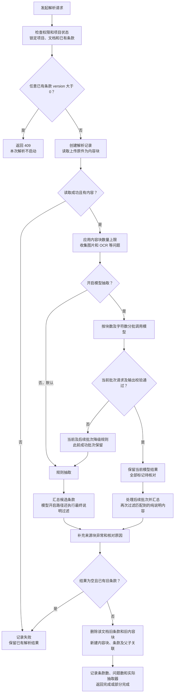

# RFQ 当前解析逻辑说明

日期：2026 年 11 月 6 日  
范围：客户 RFQ 文件解析、条款抽取、结果保存，以及与重新解析有关的版本和批注行为。

当前实现采用规则抽取与可选模型抽取。默认配置关闭模型和 OCR；开启模型后优先逐批调用模型，失败批次及后续批次改用规则抽取。输出包含条款、原文来源位置和待核对原因。

本文描述当前源码，包含本次新增的演示说明过滤。源码修改需要后端重新构建并重启后才能被运行服务加载，本文不代表当前运行包已经更新。历史技术方案中的 DOC 转换、完整表格语义理解和局部重试等规划，不属于本文所述的已实现能力。

业务约束是 RFQ 文件不允许修改。当前解析链路读取上传原件，不回写原文件；批阅稿单独保存。但批阅稿保存接口尚未校验“只增加批注、正文不变”，因此保留上传原件与禁止批阅稿正文修改是两个不同的保证。

## 1 解析入口和总体流程

启动接口为 `POST /api/rfq/documents/{documentId}/parse-runs`。入口检查项目访问权限和来源管理资格；主流程检查项目可操作状态，并锁定项目、文档及已有条款。当前请求直接执行解析并返回结果，没有在此处投递独立后台解析任务。



模型分支按批次顺序执行；图中的“处理后续批次”包含重复调用和校验。模型任一批次失败后，本次解析不再尝试模型。

## 2 文件如何变成内容块

内容块是读取器交给抽取器的基本单元，携带序号、类型、文字、章节路径、来源锚点、原生或 OCR 来源及异常信息。当前客户文件读取器支持 DOCX 和 PDF，未实现旧版 DOC 文件转换。

| 来源 | 当前读取方式 | 定位和限制 |
| --- | --- | --- |
| DOCX 段落 | 按正文顺序读取文字；识别 Heading 或标题样式形成章节路径 | 使用正文元素路径，例如 `body/3`；不依赖 Word 页码 |
| DOCX 表格 | 读取行和单元格文字，形成表格块；继续读取单元格图片和嵌套表格 | 保留行数据及表格位置；未完整还原合并单元格、表头共享条件和脚注语义 |
| DOCX 内嵌图片 | 将读取到的图片交给 OCR 适配器 | OCR 未开启、超限或失败时保留图片占位及问题说明 |
| PDF 文字页 | 逐页按位置读取文字；按空行分段，合并段内换行 | 锚点通常为 `page-页码`；合并段落超过 1200 字符时改按原行拆分 |
| PDF 扫描页或图片 | 无文字页尝试渲染后 OCR；有文字页也检查实际绘制的图片 | OCR 成功转成文字段落，失败保留图片占位；PDF 表格通常进入文字段落路径 |

OCR 成功的文字也标记为需核对，提示对照原图检查数值和单位。图片占位不会直接生成条款，但其异常会计入本次解析问题。

内容块超过配置上限时，只抽取前面的块，并记录截断问题；默认上限为 5000 块。这里限制的是读取完成后送入抽取的块数量。

## 3 规则如何识别候选条款

规则名称为 `rule-based-v1`，核心仍是编号、长度和关键词匹配，不能完整判断采购语义。

### 3.1 段落处理顺序

1. 去除段落首尾空白，尝试识别编号并得到正文。
2. 若整段匹配文档用途或演示说明模式，跳过。
3. 有编号时检查正文是否像短标题，符合则跳过。
4. 按以下条件决定是否生成候选条款。

| 情况 | 生成候选的条件 |
| --- | --- |
| 已识别编号 | 通过说明和标题过滤，且去编号后的正文至少 6 字符 |
| 未识别编号 | 正文至少 15 字符，且包含义务词匹配 |
| 空文字或图片占位 | 跳过 |

编号识别覆盖 `1`、`1.1` 等数字层级、`（1）`、`一、`、`a.` 等形式；数字或字母编号对分隔符和空格有具体正则要求，不保证所有客户编号都能识别。

短标题过滤只作用于已识别编号的段落：正文不超过 24 字符、不含所列句读符号，且没有义务词或建议词时，视作标题跳过。

义务词表达式为：

```text
应当|应|必须|须|不得|不应|禁止|需提供|需满足
```

该表达式按子串匹配，没有中文词义分析。因此“应答”“供应商”等文字中的“应”也可能触发匹配。有编号的候选段落则不要求必须出现义务词。建议词主要用于义务分类和标题判断，单独出现“建议”并不能使无编号段落通过候选条件。

### 3.2 表格处理顺序

先判断首个非空行是否像表头：包含“序号、编号、名称、项目、参数、要求、指标、条款、单位”等关键词，且未命中特定“数字加单位”特征时，跳过首行。

随后逐行拼接非空单元格，跳过不足 6 字符的行和匹配到的纯说明行，其余每行直接生成一条候选。表格行不需要通过段落的义务词条件。首单元格为纯数字层级时，将其作为客户条款编号。

表格候选全部标记为待核对。首行识别可能误把真实要求当表头，其他非要求行也可能被当成条款；表格中的说明若被编号、标签或多列拼接包裹，也可能无法匹配说明过滤。

### 3.3 候选条款输出

规则保留编号、章节、原文及正文，并尝试抽取指标名称、比较关系、数值和单位，例如 `≥ 2 MPa`。每条最多提取 12 个指标。数字层级编号可以生成父编号，入库后再关联实际父条款 ID。

以下情况增加待核对原因：无编号、引用图表或附件、识别到数值但未识别单位、原文过长，以及来源为 OCR 或存在读取异常。表格行无论是否有指标都需核对。规则未发现这些问题时输出 `VALID`，该状态不等于人工或业务审批通过。

规则段落的 `originalText` 最多保存 4000 字符，超过则截断并标记待核对；对应的 `requirementText` 仍保留去编号后的正文。表格路径没有同样的段落截断逻辑。配置虽有 `max-requirement-chars`，当前这里实际使用的是类中固定的 4000 常量。

## 4 本次新增的说明过滤

过滤目标是下述整段说明：

> 本文件用于 RFQ 系统上传及应答流程测试。采购方、设备参数和商务条件均为演示设定。请供应商逐条填写应答，说明满足情况、适用条件、证据及偏离。

`isDocumentNotice` 会尝试去掉编号，再按句号、问号、感叹号和分号分句。只有所有非空句都匹配以下允许模式，并且至少有一句是用途或演示背景声明时，才判定为纯说明：

- 用途声明：以“本文件／本文档／本资料”及“用于／仅供”开头，按正则以测试、演示或示例等结尾。
- 演示背景：采购方、设备参数、商务条件等按指定连接形式组成，并声明均为演示、测试或示例设定等。
- 附带指引：当前指定的“请供应商逐条填写应答，说明满足情况、适用条件、证据及偏离”。

这是有限正则模式。换用其他措辞、不同标点、句子被读取器拆开或合并到其他内容中，都可能影响判断。一般填写指引单独出现时，不因该过滤器而删除；混有真实技术或商务要求的整段也不会整体过滤。

规则路径在段落和表格行生成候选之前过滤。模型开启路径在批次汇总后还会再次过滤：若某个非表格来源块整体属于纯说明，该块的模型子要求也一并排除；其他候选若其引用原文本身属于纯说明，也会排除。

## 5 模型抽取与程序校验

模型由 `RFQ_LLM_ENABLED` 控制，默认关闭。开启后，默认每批最多 20 块、16000 字符，提交块序号、文字和章节路径。当前没有先按规则筛选出候选再交给模型，而是提交可读、非图片占位的内容块。

提示词要求模型忽略非采购要求、保留真实技术和商务要求，不改写原文摘录、不遗漏数值、否定和条件，并允许同块拆分多条要求。程序校验包括：

| 校验对象 | 当前要求 |
| --- | --- |
| 响应格式 | 请求正常结束，返回规定 JSON 数组字段；每批条款数不超过 1000 |
| 原文来源 | 块序号存在，`originalText` 是该块文字中的连续摘录 |
| 必要字段 | 原文及要求文字非空，单字段不超过 16000 字符 |
| 重复项 | 同批内块序号、原文和要求文字完全相同的重复项会使校验失败 |
| 块覆盖 | 每块必须有条款引用或被明确忽略，不能既引用又忽略 |
| 块内覆盖 | 未忽略块的全部非空白字符，必须被一条或多条原文摘录覆盖 |
| 忽略保护 | 规则已识别出候选要求的块，不允许模型整体忽略 |

任一请求、配置、解析或校验异常，当前批次改用规则，后续批次也全部使用规则；之前校验成功的模型结果保留。实际抽取器记录为规则、模型，或模型加规则的组合。

所有模型候选都标记 `NEEDS_REVIEW`。当前模型路径没有额外运行规则指标抽取，`metricsJson` 和 `conditionsText` 留空；条件须保留在原文和要求文字中。来源引用和覆盖校验不能证明模型生成的要求文字在语义上完全准确。

## 6 重新解析和结果保存

### 6.1 启动前的版本拦截

当前代码读取该文档所有已有条款，只要其中任意记录满足 `version > 0`，就返回 409，提示已有人工修正条款并要求上传新版本。

```java
previous.stream().anyMatch(
    r -> r.getVersion() != null && r.getVersion() > 0
)
```

这里没有比对文件内容，也没有比对条款修改前后的文字。初次提取的条款版本为 0。保存条款修正和分配确认人都会使版本加 1；条款保存接口也没有先判断内容是否实际变化。因此“版本大于 0”并不等于“人工改过条款正文”，仅分配确认人也会阻止重新解析。

### 6.2 结果替换和保留

读取或抽取发生被主流程捕获的异常时，记录失败并保留旧条款。如果新结果为零且已有旧条款，也按失败处理并保留旧结果。

通过检查后，主流程删除该文档的旧条款和旧内容块，重新插入并分配新 ID，最后按父编号关联父条款。当前没有对新旧条款做逐条差异合并，也没有在该解析主流程中重映射已有应答、评审和批注的条款关联；不能据此承诺这些业务关联在重新解析后仍然正确。

“新结果为零时保留旧结果”还有一个直接影响：若旧结果只有一条误提取说明，新规则将其全部过滤后，旧错误条款仍可能留下。

### 6.3 完成状态

| 解析状态 | 当前含义 |
| --- | --- |
| `completed` | 有条款，且没有待核对条款或已收集的处理问题 |
| `partial` | 没有条款且无旧条款，或存在待核对条款、OCR 问题、模型降级、块截断等问题 |
| `failed` | 主流程捕获读取或抽取异常，或新结果为空但已有旧条款 |

启动前的版本拦截直接返回 409，不新建本次解析记录。上述失败状态处理位于读取和抽取异常捕获路径；后续数据库写入异常由事务处理，不一定留下同样的失败记录。

`issueCount` 为待核对条款数加上收集的问题数，同一来源可能同时贡献来源异常和条款核对项，不是去重后的异常条款数量。`processedBlocks` 保存为本次采用的内容块数，不表示每块都生成了条款，也不是逐块实时进度。

## 7 各类版本与实际比对内容

| 对象 | 变化条件 | 当前用途 |
| --- | --- | --- |
| 上传文件版本 | 通过上传新版本生成文件版本记录 | 标识来源文件版本；加批注不经此路径更新 |
| 条款 `requirement.version` | 保存条款修正、分配确认人时加 1 | 并发控制、应答来源版本校验；也被直接用于重新解析拦截 |
| 应答记录中的 `version` | 保存应答草稿或确认应答时加 1 | 应答并发控制；保存时校验并记录来源条款版本，不增加条款版本 |
| 批阅稿 `revision` | 保存后的文件摘要与上一批阅稿不同则加 1 | 批阅稿并发控制和文件修订标识；不增加条款版本 |

批阅稿先比对客户端提交的预期 revision 与服务端 revision，版本不一致则拒绝保存。通过后，再计算新文件 SHA-256 摘要，与上次保存的批阅稿摘要比较：

```java
String digest = OfficeFileStore.hash(bytes);
long revision = before.revision()
    + (digest.equals(before.digest()) ? 0 : 1);
```

这是文件字节级变化判断，不会识别变化属于批注、正文、格式还是文件内部元数据。增加批注并成功保存，通常会使批阅稿版本增加，但不会增加用于重新解析拦截的条款版本。

批阅稿存储写入 `review-版本号` 及元数据，上传原件单独保存在 `original`。当前保存接口验证文件格式和版本，但没有比较上传原件正文与新批阅稿正文是否一致，尚不能作为“允许批注、禁止正文修改”的服务端校验。

## 8 当前配置默认值

以下是源码默认值，实际部署可由环境变量覆盖。

| 配置 | 默认值 | 说明 |
| --- | --- | --- |
| `RFQ_PARSE_MAX_BLOCKS` | 5000 | 读取后送入抽取的内容块上限 |
| `RFQ_LLM_ENABLED` | false | 是否调用模型 |
| `RFQ_LLM_BATCH_BLOCKS` | 20 | 每个模型批次块数上限 |
| `RFQ_LLM_BATCH_CHARS` | 16000 | 每个模型批次文字长度上限；超长单块触发降级 |
| `RFQ_OCR_ENABLED` | false | 是否调用 OCR |
| `RFQ_OCR_MAX_IMAGES` | 100 | 图片或扫描页 OCR 数量上限 |
| `RFQ_OCR_MAX_IMAGE_PIXELS` | 20000000 | PDF 扫描页渲染和图片处理相关像素限制 |
| `RFQ_OCR_MAX_IMAGE_BYTES` | 10485760 | 提交 OCR 的图片字节上限 |

模型和 OCR 默认连接超时为 3 秒、请求超时为 30 秒。开启时还需提供相应地址；模型另需有效模型名称等配置。

## 9 当前缺口与已验证范围

| 当前缺口 | 直接影响 |
| --- | --- |
| 义务词按子串判断，说明过滤为有限模式 | 仍可能误提取其他说明，或漏掉没有编号及匹配词的真实要求 |
| 表头及表格行处理依赖简单规则 | 可能丢失真实首行要求，或把其他行当成条款 |
| 将并发版本直接当人工修正标志 | 分配确认人等操作也会阻止整份文件重解析 |
| 新结果为空时无条件保护旧条款 | 全部旧条款均为误提取时，无法借本次解析清除 |
| 重新解析删除重建条款，缺少差异合并和业务关联迁移 | 已有应答、评审和批注关联需要独立保护机制 |
| 批阅稿只比摘要，不验证正文不变 | 上传原件保留，但“仅允许批注”的服务端约束尚未完整落实 |

本次说明过滤已通过两个测试类合计 16 项相关测试，覆盖原文说明过滤、编号和表格场景、真实技术商务及正式应答要求保留、模型忽略说明、模型拆分说明后排除，以及既有模型校验和 OCR 适配场景。该验证不等于完整系统验收，也不证明上述缺口已修复。

## 10 代码依据

以下路径均相对于仓库根目录。

| 逻辑 | 主要源码 |
| --- | --- |
| 入口及权限 | `apps/api/src/main/java/com/naura/rfq/controller/ParseController.java`、`apps/api/src/main/java/com/naura/rfq/service/ParseQueryService.java` |
| 编排、版本拦截、结果保存 | `apps/api/src/main/java/com/naura/rfq/service/ParseService.java` |
| DOCX 和 PDF 内容块读取 | `apps/api/src/main/java/com/naura/rfq/integration/parse/DocxBlockReader.java`、`apps/api/src/main/java/com/naura/rfq/integration/parse/PdfBlockReader.java` |
| OCR 接入 | `apps/api/src/main/java/com/naura/rfq/integration/parse/OcrClient.java` |
| 规则与说明过滤 | `apps/api/src/main/java/com/naura/rfq/integration/parse/RuleBasedExtractor.java` |
| 模型、校验及降级 | `apps/api/src/main/java/com/naura/rfq/integration/parse/HybridRequirementExtractor.java` |
| 条款修正及版本递增 | `apps/api/src/main/java/com/naura/rfq/service/RequirementService.java`、`apps/api/src/main/resources/mapper/RequirementMapper.xml` |
| 应答版本 | `apps/api/src/main/java/com/naura/rfq/service/ResponseService.java` |
| 批阅稿摘要与存储 | `apps/api/src/main/java/com/naura/rfq/service/OfficeDocumentService.java`、`apps/api/src/main/java/com/naura/rfq/storage/OfficeFileStore.java` |
| 配置 | `apps/api/src/main/resources/application.yml`、`apps/api/src/main/java/com/naura/rfq/config/properties/ParseIntegrationProperties.java` |
| 相关回归测试 | `apps/api/src/test/java/com/naura/rfq/integration/parse/DocumentNoticeExtractionTest.java`、`apps/api/src/test/java/com/naura/rfq/integration/parse/ParsingAdaptersTest.java` |
