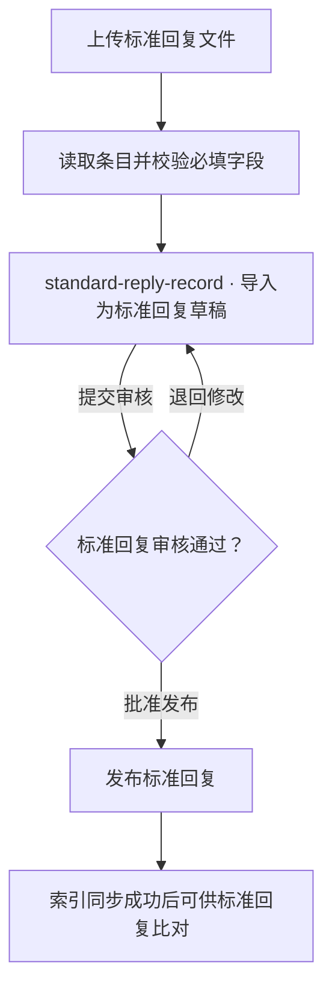
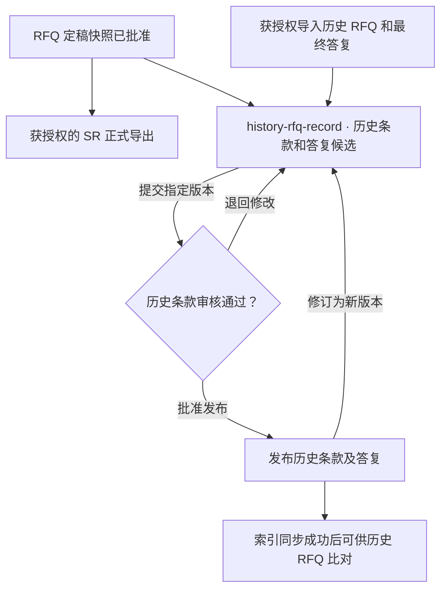
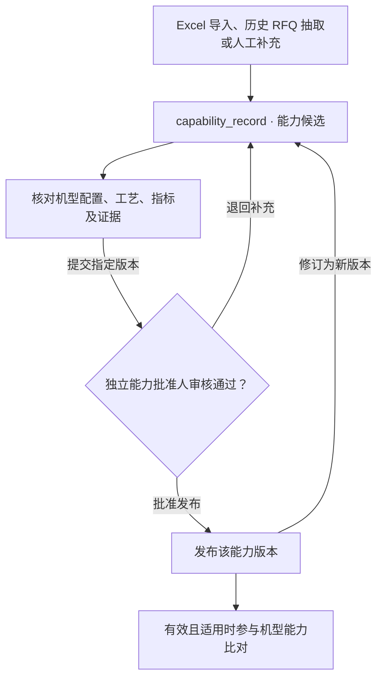

# RFQ 条款自动比对技术方案

v0.1 评审稿 · 2026-11-08

RFQ 文件解析成功后，后端按项目所属 BU 的配置逐条比对，返回建议应答、条件差异和可回查的证据。默认顺序沿用「标准回复库 → 历史 RFQ → 机型能力边界」。条款保存后即可在「RFQ 细则比对」起草应答。每条匹配独立完成，用户可以处理已返回的条款，并重试失败的条款。默认顺序及各库的比对规则见 [PRD 4.6、4.7、4.9](../product/FEP销售RFQ提效Agent_PRD_v0.2.md) 和 [交互设计 7.2、PG-03](../product/FEP销售RFQ提效Agent_交互设计.md)。

## 1 现状与架构选择

`ParseService` 在 MySQL 保存来源块和条款。前端读取解析结果，新条款以「待确认」进入工作台。目前历史候选和重新匹配使用演示逻辑。[ParseService](../../apps/api/src/main/java/com/naura/rfq/service/ParseService.java) · [ResponsePage](../../apps/web/src/pages/ResponsePage.jsx)

| MySQL 表名 | 中文名称 | 本方案中的存储职责 |
| --- | --- | --- |
| `standard-reply-record` | 标准回复库 | 保存从上传文件导入的标准回复及其适用要求、条件、来源文件、版本和审核状态。 |
| `history-rfq-record` | 历史 RFQ 条款表 | 统一保存历史 RFQ 原条款及对应的原答复，并保留适用条件、来源文档、版本和审核状态。 |
| `capability_record` | 机型能力边界表 | 特定机型、配置和工艺下的能力指标、数值或范围、保证值或典型值、适用条件和证据引用。 |
| `evidence_record` | 证据资料元数据表 | 测试报告、配置清单等依据的名称、版本、来源位置、有效状态和可见范围。 |

**图 1 标准回复发布**

上传时记录来源文件及导入位置，将通过字段校验的条目保存为草稿。维护人员提交指定版本，由另一位有知识发布资格的人核对标准回复内容、复用范围及适用条件。批准发布且索引同步成功后，该版本可供标准回复比对。[PG-06 知识与结果维护](../product/FEP销售RFQ提效Agent_交互设计.md#pg-06-知识与结果维护)

**图 2 历史 RFQ 发布**

RFQ 定稿后即可在 `history-rfq-record` 生成历史候选。维护人员提交具体版本，由另一位有知识发布资格的人核对原条款与定稿答复、来源版本、适用条件和共享范围，再执行「批准发布」或「退回」。发布时记录审核人、时间、意见和条款版本。已发布且完成索引同步的条款才参与历史 RFQ 比对。正式导出按已批准的 RFQ 快照执行，历史发布可以随后完成。[PRD 知识回流](../product/FEP销售RFQ提效Agent_PRD_v0.2.md) · [PG-06 知识与结果维护](../product/FEP销售RFQ提效Agent_交互设计.md#pg-06-知识与结果维护)

**图 3 机型能力边界发布**

指定能力批准人核对证据能否支持该机型、配置和工况下的能力，按指标区分保证值、典型值和单次测试值。同一版本由提交人以外的人员审批。机型能力比对从 RFQ 的能力和证据表读取已发布且有效的版本，再核对本次项目的适用条件。[PRD 机型能力边界](../product/FEP销售RFQ提效Agent_PRD_v0.2.md) · [PG-14 机型与能力](../product/FEP销售RFQ提效Agent_交互设计.md)

| 方案 | 取舍 |
| --- | --- |
| 解析接口同步完成三级比对 | 调用链短。检索超时会延长解析请求和数据库锁的持有时间，整份文件也难以按条重试。 |
| RFQ 后端异步编排，知识中台召回标准回复和历史 RFQ 候选 | 本稿采用。复用 Spring Boot 和 MySQL 保存任务与结果。知识中台提供语义和关键词召回，RFQ 保留业务规则和数据权限。需要维护发布数据到索引的同步状态。 |

机型能力边界从 RFQ 的能力和证据表按结构化字段查询。语义相近的指标仍须核对指标定义、机型版本、工况和单位。RFQ MySQL 保存业务原始记录及审核版本，知识中台保存用于候选检索的投影。[知识中台 v1 接口](../api/knowledge-platform-semantic-api-reference-v1.md)

## 2 触发与比对顺序

1. 解析保存条款、更新解析任务状态时，在同一事务写入比对任务。提交后由后台 Worker 领取，外部调用在事务外执行。抽取结果不再区分复核状态：只要条款有可用正文、且不是人工删除（`EXCLUDED`），落库即排队。抽取提示（`review_reasons`）随条款保存，仅用于展示，不阻断比对。
2. Worker 使用条款标题、`requirement_text`、已核实的条件组织查询，正文缺省时用 `original_text`。保留否定词、数字和单位。查询输入及比对结果都绑定条款版本、原件版本和项目设备配置基线。原文要求修正后须重建或重新核实结构化指标和条件，再用于能力判断。
3. 每条按本轮保存的库顺序依次执行。首次命中后结束该条比对，后续库显示「未执行」。当前库未命中或明确不适用时，继续下一个库。

### 2.1 比对顺序配置

有权限的 BU 管理员在 BU 设置中调整三个库的先后顺序。默认配置为 `standard_reply → history_rfq → capability`，分别对应标准回复库、历史 RFQ 库和机型能力边界库。服务端校验三项各出现一次，保存顺序、配置版本、修改人和时间。

每轮比对在创建时保存配置版本和实际顺序。设置更新后，新建任务和手动发起的新一轮使用新顺序。已排队、运行和自动重试的任务使用创建时的顺序，已有结果保留原执行顺序供回查。各库的命中条件和权限校验按其自身规则执行。

检索失败、访问范围无法确定或索引未就绪时，停在当前库并显示原因。机型能力比对若明确缺少设备归属或配置，记录阻塞原因，并继续检查配置中后续的文本库。文本库有命中时可返回该结果。其余库均未命中时，本轮保持待补配置，不能据此判为知识缺口。

| 比对库 | 可用候选与命中规则 | 输出 |
| --- | --- | --- |
| 标准回复 | 在允许用于当前项目、已审核发布且当前有效的标准回复中召回候选，由 RFQ 重排。最高业务相似度严格 `> 0.80` 且回复可复用时命中。`0.80` 和更低分数继续下一个库。 | 预填初始应答并保留原回复条件、来源与版本。条件尚待确认或已有冲突时标记待核对，保留冲突证据。 |
| 历史 RFQ | 召回有已审核答复的历史条款，按独立规则判断是否为可参考的匹配。对照机型、配置、材料、指标、工艺和验收条件。存在匹配即停止自动检索。 | 默认展示前 3 条，更多从本轮保存的有权候选中展开。保留原要求、已审核答复、差异、适用条件、精确来源版本。客户反馈和实际验收分别展示，未知时显示「未记录」。由用户核对后采用。 |
| 机型能力边界 | 按条款所关联设备项查该 BU 下精确的机型版本、配置基线、工艺和指标。只用已发布、有效且关联有效证据的能力。 | 展示逐项比较、限制、证据和建议结论。涉及多台设备时分别比较。 |

知识范围按项目绑定的知识分组裁剪，三个库统一适用：

- 范围 = 项目绑定分组自身 + 其全部上级分组（含根分组）。挂在根分组的资料对所有下级分组的项目生效，挂在中间层分组的资料对该分组的子树生效。
- 未关联任何分组的资料视同根分组，对所有项目生效，避免存量资料因未归类而退出比对。
- 显式指定历史 RFQ 文件时以用户选择为准，不再按分组裁剪；仅当前项目的资料只受项目范围约束，不受分组裁剪。
- 项目未绑定分组（存量项目）不做分组过滤，沿用 BU 内已发布且有效的共享资料。分组或资料分组变化会改变范围戳，已完成的比对按范围变更重算。

知识中台的 `score`、RRF、BM25 和向量分数用于召回排序。RFQ 通过可替换的条款对评分器，对有权候选按「当前条款与候选原要求」进行二次评分，输出版本化的 `businessSimilarity`。首期拟选用支持业务语言的重排模型，以脱敏标注样本校准到 `[0,1]`。标准回复按业务相似度降序选最高分，同分按 `source_id` 排序，按未四舍五入的原值应用 `> 0.80`。历史匹配规则单独校准，建议置信度使用独立口径。评分缺失或评分服务失败时显示该级失败，保留待确认状态。[知识中台响应语义](../api/knowledge-platform-semantic-api-reference-v1.md#58-响应语义)

### 2.2 能力边界与偏离

- 用已维护的指标定义及单位换算规则比较运算符、数值区间、端点和容差，同时核对材料、厚度、配置及测试方法。保证值可以支持承诺，典型值和单次测试结果只供参考。多项约束须在同一适用工况下成立。
- 比较输入为条款归属的设备项、已核实的必需指标及逻辑关系，设备归属缺失时由项目人员补充。全部必需约束在同一适用工况下获有效证据支持时推荐 `Comply`。只有在明确配置或限制条件下支持时，保留条件并推荐「有条件 Comply」。已确认适用范围内，只要有一项必需约束被有效证据明确反驳，即可推荐「不满足」并转专业评审，同时展示其他未核对项。
- 选配或工况尚未确认、能力记录冲突或指标无法可靠解析时，推荐「待确认」并列出待核对项。机型能力库以 `hit` 表示找到能参与判断的证据，即使结论仍待确认。以 `blocked` 表示缺少比较输入或证据资格无法核实。在范围和输入均已明确、查询成功且无可用证据时记 `miss`。
- 三个库都成功完成且均为 `miss` 时，记录「知识库中没有」偏离。机型未选、服务失败、无权限和索引落后属于待处理状态。商务等明确不适用机型能力的条款转对应专业核对，机型能力库显示「不适用」。条款级匹配结果被用户明确拒绝，或经校准的推荐置信度严格低于配置阈值，也分别记录偏离来源。以条款和项目工作版本合并事项，重复执行只补充尚未记录的来源。无依据时建议「待确认」。

项目创建和维护接口需保存结构化设备项、机型版本、配置基线及工艺，校验其同 BU 归属，并允许条款关联具体设备项。现有项目缺少绑定时，机型能力库显示「缺少设备配置」。能力记录需提供可机读的指标、范围及条件，以及精确的证据 ID、版本和位置。缺字段的历史记录进入补齐清单。[项目创建 DTO](../../apps/api/src/main/java/com/naura/rfq/model/dto/CreateProjectRequest.java)

## 3 知识中台接入

### 3.1 数据集与同步

每个试点 BU 分别配置标准回复、历史 RFQ 和能力边界数据集。`BU-FEP` 的默认名称为 `rfq.fep.standard-reply`、`rfq.fep.history-clause` 和 `rfq.fep.capability-boundary`，配置位于后端 `application.yml`。三类数据集各自接收对应业务表的已发布版本。能力边界的语义投影包含指标名称、配置、能力值、适用条件和限制。`X-API-Key` 通过服务端密钥配置注入。上线前用测试环境确认 API Key 权限、数据集、字段类型、过滤白名单和可用索引。

| 投影字段 | 写入规则 |
| --- | --- |
| `records[].id` | 由 RFQ 分配稳定 `source_id`，映射到 `(bu_id, source_type, resource_id)`，同一业务条目换版沿用。 |
| `title`、`requirement_text` | 作为 `embedding_fields`。只投影经审核允许在知识中台处理的文本。 |
| `bu_id`、`record_version` | `bu_id` 用于过滤，`record_version` 为回查时核对的精确发布版本。显式声明类型和返回白名单。 |

标准回复正文从 `standard-reply-record` 回查，历史原条款及原答复从 `history-rfq-record` 回查。权限、完整证据和适用条件由 RFQ 回源读取。当前项目的新条款作为检索 `query` 发给知识中台。上线前确认允许发送的字段及内网服务边界，按范围移除查询所不需的客户标识和附件内容。

RFQ 为每个知识条目维护当前发布版本及有效区间。修订稿审核期间继续使用仍有效的上一发布版本。导入的草稿保存在 RFQ，审核发布后才加入索引同步队列。发布和撤销在同一事务更新业务记录与索引同步队列。初次调用 `:ingest` 时提交 `dataset_config` 及首批已发布记录。后续提交完整投影。撤销、失效或移出范围时，RFQ 先取消可用资格，再发 `op: delete`。

同一 `source_id` 串行同步，使用单调递增且重试时保持不变的 UTC `updated_at`，记录期望版本、同步事件、`job_id` 和已确认版本。超时重放同一事件。收到 `202` 后轮询任务，`partial_success` 按记录确认成功和重试失败。记录成功但 RFQ 已有更新的期望版本时，旧任务回执只保留审计。周期性对账检查授权范围内应入库的版本是否均已确认。索引就绪后才用于判定当前范围的命中或无可用候选。[入库与任务契约](../api/knowledge-platform-semantic-api-reference-v1.md#3-数据集入库接口)

### 3.2 查询范围与回源校验

1. RFQ 先根据项目与 BU、来源授权、当前发布版本及有效性计算可供该项目共享的 `source_id` 集合。首期自动任务使用项目共享范围，个人专属资料进入人工补证。范围必须由后端使用结构化授权数据计算。资源只配置了展示标签、缺审批或无法解析授权时，按待补齐处理。
2. 使用 `POST /api/v1/semantic-datasets/{dataset_key}:search`，传 `mode=hybrid`、`query` 和高级 `filter`。过滤条件为 `bu_id eq <BU>` 与 `id in <授权 ID 集合>`。用 `result_options` 返回 `record_version` 并关闭 `include_matched_chunks`，按配置的 `top_k` 召回候选。已确认范围为空可按该级无可用候选处理。授权 ID 数量超过平台约定上限时标记待处理，首期按受控数据规模运行。
3. 以 `source_id + record_version` 回查精确记录，再校验发布状态、有效性、证据权限及项目共享资格。读取结果、采用建议和提交确认前，按当时权限和引用有效性重新校验。权限变化后，只返回通用不可用原因。候选版本与 RFQ 当前发布版本不一致，或授权范围内仍有待索引版本时，按索引未就绪处理。
4. 在授权范围已完整覆盖、索引就绪、检索及后续校验都成功的前提下，`200 + hits: []` 或候选均未达到该级规则才记为未命中。这个结果基于已约定的召回配置。超时、`429`、依赖故障可重试，鉴权和契约错误进入配置排查。日志保留知识中台 `request_id`、`index_version`、耗时与错误码。新索引版本和评分策略的效果需用同一验证集回归。

每次运行记录读取的知识范围版本，覆盖 BU 发布与索引同步进度、项目授权和能力证据的当前版本。服务端在这些数据变化时同步递增对应版本号。完成事务复核范围版本及执行期间发生的有效期变化，命中和未命中都适用。范围已变时重算，避免在新来源发布或权限调整后登记过期的知识缺口。

## 4 持久化、重试与版本校验

| 记录 | 字段与用途 |
| --- | --- |
| `bu_match_policy`（拟新增） | 保存 BU 当前的 `match_order`、配置版本、修改人和时间。未配置时使用默认顺序。 |
| `requirement_match_run`（拟新增） | `run_id`、项目／BU、`work_version_id`、`requirement_id`、条款版本、`document_id`／原件版本、`parse_run_id`、设备配置基线、输入指纹、知识范围、策略版本与本轮 `match_order`、触发原因、状态、尝试次数、下次执行时间、租约及错误。按库保存执行状态和外部请求 ID。 |
| `requirement_match_result`（拟新增） | 每个完成的 `run_id` 对应一份不可变结果。包含建议结论、草稿、差异、分数与算法版本、分库候选，以及知识、能力和证据的精确版本。保存必要的来源定位与判断理由。 |
| `knowledge_index_sync`（拟新增） | 以数据集与 `source_id` 跟踪期望版本、同步操作、时间戳、索引任务和已可查版本。保留删除状态，支持失败重放与对账。 |

任务状态包括 `queued`、`running`、`retry_wait`、`completed`、`blocked`、`failed`、`superseded`。每个库分别记录 `not_run`、`running`、`hit`、`miss`、`not_applicable`、`blocked` 或 `failed`。自动触发按项目工作版本、条款 ID、原件及解析标识、比对输入指纹和策略版本去重。输入指纹包括条款正文、条件、指标及设备配置基线。改派确认人等仅增加条款行版本的操作可复用相同输入的比对结果，应答写入仍校验最新行版本。

同一条款同时只有一个当前运行。手动重新比对提交新操作 ID 后开启新一轮，重复提交同一 ID 返回原 `run_id`。瞬时错误自动退避重试。索引未就绪进入 `blocked`，对应同步成功后恢复原轮次。设备基线、条款内容或工作版本变化时，为受影响的有效条款建立新轮次，旧轮退出当前建议。其他配置或权限阻塞解除后可手动重试。同轮重试按本轮保存的顺序从首个库重算。

Worker 用 MySQL 短事务批量领取可执行任务，通过租约和领取令牌支持多实例与进程退出后恢复。对同一 BU 和全局限制并发，退避重试有上限。完成时按现有「项目 → 原件 → 条款」顺序加锁，复核项目未归档、条款与解析仍有效、设备基线未变、实际执行策略与本轮快照一致、当前运行令牌有效且引用仍可用，再原子保存结果和运行状态。被新轮次替代后才返回的任务标记 `superseded`。外部失败单独记录在比对状态，已入库条款仍可继续人工起草。

当前重解析会替换该原件的条款 ID。方案沿用现有人工修正保护，并在同一锁顺序内检查已保存应答、确认、关联评审及快照。有这些记录时走新文件版本流程。允许重解析时，旧条款的匹配记录保留追溯并退出当前展示。前端按原件 ID、解析轮次及条款 ID 关联结果。

新文件是否替换旧文件由显式关系确定。新文件仍可先解析、比对和起草，原件尚未完成有效范围核对时，旧文件继续作为当前版本。负责人完成影响及来源完整性核对后生效替换并开启新的项目工作版本。已有应答随精确来源保留追溯，受影响条款在新版本重新确认。[解析事务](../../apps/api/src/main/java/com/naura/rfq/service/ParseService.java) · [应答版本校验](../../apps/api/src/main/java/com/naura/rfq/service/ResponseService.java)

通过 Flyway 后续迁移将现有 `history_clause` 重命名为 `history-rfq-record`，将 `knowledge_record` 重命名为 `standard-reply-record`。迁移时按 BU、条款 ID 和版本核对旧知识表中的历史记录，将其统一归入历史 RFQ 条款表，并同步更新后端查询和演示数据导入目标。SQL 中用反引号引用带连字符的表名。新增表和索引也通过后续迁移落库。当前 `DatabaseInit` 的自定义资源提供器只发现 B10 基线，需注册后续迁移并保留原基线标识和校验和。分别验证空库初始化和既有 B10 库升级。[DatabaseInit](../../apps/api/src/main/java/com/naura/rfq/config/DatabaseInit.java)

## 5 RFQ 接口与工作台

下列路径和字段为拟定契约，使用现有 `/api/rfq` 和登录态。

| 接口 | 行为 |
| --- | --- |
| `GET`／`PUT /api/rfq/business-units/{buId}/match-policy` | 读取当前比对顺序及版本。有权限的 BU 管理员提交 `matchOrder` 和当前配置 `version` 更新顺序，版本冲突返回 `409`。 |
| `GET /api/rfq/projects/{projectId}/match-results` | 按当前原件及解析轮次分页返回条款 ID、匹配状态、最新结果版本和有权查看的摘要。 |
| `GET /api/rfq/requirements/{id}/match-runs/{runId}` | 返回指定轮次的各级状态、建议及授权后的候选详情。 |
| `POST /api/rfq/requirements/{id}/match-runs` | 有权用户提交 `sourceRequirementVersion` 和本次操作的 `requestId` 发起重新比对。返回 `202` 和 `runId`，版本变化返回 `409`。 |
| `POST /api/rfq/requirements/{id}/match-runs/{runId}/reject` | 有权用户明确拒绝当前条款的整轮匹配结果并填写原因，服务端幂等登记「用户未接受」来源。 |
| 现有应答保存与确认接口 | 扩充可选的 `matchRunId` 和 `candidateId` 用于记录采纳来源。服务端复核当前结果、条款／应答版本、权限和证据，保存精确引用。 |

工作台在匹配处理中照常展示原文和应答表单，并轮询当前原件的运行状态。按后端返回的本轮 `matchOrder` 展示各库执行状态和候选。真实项目移出演示匹配和模板回退。标准回复命中且表单无人工修改、无已保存应答时，将持久化的系统建议作为可编辑的初始应答带入表单。已有草稿、已确认记录和未保存编辑时，新结果在建议区展示，由用户核对差异后明确采用。候选切换只改变预览。

系统预填和明确采用都要随保存或直接确认提交匹配轮次及候选 ID，后端校验候选属于同一条款、来源、输入指纹和项目工作版本，且来自当前完成的轮次。后续人工编辑默认保留精确引用，显式解除引用作为独立操作并记录原因、重新核对依据。应答确认及导出按精确引用校验有效性，已批准历史快照用于追溯。[现有应答接口](../../apps/api/src/main/java/com/naura/rfq/controller/ResponseController.java)

项目或知识权限变化后，匹配详情、应答、历史和导出接口按精确引用过滤或阻断受限内容。撤销、替换、过期或配置变化影响到已采用的依据时，按精确引用标记待复核，历史记录保留用于授权审计。项目内共享和对客户导出分别校验使用范围。

服务端持久化当前项目工作版本。初次启用时建立工作版本，原件替换生效或已批准项目重新开启等业务动作建立新版本。日常草稿保存只更新应答行版本。偏离事项以 `(project_id, work_version_id, requirement_id)` 唯一定位，使用 `response_review` 承载工作台事项，关联触发来源和匹配轮次。结果入库时同步校验所属工作版本，再登记该轮触发的知识缺口或低置信度。明确拒绝只受理当前完成的轮次并写入同一事项。明确不满足且已有偏离时在原事项内评审，否则创建专业评审。关联评审与应答确认在服务端同步校验。

## 6 实施顺序与验收

1. **验证数据与契约。** 确认试点 BU 的已发布样本、项目共享授权、能力指标字典和来源证据。测试环境用一条记录验证入库任务可查、ID 过滤、命中回源及撤销。用标注集确定标准回复业务相似度与历史命中口径。
2. **贯通后端。** 落地版本化发布视图、索引同步、条款比对任务和三级编排。先用受控发布数据运行，记录召回及比对效果。能力判断接入结构化项目设备项、工艺、配置和已核验证据。
3. **贯通应答与偏离。** 工作台读真实结果，保留人工编辑。完成建议采纳、精确引用、失效复核、偏离去重和权限校验后，按 BU 开启自动触发。停用时保留历史记录和人工应答入口。

| 验收场景 | 预期结果 |
| --- | --- |
| RFQ 已定稿，历史条款候选待审核、退回或已发布 | 候选及退回版本保留在历史库，发布前不参与检索。另一位有资格的审核人批准指定版本，索引同步成功后可供历史 RFQ 比对。 |
| 上传标准回复文件，提交并审核发布 | 导入的条目及来源记录保存在 `standard-reply-record`。草稿和待审核版本仅在库内维护，已发布且完成索引同步的版本可供标准回复比对。 |
| 按默认顺序执行，标准回复业务相似度分别为 `0.81`、`0.80`、`0.79` | 首条预填，后续两个库未执行。其余两条查询历史 RFQ。知识中台原始排序分不会改变边界规则。 |
| BU 将历史 RFQ 移到首位，历史库命中 | 先查历史库并返回结果，标准回复和机型能力显示「未执行」。 |
| BU 调整顺序时已有任务排队、运行或等待重试 | 已有任务使用保存的顺序，新建和手动发起的新一轮使用新顺序。提交重复、缺项或未知库的配置会被拒绝。 |
| 机型能力在首位，条款缺少设备配置 | 能力库显示待补配置，仍继续检查后续文本库。若文本库均未命中，本轮保留待补配置，不生成知识缺口。 |
| 历史命中但工况不同，或历史证据互相冲突 | 保留差异及来源，显示待核对。配置在历史库之后的库显示「未执行」，人工应答保留。 |
| 轮到机型能力比对且设备配置齐全 | 区分单位等价、保证值与典型值、多设备与不同工况。支持、反驳、待确认均可追溯到证据。 |
| `200` 空结果、`403`、`429`、超时和索引未就绪 | 只有三个库都执行成功且均未命中才触发知识缺口。失败状态及重试行为符合错误类别。 |
| `202` 后未完成、部分成功、撤销与乱序重放 | 分别核对索引可见性、逐条同步状态和旧任务回执。已撤销来源即使仍可被召回也不会显示或采纳。 |
| 部分解析、进程退出、重复领取、并发重解析或用户改答 | 条款落库即排队，可独立完成；人工修改后按新版本重新入队。过期任务结果不进入当前工作台。人工草稿和确认记录保留。 |
| 查询未命中后、提交结果前有新来源发布或授权变化 | 当前轮重新计算查询范围，旧的未命中不会建立偏离。索引同步完成后恢复受影响的等待任务。 |
| 跨 BU、项目撤权、引用失效 | 检索范围、结果读取及采纳均校验权限，已采用的失效引用触发待复核。 |
| 低置信度后明确拒绝同一轮结果 | 同一工作版本生成一个偏离事项并记录两个来源。重复事件不再建单。 |

验收同时记录各级命中、人工采纳和误预填情况，以及任务排队时长、各级耗时和重试量。对时延和效果按试点目标评审。[PRD 验收用例及待定参数](../product/FEP销售RFQ提效Agent_PRD_v0.2.md)

## 7 联调前待确认

- 知识中台测试环境地址及 API Key、数据集权限、`id in` 规模限制、单条内容长度、`updated_at` 支持精度和限流策略。
- 试点 BU、可共享资料范围、正式发布与撤销的写入方，以及当前资源和证据记录中需要补齐的结构化字段。
- 标准回复评分器和标注集、历史匹配规则、推荐置信度及低置信度阈值、能力指标字典和试点性能目标。参数确认前，可用模拟响应验证编排与版本行为。自动预填和正式效果验收以试点校准结果为准。
