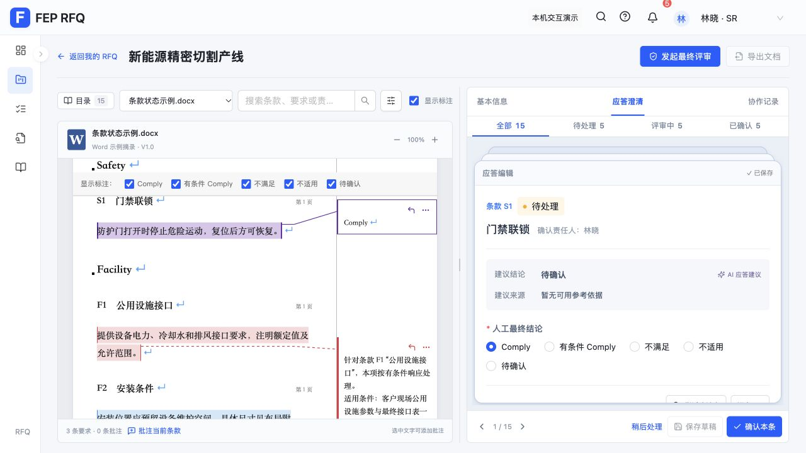

# 应答工作区筛选与操作区域压缩

按用户确认的四项范围实施：

- 状态数量使用 32px 高的一行筛选，沿用同一份统计与选择逻辑。
- 保留搜索框；状态、事项类型和偏离来源放入弹层。选择条件后点击应用才更新结果，重置恢复全部，入口显示已应用条件数量。
- 移除卡片内操作区和独立队列底栏，统一为工作区底部固定操作栏。上一条／下一条、当前位置、稍后处理、保存及确认集中呈现；保存为次按钮，确认保持主要按钮。
- 隐藏分栏工作区底部宣传与重置演示页脚，其余页面仍保留原入口。以可用视口高度布局，释放给原文和编辑正文。

验证：316 项测试、生产构建和 `git diff --check` 通过；独立范围审查未发现问题。依赖块体积警告沿用此前状态，未新增依赖。

浏览器使用生产预览 5174 的独立存储，未保存测试编辑或执行真实上传。1280×720 下，原文区高度从前次截图的 520px 增至 566px，统计栏 32px，统一操作栏 51px，无页面溢出。编辑区滚动 240px 后，操作栏纵坐标保持 652px。

已确认：选择弹层条件前后结果保持原值，应用“已确认”后变为 5 条；重置恢复 15 条；搜索“公用”显示 4 条，清空恢复 15 条。修改结论后切换筛选仍触发未保存提示，取消保留草稿，放弃后可继续。稍后处理期间导航、保存、稍后及确认按钮均禁用。

390×844 下页面宽度为 390px，底栏维持一行，按钮全部位于视口宽度内；弹层边界完整可见。临时视口覆盖已恢复，最终页面无控制台 error/warn。

