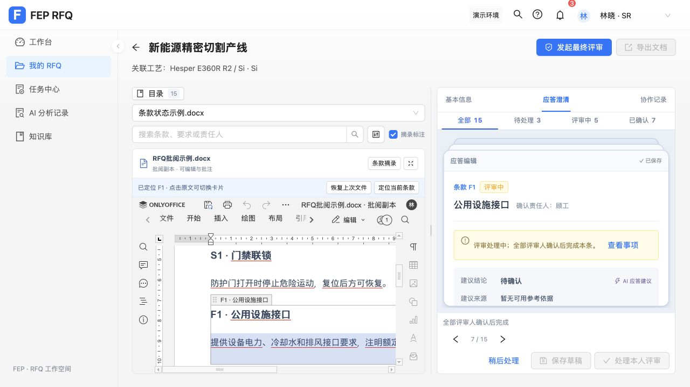

# 原文件与应答卡片定位

## 变化

详情的原生 Word 编辑器接收当前来源文件、版本和条款锚点。切换卡片时选择对应内容控件；普通 DOCX 通过精确且全文唯一的原文定位。点击 Word 原文后通过插件事件选择对应卡片。没有匹配、多处匹配及 PDF 都提供条款摘录入口。

原文件与批阅副本保存方式不变。联动仅选择原文，不写正文或改变应答结论。相同来源切卡保留 iframe、未保存批注和业务表单离开保护。父组件无关重渲染不触发重选；异步定位和光标事件检查请求序号、事件世代、随机通道、来源和窗口，旧请求不覆盖新卡片。

旧通用英文测试文档无法与中文条款匹配，已改成对应 S1/F1/F2 的中文 fixture。已有浏览器用“载入联动示例”显式切换，原关联保留在“恢复上次文件”；加载期间新增修改会阻止替换。没有覆盖或重置用户的业务应答。

## 实测

完整验证：前端 353 项测试通过，后端 18 项测试通过，Vite 生产构建通过（保留已有分包体积提示）。

- 用户提供的 RFQ-001 / DOC-EXAMPLE-6 任务链接：Word 打开后显示“已定位 S1”，原生控件与正文被选中。
- 目录选择 F1 后卡片变为“公用设施接口”，左侧变为“已定位 F1”。同一 iframe 保持，保存栏仍为原件已上传，撤销按钮禁用，定位未产生编辑。
- 使用原生 `SearchNext` 将精确唯一正文滚入视区；编辑过的内容控件仍按标签选中，避免搜索到其他位置的旧正文。
- 恢复上次英文文件后明确显示“未找到当前条款原文”；再次恢复中文文件后定位恢复。
- 反向光标映射、重复文本/控件拒绝、空白差异、快速光标与卡片竞态、业务导航被拒时恢复选区通过 VM 协议测试。
- 当前 CUA 对 ONLYOFFICE iframe 内的点击/按键返回失效目标，未能完成原生鼠标点击回跳的端到端操作；该方向的验证范围为插件与桥接测试。右卡切换到原文方向已完成真实浏览器验证。

## 实现与部署

采用官方社区插件 SDK，未使用 `createConnector`。资源由 RFQ 后端 `/api/office/plugin/` 提供，保留 SDK 的 Apache 2.0 版权及许可。仅公开插件清单提供 CORS，文档能力凭证不会传到插件或清单。前端通过既有 `/api/office` 反向代理访问。部署来源通过 `ONLYOFFICE_FRONTEND_ORIGINS` 限定。

参考：[插件配置](https://api.onlyoffice.com/docs/docs-api/usage-api/config/editor/plugins/)、[插件事件](https://api.onlyoffice.com/docs/plugins/interacting-with-editors/overview/how-to-attach-events/)、[内容控件导航](https://api.onlyoffice.com/docs/plugins/samples/content-controls-navigation/)。

