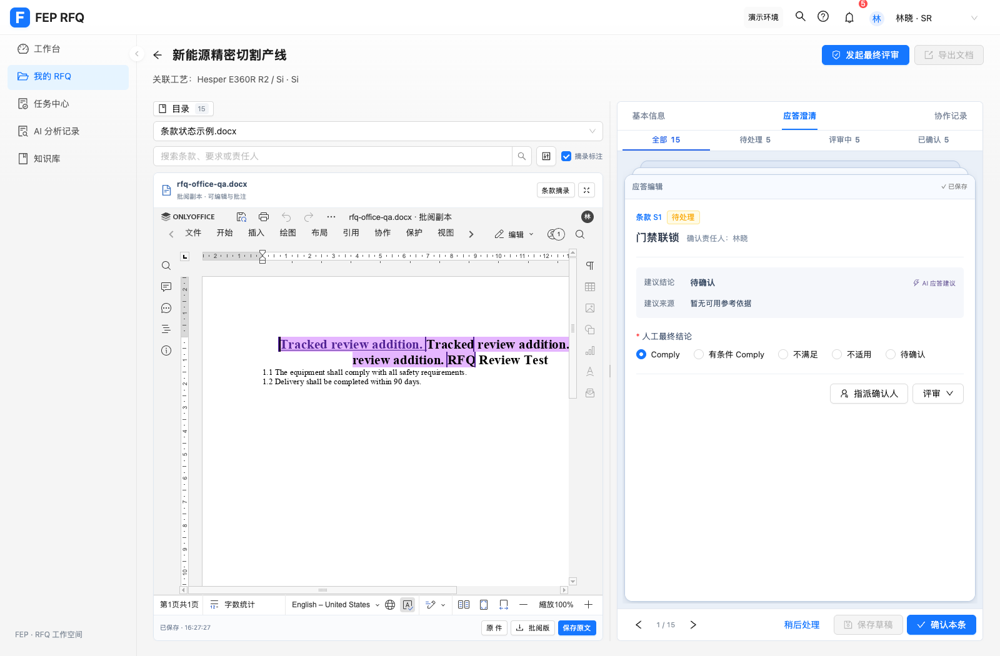
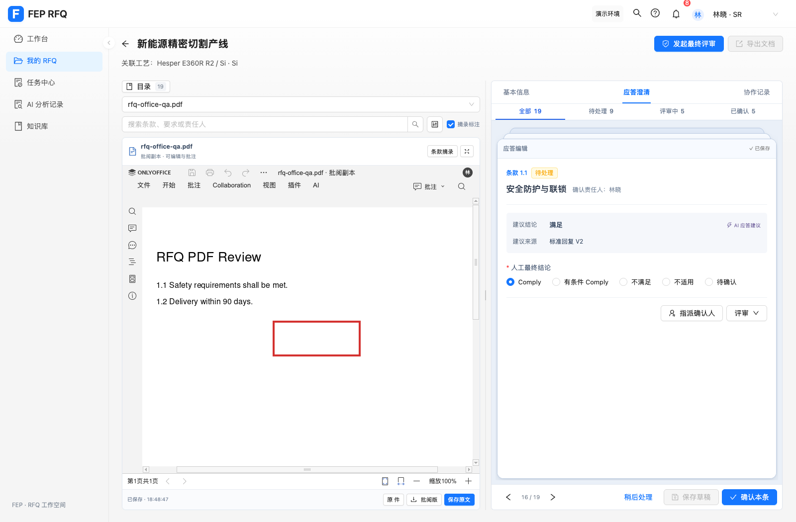

# ONLYOFFICE 原文件批阅验收

日期：2026-10-30。分支：`codex/onlyoffice-source-pane`。

## 当前使用

打开 `http://127.0.0.1:5173/#/response?projectId=RFQ-001`。详情左侧默认使用 ONLYOFFICE，右侧应答继续工作。历史示例没有原件时，由 SR 上传 DOCX / PDF；“条款摘录”保留原有高亮和业务批注。

后端和 RFQ 专用 ONLYOFFICE 已启动，端口分别为 `48081`、`8082`。原件独立保留，编辑写入批阅副本。文件、保存状态及回调去重记录持久化在专用命名卷。未修改其他项目的文档服务。

## 验证结果

| 验证 | 结果 |
| --- | --- |
| 前端完整测试 | 333 项通过，0 失败 |
| 前端生产构建 | 通过，仍有既有 vendor 大包体积提示 |
| 后端 Docker / Maven verify | 17 项通过，构建成功 |
| DOCX 原生批注 | 下载文件含 `word/comments.xml` 和测试批注文本 |
| DOCX 原生修订 | 原生“协作 → 跟踪更改 → 为我开启”后输入，下载文件含 `w:ins` 和对应文本 |
| DOCX 保存、刷新重开、下载 | 通过，以服务端保存时间确认落盘 |
| PDF 矩形标注 | 保存、刷新重开及下载后保留 `/Annots`、`/Square` 原生标注对象 |
| 原件保留、重启恢复 | 原件字节不变；存储重建及实际后端容器重建后仍可读取已有文件 |
| 编辑器自带保存 | 回调确认后清除未保存状态，批阅版可下载；再点应用保存正常返回 |
| 保存失败后重试 | 保留原 iframe 实例和未保存状态；连接恢复后成功落盘 |
| 技术身份只读 | 页面显示只读，没有保存操作；签名配置关闭编辑与批注权限 |
| 历史摘录及 390px | 摘录可用，缺少原件状态明确，窄屏无页面横向溢出 |

浏览器验收使用独立上下文及测试原件，没有重置用户浏览器数据。

## 独立代码检查

一次完整检查发现三项 Important 问题，均已修复并验证：

- A → B → 重试 A 回调可能回滚文件：持久化成功回调摘要，重复回调幂等；新增回归测试先复现再通过。
- 原生保存后应用仍脏：核对编辑代次、文档服务接收代次及后端保存进展，浏览器验证下载恢复可用。
- 重试销毁未保存实例：回归先证明旧 iframe 被断开；修改为有未保存内容时保留实例并重试保存，恢复后通过。

没有遗留的 Minor 检查项。非法签名、过期 key、异源下载、强制保存 key、非连续重复回调、只读配置及大小/格式校验均有后端覆盖。

## 范围与决定

- 按用户要求在当前工作区的新分支实施并保留；同一工作区的后续改动需要继续协调。
- 验证使用 Dockerfile 的 Java 17 / Maven；宿主机 Maven 文件不可用、Documents 绑定挂载受限，后端复验需要 Docker。
- 当前是本机演示身份和文档访问凭据，企业认证、服务端项目成员权限尚未接入；端口保持回环绑定。
- 原有业务批注和原文件批注分别保存；后续已补 Word 条款双向定位，详见 [联动验收](2026-10-30-onlyoffice-clause-link.md)。PDF 定位继续使用条款摘录。
- 全文解析和应答匹配仍是明确的模拟流程；批阅不会自动更新要求、确认、最终评审或正式对外应答导出。
- 本轮为单后端实例文件存储；多实例锁与断电级事务保证留待正式部署实现。

## 页面效果

### 补充：任务入口缺少示例文件

先前手动放入的示例引用只存于操作时的浏览器缓存，因此其他浏览器或独立访问源没有该引用。RFQ-001 的条款 6 与默认项目页使用相同来源，问题不在任务参数。

现将公开示例打包到 `public/onlyoffice-demo/RFQ-review-example.docx`，只对 `RFQ-001 / RFQ-001-DEMO-FILE-CLAUSE-STATUSES / V1.0` 自动初始化。已有原件优先；其他项目、来源或版本不自动绑定示例。各浏览器保存各自的示例副本，未开放其他用户文件的访问凭据。

已验证无预先关联记录的 `localhost:5173` 独立缓存使用用户的完整条款任务参数会自动打开原生编辑器；既有 `127.0.0.1:5173` 原件关联继续保留。新增 3 项测试，完整测试共 336 项通过，生产构建通过。

