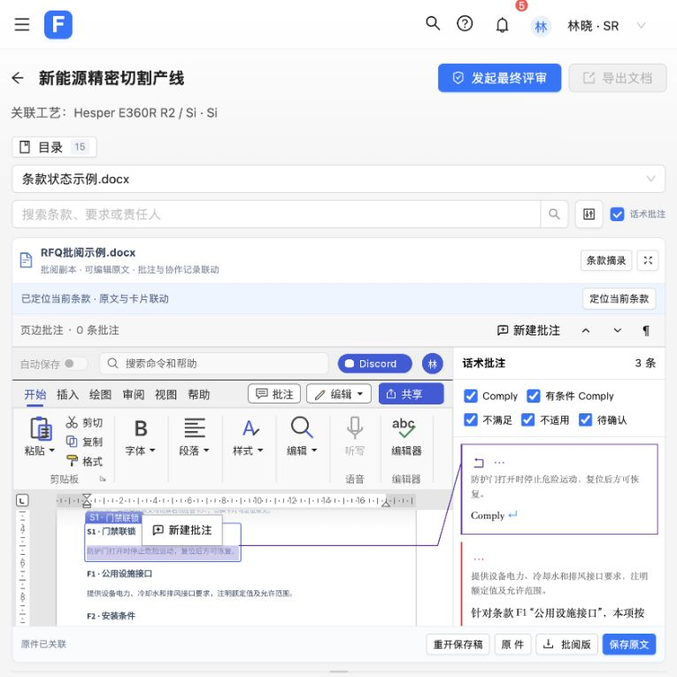
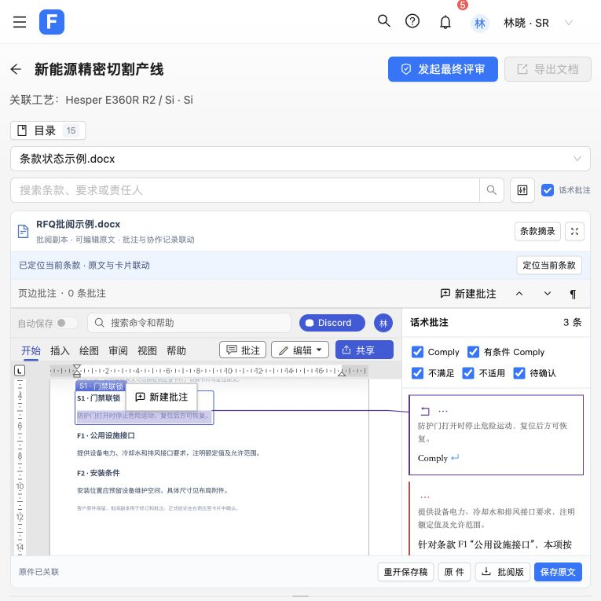
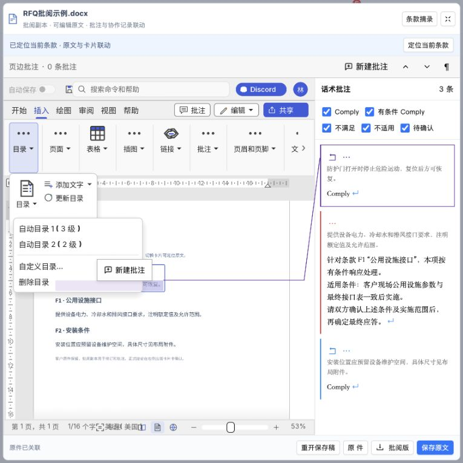
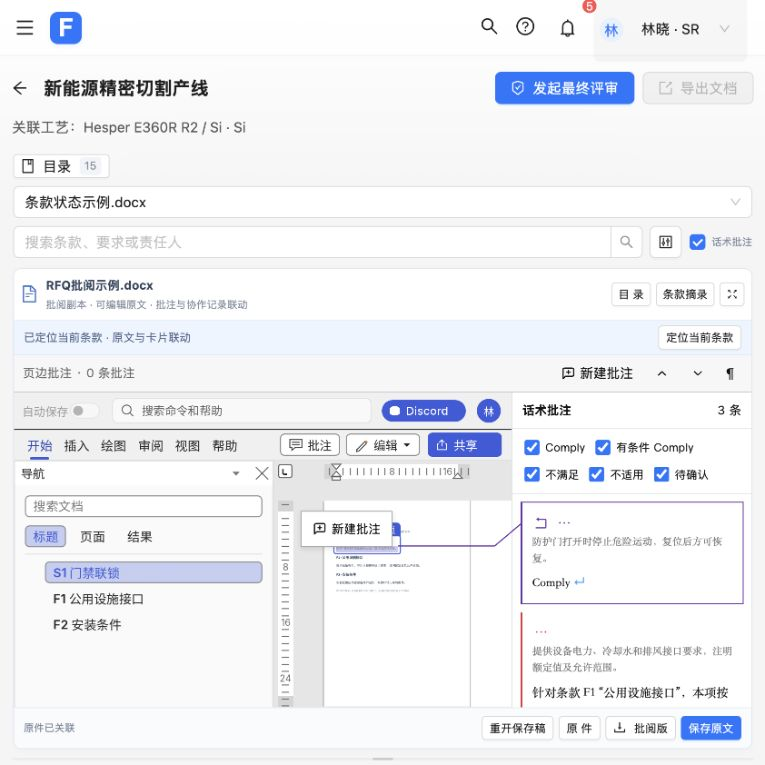
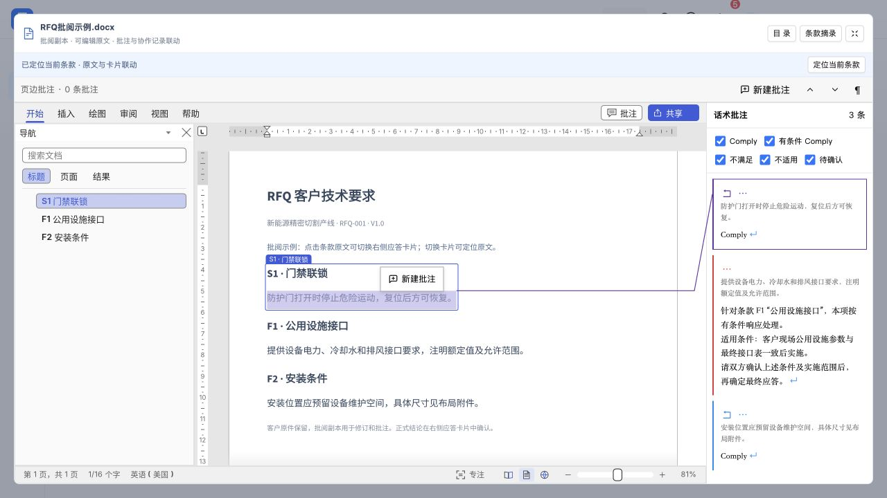
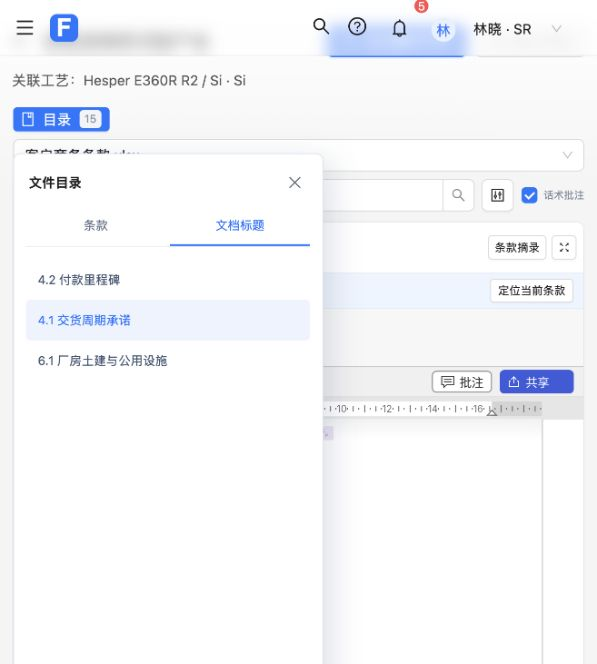

# Word / PDF 项目批阅验证记录

日期：2026-11-01。分支：`codex/rfq-craft-document-review`。

入口：[RFQ-001 第 6 条](http://127.0.0.1:5174/#/response?projectId=RFQ-001&requirementId=RFQ-001-DOC-EXAMPLE-6)。
启动及数据边界见 [接入说明](../../development/craft-project-review.md)。

## 已执行的验证

| 范围 | 结果 |
| --- | --- |
| 前端 `npm test` | 423 项通过，0 失败；包括真实 React 挂载、同步协调器、帧隔离、保存队列及既有业务回归 |
| 共用批注 DOM `node --test packages/craft-editors/tests/*.test.mjs` | 25 项通过，0 失败 |
| 后端 Docker 构建中的 Maven `verify` | 27 项通过，0 失败；其中 9 项为真实 HTTP 文件集成测试 |
| Word 原生批注定向测试 | 14 项通过，含项目桥回归及关闭系统字体后的中文字形检查 |
| PDF 原生批注及几何定向测试 | 15 项通过，含 6 项项目桥回归 |
| PDF 稳定批注对象身份 | 3 项通过 |
| `npm run craft:build` | 两个固定版本引擎的离线 WASM 构建及资源准备成功 |
| `npm run build` | 生产构建成功；产物包含 28 个散列匹配的编辑器文件，包括嵌套运行脚本与许可声明 |
| 源码补丁 | 从固定归档重新解压、实际应用补丁；Word 18 个及 PDF 16 个 Rust 文件逐字节匹配已测试、已构建源码 |
| 差异检查 | `git diff --check` 通过 |

后端新容器 `rfq-craft-service-local` 独立监听 `48083`，使用 `rfq-craft-documents` 卷。健康接口返回 UP。通过真实 HTTP 上传 DOCX、保存不同文件字节、下载并核对原件不变及批阅稿完全一致；旧版本保存返回 409；相同字节保存不增加 revision；重启容器后元数据仍在。PDF 的上传、保存及字节一致下载也通过了前端代理。

前端 `5174` 的项目页面、React 模块、示例 DOCX、Word/PDF WASM、嵌套 JavaScript 依赖均返回 200；嵌套脚本返回 JavaScript 类型。`/api/craft` 代理可读取独立后端的文件元数据。旧 `5173`、ONLYOFFICE 服务及其存储保持独立。

## 重点回归

- 未关联条款的批注不进入业务记录；只有明确选择有权限的条款后才同步。
- 双向新增、编辑、回复、解决及删除不重复；外来作者、@人员、评审关联及并发回复保留。
- 旧帧、其他来源版本、其他文档 token 和不完整快照不能覆盖当前文件或误删讨论。
- 保存期间新输入、尚未同步的右侧内容及晚到的草稿不能被旧保存确认标成已保存。确认数据来自实际序列化的文件字节。
- 已在原生编辑器确认、尚未保存的修改和回复，在重开旧文件后保留并重放。服务器新版本同时改变或删除同一批注时保留本地内容、提示冲突，不自动覆盖或重建。
- 原生删除后的同一会话撤销可以恢复讨论；跨会话打开旧文件仍保留未保存删除的保护。
- 技术角色的批注选区必须位于授权条款内；只读及正文编辑权限由原生会话和宿主同时检查，不写入伪造的文件保护信息。
- 编辑器资源复制包含生成的嵌套脚本。新增回归会实际加载复制后的 JavaScript 模块，并拒绝散列不符的源文件。

同步协调器及宿主经过独立代码复查；发现的重开覆盖、删除撤销和较新远端删除冲突问题均新增回归并修复，最后定向复查 62 项通过。

## 验证限制

当前 Work 设置关闭了浏览器自动化，本次没有浏览器视觉和实际点击验收。HTTP、DOM、React 挂载及原生文件往返测试不能代替使用客户文件的排版验收。

曾尝试完整 Word UI 测试：1015 项通过、6 项失败、2 项忽略。失败涉及对象拖动/旋转、字体符号及需要本机 socket 的 Zotero 流程；没有把这次完整运行记录为通过。本次修改的批注相关定向测试全部通过。上游历史 Clippy 告警未在本任务中清理。前端生产构建仍提示部分第三方分块超过 500 kB。

企业认证、服务端条款成员授权和业务数据库尚未接入。协作记录仍为当前浏览器的原型数据；后端保存真实文件。复杂 Office 排版、PDF 字体和第三方批注兼容性仍需实际样本人工验收。

## 补充：修复原文件一直加载

用户反馈正文未显示，页面一直提示「正在打开原文件」。排查发现 iframe 使用了
`/craft-editors/wordcraft-classic/` 目录地址；Vite 返回的是 RFQ 首页，状态码仍为 200，
并没有启动 WordCraft。PDF 目录地址存在相同问题。

现改为显式加载两个编辑器的 `index.html`。通过实际 HTTP 响应核对 Word 的
`wordcraft_canvas` 和 PDF 的 `pdfcraft` 画布，确认不再返回 RFQ 首页。
React 回归覆盖两个 HTML 入口、文件握手后移除加载遮罩，以及只读缺少原件的回退。
此前仅检查目录地址 200 的结果不足以证明编辑器已载入；本次补充了页面内容检查。

## 补充：修复 Word 中文缺字

原件的 DOCX XML 中文正常；原 Word WASM 的生成字体列表为空。上游的 Web 字体过滤
还会排除中文，因此仅提供字体目录仍不足以修复。现校验并打包固定版本的 Noto Sans CJK SC
与 BIZ UDPGothic，允许中文进入 Web 构建，并在必需字库缺失时让构建失败。
字体和许可随编辑器分发，输入记录在 `wordcraft-fonts.json`。

- 两项构建回归先失败后通过：Web 保留中日文字体、必需中文字库缺失时报错。
- 新增原生回归先复现无字库失败，再使用实际字体关闭系统回退检查中文覆盖与字形，
  确认不生成缺字符号；Word 定向测试共 14 项通过。
- Word WASM 与前端生产构建通过；实际 HTTP 下载的 WASM 包含经校验的 16,437,364 字节
  中文字体。源码补丁实际应用后，19 个 Word Rust 文件与构建源码逐字节一致。
- `cargo xtask ci` 已尝试，因本机缓存的路径依赖 `craft-libs-pdf/crates/menu` 中
  `craft-keymap` 的 workspace/default-features 声明不兼容，停在 `cargo fmt --all`；
  后续整套检查未执行。改动文件单独格式检查及定向测试另行执行，不把完整 CI 记录为通过。

浏览器视觉仍待人工确认。字体修复只影响渲染资源，不改写客户原件或已保存的批注。

## 补充：跨文件切换卡片保留原文显示

示例卡片顺序中，第 6 条之后的下一张为 `req-28`，来源从「条款状态示例.docx / V1.0」
切换到另一份业务文件 V1.1。该来源未关联真实原件，原文摘录却仍处于隐藏状态。
现将无原件来源默认切换到对应条款摘录，并显示当前文件尚未关联原件的提示；SR 可补传。
不会把前一文件的 Word 当作当前条款原文。

React 回归验证同文件切换保留同一 iframe、地址与文件打开次数；跨到无原件来源时摘录可见。
无原件回归已验证先失败后通过。原生跨页定位的临时排查也通过，没有修改原生引擎。

## 补充：统一示例的完整 Word 界面

用户确认需要整套 Word 界面和工具栏保持与独立 Demo 一致。为 RFQ-001 的商务 V1.1、
技术 V2.0、状态矩阵 V1.0 补充三份明确标记的 DOCX 演示摘录，覆盖 3、2、7 条要求。
原有 3 条 Word 状态示例保留，因此 15 张示例卡片均有可批阅的 Word 文档。
已有上传引用仍优先，来源版本及项目严格匹配，未修改实际客户文件。

演示文档由 `packages/craft-editors/build_project_samples.py` 从导出的模拟 `files`、`rows`
JSON 生成。三份文档均使用已验证的中文字体通过 `render_docx.py` 渲染并逐页检查，
每份一页，中文、标题及正文无缺字、重叠或截断。HTTP 下载的文件逐字节匹配，全部条款
原文与模拟数据一致。前端 424 项测试及生产构建通过。浏览器内的整套界面视觉仍待人工确认。

## 补充：恢复原生编辑器旁的话术批注

原接入只保留了人工文件批注，话术标注仍在隐藏的旧摘录中。现给原生编辑器接回
`selectSourceResponseAnnotations` 和原版 `SourceResponseAnnotation` 卡片，显示本文件
各条款的 Comply / 推荐话术。当前右侧表单的结论、条件及原因用于实时预览，可按结论
筛选，点击卡片定位或进入讨论。工具栏原「摘录标注」改名为「话术批注」。

话术预览与人工文件批注分开显示，不修改客户文件或协作记录。宽区域在编辑器旁显示，
窄区域在下方显示。React 回归先复现话术卡片缺失，再验证 Comply、未保存的原因变更
即时显示，以及编辑器实例和文件打开次数保持不变。浏览器视觉仍待人工确认。

## 补充：接通话术批注与原文定位

点击当前已选中的话术时，原先只更新业务选择，不会再次向原生编辑器发送定位。
现每次获准点击都显式定位该条款；同文件编辑器不重开。原生 Word / PDF 快照新增
`sourceRanges`，由实际文本匹配、页面变换及滚动位置得到。宿主据此绘制当前条款的
高亮与到话术卡片的连线；未匹配、歧义、滚出视口或来源已切换时清除旧高亮。
原文选中其他已识别条款时，原有反向选择继续生效，话术列表滚到当前条款。

Word 中原文重复时，用条款编号和标题组成上下文匹配，区分演示矩阵里正文相同的
不同条款；无法唯一匹配时仍提示核对。此定位上下文不改写业务条款或文件内容。

回归覆盖重复点击发送定位、坐标裁剪/变换、旧条款坐标隔离、重复正文的上下文目标。
新增 Word 原生回归验证真实坐标跟随页面移动，并在歧义时停止输出范围。
Word 15 项及 PDF 14 项定向测试通过，两个 WASM 已重编译。浏览器视觉仍待人工确认。

## 补充：统一隐藏七个 Word 功能区标签

RFQ 批阅模式在原生工具栏形成最终标签列表后，统一过滤 `Zotero`、`Developer`、
`Mailings`、`References`、`Layout`、`Design`、`File`。所有人加载本次更新后的编辑器资源均生效；
旧偏好、显式显示、重置功能区及窄屏“更多标签”菜单不能恢复这些标签。
其他普通标签、表格等上下文标签及宿主保存、上传、下载、批注入口保留。

- 新增三个真实 egui UI 回归：重置／显示／旧选中标签、窄屏菜单、上下文及自定义标签。
  修改前两项按预期失败，一项上下文对照通过；修改后三项全部通过。
- 工具栏相关原生测试 36 项全部通过；前端测试 426 项全部通过；现有 Word 字库检查 2 项通过。
- 沙箱外完整 `wordcraft-ui-egui --lib` 测试：1026 项通过、1 项失败、2 项忽略。
  剩余既有失败为 `theme::tests::interface_symbols_have_glyphs`，提示原批注界面的
  `↶ U+21B6` 缺少字形；该字体及批注代码不在本次修改范围内。沙箱内的首次完整运行另有
  本机 socket 和交互测试限制，不作为完整通过记录。
- Word WASM 重编译成功；为标准前端打包补齐原分支 PDF WASM，未修改 PDF 源码或补丁。
  `npm run build` 成功，仍有既有的第三方分块大于 500 kB 提示。
- 新补丁从固定源码归档重新实际应用，21 个 Word Rust 文件逐字节匹配测试／构建源码；
  改动文件格式检查及 `git diff --check` 通过。独立代码复查无问题。
- 本次浏览器验证可用，已实际打开 5174 的 RFQ-001 Word 批阅页面：工具栏显示
  “开始、插入、绘图、审阅、视图、帮助”，原文已定位，原件、批阅版、保存原文按钮显示正常。
  本次未通过 UI 执行文档写入或下载操作。

## 补充：Word 工具栏默认收起

宿主批阅模式首次启用时将功能区设为收起，覆盖旧浏览器的展开偏好；逐帧调用不会覆盖用户手动展开的状态。
点击普通标签或“更多标签”中的标签会展开工具，双击标签用于收起。此前隐藏的七个标签仍保持隐藏。

- 新增回归先复现默认未收起，再验证首次收起、点击当前标签展开、后续帧保持展开、手动收起及切换标签展开。
  原生功能区及相关对话框测试 42 项、宿主批阅回归 20 项全部通过；前端 426 项全部通过。
- Word WASM 与标准前端生产构建成功；补丁重新从固定归档应用、逐文件比较及资源散列校验通过。
  本次未重跑完整上游原生套件，既有字体符号测试限制仍见上一节。
- 浏览器实际验证：刷新后功能区默认收起；单击“开始”展开工具；双击“开始”重新收起。
  页面当前保留收起状态，原文和话术定位正常，未修改业务数据或文档正文。
- 独立复查通过。双击定义为收起操作；展开使用单击。

## 2026-11-02：Word 正文目录入口（已撤回）

本节保留澄清前的验证历史。用户随后明确需要独立展示目录且原文件不能修改，以下新增入口已撤回，最终实现和验收见下一节。

用户明确需要插入 Word 正文的目录。“插入”标签前部复用原“引用”栏的完整目录工具组，提供自动目录、
自定义目录、添加文字的目录级别、更新及删除。“引用”标签仍隐藏，默认收起行为保留，未更改底层目录命令。

- 两项新增真实 UI 回归在修改前因“插入”栏缺少目录按钮失败；修改后验证自动生成 TOC1/TOC2 条目、
  DOCX 序列化并重开保留条目，以及删除目录保留原文。无正文编辑权限时，菜单操作和直接目录命令不能改写正文。
- 工具栏及相关对话框 44 项、宿主批阅 20 项、自定义目录 1 项、前端 426 项全部通过。
  本次未重复完整上游原生套件；此前字体符号测试限制保留。
- Word WASM 与标准前端生产构建成功；新补丁从固定归档应用，23 个 Word 源码文件逐字节匹配。
  编辑器来源、public 和 dist 的资源散列一致；格式和差异检查通过。独立复查无问题。
- 实际浏览器核对了窄屏“插入”栏最前部的“目录”折叠工具组。放大原文件区后核对了完整的自动目录、
  自定义目录、删除目录菜单和更新按钮。目录生成及 DOCX 往返由合成文档原生 UI 回归验证，未在用户当前文件中插入目录。
- 验收后刷新恢复默认收起状态，未修改业务数据或原文件。

## 2026-11-02：独立只读目录导航（最终实现）

原文件区右上角增加“目录”开关，展开原生导航面板。优先显示已有文档标题；没有标题时使用当前文件版本中可唯一定位的条款；没有可用条款时显示页码。已恢复上游“插入”和“引用”源码，撤掉此前新增的正文目录工具组。七个隐藏标签和默认收起行为保留。

- 新增原生 3 项回归先因缺少 `outline` 协议失败，再验证打开、跳转和关闭不改变文档序列化内容、版本号、撤销深度或未保存状态。未设置标题的文档不会被添加标题样式；歧义条款被跳过，无匹配时可按页跳转。
- 前端回归验证按钮开关、视图状态同步、条款标题传递、PDF 不显示 Word 目录，以及目录操作不触发保存、重载或批注写入。前端 427 项全部通过；原生功能区及对话框 42 项、宿主 23 项、既有导航 4 项全部通过（宿主集合包含新增 3 项）。
- `outline` 只调用视图导航命令，跳转只改变光标；不刷新批注草稿、不标记文档修改、不调用保存。原有正文编辑权限不变，本功能本身不改写 DOCX。
- Word WASM 与标准前端生产构建成功。补丁从固定归档干净应用后，24 个 Word 源码文件与测试源码逐字节相同；31 个 Word/PDF 产物在来源、public、dist 中散列一致。新增导航及测试源码格式检查、Git 差异检查通过。
- 独立复查通过，未发现重要问题。本次没有重复完整上游原生套件，此前字体符号测试限制保留。
- 实际浏览器展开 S1/F1/F2 目录，点击 F1 跳转到“公用设施接口”并联动应答项，再返回 S1；关闭和重新展开目录均未出现文档未保存状态。放大/还原原文件区后目录仍可使用。未编辑文档或业务内容，未执行保存，页面保留目录展开及工具栏收起。

## 2026-11-02：去掉顶部 Discord 行、编辑按钮及底部文件操作行

按最新要求，在宿主 Word 中去掉整个原生标题行（自动保存、快捷按钮、搜索、Discord、头像及重复文件名），不占原来的 38 像素高度；同时去掉功能区右侧“编辑／审阅”模式菜单及其宽度占用。Word/PDF 宿主底部的重开保存稿、原件、批阅版、保存原文整行也去掉。独立 WordCraft 模式、既有编辑权限、修订设置及键盘保存路径不变，目录和其他功能区继续保留。

- 新增 3 项原生回归先失败：标题行仍占高度、完整宿主仍有账户控件、窄屏仍有编辑按钮。实现后 7 项 RFQ 回归通过；标题行 12 项、功能区 43 项、宿主 25 项均通过。覆盖独立模式、两种修订状态、340/1600 宽度及不改变原文。
- 前端回归先验证原组件仍有底部文件操作行；删除后验证 Word/PDF 均无该行，目录保留，原生保存继续按确认版本写入，失败不清除未保存状态。未保存/保存中状态并入原有文件标题说明，保存失败的备份及重开入口放到错误提示中。
- 独立复查发现一项 P2：保存失败后的“重试”原本只同步批注并清除错误提示，使恢复入口消失。新增回归复现“写入次数仍为 2 而不是 3”，修复为实际调用原生保存，确认成功前保留错误及备份入口；持续失败和随后重试成功均已覆盖。最终前端 427 项全部通过。
- Word WASM 与最终标准前端生产构建成功；固定归档干净应用补丁后 26 个源码文件与测试源码逐字节一致，31 个编辑器产物在来源、public、dist 中散列一致。格式及 Git 差异检查通过。本次未重复完整上游原生套件，此前字体符号测试限制保留。
- 实际浏览器核对正常和放大视图：顶部 Discord 行没有留白，功能区只余可见标签、批注和分享按钮，底部文件操作行已消失，独立目录和原文话术联动仍显示。没有编辑或保存用户文件；验收后还原页面布局并保留目录展开。
- 用户明确本次先改、不打包；仅重建本地预览，未生成或发布新 ZIP，未提交或推送此次改动。现有 `craft-editors-ca90976` Release 对应上次提交，不包含本次精简。

## 2026-11-02：master 合并与 Windows 交付验证

用户随后明确要求合并推送到 `master` 并打包 Windows 所需；上一节“未打包、未提交推送”是当时的状态，本阶段已获交付授权。当前远程 `master` 已包含 `ca90976`，后续界面精简及 Windows 兼容通过功能分支提交后快进合并。Windows 包的安装路径及启动步骤见 [Windows 启动说明](../../development/windows-craft-startup.md)。

- 实际用 `core.autocrlf=true` 检出两个编辑器补丁，确认旧配置会转换为 CRLF；固定 LF 属性后，检出字节与 Git 内容一致。prepare 回归先复现同一补丁的 CRLF 格式被拒绝，修复后接受仅换行差异，拒绝实际补丁变化；运行文件散列继续严格按原始字节检查。
- 用户进一步确认统一目录也一起合并。包含该改动的最终前端 430 项通过，生产构建成功；原生标题行 12 项、功能区 43 项、宿主 27 项通过。本次未重复完整上游原生套件，既有字体符号测试限制保持。
- 对本次 Java 后端重新执行 Docker 构建阶段的 Maven `verify`，27 项测试通过；从构建镜像提取运行 JAR。在独立临时端口直接用 Java 启动该 JAR，验证健康检查、真实 DOCX 上传、带版本保存、原件下载字节不变、批阅稿字节一致及旧版本写入返回 409；未使用业务存储目录。
- 独立复查无 Critical/Important 问题。Windows 资源包只含编辑器运行文件、清单、许可证、Java JAR 及说明，不包含业务文件或凭据；实际 Windows 系统未在本机运行验证。
- 统一目录保留条款视图的筛选、勾选及批量确认，文档标题视图读取真实结构并校验会话和版本。实际页面验证了标题跳转、来源隔离及切换视图后的筛选/勾选保留；独立复查通过。新的 Word 引擎和前端产物一致，26 个补丁源码逐字节匹配固定归档应用结果，31 个编辑器产物在来源、public、dist 中散列一致。

