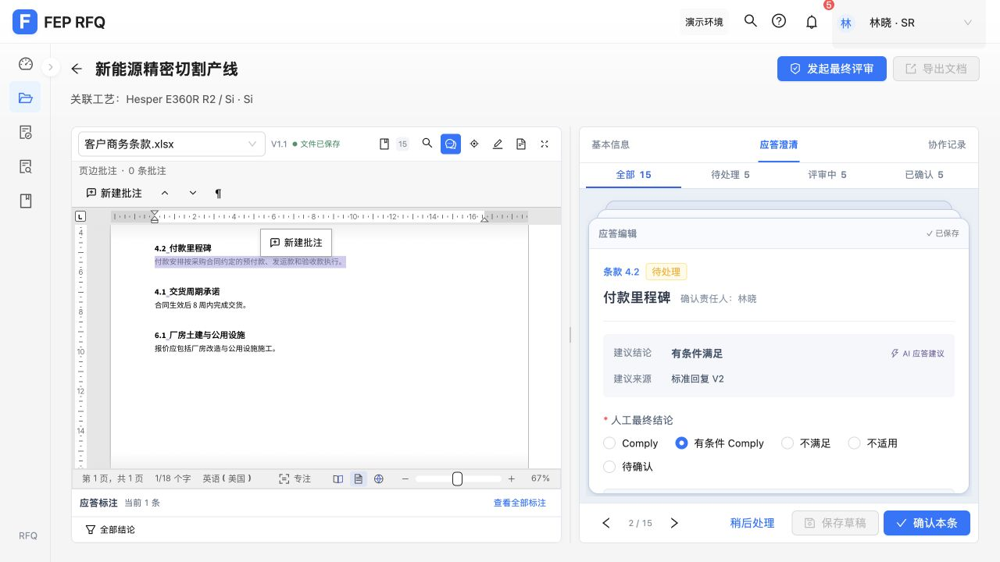
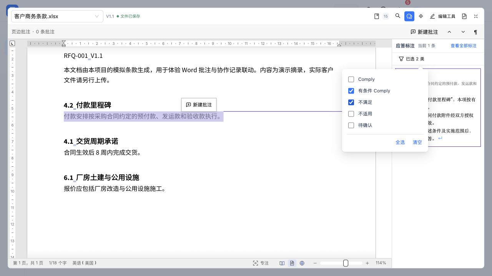
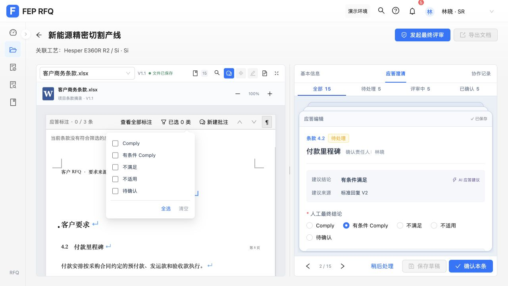
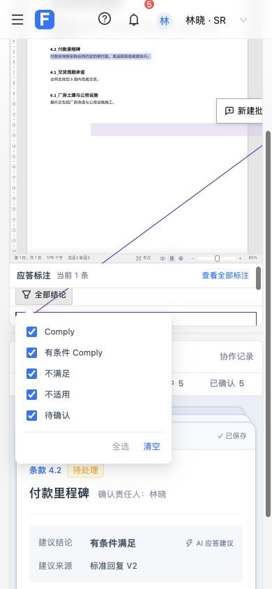

# 第 8 项：应答标注结论筛选菜单

用户确认：收进筛选菜单，保留多选、全选和清空；原文件区和项目条款摘录采用相同布局。

## 结果

- 五个结论复选框默认收起，入口显示“全部结论”；部分或清空时显示“已选 N 类”。
- 菜单即时筛选，多选和全选/清空保持展开，关闭后保留选择。清空后沿用当前条款/全部范围的空状态。
- 支持键盘打开、空格勾选和 Esc 返回入口；批量选择后焦点回到第一项，避免禁用按钮丢失焦点。
- 点击外部、同源原文 iframe 或切换原文件/条款摘录会关闭相应菜单；隐藏视图的选项不可继续操作，原有筛选选择保留。
- 原有范围、预览、定位、权限和文件保存流程沿用。文档处理页继续平铺显示结论选项。

## 自动检查

扩展真实 SourceDocumentPane 原文件/摘录集成测试，不替换筛选、标注或原文宿主组件。外部文件读取和禁用导航的 iframe DOM 边界由测试控制。

- 初始 RED：两个视图都缺少紧凑入口；实现后通过。
- 批量选择焦点 RED：实际焦点仍在按钮；修正后回到选项，通过。
- 独立审查发现两个 Important 关闭问题。新增回归分别观察 iframe pointerdown 后及键盘隐藏摘录后 aria-expanded 仍为 true；修正后通过，并覆盖原文件→摘录→原文件双向切换保留选择。
- 覆盖真实标注结果、多选、清空、全选、重新打开、Esc、源文件重置、隐藏/禁用、iframe 不重建、无文件写入和既有预览/讨论边界。
- 完整测试最终 442/442 通过；生产构建退出码 0，保留既有 chunk 体积提示。引入真实 Popover 后两个 HappyDOM fixture 补齐 Element/SVGElement 浏览器类型，没有添加生产环境垫片。

## 实际页面

在 RFQ-001 商务文件中检查默认当前 1 条、清空为 0、多选显示已选类别数、全选恢复，以及关闭再打开的选择保留。

- 普通布局筛选按钮底部 693.5px，在面板底部 695px 内。
- 放大文件区中弹层可见、可点击；原文 iframe 的画布点击会关闭弹层，并继续执行既有原文定位。
- Esc 返回入口焦点；键盘切换两种视图均关闭旧菜单，原文件的 4 类选择在返回后保留。
- 390×844 窄屏中弹层左右位于 34～234px，完整处于视口内；临时视口及放大状态已恢复。
- 验收只改变视图、筛选和定位，没有修改业务应答、新增批注或保存原文。最终恢复全部结论、当前条款和原来的条款 4.2 页面。

默认布局：

放大文件区的多选菜单：

摘录清空后的状态：

窄屏：

## 审查及交付

只进行一次独立只读审查。两个 Important 关闭问题在一个修正回合内完成 RED→GREEN，并通过完整测试及页面验证；没有延后 Minor 项。既有摘录/原生讨论入口差异、后端与原生持久化保持原范围，本次查看路径没有新增写入；相关既有问题需另项调查。

按用户要求单独提交并合并本地 master，合并后重跑完整测试。最终提交和分支状态以 Git 记录为准，不自动推送远端。
