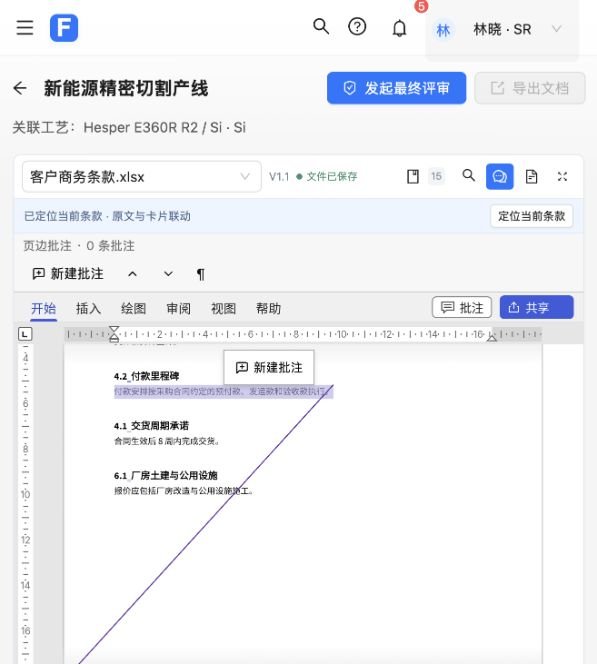
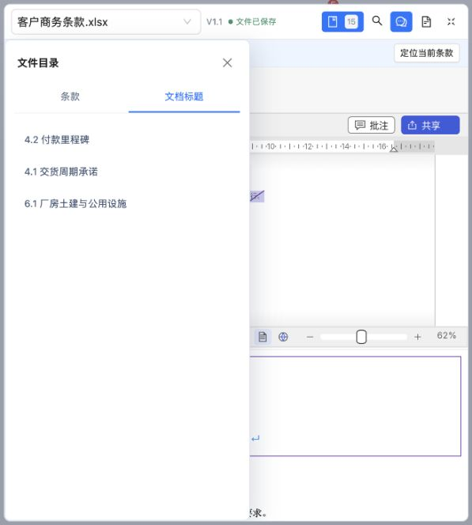

# 单行文档工具栏验收（第 2 项）

用户已确认：合成一行，文件和状态在左，工具在右；搜索点击后展开。并要求每完成一项独立提交、合并到 master。

本项把文件切换、来源版本、当前文件保存状态、目录、搜索与筛选、话术批注开关、条款摘录及放大集中到文件区顶部。文件名只在下拉框展示；文件状态读取原有保存队列及 dirty 状态，加载、缺少原件和读取失败不会显示为已保存。应答区保存状态继续独立展示。

搜索与筛选使用同一个弹层；Esc 收起会阻止原生 search 输入框的清空行为，保留未应用输入。现有搜索、筛选、文件切换和未保存保护仍调用原有业务处理。目录面板放入文件区，放大时仍能切换条款和真实文档标题。

验证：

- 修改前前端基线 430 项通过；完成后 431 项全部通过。
- 相关交互检查 3 项通过：按需搜索、完整筛选草稿回调、Esc 保留输入、单弹层关闭、文件状态与保存失败恢复、放大时目录可用、工具操作不重新打开 iframe。
- 前端生产构建成功；仅保留既有的第三方分块体积提示。本次未修改或重编译 Word/PDF 原生代码。
- 实际浏览器验证正常和放大状态的目录、真实标题、搜索输入与 Esc 重开、筛选关闭、重复标题移除及顶部控件位置；搜索草稿已清空还原，未保存或确认业务内容。
- 正常工具栏实测 `clientWidth = scrollWidth = 569px`、高度 `43px`，五个工具按钮纵坐标一致，无横向溢出。
- 页面无 error 级控制台日志。
- 独立复查发现放大文件区可能遮挡批量确认弹窗；已在真实页面先复现，再将放大文件区降到确认弹窗之下、目录升到浮动批注之上。修正后弹窗可见且可取消，目录不被浮动按钮遮挡，验收勾选已还原；修正后 431 项测试及生产构建再次通过。无其他需处理的复查问题。

后续第 3 项及其他精简仍须逐项确认，本提交不包含这些改动。
