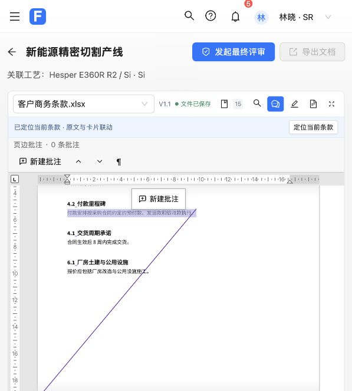
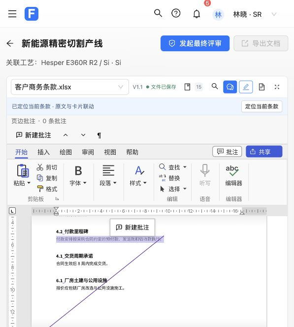
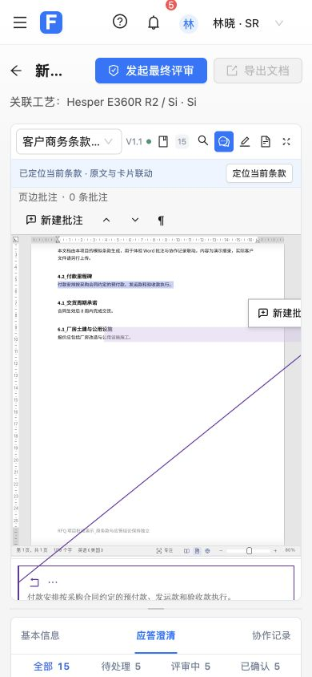

# 按需展开 Word 编辑工具验收（第 3 项）

用户选择默认隐藏整排功能区，通过顶部“编辑工具”开关展开，并要求本项单独提交、合并到 master。

实现：在 Word 原生宿主视图中保存每个文件的功能区可见状态，隐藏时不渲染整排标签、工具及附属按钮，也不预留高度；启动时在恢复个人偏好之后、首次绘制之前启用隐藏。宿主重新配置条款不会覆盖手动选择；新文件默认隐藏。展开只改变视图，原有正文与批注权限继续生效，独立 Demo 和 PDF 的工具栏行为不变。

验证：

- 新原生用例和桥接用例先复现缺少控制，再通过；前端完整 432 项通过，相关桥接/文件区 18 项通过。
- 原生 RFQ 检查 14 项、宿主检查 29 项通过，覆盖宽/窄窗口无空白占位、展开工具、七个既有隐藏标签、只读拒绝写入、正文/修订/撤销/dirty 不变、重新配置保留选择、启动默认和新文件/旧会话隔离。
- 固定归档实际应用补丁，26 个源文件逐字节匹配测试/构建输入；Word WASM 重编译及前端生产构建成功。仍有既有第三方分块大小提示。
- 实际浏览器验证默认隐藏、点击后展开真实标签与工具、同文件切换条款保持展开、再次点击完全隐藏；已还原原条款及隐藏状态。文件状态保持已保存，未执行业务确认或文档保存。
- 正常工具栏实测宽度和内容宽度均 569px；390px 窄屏下均 362px，六个按钮纵坐标一致且都在视口内。临时视口覆盖已撤回。页面无 error 级控制台日志。
- 独立复查无 Critical/Important 问题。低优先级待补测试：桥接层开关在未就绪、销毁后、PDF 和非布尔参数下的拒绝用例。对应代码限制已实现；现有用例覆盖成功切换、原生非法参数/旧会话拒绝及 PDF 不显示开关。

第 4 项定位提示及其余精简仍待用户逐项确认。
