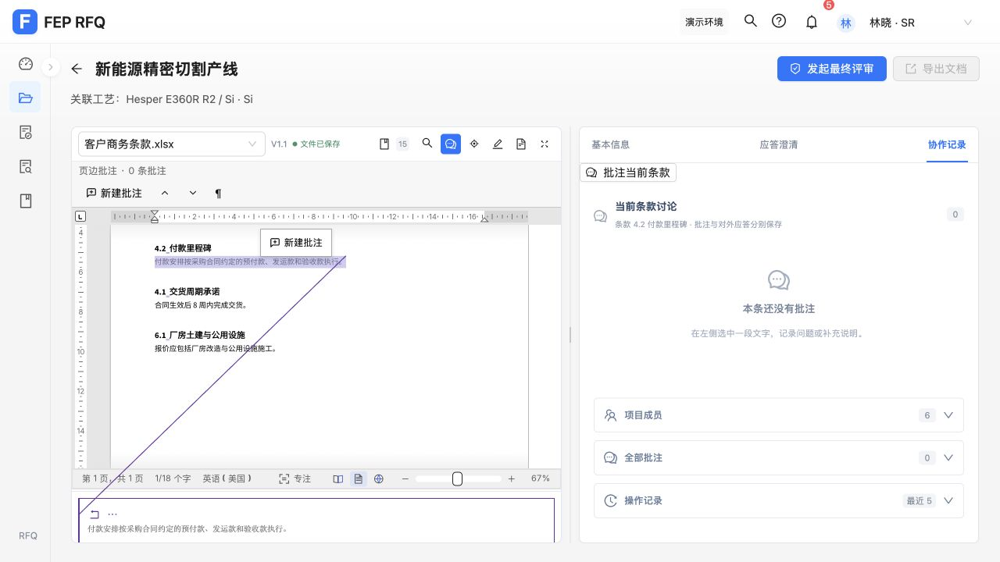
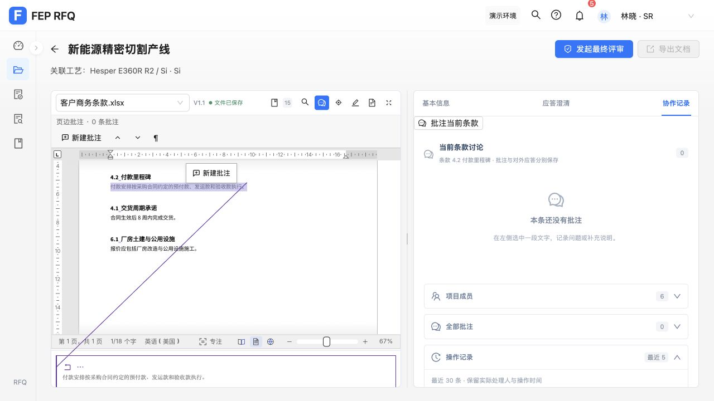
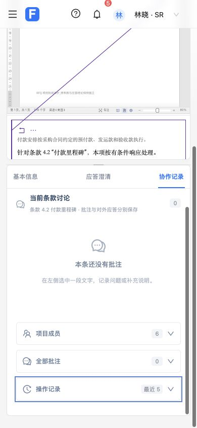

# 第 6 项：当前条款讨论与按需项目记录

用户确认：默认当前条款讨论，项目记录按需展开。本项只改变右侧协作记录的默认内容及项目记录展开方式。

## 实现

- 进入“协作记录”立即显示当前条款讨论及其条款名称；没有批注时显示空状态。使用当前显示文件与来源版本的锚点隔离讨论。
- 项目成员、全部批注和操作记录使用三个独立的原生折叠区，默认收起，并显示数量。记录刷新和同项目切换条款保留展开状态，不同项目重新收起。
- 保留原有回复、修改、解决/重开、转评审、跨条款定位、历史版本提示及未关联文件批注入口。权限和保存行为沿用原规则。
- 项目操作记录仍按原有对象范围过滤并最多显示最近 30 条。折叠状态仅在当前视图内保留。

## 自动验证

- 新增真实 ResponsePage 集成测试 `src/focusedDiscussion.test.js`，不替换讨论、项目记录或原文区组件。先观察默认讨论缺失的断言失败，再验证实现通过。
- 验证无需先选批注即可显示当前讨论、文件/版本隔离、只读权限、独立展开、记录更新保留状态、跨条款定位、空项目切换及查看操作零业务写入。
- 前端 `npm test`：440 项通过，0 失败；`npm run build`：退出码 0。构建仍有既有的大体积 chunk 提示。

## 实际浏览器验证

在本机 `127.0.0.1:5174` 的 RFQ-001 条款 4.2 验证：

- 点击“协作记录”立即显示“当前条款讨论”及空状态，三个项目记录区均收起，数量为成员 6、批注 0、操作记录最近 5。
- 回车展开成员，空格收起；点击操作记录可查看实际处理人、时间和内容。
- 390×844 视口中折叠标题与数量完整显示，三个 summary 宽度和内容宽度均为 324px，无内部溢出；回车仍能收起操作记录。临时视口设置已恢复。
- 浏览器验收只切换视图和展开记录，没有新增批注、修改应答或保存原文。含批注与跨条款的数据交互由上述真实页面集成测试覆盖。

默认效果：

展开操作记录：

窄屏：

## 合并前审查

独立只读审查结论：可合并，无 Critical/Important 问题。一个延后的小项是补充“点击历史版本批注并回填路由”的直接测试；当前测试已覆盖历史提示、版本隔离及跨条款定位。

审查范围判断：后续 list 项目、无关 outputs 文件，以及未修改的原生编辑器持久化内部逻辑留在各自范围；本项查看路径已检查没有新增保存或业务写入。原生保存完整性继续由既有测试覆盖。

按用户要求，本项单独提交并合并本地 master，合并后重跑完整前端测试；最终提交和分支状态以 Git 记录为准，不自动推送远端。
