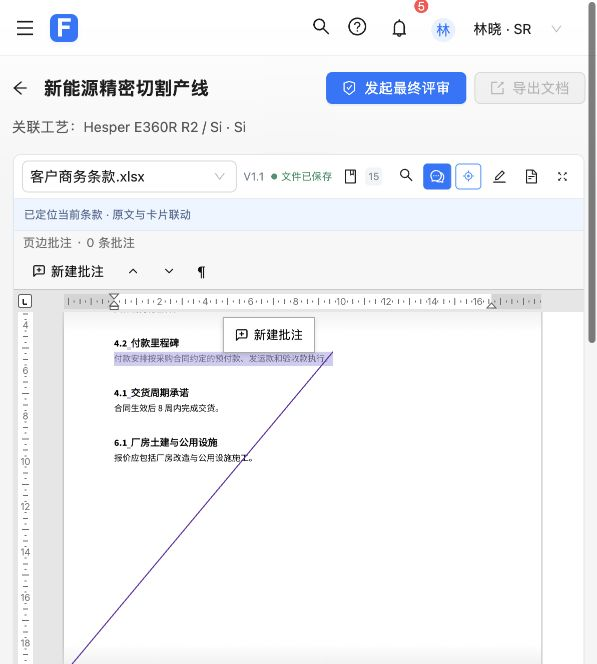
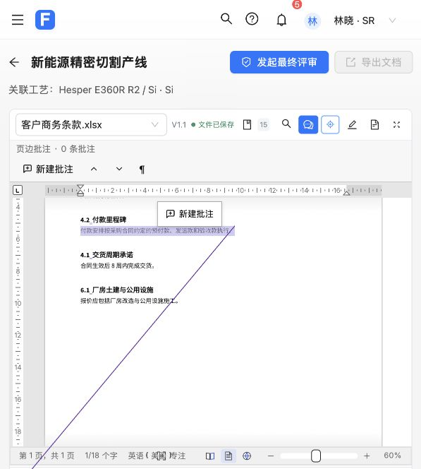
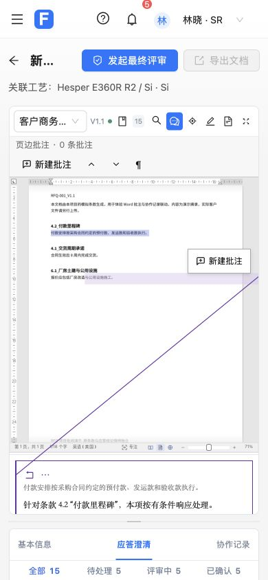

# 定位提示精简验收（第 4 项）

用户选择：成功后收起，失败时保留提示，定位入口移到顶部。本项单独提交并合并到本地 master。

顶部增加“定位当前条款”图标。成功提示显示 2 秒后整行移除；未找到、多处匹配、不支持定位和仅跳转来源页持续显示提示，保留“重新定位／查看摘录”。重试期间保留原有警告并禁用重复请求。定位入口在加载中、原件未就绪、没有当前条款或查看摘录时禁用。

验证：

- 定向用例先复现缺少顶部入口及成功提示不收起；实现后通过。复查发现点击已选中的话术绕过重新提示，新增用例复现后统一入口，定向用例通过。
- 在真实 React 和项目桥接层中使用受控的 2 秒计时器：1999ms 保持显示，2000ms 整行移除；几何坐标等无关快照不会延长提示；顶部按钮和当前话术的重复定位均重新显示提示。
- 四种需核对的状态持续显示，等待重试期间警告保持且按钮禁用；查看摘录隐藏原文提示。旧条款定时器及延迟返回不影响新条款提示，其他条款的成功不能作为当前条款成功。等待旧返回时，新条款也要收到自身的原生确认才能显示成功。
- 同一文件切换条款、查看摘录和放大保持原生 iframe，不新增原文保存或 dirty；既有文件保存失败重试和 PDF／无原件回退检查继续通过。
- 前端完整 432 项通过；生产构建通过，仍有既有第三方分块大小提示。本项没有修改原生定位算法或编辑器资源，无需重编译 WASM。
- 实际浏览器验证顶部定位、重复点击当前话术、成功整行自动收起；正常工具栏宽度与内容宽度均为 569px，390px 窄屏下均为 332px，七个工具按钮处于同一行且在视口内。临时视口覆盖已撤回，页面无 error 级控制台日志。
- 失败状态及延迟返回由原生消息边界集成用例验证，未改造演示文件制造定位失败；实际浏览器未执行业务确认、话术采用或原文保存。
- 独立复查提出的当前话术重复定位问题已修复；补充等待重试、旧目标延迟返回检查，均通过。本项无待处理的复查问题。

第 5 项及后续精简等待用户逐项确认。
