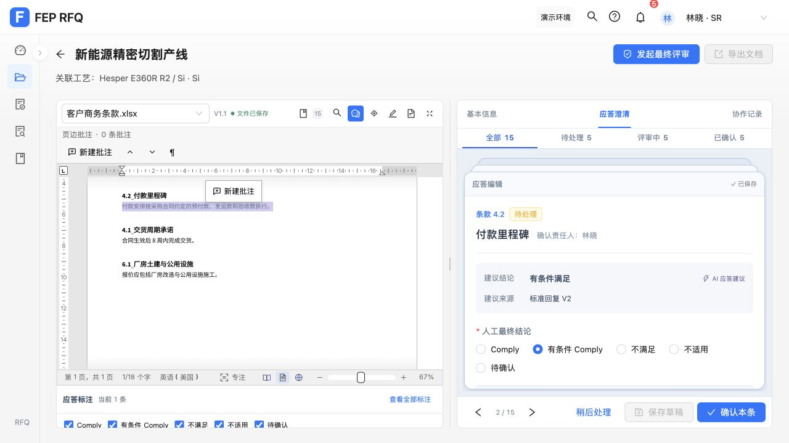
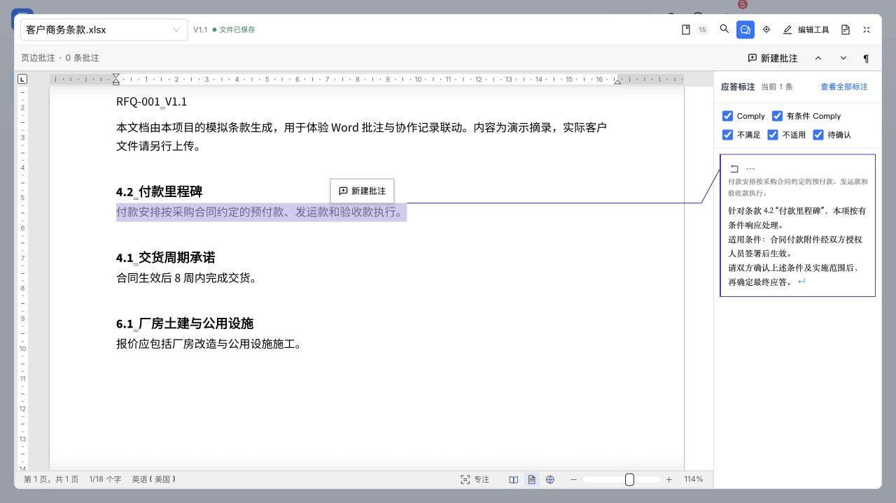
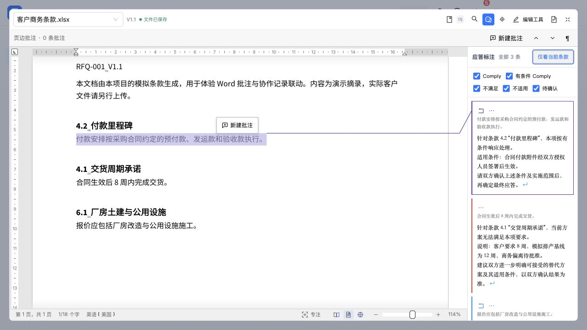
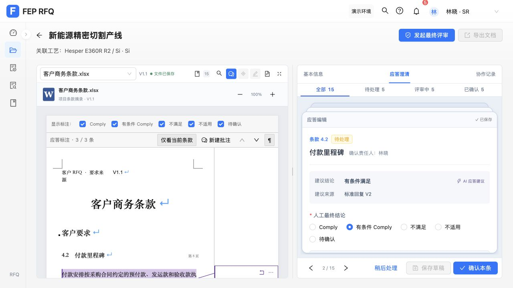
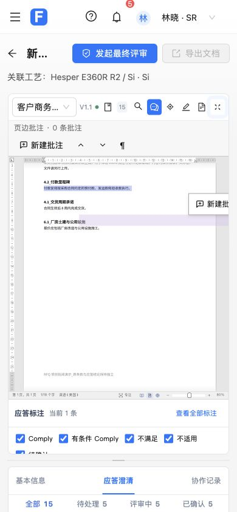

# 第 7 项：应答标注默认当前条款

用户确认：改名为“应答标注”，默认当前条款，按需查看全部。

## 实现与范围

- 项目顶部开关、原文件旁标题、筛选及辅助标签统一使用“应答标注”。
- Word/PDF 旁和项目条款摘录默认只显示当前条款，提供“查看全部标注／仅看当前条款”。全部范围沿用本文件输入条款及现有结论筛选。
- 同文件切换条款保留范围选择；新文件或来源版本恢复当前条款默认。无当前条款或当前结论被过滤时显示空状态，不自动回退到另一条。
- 编辑中预览、原文定位、查看应答、讨论权限与原有菜单继续保留。文档处理页的摘录仍沿用默认全部范围。
- 范围操作并入原生标注标题行，滚动时保留入口；当前模式预览刷新不再自动滚走标题，切回当前模式恢复顶部。文件区较窄时仍沿用标注区内部滚动；空间分配属于后续 list 项目。
- 本项仅改变显示，无业务数据迁移，无原生引擎或文件保存改动。第 8 项结论筛选菜单尚未实施。

## 自动验证

新增 `src/responseAnnotationScope.test.js` 使用真实 SourceDocumentPane、原生标注和摘录组件；只控制外部文件读取及 iframe 导航。

- 先观察两个视图默认显示 R1/R2 而非仅 R1 的断言失败，再验证实现通过。
- 覆盖默认当前、按需全部、同文件切换保持范围、不同文件/版本重置、编辑预览、结论过滤、缺失选择、定位及讨论边界、原生 iframe 保留和无文件写入。既有模型测试继续保护文档处理默认全部行为。
- 窄屏实测发现原有自动滚动会卷走范围入口，补充有限高度/真实卡片几何的回归。先观察 scrollTop 为 128 而非 0，再修正并验证；切回当前范围也断言恢复顶部。
- 最终完整前端测试：442 项通过，0 失败。生产构建退出码 0，仍有既有大体积 chunk 提示。

## 实际页面验证

在 `127.0.0.1:5174`、RFQ-001 商务文件及条款 4.2 验证：

- 默认 1 条当前标注；回车展开本文件 3 条，空格返回当前 1 条。
- 全部标注的“查看应答”菜单跳转到条款 6.1；点击条款 4.2 标注回到原条款，仍保留同文件范围选择。
- 排除“有条件 Comply”后当前范围显示 0 条及空提示，恢复筛选后再次显示当前标注。
- 条款摘录默认 1/3 条，展开为 3/3 条；返回原文件保持该原文件视图的当前范围。
- 普通布局和 390×844 窄屏中范围按钮完整位于标注面板内；展开后入口保持在面板顶部，可用键盘返回。放大原文件区后可在侧栏查看当前及全部标注。临时视口和放大状态已恢复。
- 页面验收只切换视图、筛选和定位，没有修改应答、新增批注或保存原文。文件保存状态保持已保存。

普通默认视图：

放大文件区的当前标注：

按需全部：

项目摘录：

窄屏入口：

## 独立审查与交付

一次独立只读审查：可合并，无 Critical/Important/Minor 遗留项。保留既有摘录与原生讨论入口差异、原生引擎内部持久化和无关 outputs 文件的原有范围；本项实际编辑权限仍经目标条款校验，文件持久化由既有测试覆盖。

按用户要求，本项单独提交并合并本地 master，合并后重跑完整前端测试。最终提交及分支状态以 Git 记录为准，不自动推送远端。
