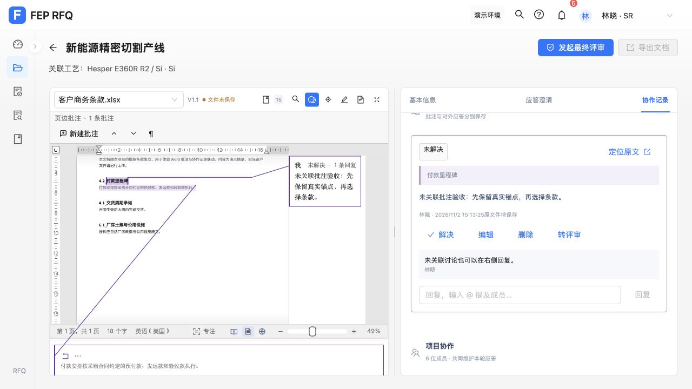
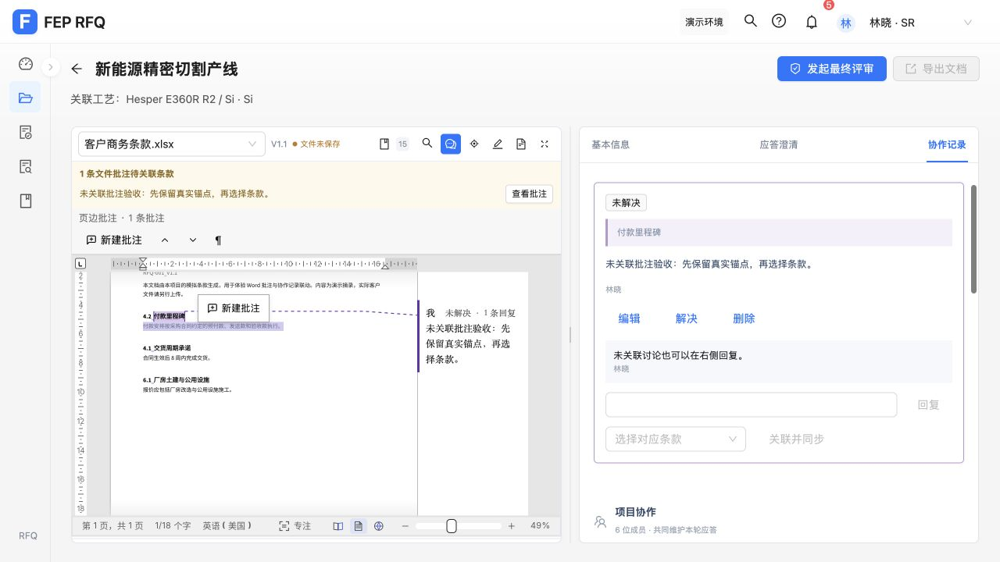
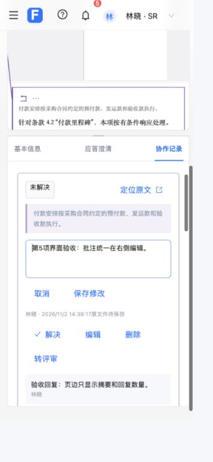

# 统一右侧批注编辑验收（第 5 项）

用户选择“统一到右侧协作记录，页边只看摘要”，本项单独提交、合并到本地 master。

页边保留作者、三行摘要、回复数、解决状态、锚点和连线，点击打开右侧讨论。右侧保留新增、编辑、回复、解决/重开、按权限删除、@提及和转评审。未关联的真实文件批注在右侧独立处理，明确关联后才进入条款协作记录，不以当前条款补猜。仅 RFQ 项目启用摘要模式。

验证结果：

- 基线 432 项前端测试通过；本项完成后 439 项通过。共享 Word/PDF 页边界面 25 项通过，独立 Demo 的完整编辑继续生效。生产构建通过，仍有既有第三方分块大小提示。
- Word/PDF 项目消息边界集成覆盖页边无完整编辑控件、点击只打开对应讨论、原文新建保留原生键和摘录、空白批注按显式请求导入、几何回传不重复打开或写入，以及右侧保存只更新原有原生批注。
- 覆盖歧义、无摘录、条款范围外、既有空白和未关联外来作者；不会自动套用当前条款。新建者可取消其原生已授权的新空白批注，文档管理员保留外来未关联批注删除权限；只读身份和原文文件保护均拒绝写入。旧文件消息、销毁后的动作、过期关闭回调不会操作新的讨论。
- 右侧组件验证真实输入、保存、回复、解决/重开、取消、外来作者和管理权限、原生状态回传保持输入，以及分区卸载重建后不重播旧编辑请求。删除通过当前数据的函数更新发送，旧原生回传不会恢复尚在删除的记录。
- 删除后新建复用同一原生编号的回归用例先失败后通过：旧讨论与评审关联保持删除历史，新讨论有独立身份；原生撤销仍能恢复旧批注。延迟执行的页面数据更新也保留该边界，归档删除不会阻塞文件保存检查。
- 实际 Word 浏览器验证：原文新建直接进入右侧、保存/回复/解决/重开更新同一摘要、重复点击摘要保留输入、只查看摘要不打开旧编辑框；标题摘录不能唯一对应正文时显示右侧待关联文件批注，可编辑/回复，显式选择条款后只形成一条业务讨论。删除后再次新建不会带出旧文本、时间或回复。
- 390px 窄屏仍在协作记录内编辑，操作会自然换行；桌面分栏同时显示原文摘要和右侧完整讨论。临时视口覆盖已撤回。PDF 在消息边界与共享界面测试中验证，本项未另开真实 PDF 做浏览器验收。
- 浏览器仅操作带明确验收文字的本机演示批注，已取消/删除全部测试批注；未采用话术、确认应答、发起评审或保存原文文件。重新打开后的页面显示文件已保存、0 条原生批注，保留原条款。最终验收页面无 error 级控制台日志。
- 独立复查提出两个 Important 问题：未关联批注缺少取消/删除、旧编辑请求重播。均以失败用例复现并修复，完整测试通过；无遗留 Minor。复查未独立执行的浏览器/窄屏/清理和最终测试由实现方按上述记录完成。

本项没有改动 Word/PDF 原生源码补丁或预编译资源，无需重编译 WASM。

后续 list 项目仍按用户要求逐项确认后实施。
