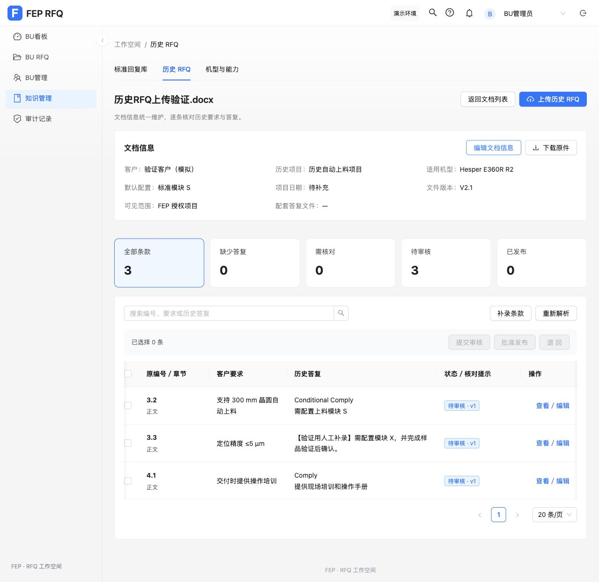

# 历史 RFQ 上传解析验收

日期：2026-11-03（Asia/Shanghai）。入口：`http://127.0.0.1:5173/#/history`。

## 已验证

- 前端完整 `npm test`：480 项通过，0 失败。生产构建通过；现有 bundle 大小提示仍存在。
- 后端完整 `mvn verify`：58 项通过，0 失败。使用已有本机 MySQL 和缓存依赖；JDK 环境显式启用 Lombok annotation processing。
- 后端历史测试使用真实生成 DOCX/PDF：合并结论与说明、缺答复、配套唯一编号、重复编号拒绝自动关联、图片／扫描异常、登录和 BU 校验、伪文件拒绝、PDF 多条款逐行拆分、Comply 数据不误判为表头。
- 前端回归覆盖：原件先存储、页面内导航后解析继续、失败保留原件并重试、同文件去重与原件恢复、人工修改与已提交版本保留、批量缺答复拒绝、自审拒绝、文档范围同步、旧记录迁移及补录不丢失、身份切换清空旧编辑器、其他标签页收紧文档范围后旧编辑器不可继续公开条款。
- 浏览器真实上传合成文件“历史RFQ上传验证.docx”：识别验证客户、历史项目、机型、配置和文件版本 V2.1，形成 3 条知识草稿。原件包含一条缺答复条款；人工补录后重新解析，内容和条件保留；随后 3 条批量进入待审核。
- 条款核对面板已实际打开，左侧保留段落／表格，右侧编辑客户要求、历史答复和条件；要求与答复可分别定位。

## 独立审查与修复

独立审查复现了 Comply 单元格误判表头、旧记录保存范围扩大／补录失联、身份和范围变化后旧抽屉仍可保存的问题。均已修复，新增行为测试及原复现脚本重新执行通过，无未处理的重要发现。

## 运行状态与边界

本机 `rfq-craft-service-master` 已更新至本轮 `target/rfq-service.jar` 并重启，继续使用原数据卷与原环境设置。前次运行包备份位于 `/private/tmp/rfq-history-build/previous-service.jar`。分发用 `runtime/rfq-service.jar` 没有自动替换。

元数据、条款与审核沿用原型本地存储，原件保留于 IndexedDB。后端使用真实读取与保守规则抽取，未将规则识别描述为已完成模型语义解析，也未将本地审批描述为企业跨用户知识库。

