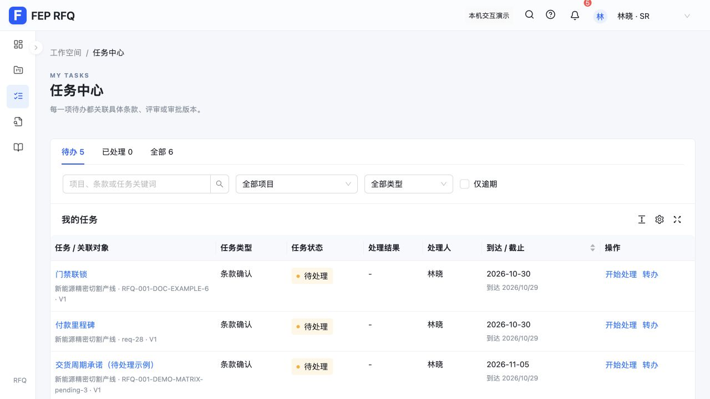

# RFQ Ant Design UI 验证记录

日期：2026-10-29。范围：既有 React 原型的展示层和组件适配。

## 已实现

| 区域 | 调整 |
| --- | --- |
| 全局框架 | ProLayout、统一主题、中文组件文案、Ant 消息提示、弹窗、抽屉、空状态及分页 |
| 项目与待办 | 项目列表、任务及 AI 分析记录使用 ProTable，支持列设置、密度及分页；保留项目卡片及现有筛选 |
| RFQ 创建 | ModalForm、字段校验、日期组件与按资格筛选的人员选择；保留机型工艺树及嵌套创建 |
| 文件选择 | Upload.Dragger，手动选择和删除文件；保留版本、替换原因、重复提示和元数据处理 |
| 人员与批注 | Select 使用人员 ID；无效历史选择可见且禁用；Mentions 支持姓名或 ID 搜索，保存时提取最终文本中的有效人员 ID |
| 原文应答 | Splitter 可拖动调整宽度，方向键、Home/End、Enter 可调节；Radio 结论、可读字号，窄屏上下排列 |
| 手机头部 | 390px 下身份选择完整可见；侧栏默认收起，选择导航后关闭 |

依赖：Ant Design 5.29.3、ProComponents 2.8.10、官方 React 19 兼容补丁。业务存储键和领域回调保持现有协议。

## 自动验证

- `npm test`：314 项通过，0 失败、0 跳过。
- 新增 7 项组件适配行为测试，覆盖日期字符串与 Dayjs 转换、键盘分栏边界、人员资格及历史值、文件元数据、最终文本提及提取、状态映射、中文姓名候选过滤。
- `npm run build`：通过，Vite 7.3.7；分离 React、Ant Design 和 ProComponents 依赖块。
- `git diff --check`：通过。

## 浏览器验收

使用生产预览 `http://127.0.0.1:5174/` 的独立来源存储，未重置日常开发地址 5173 的数据。

- 项目卡片与列表可切换，任务中心表格及转办表单可打开。
- 新建 RFQ 校验生效；实际创建测试草稿，日期保持为 `2026-11-12`。嵌套创建取消后保留父表单；选择与展开工艺树不会提交表单。
- 选择测试文件后显示列表；删除最后一个文件后，开始解析提示需要选择文件。
- `@顾` 可找到中文姓名候选，选择后插入稳定人员 ID；未发送通知。
- 拖动分隔栏后原文与标注随容器重新布局；键盘 ArrowLeft 将比例从 55 调至 50。
- 修改应答后切换页面触发未保存提示，放弃修改后可进入任务中心；未满足最终评审要求时正式导出保持不可用。
- 390×844 下无页面横向溢出，身份选择位于视口内，侧栏默认关闭、手动打开后可导航并收起。临时视口覆盖已恢复。
- 最终页面未捕获到控制台 error 或 warn。

独立整体验收发现并修复日期转换和键盘调节问题；后续浏览器验收修复工艺树默认提交、中文 @ 搜索及窄屏头部宽度问题。

## 当前边界

文件仍只保留元数据；真实上传、Word 解析、DOCX 输出、企业登录与 @ 通知需要后端接入。组件迁移不改变既有保存、确认、评审和导出权限规则。

构建仍提示部分依赖块超过 500 kB：Ant Design 约 1.40 MB（gzip 440 kB），ProComponents 约 612 kB（gzip 187 kB）。构建成功；正式发布前可继续按页面拆分加载以减少首屏体积。

