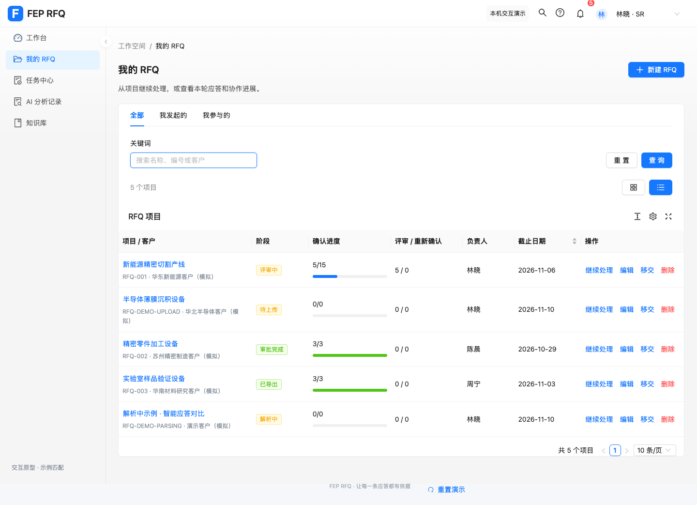
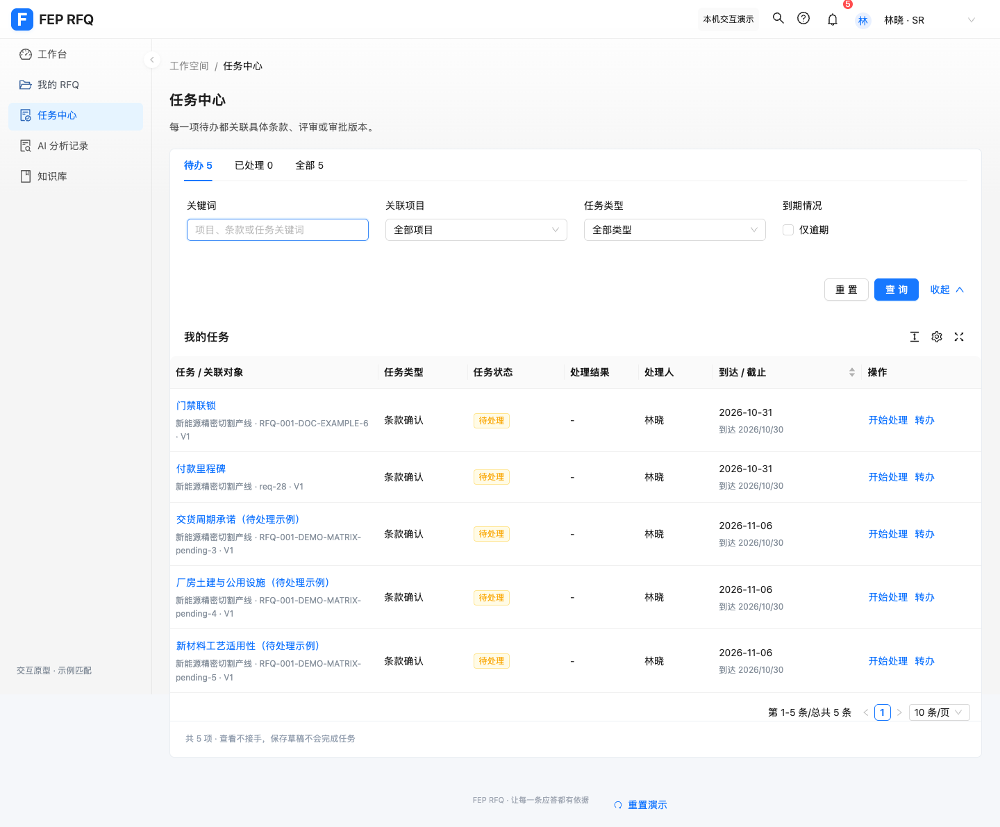

# RFQ Ant Design 内页统一验证

日期：2026-10-30。范围：现有 React 原型的组件层；保留领域逻辑和本地数据协议。

| 用户指出的差异 | 实现 |
| --- | --- |
| 主色与基础主题 | `#1677ff`；移除自定义控件高度、表头背景及 Arco 文本色覆盖。业务 CSS 变量从 antd token 派生。 |
| 页头 | 使用真实 PageContainer；标题与操作由原生 PageHeader 排列，RFQ 详情保留返回和最终评审入口。 |
| 筛选 | 项目、任务、分析、知识、审计、BU 人员及 BU 看板改为纵向 Pro QueryFilter，使用原生查询/重置。 |
| 表格 | 原有 ProTable 保留；27 处残留手绘表格改由 Ant Table 渲染，表头、行间距、边框及 hover 使用组件默认主题。 |
| 状态 | 公共状态组件改为 Tag，使用原生语义色、浅彩底和描边；移除灰底圆点状态展示。 |
| 图标 | 页面及外壳统一使用 `@ant-design/icons`，删除 lucide-react 项目依赖；装饰图标不干扰按钮可访问名称。 |

项目默认显示列表，仍可切回卡片。按钮、输入、选择、复选、标签、Tabs 使用 antd 组件；知识页弹窗、抽屉、分页和空状态同步统一。原文、应答与机型工艺等业务布局继续使用各自布局样式。

## 验证结果

- `npm test`：324 通过，0 失败、0 跳过；基线 319 项。
- 新增检查覆盖表格行 key、内容与回调保留、条件列、合并空行、空数据、Select 缺省文本值/数字值、TextArea 原生 focus/scroll ref。
- `npm run build`：通过。仍提示大依赖块（antd、ProComponents），本次未扩展到加载优化。
- `git diff --check`：通过。
- 浏览器复现迁移前页头不属于 PageContainer；迁移后通过同一检查。
- SR：项目列表查询/重置、已保存查询重新加载后的重置、新建弹窗、任务查询、知识页及 RFQ 详情正常；最终评审未满足时导出仍禁用。
- BU 管理员：BU 看板、人员查询与配置弹窗、机型能力页、审计查询正常。
- 后台管理员：账号目录动态表格正常。
- 390px：页面无横向溢出，表格在自身区域滚动；桌面切换到手机宽度后侧栏关闭。
- 最终浏览器检查未捕获 page error、console error 或 console warning；查询表单初始值固定为首次载入的已保存条件，避免后续查询触发 ProForm 初始化警告。
- 独立代码复核的 Select 缺省值与 TextArea ref 两项问题均已修复；回归测试先失败、修复后通过。

主题行为核对参考 [Ant Design 官方主题文档](https://ant.design/docs/react/customize-theme/)，实现以项目安装的 antd 5 / ProComponents 2 为准。

## 效果

