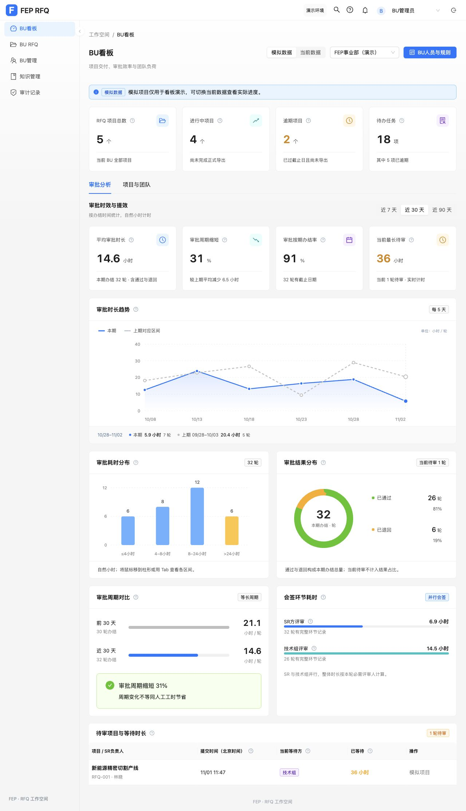
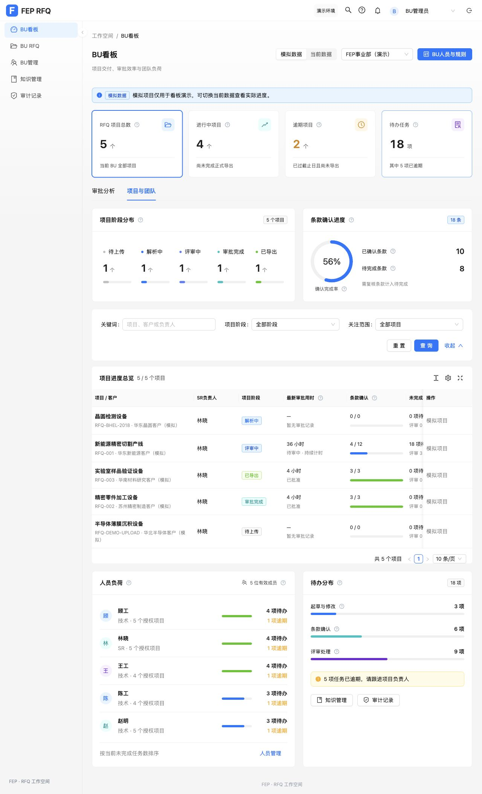
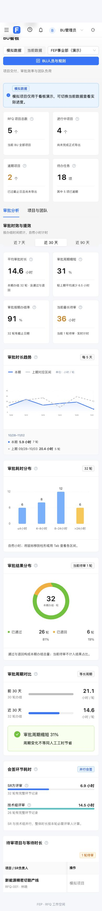

# BU 看板 Ant Design Pro 优化

2026-11-02，沿用现有 Ant Design 5 与 ProComponents 2，无新增依赖。

- 业务概览和审批指标改用 StatisticCard，统一字号、间距、图标、颜色和统计单位。
- 页面分为“审批分析”和“项目与团队”两个 Tabs，点击业务指标可直接切换并筛选项目。
- 图表、阶段分布、条款确认、人员负荷和待办分布使用 ProCard；确认率与负荷使用原生 Progress，人员列表使用 List/Avatar。
- 项目进度与待审明细改为 ProTable。项目表支持查询、排序、分页、密度、列设置和全屏。
- 保留当前 BU 权限、模拟／当前数据隔离、7／30／90 天统计、实时待审及精简气泡。模拟项目保持展示用途。

新增实际组件集成回归覆盖页签、指标筛选、气泡不误触、数据切换和重置查询。独立审查发现首次业务卡筛选被误用作表单重置初值，新增测试复现后改为固定空关键词／全部阶段／全部项目。

浏览器验证桌面和 390px 窄屏：气泡、卡片筛选、关键词查询、数据切换、90 天统计和重置后再次查询正常；手机页面宽度为 390px，表格在内部横向滚动。控制台未出现错误。生产构建及 git diff --check 通过，保留已有大分包提示。

BU 相关 30 项测试全部通过。最终完整 npm test：466 项，465 项通过，1 项失败。失败为本次范围外的 knowledgeMaintenance.test.js 中“all four roles can create, save, submit and open knowledge imports while publishing stays separate”，第 56 行适用条件标签断言实际为 []，预期为两个标签。本次未修改该测试及知识库编辑实现。

