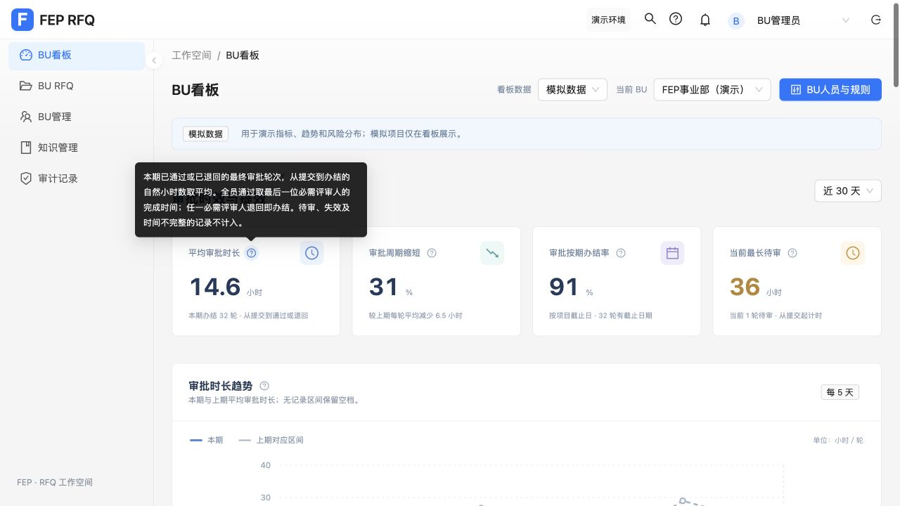
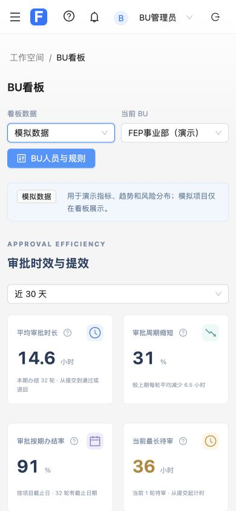

# BU 看板指标说明与模拟数据

2026-11-02，修改位于 `apps/web`。

- 审批指标、图表、会签环节、项目统计、条款确认、人员负荷、待办分组及明细表统计列提供问号气泡，解释含义、计算公式、统计范围与时间口径。
- 支持悬停、点击、键盘聚焦展开，Escape 关闭；点击气泡不触发项目筛选。
- 看板默认展示模拟数据，可通过顶部“看板数据”切换到“当前数据”。模拟数据仅在内存生成，复用原有汇总计算，不覆盖项目、任务或审批历史。
- 模拟数据含五个项目阶段、逾期项目、有效待办、人员负荷、180 天审批历史、通过与退回及当前待审。近 7／30／90 天均有本期与上期数据。
- 模拟数据仍校验当前身份与 BU 管理权限。模拟项目仅展示看板，不能进入真实项目详情或配置。

独立审查后补齐旧版澄清待办的分组归属，统一纳入“评审处理”，避免有效待办总数与分组总和不一致；新增回归测试。

验证：完整 `npm test` **463 项通过**，`npm run build` 成功，`git diff --check` 通过。构建保留现有大于 500 kB 的分包提示。

浏览器使用真实 App 验证数据模式切换、周期选择、气泡点击与键盘关闭、气泡不误触筛选和卡片筛选；390px 视口下页面宽度为 390px，无页面级横向溢出。最终页面未出现控制台错误。

