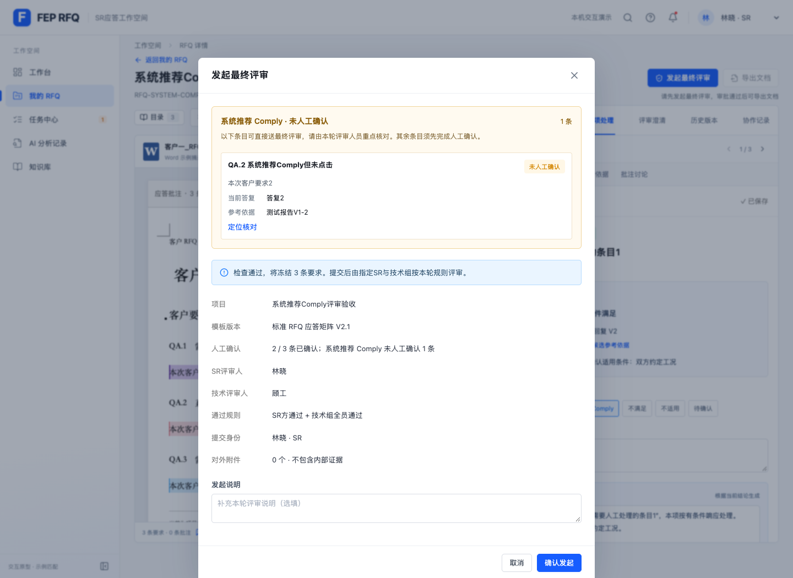

# RFQ 系统推荐 Comply 送评验证

日期：2026-10-27

## 行为

- 系统未推荐Comply的条目必须人工确认后才能发起最终评审；手动将结论改为Comply不会绕过确认要求。
- 当前结论和有效系统推荐均为Comply，且答复、证据完整的条目可免逐条人工确认送评。来源变化、待核对评审建议和未关闭事项继续阻断。
- 发起弹窗和只读审批详情最上方集中显示「系统推荐 Comply · 未人工确认」。冻结全文同样优先显示这些条目。
- 快照保存本轮未人工确认条目ID，保留真实待确认状态；审批不会伪造逐条人工确认记录。此类条目的正式CSV确认状态为「最终评审已通过（未逐条人工确认）」。
- 只有本轮指定SR与技术组全部通过，才解锁正式导出；修改来源或应答后重新锁定。
- 有效的系统推荐Comply条目不再产生强制逐条确认待办，已批准项目可进入审批完成阶段。

## 验证

- Node测试223项通过，0失败；新增规则测试7项。
- 独立代码审查未发现可证实缺陷，审查方另运行11项相关测试全部通过。
- 构建通过；保留已有JS大包提示。`git diff --check`通过。
- 独立无持久化Chrome上下文，`http://localhost:5173`测试项目`RFQ-SYSTEM-COMPLY-QA`，未更改用户已有浏览器项目。
- 浏览器验证：非Comply未确认阻断；人工确认非Comply后、系统推荐Comply仍未点击也可提交；发起与审批顶部清单；冻结ID及真实未确认状态；不产生额外必需确认待办；仅一方通过仍锁定；双方批准后导出；实际下载CSV并检查确认状态；来源变化后旧推荐和批准均不能继续使用；无页面错误。
- 日期迁移测试的3处待办fixture显式设为无可用匹配，继续测试必需人工待办的日期迁移与历史保留；常规系统Comply不再属于该类待办。

## 截图

