# FEP 销售 RFQ 提效 Agent 交互设计

本文整理项目入口、业务流程、页面字段和通用交互。业务约束及需求编号见[产品需求文档](FEP销售RFQ提效Agent_PRD_v0.2.md)，本地运行与已接通能力见[工程说明](../../README.md)。

- [导航与项目上下文](#2-导航和统一上下文)
- [项目处理页](#6-项目处理页)
- [解析与匹配](#7-解析和-ai-匹配)
- [导出与最终审批](#10-导出检查和最终审批)
- [页面字段与线框参考](#14-页面字段与线框参考)

条款确认历史支持查看和比较已确认应答。恢复旧版会生成待确认草稿，由当前确认人复核。已有保存草稿时，恢复前先保留草稿检查点。

## 1 设计决策

### 1.1 信息架构

| 入口 | 负责什么 | 不在这里重复处理的内容 |
| --- | --- | --- |
| 工作台 | 快捷发起、按项目聚合本人待办、最近项目、异常提醒 | 长任务列表和完整项目台账放在对应一级页 |
| 任务中心 | 跨项目查找并处理本人任务，查看已办历史 | 应答和审批操作进入统一处理页 |
| 我的 RFQ | 同一项目集合的卡片和列表视图，查询、进入、管理项目 | 合并原项目列表与台账，避免两套项目数据 |
| AI 分析记录 | 查询每次解析和匹配的版本、执行状态和结果 | 历史分析记录只读；修改与重试进入当前项目 |
| 管理后台 | 按授权提供业务资源维护及系统管理 | 进入同一导航分组不等于获得全部子模块权限 |

项目处理页不增加一级导航。从任务、项目、异常或分析记录进入时，恢复对应项目、文件、版本、条款及来源页面。

### 1.2 对用户 V1.0 方案的关键调整

| 原方案中的规则 | 本版调整 | 原因 |
| --- | --- | --- |
| 保存或提交后，任务变为已处理 | 保存只更新草稿；提交、确认、批准等动作分别按任务类型判定完成任务 | 保存应答不等于完成确认；保存评审方案不等于批准 |
| 进入处理页即处理中 | 查看不改变状态；明确点击“开始处理”或执行首次有效编辑后进入处理中 | 区分查看、接手和实际处理 |
| 项目在起草与专业评审阶段间反复切换 | 项目保留稳定主阶段，另显示专业评审、澄清、复核数量 | 同一项目可同时起草、评审和等待客户回复 |
| 项目只有一个当前处理人 | 显示负责人，另显示当前待办责任人摘要；多人的场景显示人数并可展开 | 项目负责人和当前任务处理人职责不同 |
| 合同比对默认客户新版与当前稿比较 | 分为“客户 RFQ 版本比对”和“建议与答复对比” | 客户要求与供应商答复属于不同对象，不能作为同类版本比较 |
| AI 审查需要确认才能进入起草 | 解析成功的条款自动进入细则比对；异常条款单独处理 | 沿用现有自动导入约定，允许边处理边起草 |
| 知识库无匹配属于 AI 失败 | 无匹配属于正常结果；系统、转换或检索异常才是执行失败 | 无依据与服务失败需要不同处理动作 |
| 原文与应答层叠显示 | 默认原文只读，条款应答与批注分层；可开启“显示应答标记” | 保留原始依据，避免把人工答复显示成客户原文 |
| 转办和项目移交使用相同语义 | 任务转办只改任务处理人；项目移交改负责人，并单独选择待办是否改派 | 避免移交项目时误改所有专业职责 |
| 评审结束风险消失 | 保留已批准偏离及其条件；未解决事项数量下降 | 内部批准不代表客户要求已满足或风险已经不存在 |
| 三个页面的计数始终相等 | 同用户、同授权范围、同筛选口径下相等；最近项目和分页显示局部合计 | 避免部分列表被当作全部待办 |

### 1.3 主流程

新建项目并上传来源文件 → 自动解析并逐条匹配 → 原文联动应答 → 必要时评审或客户澄清 → 专业确认 → 导出前检查 → 冻结并提交快照 → SR与技术组最终评审 → 正式导出。

解析、匹配、起草可以按文件和条款并行推进。评审及澄清完成后回到同一条款核对应答；新版要求或引用变化时，仅受影响项进入复核。

## 2 导航和统一上下文

### 2.1 页面结构

```text
工作台
任务中心
我的 RFQ
AI 分析记录
管理后台
  业务资源：标准回复、历史 RFQ、机型与能力、资料与证据
  管理设置：成员与权限、审批规则、导出模板、系统配置、审计记录

项目处理页
  RFQ解析 | RFQ细则比对 | 导出文档
  项目工具：版本记录、流程详情、项目设置
  RFQ细则比对内部：原文与应答 | 偏离与澄清
```

“RFQ细则比对”保留现有名称，核心仍是客户要求与标准回复、历史 RFQ、机型能力的比对。新版文件比较属于版本工具。

### 2.2 跳转规则

| 来源 | 进入时定位 | 返回时恢复 |
| --- | --- | --- |
| 任务名称或查看 | 项目、业务对象、对应文件与版本；任务上下文只读展示 | 任务页签、筛选、页码与滚动位置 |
| 任务开始处理 | 上述上下文及任务 ID；激活该节点的操作区 | 可返回原列表或开始下一条本人待办 |
| 项目详情 | 最近访问的位置；首次访问按项目进度选择解析或细则比对 | 我的 RFQ 原视图、筛选和排序 |
| 项目继续处理 | 本人最优先的有效任务；没有本人任务时显示“查看项目” | 原项目视图 |
| AI 分析记录 | 对应运行批次、来源版本和条款 | 原记录筛选；历史记录保持只读 |
| 导出检查项 | 精确到条款、事项、文件或模板缺项 | 原导出模板、映射、预览与检查位置 |

优先任务按逾期优先、截止时间较早优先、到达时间较早优先排序。候选责任池中的未接手任务可进入领取操作，不能静默归给查看者。

所有跳转按稳定条款标识定位，文件和版本也是定位条件。客户原条款编号可以为空或重复，编号与页码均不能单独作为唯一定位键。目标已失效或无权访问时，说明原因并返回有效列表，不默认跳到第一条。

## 3 工作台

### 3.1 布局

| 区域 | 内容与操作 |
| --- | --- |
| 快捷发起 | 新建 RFQ、上传客户文件。新建先收集项目资料；上传要求选择已有项目或新建项目 |
| 我的待办概览 | 本人待办总数、按项目分组的数量；点击进入任务中心并带项目筛选 |
| 最近项目 | 最近访问五个项目，显示主阶段、本人待办数、主要等待事项及最近访问时间 |
| 异常提醒 | 本人有权处理的超时任务、解析失败、未分派事项、待澄清超期；直接定位业务对象 |

最近项目中的等待摘要可为“技术评审 2 项，其中 1 项逾期”。多任务场景不显示含义不明确的单一“当前处理人”或“项目停留 2 天”。

无待办与无项目分别提供空态。本人没有待办不代表项目已完成；尚有项目时仍可继续查看或起草。

### 3.2 新建项目

沿用现有必填项：项目名称、产品线或设备范围、负责人、截止时间；客户选填。机型、版本及选配尚未确定时可以创建，但依赖这些条件的条款不能无条件确认满足。

新建成功进入解析页并提示上传文件。直接上传时可在同一弹窗选择已有项目，或展开上述新建字段；同一次提交不重复建项目。

## 4 任务中心

### 4.1 页面字段

顶部使用“待办、已处理、全部”三个页签。待办包含待处理和处理中；处理中使用独立徽标。筛选包括项目、任务类型、是否逾期、责任范围及关键词。

| 字段 | 展示规则 |
| --- | --- |
| 任务名称 | 项目名、条款标题或快照名称；补充原编号、来源文件和任务标识 |
| 任务类型和节点 | 应答起草、条款确认、条款复核、专业处理、专业批准、客户澄清跟进、最终审批等 |
| 业务进展 | 例如等待客户回复、方案被退回；与待处理或处理中分开 |
| 处理人和部门 | 当前任务责任人；未领取的责任池显示候选范围 |
| 到达和截止时间 | 到达时间下显示本节点停留时长，逾期依据截止时间判断 |
| 完成时间 | 完成任务后显示；历史退回、转办记录在任务详情中保留 |
| 操作 | 待办：开始处理或继续处理、转办；已办：查看；已取消或已失效：查看原因 |

点击任务名称与“查看”使用相同上下文进入页面，不丢失任务 ID。“开始处理”是明确操作，成功接手后变为处理中；重复点击不创建任务或重复接手。

### 4.2 哪个动作算完成任务

| 任务类型 | 保存时 | 完成任务动作与后续 |
| --- | --- | --- |
| 应答起草 | 保留处理中 | 提交专业确认后，该起草任务完成任务，生成或更新确认任务 |
| 条款确认或复核 | 保留处理中 | 校验通过并确认当前条款版本后完成任务 |
| 专业处理 | 保存方案不完成任务 | 提交方案批准后，本轮处理任务完成任务，生成批准任务 |
| 专业批准 | 保存意见不完成任务 | 批准或退回后本轮任务完成任务；退回生成新的修改轮次 |
| 客户澄清跟进 | 记录进度不完成任务 | 登记回复、核对附件、提交应答核对后完成任务；等待回复不自动完成任务 |
| 最终审批 | 查看快照或保存意见不完成任务 | 批准或退回指定快照后完成任务 |
| 知识或能力审核 | 保存审核草稿不完成任务 | 获授权人员发布、退回或撤销对应版本后完成任务 |

同一任务标识用于跨入口去重；任务包含业务对象、对象版本和处理轮次。刷新、重新打开或重复提交不产生重复待办。旧版任务被替代时保留已失效记录，不伪装成已经完成。

### 4.3 转办

转办弹窗显示任务、原处理人、新处理人、截止时间及必填原因，先展示对方是否具备该节点所需权限。任务转办后更新责任分配，保留原到达时间、原期限和历史；调整期限必须另记原因。

转办不计入转出人的已处理，不改变项目主阶段，不自动改变专业批准人或应答确认人。原处理人的列表可从任务历史查看转出记录。

## 5 我的 RFQ

### 5.1 视图和筛选

卡片与列表共用项目集合、筛选、排序和选中项目。视图切换不刷新业务状态。顶部保留“全部、我发起的、我参与的”；“全部”表示当前授权范围内的项目。

范围筛选按权限开放“我相关、本部门、全部授权项目”。“我发起的”和“我参与的”可以重叠，三个数字不能相加作为总数。

### 5.2 卡片

显示项目名、客户、负责人、主阶段、本人角色、本人待办数量、截止时间及等待摘要。主按钮为有待办时的“继续处理”，无待办时的“查看项目”；项目详情为辅助入口。

“发起评审”放入更多操作。点击后先选择具体条款，展示选择范围，再进入对应评审抽屉。首期采用单条事项，项目卡片不能创建没有关联条款的空评审。

### 5.3 列表

列包括项目、客户、负责人、主阶段、未闭事项摘要、本人待办、截止时间、最近更新时间和操作。查看、编辑项目资料、项目移交、流程详情、已导出版本按权限显示。

“编辑项目资料”只进入项目设置，不直接编辑已批准应答。配置、范围或机型变化前展示受影响条款，并按复核规则处理。

### 5.4 项目移交

移交弹窗包括新负责人、必填原因、待办和成员职责影响预览。默认只移交项目负责人；可另选原负责人名下尚未完成的项目管理或起草任务并指定接收人。

专业评审、专业批准、最终审批不随项目负责人自动全部换人。它们需要按节点授权单独改派；历史发起人、确认人和批准人保留。移交本身不自动扩大项目访问授权，缺少必要授权时提示先完成职责配置。

## 6 项目处理页

### 6.1 布局

```text
返回来源页  项目名 / 当前文件版本  主阶段  本人待办  项目工具
RFQ解析 | RFQ细则比对 | 导出文档

当前任务条：任务类型、责任人、期限、对象版本、处理状态

原始章节目录     客户原 Word 主视图                条款与任务处理侧栏
文件切换         保留章节、表格及原文              问题清单与处理状态
原始层级         当前条款高亮                      客户要求与差距
条款状态标记     批注锚点、应答位置标记            匹配依据、人工答复
                 可切原文或应答副本                评审事项、批注与记录

                                                当前角色的操作区
```

桌面建议目录约 15%～18%、正文约 48%～53%、右侧约 30%～35%，具体宽度按实际 Word 可读性调整。全局导航和章节目录均可收起；正文与右侧可独立滚动，当前任务条和右侧操作区保持可见。

常规模式按条款阅读和应答；“偏离与澄清”页签提供项目内的事项列表及集中跟进，打开事项后复用同一个详情组件。

### 6.2 右侧信息顺序

问题清单默认按客户原文顺序；提供仅看未确认、评审中、待澄清、待复核等筛选。选择问题或目录条款后，正文定位并高亮，右侧依次展示：

1. 条款标题、原编号、来源版本和处理状态。
2. 客户要求、当前能力、单位换算、数值差距及适用条件。
3. 系统建议及其依据来源。
4. 人工结论、对外答复、适用条件、证据、确认责任人和判断原因。
5. 关联评审或澄清摘要。

“差距与应答、匹配依据、批注与记录”使用侧栏内的三个页签。事项摘要始终保留在当前条款中，可打开评审抽屉。复杂评审通过“展开处理”进入工作区，避免长表单挤压 Word 阅读。

风险和优先级只有在存在规则或人工依据时显示；没有判定依据时显示待评估。问题卡片同时标明问题类型和处理状态，不能只靠颜色表示含义。

### 6.3 操作按钮随角色和节点变化

| 用户当前职责 | 主操作 | 辅助操作 |
| --- | --- | --- |
| SR起草人 | 提交条款确认 | 保存草稿、发起评审、发起澄清 |
| 分派的SR或技术组确认人 | 确认并下一条 | 保存草稿、发起评审、退回起草并说明原因 |
| 专业处理人 | 提交方案批准 | 保存方案、补充证据 |
| 专业批准人 | 批准方案 | 退回修改并说明原因 |
| 澄清跟进人 | 登记回复并提交核对 | 保存进度、导出澄清问题 |
| 指定SR及必需技术评审人 | 通过本人本轮评审 | 退回快照、查看逐人结果及差异 |
| 只读参与人 | 查看关联信息 | 无编辑与批准动作 |

顶栏不重复放“保存”和“发起评审”。全局“已保存”改为准确指向当前编辑对象的状态，例如“应答已保存”“批注保存中”“保存失败”。确认按当前业务版本重新检查权限和条件。

“下一条”明确区分下一未确认条款与下一本人待办。确认并下一条仅遍历当前文件或当前筛选范围内本人可确认条款；若只剩其他人员负责条款，提示本人范围已完成，不宣称项目全部完成。

### 6.4 批量确认

在条款清单中明确勾选范围，再打开批量检查。仅对满足既有业务规则的简单条款开放：有效标准回复命中且相似度大于 80%、推荐 Comply、无关键标记、条件已核对、证据有效、无未闭事项，以及当前用户有确认权限。

有条件 Comply、不适用、待复核、关键要求及有未解决差异的条款逐条确认。界面先列出选中数、符合条件数、排除数及逐条原因；未显式选择的其他分页条款不参与。

执行后逐条显示成功与失败结果，只将成功确认对应的任务完成任务。重试仅处理失败项；刷新或重复点击不再次确认已完成版本。

## 7 解析和 AI 匹配

### 7.1 文件上传与解析

文件用途沿用“要求来源、补充附件、应答模板”，只有要求来源自动生成条款。上传前选择作为新文件还是既有文件的新版本；不同来源文件不因编号相同而合并。

文件列表分别显示上传、格式转换、内容读取、条款抽取、匹配的执行状态。成功条款自动同步细则比对，可以立即起草；不增加全量“确认导入”或“确认并进入起草”关卡。

DOC 转换、表格跨页、编号重复、无编号和章节不可靠分别给出提示。章节沿用原文件，未知时显示未识别章节，不强制改成技术、商务等统一分类；内部专业责任字段与原文章节分开。

解析不完整时保留成功结果。重试可针对失败范围执行；无法解析的内容可人工补录并记录来源位置及完整性核对结果。正式提交前要求来源完整性问题已处置；仅点击“转人工”不等于已补齐遗漏条款。

### 7.2 三级匹配

保留“标准回复库 → 历史 RFQ → 机型能力边界”的执行顺序，前一级命中后后级显示未执行。标准回复最高相似度大于 80% 时按原有约定填入初始应答；这不是确认，也不说明适用条件已经一致。历史匹配不套用标准回复的 80% 阈值。

| 信息 | 展示和处理 |
| --- | --- |
| 相似度 | 表示文本匹配，标注来源及阈值；不代替适用性判断 |
| 置信度 | 仅在模型或规则提供有效口径时显示；没有时显示未提供 |
| 无匹配 | 正常执行结果；转补证、人工应答或评审 |
| 失败 | 转换、读取、检索等执行错误，显示具体原因及重试入口 |
| 无权限 | 隐藏受限来源的摘要与内容，提示获授权人员处理 |

重新匹配保留人工答复，新增建议版本。已有编辑时，采用新建议先展示答复、条件、证据和结论差异，由用户选择采用；不静默覆盖。

沿用三类偏离来源：三级检索均正常完成后仍无可用依据、内部用户明确未接受匹配结果、建议置信度低于已配置阈值。同一条款同一工作版本合并来源；服务失败、单级未命中或受限来源不可访问不能直接归为知识库中没有。

### 7.3 AI 结果查看

“AI 结果”作为细则比对中的筛选视图，支持全部、需人工核对、执行失败。每条显示建议结论、执行状态、命中来源及版本、适用性缺口；点击仍联动原 Word。

没有独立的“比对结果确认”必经任务。只有真实需要人工处置的抽取异常、来源冲突或应答核对，才生成相应任务。

## 8 Word 批注和修改

### 8.1 三种文档层

| 层 | 用途 | 编辑规则 |
| --- | --- | --- |
| 客户来源原件 | 还原要求、表格、章节和上下文 | 原版本只读；新版上传作为新来源版本 |
| 应答内容或应答副本 | 对外答复、填写客户表格、必要条件 | 与条款应答关联，按草稿及确认规则编辑 |
| 内部批注 | 讨论、提问和解释 | 选中文字新建批注，支持修改、回复、解决、再次打开及定位 |

默认展示原文与高亮，用户可开启应答位置标记或切换应答副本。任何叠加内容都明确标识作者及所属层，不能覆盖或冒充客户原文。

### 8.2 批注交互

复用现有批注原型的选区创建、页边输入、彩色选区和连接线、回复、修改以及上一条或下一条定位。正式批注必须关联项目、文件、来源版本、段落或表格锚点及相关条款，不能只依靠示例正文的字符位置。

批注自动保存并显示保存中、已保存或失败；关闭失败编辑时保留恢复入口。应答正文继续显式保存，不能因批注已自动保存就显示全部编辑已保存。

普通批注不直接生成待办、不改变应答确认、不自动阻止导出。需要责任人、期限和正式结论的批注，可点击“转评审”或“转澄清”；转换后保留双向关联，事项只生成一次。

解决或删除普通批注不会关闭关联正式事项。修改已转事项的批注时，说明这只是讨论更新；正式问题、方案或应答变动仍通过相应编辑入口提交。

### 8.3 修改和复核

| 修改对象 | 操作及影响 |
| --- | --- |
| 抽取字段 | 修改标题、编号、内容或定位，填写原因，保留客户原文与稳定 ID；重新核对相关匹配及确认 |
| 未确认答复 | 保存草稿；重新匹配不覆盖人工内容 |
| 已确认答复或承诺条件 | 保存前展示差异并填写原因；该条进入待复核，旧确认不再支持当前版本 |
| 配置、机型或引用证据 | 展示受影响条款及原因，局部复核；不能只更新资料而保留无效确认 |
| 客户新版文件 | 先生成版本变化与影响清单，人工核对不确定对应关系，再应用影响 |
| 批注文字或回复 | 只更新讨论记录；涉及业务变更时走对应的正式修改入口 |

版本比对拆成客户 RFQ 旧版与新版、AI 建议与当前人工答复、已提交应答快照与当前工作稿三种模式。每种模式都先明确左右对象、版本和变更类型；仅查看差异不改变状态。

客户新版比较结合来源文件、章节路径、锚点和内容核对，不只按条款编号对齐。重复或无编号条款需要保留独立身份；不确定映射显示待人工对应。删除项保留历史和旧答复，记录范围处置，不直接从项目中消失。

## 9 专业评审和客户澄清

### 9.1 发起评审

条款、问题卡片或批注均可作为入口。抽屉带入项目、条款、来源版本、原文定位、差距、当前答复、条件、证据和发起来源。

用户填写问题类型、问题说明、处理人、批准人、截止时间、建议方案及成本或交期等影响。责任人按项目专业配置推荐；路径显示实际触发规则。技术、质量、商务、服务按需要选择，法务只在项目配置涉及该专业时加入，不强制所有评审依次经过全部专业。

首期沿用同一条款同一版本合并未闭事项和来源的原则。重复发起时打开已有事项并提示追加问题；多个独立问题的拆分及并行会签作为扩展设计，不能绕开现有重复事项约束。

提交成功生成或更新专业处理任务，条款显示评审中，并保留其他可编辑草稿。抽屉关闭后恢复原条款、正文位置和未保存输入。

### 9.2 处理和批准

专业处理人核对原文、保存方案、补证并提交批准。提交冻结本轮方案版本；待批准方案只读，修改时撤回或在退回后生成新轮次。

批准人查看方案、差异、证据、承诺条件和影响，批准或填写原因退回。提交人与批准人必须按同一真实身份区分；切换角色不能绕过同版本独立审批。

批准关闭事项后，形成获批方案及待核对应答建议。现有应答已有人工修改时先显示差异，不能静默覆盖。条款进入待确认或待复核，由授权确认人完成对外答复确认。

明确不满足的条款可以按获批偏离方案定稿，不要求改成 Comply。项目风险摘要继续展示已接受偏离和适用条件，与未关闭事项分开。

### 9.3 客户澄清

澄清独立记录问题、来源条款、跟进人、预期回复日期、客户回复及附件。提供复制或导出问题清单，由销售按实际沟通渠道发送；生成清单不等于已发送。

收到回复后，销售登记回复日期、来源和附件，确认是否足以解决原问题。不充分时继续跟进；涉及技术承诺时提交专业评估。回复充分后形成应答修改建议，回到条款核对与确认。

客户接受、内部批准、实际验收分别记录；未记录不得显示为接受或验收通过。知识维护不新增已取消的“客户反馈与验收”页签，项目事项中的沟通记录继续保留。

## 10 导出检查和最终审批

最终评审由指定SR与技术组共同完成。BU管理员选择技术组全员通过或负责人代表通过；候选范围不等于本项目的必需评审名单。逐人展示待处理／通过／退回，SR提交不自动计为SR通过。未齐备前禁用正式导出；任一必需人员退回后本轮关闭，新快照重新评审。名单及规则随快照固定，变更或撤权后旧轮次失效。

### 10.1 导出页结构

项目内“导出文档”保持固定可见入口。页面使用“模板与预览、检查结果、审批与快照、导出历史”四个区域或页签，避免只能从某个条款抽屉找到最终出口。

模板与预览展示所选模板版本、字段映射、有效条款范围、应答结论和必要条件、批准附件。内部证据、内部批注、评审意见、内部成本及历史项目名称默认不进入对外内容。

### 10.2 检查与返回

检查来源完整性、未确认或待复核条款、开放评审及澄清、条件和证据有效性、关键承诺批准、责任配置、模板映射、附件范围及内部与对外字段分标。

每个问题有业务对象标识和精确跳转。跳转前保存导出配置，完成处理后返回原检查位置并重新运行检查。一个条款多项缺失合并为一个条款问题组，组内逐项展示原因，避免把错误条数当作未确认条款数。

草稿下载允许包含明确标注的未确认内容，但仍按权限和字段分标输出。正式提交不能以“导出草稿”或“转人工”绕过缺项。

### 10.3 冻结审批

提交审批时检查当前版本，通过后冻结条款、来源、配置、模板、字段映射、批准附件和引用版本，生成快照与按必需人员分别分派的最终评审任务。相同内容重复提交打开原待审批快照。

审批人查看指定快照和与前版的差异。批准或退回均保留对象及版本；退回必填原因。审批中源数据变化时，原快照标记与当前工作稿不一致，阻止以旧审批结果发布新工作稿。

修改影响待审批内容时，旧最终审批任务置为已失效或撤回并记录原因，不继续催办已经不能批准的版本。重新提交后生成新快照及新轮次任务；查看旧任务仍能回看当时快照。

### 10.4 正式导出与历史

正式导出只读取已批准且通过当前有效性检查的快照，记录文件、生成时间、操作者、模板及快照编号。文件生成失败可以重试，不重复生成批准任务。

当前有效快照获批后，项目标为审批完成；正式文件成功生成后，项目标为已导出；这不表示已发送客户或客户已接受。再次修改开启新工作轮次并重新审批，历史快照和已生成文件继续保留。

历史文件提供有权限的回看或原文件下载，并显示它所属的旧版本；不能把历史批准文件重新标为当前有效定稿。历史证据失效时提示影响，由负责人判断是否需要重新对外沟通。

## 11 状态和统计

### 11.1 分层状态

| 对象 | 状态口径 |
| --- | --- |
| 项目主阶段 | 待上传、解析比对中、评审确认中、审批完成、已导出 |
| 文件或分析任务 | 排队、处理中、完成、部分异常、失败；解析和匹配分别记录 |
| 条款人工结论 | Comply、有条件 Comply、不满足、不适用、待确认 |
| 条款确认状态 | 草稿、待确认、已确认、待复核 |
| 条款关联标记 | 评审中、待澄清、证据缺失、新版变更等，可同时存在 |
| 处理任务 | 待处理、处理中、已处理；取消、转出、失效单独留历史 |
| 任务处理结果 | 与任务类型、状态分列：已提交、已确认、批准、退回、澄清已解决；历史未知结果显示 — |
| 专业事项 | 待处理、方案处理中、待批准、已退回、已关闭；变化后可重开 |
| 应答快照 | 审批中、已批准、已退回；另标与当前工作稿的一致性及有效性 |

项目主阶段统一为“待上传 → 解析中 → 评审中 → 审批完成 → 已导出”。尚无要求来源和条款为待上传；要求来源排队、处理或解析失败待解决时为解析中；解析后起草、确认、评审、澄清及最终审批等待均属于评审中。当前有效快照批准且全部条款已确认、无未闭事项时为审批完成；该快照正式文件成功生成后为已导出。内部草稿下载不改变项目状态。来源、应答、配置、模板或映射发生变化后按当前工作重新计算状态，历史批准与导出记录保留。

已确认且没有后续变化的条款不允许新增开放评审而继续保持有效确认。发起影响该承诺的评审或澄清时，将条款标为待复核并保留旧确认历史。

审批退回时，审批人的任务记为已处理、结果为退回；专业事项按新轮次生成待处理任务，最终快照退回后给原提交人生成应答修改任务。重新提交新快照后，修改任务记为已处理、结果为已提交。单纯查看不改变任务状态；有效保存进入或保持处理中，不自动完成。取消和失效不计入已处理，逾期只是提醒标签。

### 11.2 数量与时长

同一用户、同一授权范围和刷新批次下：本人待办总数等于有效的待处理和处理中任务去重数量。工作台按项目完整分组的合计、任务中心同口径待办数、我的 RFQ 全部相关项目的本人待办合计应一致。分页与最近五个项目仅显示局部数量。

已确认数量按有效条款去重；评审中、待澄清、待复核可能重叠，不能相加作为条款总数。AI 统计区分执行成功、失败以及需人工核对，需人工是结果标记，不一定与执行成功互斥。

示例：某项目十条条款，其中两条评审中、一条待澄清；同一条可能同时评审和澄清。项目显示各自数量，不能计算为剩余七条。本人待办按实际任务标识计算，不能直接拿问题标签数量替代。

停留时长基于当前任务或节点的到达时间；处理时长基于开始和完成时间；逾期根据截止时间。转办不重置原时限，已办任务显示实际处理时长，缺少真实时间数据时显示未记录。

## 12 AI 分析记录和管理后台

### 12.1 AI 分析记录

每次执行记录运行标识、项目、来源文件版本、类型、起止时间、执行状态、成功与失败数量、需人工核对标记、策略或模型版本及操作者。记录可以是文件级或条款级，打开文件级记录后先展示本次结果列表，再定位具体条款。

旧分析按当时版本只读回看；跳到当前稿明确提示版本不同。重试生成新运行记录并关联原运行，不能覆盖历史失败记录。审计记录负责人工操作追踪，两者分别保留并可相互关联。

### 12.2 管理后台子模块

当前基础角色为后台管理、BU管理员、SR、技术。BU后台维护人员范围、项目授权和技术组规则；技术组支持多名成员，最终评审固定要求SR方通过，并由技术组全员或指定负责人按BU设置完成技术方评审。项目设置按人员ID选择组员、负责人及条款责任人。

机型与能力页按“BU → 机型 → 工艺 → 能力条目”浏览。顶部切换有权访问的BU，左侧选择机型及下属工艺；“机型元数据”展示机型配置和工艺表，“能力边界”展示所选工艺的能力。BU管理员可新增和配置所属BU的机型、工艺及启停状态，机型配置保存生效且保留资料版本；技术和SR只读这些基础配置。能力候选继续由技术维护，经独立审核后发布。工艺停用后保留历史关系，阻止新的能力提交或发布；旧能力没有明确工艺时列入“待关联工艺”，不自动猜测。导入前选择启用工艺，项目内补充同样选择本BU机型下的工艺。

| 分组 | 子模块 | 权限要点 |
| --- | --- | --- |
| 业务资源 | 标准回复、历史 RFQ、机型与能力、资料与证据 | 查询、维护、提交、发布分别授权；同版本维护与批准独立 |
| 成员与权限 | 账号、部门、角色、项目访问范围 | 系统管理权不自动获得业务批准权 |
| 审批规则 | 专业默认责任人、批准人、期限、项目默认配置 | 项目实际使用版本可追溯；项目成员在项目设置调整职责 |
| 模板配置 | 对外模板、映射、附件分标 | 模板与标准回复分开维护，前者控制输出布局，后者提供答复内容 |
| 系统与审计 | 运行状态、解析策略、匹配策略、审计查询 | 分角色开放；不把 AI 运行记录替代人工审计 |

项目设置继续放在项目工具中，维护项目资料、设备范围、配置、成员及项目审批职责。它不因一级导航合并而消失，也不要求普通负责人获得系统管理权限。

## 13 交互验收场景

| 编号 | 场景 | 预期结果 |
| --- | --- | --- |
| IX-01 | 从任务名称查看，再从开始处理进入同一对象 | 两次都定位正确；查看不改状态，明确处理后才进入处理中 |
| IX-02 | 处理人多次保存评审方案或应答草稿 | 保存成功，任务仍未完成，各入口待办口径一致 |
| IX-03 | 同一角色同时起草部分条款、等待两项评审和一项澄清 | 项目保持评审中，附带并行事项数量，不反复切阶段 |
| IX-04 | 文件中存在相同编号、无编号和表格条款 | 从目录、任务、AI 结果、批注及检查项均定位同一稳定条款 |
| IX-05 | 部分文件解析失败，其他条款成功 | 成功部分自动进入应答；失败范围可重试或人工补齐；完整性未处置时阻止正式提交 |
| IX-06 | AI 无匹配、执行失败与无权限各一条 | 三者文案和后续动作不同；都不自动判为不满足 |
| IX-07 | 已有人工答复时重新匹配或收到批准方案 | 人工内容保留，采用时展示差异，不能静默覆盖 |
| IX-08 | 普通批注保存、解决或转评审 | 保存不生成任务；转换后生成关联事项；解决批注不关闭事项 |
| IX-09 | 专业方案批准后回到条款 | 仍需核对应答并确认；有依据的不满足可保持该结论并定稿 |
| IX-10 | 转办单项任务，随后移交项目负责人 | 两个操作影响范围独立；转办不算已办，时限和历史保留 |
| IX-11 | 在导出检查中点击第三条款的缺失证据 | 精确返回该条款；补齐后恢复原模板、映射和检查位置 |
| IX-12 | 冻结快照后修改条款或引用条件 | 旧快照保留，不能以其批准结果正式导出新的工作稿 |
| IX-13 | 修改已确认答复或发起影响承诺的新评审 | 当前条款进入待复核，原确认保留为历史，产生当前轮次任务 |
| IX-14 | 切换我的 RFQ 卡片与列表及范围筛选 | 项目与筛选一致；我发起和我参与可重叠；授权外数据不可见 |
| IX-15 | 知识维护人员只有业务维护权限 | 可进入获授权业务资源，不获得系统管理或业务批准权限 |
| IX-16 | 提交人切换演示角色后尝试批准同一快照 | 正式实现按真实身份检查自审，不能仅依赖角色标签 |
| IX-17 | 正式文件生成失败后重试，或回看旧批准文件 | 重试不重复审批；旧文件显示旧版身份，不变成当前有效定稿 |
| IX-18 | 批注已保存但答复未保存时退出页面 | 明确提示未保存的答复；保留保存并切换、放弃修改、继续编辑 |

## 14 页面字段与线框参考

PG、SV 和 DL 编号沿用 PRD，便于定位字段、子视图与弹窗。线框图记录早期布局，页面入口和处理顺序以第 1–12 节为准。4.4、4.7、4.9、第 5 章及 BR／FR 编号指向 PRD。

### PG-01 项目列表

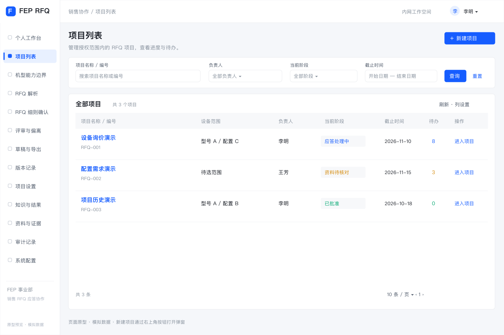

**新建项目弹窗（点击列表右上角“新建项目”后显示）**

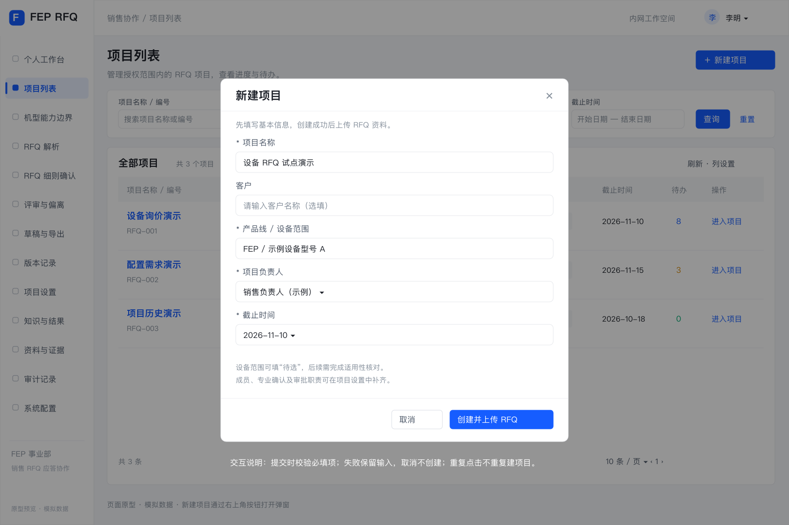

列表默认占满内容区，不常驻显示新建表单。点击“新建项目”打开居中弹窗；客户选填，其他四项必填。取消或关闭不创建；提交失败保留输入，必填错误定位字段，重复提交不重复建项目；创建成功进入 PG-02 上传资料。

- 列表显示有权访问项目的编号、名称、设备范围、负责人、截止时间、当前阶段及待办数；支持按负责人、状态和截止时间筛选。
- “新建项目”必填项目名称、产品线或设备范围、负责人、截止时间；范围不明确可填写“待选”，但后续适用性核对不能据此假定型号相同。
- 项目可关联一个或多个设备项，每个设备项选择机型、机型版本及配置基线；选配区分已选、未选和待确认。尚未选型可保存项目，但依赖机型的技术条目不能确认或无条件推荐 Comply。
- 创建后进入资料页。项目负责人可配置成员及职责；未分派专业责任人的要求可以保存，但不能确认或完成审批。

### PG-02 RFQ解析

2026-10-21 调整：解析取消人工比对，PG-03 与 PG-04 合并为同一工作台。以下历史线框仅供布局参考，流程以本节最新文字及 React 原型为准。

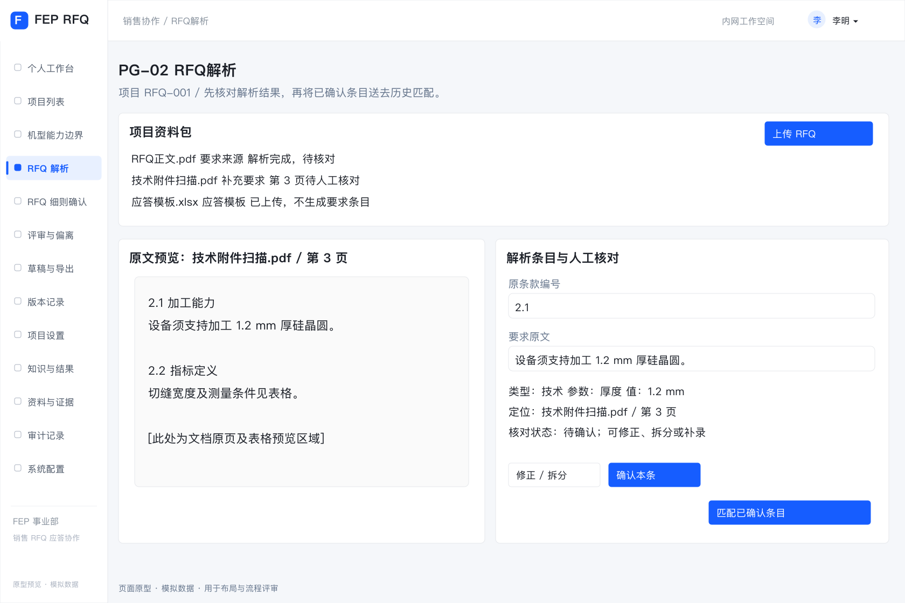

- 上传以 DOC／DOCX 为主，兼容既有 PDF／Excel 等资料；显示排队、处理中、完成／部分异常／失败，明确转换、段落或表格读取失败原因及重试／补录入口。原型仅使用模拟解析，实际文件内容不读取。
- 每份 RFQ 有独立目录。页面采用“原始章节导航 + 文档原文摘录 + 本章条款清单”；沿用该客户的原始标题、层级、编号及顺序，不设置统一要求类别筛选。Safety／Facility 与反应模块／中转模块分别作为两份 Word 示例。
- 点击章节筛选该章及下级条款；搜索覆盖当前文件的章节、编号、标题及原文；切换文件清空搜索／章节筛选，不混入其他文件。无可靠章节时显示“未识别章节”，不伪造目录。
- **点击条款标题：** 按条目稳定内部 ID 跳转 PG-03，选中正确条目并切到其所在分页，显示该条原文、依据与应答；原编号重复或为空也不串项。同步中条目暂不可跳转，避免落到默认第一条。
- **定位原文：** 条款卡片的辅助按钮定位并高亮左侧对应原文；来源可为段落／表格锚点，Word 页码只作辅助。PG-03 提供“返回解析定位本条”，恢复对应文件、位置和高亮。未保存编辑沿用离开保护。
- 成功条目自动导入细则比对，无需勾选、确认或手动导入；异常内容单独提示，保留已完成结果与已有人工应答。修正原文／编号须填写原因并使相关确认待复核，不改变稳定 ID；编号可空或重复。文件用途仍区分要求来源、补充附件和应答模板，仅要求来源生成条款。
- 原型包含两份固定 Word 结果示例，覆盖嵌套章节、重复编号和无编号；上传任意文件仅保存元数据，不推断其真实章节，不可将模拟演示当作真实解析验收。

### PG-03 RFQ细则比对：细则比对（三栏视图）

项目导航仅保留“RFQ细则比对”一个入口，包含“细则比对”和“偏离处理”两个页签。前者覆盖全部要求及应答，后者处理关联条目的差距、澄清及专业评审；共用要求编号与处理记录。

比对结论及处理路径见 4.2，历史知识匹配规则见 4.6。

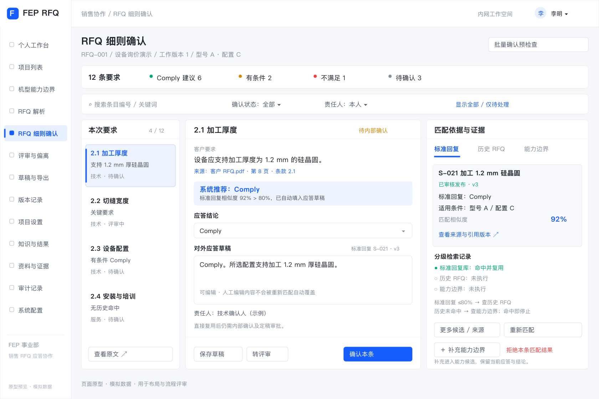

| 区域 | 默认显示 | 用户操作与系统响应 |
| --- | --- | --- |
| 顶部 | 项目及版本、总条目数、各类结论及处理状态计数 | 按来源文件的原文章节、责任人、状态、无历史命中、条件差异或关键要求筛选；计数与条目明细一致 |
| 左栏：本次要求 | 原条款编号（可空／重复）、原文章节路径、原文摘要、关键标记及处理状态 | 选择条目，联动刷新中、右栏；查看原文；有权限时修正要求，触发受影响建议及确认失效 |
| 中栏：分级比对结果 | 顶部显示“标准回复库 → 历史 RFQ → 能力边界”检索进度，各级标记查询中、命中、未命中、未执行或失败；默认展开最终命中来源 | 标准回复显示相似度、80% 阈值、回复及版本，>80% 直接填入应答；否则查询历史 RFQ，有匹配即返回原文、已审核答复及条件；仍无匹配才展开能力边界对照。历史候选默认前 3 条并提供更多入口；前一级命中时后续级标记未执行；切换候选不覆盖人工编辑 |
| 右栏：结论与应答 | 系统推荐及依据、条件差异、证据、可编辑答复、责任人及最终确认状态 | 采纳建议、修改后确认、保存草稿或转评审；系统推荐和人工结论分开展示 |
| 底部／侧栏 | 当前条目的偏离、附件、操作记录及确认版本 | 查看变更者、时间、理由，打开评审任务；确认后可跳转下一未处理项 |

关键交互规则：

1. 切换条目前若存在未保存内容，提示保存、放弃或取消切换，不静默丢失。
2. 标准回复相似度 >80% 时自动填入应答，无需再点击采纳；历史 RFQ 命中时返回答复供采用，能力边界结果供生成建议。自动填入及“采纳建议”均不等于确认；确认时校验权限、必要依据和条件。
3. “修改后确认”要求填写修改原因；结论为不适用时填写范围依据；有条件 Comply 必须填写适用条件。
4. “重新匹配”从标准回复库重新按三级顺序执行，只刷新命中结果与系统建议；保留人工答复并提示差异，不直接覆盖确认结果。来源失效等情况按 BR-09 转待复核。
5. “转评审”必选问题类别、责任人和问题说明，可附证据；任务提交后显示跟踪入口。
6. 批量确认先显示选中范围、符合条件及被排除条目和原因，执行后逐条反馈结果。禁止将当前页以外的条目隐式加入批次。
7. 各级未命中、未执行、无权限和检索失败分别显示；权限不足不展示受限来源名称或摘要。
   知识库无可用知识、用户明确拒绝本条匹配结果或置信度低于阈值时，建立关联偏离项并展示来源及跟踪入口；明确拒绝时填写原因。仅未点击采纳、尚未确认或拒绝某个候选不等于拒绝本条匹配结果。
8. 仅当前两级均未命中时自动查询能力边界；前一级已命中时，能力级显示“未执行”。用户仍可手动查看中栏“机型能力”标签页：显示条目所属设备项、机型／配置基线、能力范围、值类型、条件、限制、证据及引用版本；与客户要求并排比较，可按权限进入 PG-14。无历史命中仍可使用有效能力；商务等非机型条目按对应资料评审。

9. 比对时提供“补充能力边界”入口，打开预填当前机型、配置和条目来源的抽屉；用户补充实际能力、条件及依据，保存为候选并显示关联编号。保存不覆盖当前应答、不自动改变 Comply 结论；发布后明确重新比对或采用，按 BR-07、BR-09 复核。无维护权限的项目成员可按授权提交候选，由维护人接续处理。

#### 历史参考卡片与候选详情

承接 PRD 4.6.2 的历史参考信息要求。PG-03 中栏展示候选摘要，点击历史候选打开 SV-04 详情抽屉；每条要求的历史参考须展示：


- 参考项目、时间、设备型号和配置。
- 历史要求、最终答复及审核状态。
- 本次与历史案例在材料、厚度、工艺条件、指标或验收方式上的差异。
- 历史处理方案、适用条件及证据。
- 客户接受、拒绝、待确认或实际验收结果。
- 建议动作：复用、修改后复用、发起专家评审或向客户澄清。

结果未知时标记“未记录”；客户接受结果与实际验收结果分开显示。

卡片上的“复用／修改后复用”将所选答复带入右栏，保留来源版本及原有条件；已有人工编辑时提示差异，由用户决定采用，不能静默覆盖。“发起专家评审／向客户澄清”进入关联 PG-04 事项并带入当前要求、候选及问题。采用历史答复不等于最终确认。

### PG-04 RFQ细则比对：偏离处理

从项目处理页进入偏离与澄清事项。处理结果回填关联要求，可定位回“细则比对”继续确认应答。

偏离与待确认事项的业务处理规则见 4.7。

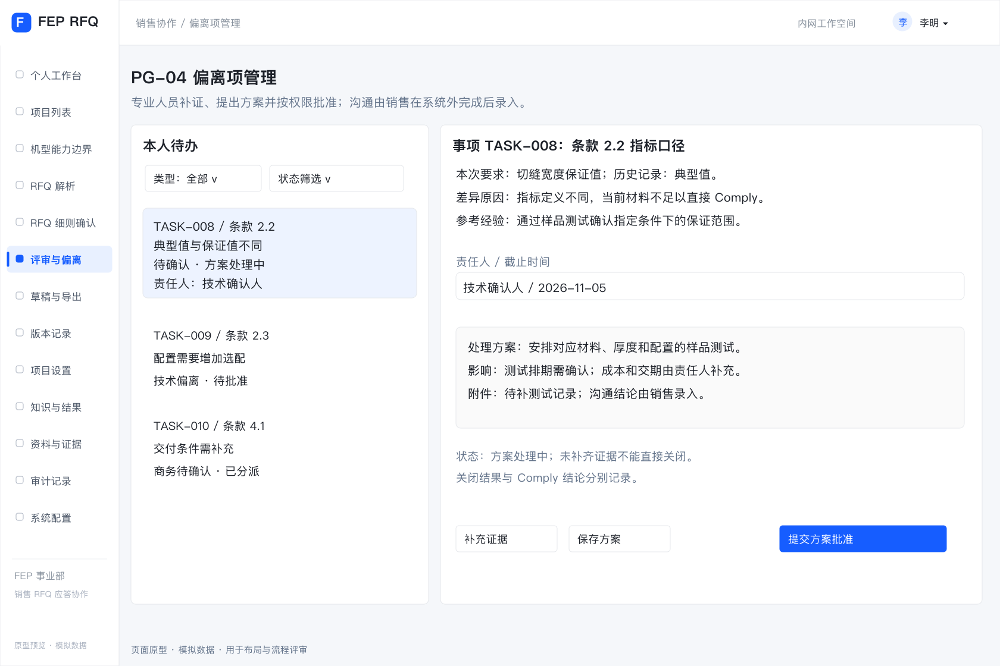

- 列表显示条目、偏离来源（知识库中没有／用户未接受／置信度低）、事项类型、影响、责任人、截止时间、状态及批准条件；支持按本人待办、来源、类别、状态筛选。同一条目可显示多个来源。
- 详情展示本次要求、差距、证据、历史处理经验、处理方案、成本／交期／质量影响及沟通记录。
- 责任人可补证据、修改方案、提交批准；批准人可退回或批准关闭，退回填写理由。重新分派保留原责任人和原因，原处理记录不得删除。
- 沟通结果由销售录入；沟通接受与验收通过使用不同字段。“用户未接受”指内部使用者未接受匹配结果，与客户拒绝应答分开记录。偏离项经补证或评审后可更新结论并按规则关闭，不强制判定不满足。

### PG-05 导出文档

应答审核与定稿规则见 4.8，提交与导出门槛见 BR-08。

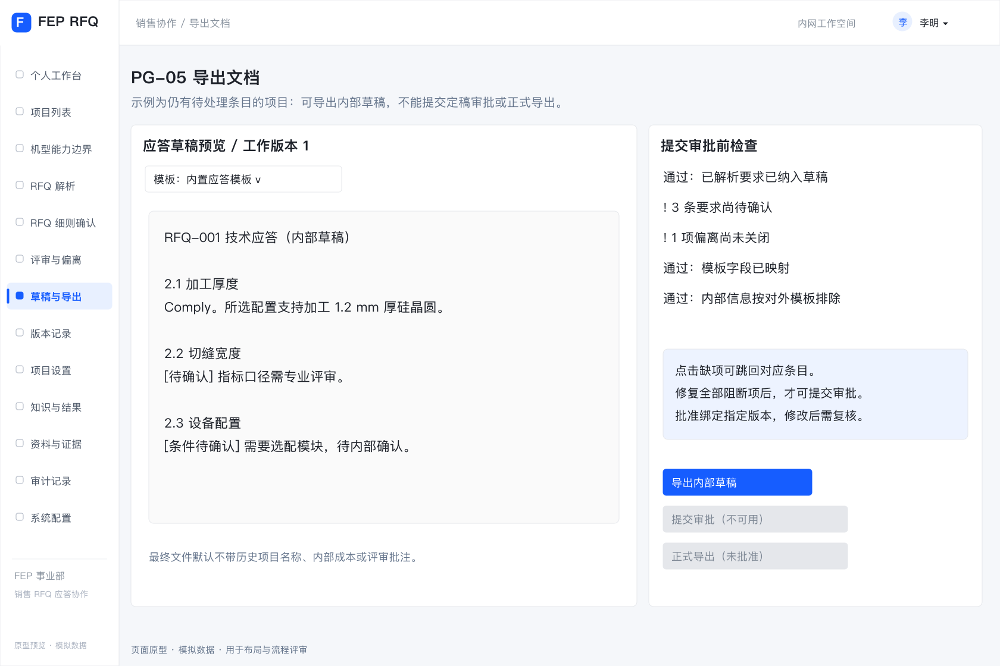

- 销售选择内置模板，核对字段映射，生成前预览将包含的条目及缺项。
- 可随时生成内部草稿，未确认内容显式标记；导出草稿与“批准定稿”使用不同按钮和状态。
- “提交审批”运行 BR-08 检查，失败逐条列出原因及跳转入口；通过后冻结待审批快照。
- 审批人查看具体快照及变更记录，批准或退回并填写意见；源数据后续修改产生新工作版本，不改变既有快照。
- 正式导出只读取已批准且通过当前有效性检查的快照，生成文件包及附件清单；审批中不允许正式导出。
- 默认对外文件只包含本次要求、最终答复、必要条件及批准附件；历史项目名称、内部评审、成本、批注与内部检索引用不自动带出。内部证据与对外附件分别管理。

### PG-06 知识与结果维护

知识使用及复用规则见 4.6。此模块仅保留“标准回复库”和“历史 RFQ 知识”，移除“客户反馈与验收”页签及录入入口。

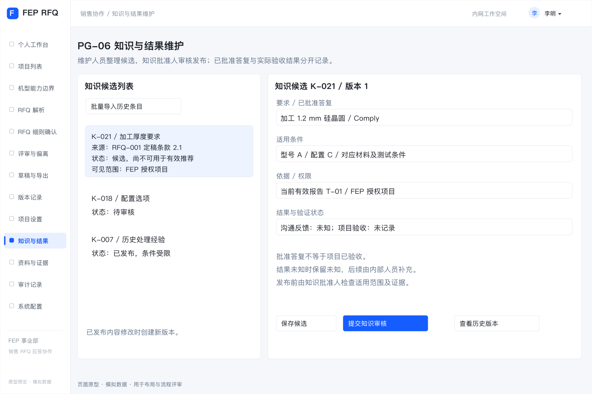

- 历史知识可通过首期固定 Excel 模板批量导入，必填历史要求、最终答复、来源、审核信息、产品范围及访问范围；缺失数据进入候选区，逐行反馈导入错误，不默认发布。
- 项目定稿生成知识候选；维护人员去重、修订适用条件并提交审核。
- 知识发布或撤销由指定知识审批人操作；系统管理员不因技术管理身份获得业务批准权。
- 已经发布的知识不得直接覆盖，修改产生新版本，经审核再发布。

#### 历史知识匹配与回流交互流程

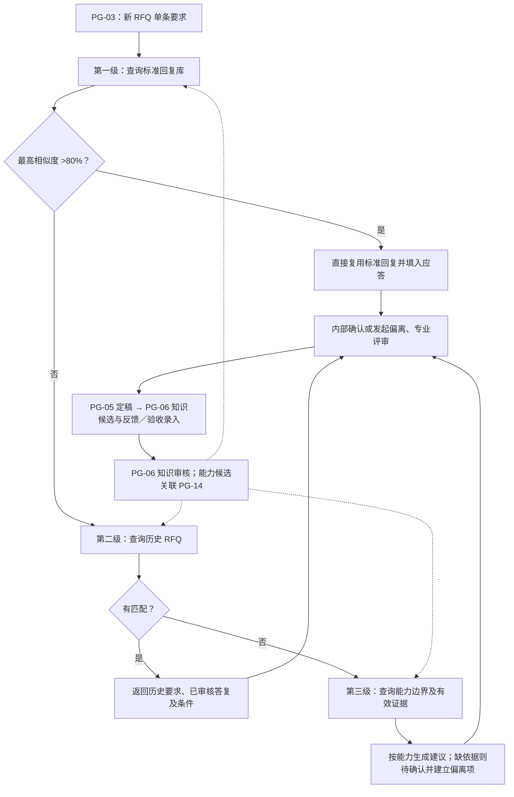

### PG-08 个人工作台与待办

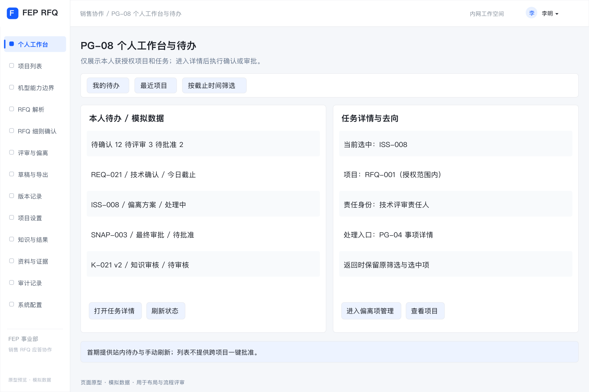

- **入口与对象**：系统默认落地页、全局“我的待办”；所有业务角色按本人权限访问。
- **布局**：顶部为待确认、待评审、待批准、待复核数量；中间为本人待办列表，包含类型、授权项目、对象编号、责任身份、截止时间、状态和最近更新时间；侧栏为最近访问的授权项目。
- **筛选与跳转**：按项目、任务类型、状态及截止时间筛选。要求确认／复核进入 PG-03；事项处理／专业批准进入 PG-04；最终审批进入 PG-05 的具体快照；知识审核进入 PG-06 的具体知识版本。保留返回待办及原筛选条件的入口。
- **操作规则**：列表不提供跨项目一键批准；进入详情后重新核对权限和版本。任务随业务对象状态更新，同一任务不因刷新或重试重复生成；任务失效显示已处理或权限变化。
- **边界**：首期采用站内待办与手动刷新；邮件、即时通信推送、自动催办及高级统计属于 P1。待办为空仅表示本人当前无待处理任务。

### PG-09 项目设置、成员与审批配置

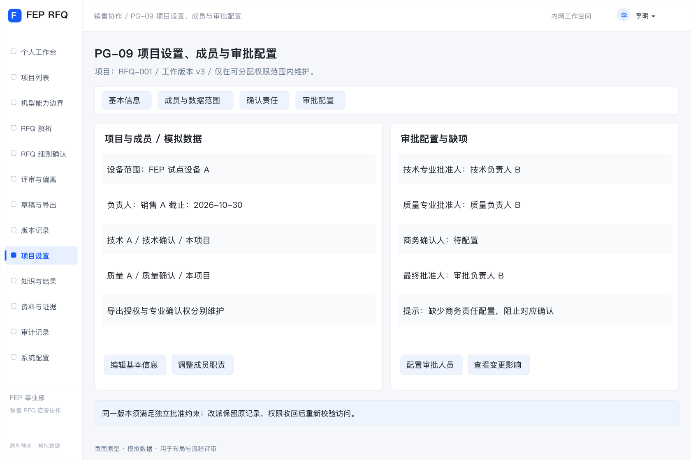

- **入口与对象**：PG-01 项目行及项目内“项目设置”；项目负责人按项目管理授权维护，其他成员按权限只读。全局账号与授权策略从 PG-13 管理，项目负责人不能突破其可分配范围。
- **布局**：基本信息、成员与数据范围、确认责任、审批配置四个标签页。基本信息包含名称、客户、产品线／设备范围、设备项及其机型版本／配置基线、负责人、截止时间及项目工作版本；成员表包含身份、职责、可访问范围、确认／导出授权及生效状态。
- **确认与审批配置**：按技术、质量、商务等类别明确确认人、关键承诺专业批准人及项目最终批准人；知识批准人由知识授权配置，不因项目批准身份自动获得。允许一人兼任角色，但必须满足 5.1 的同版本独立审批约束。
- **操作与反馈**：新增／调整／移除成员、改派职责和配置审批人均先展示影响范围，填写原因并保留变更记录；必填项或责任配置缺失逐项提示，允许保存未完成配置，阻止对应确认、批量确认或审批。
- **影响处理**：设备范围或适用配置变化按 BR-09 触发相关复核；权限收回按 BR-11 立即重新校验访问和后续操作；负责人／审批人改派保留原处理记录，未完成任务转给新责任人，不伪造其确认或批准。

### PG-10 资料与证据管理

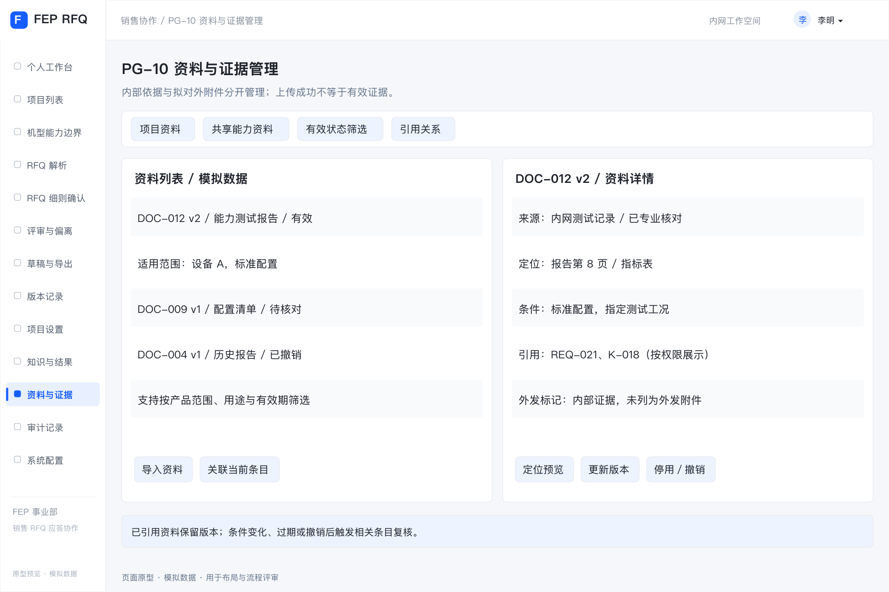

- **入口与对象**：全局“资料与证据”及 PG-02、PG-03、PG-04、PG-06 的关联资料入口。项目资料受项目授权控制，共享能力资料受其独立数据范围控制；页面只显示用户可访问的记录。
- **布局**：资料列表与详情预览，按项目资料／共享能力资料、用途、产品范围、有效状态及是否被引用筛选。列表包含编号、名称、版本、用途、维护人、来源日期、有效期及可见范围。
- **资料详情**：展示原件及页码／工作表定位、型号配置、工艺或适用条件、来源与确认记录、关联要求／知识及版本；无法预览时显示文件信息并在有权时下载原件，不把无法预览等同于无内容。
- **操作与用途**：项目上传沿用 PG-02 的要求来源、补充附件、应答模板分类；共享资料由获授权维护人导入。关联、替换、更新版本、停用／撤销均记录原因。上传成功仅代表存储成功，须由获授权专业人员核对来源、条件和有效性后才能作为有效证据；不新增独立的资料审批流程。
- **引用与外发**：内部证据与拟对外附件使用不同标记；标为对外附件不等于获准发送，仍须 PG-05 的附件分标检查及快照批准。已引用资料不能直接物理删除或覆盖版本，替换保留旧版追溯。
- **有效性影响**：过期、撤销、条件修订或权限变化列出操作者可访问的受影响对象，按 BR-09 触发复核；无法访问的对象不披露名称或摘要，其处理由对应获授权责任人完成。确认或正式导出时再次校验证据。

### PG-11 项目版本、变更与快照记录

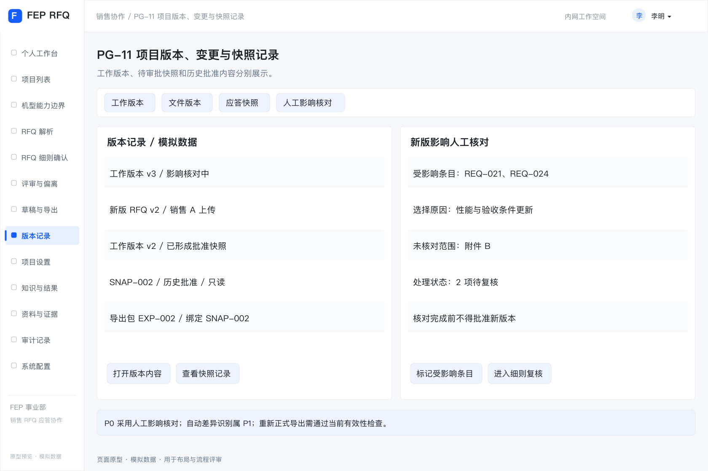

- **入口与对象**：项目顶部版本入口，以及 PG-02 的文件版本、PG-03 的变更记录、PG-05 的快照历史；仅限授权项目。
- **布局**：工作版本、文件版本、应答快照三个标签页。记录编号、来源、创建人／时间、状态、关联条目、审批人及导出记录；选中后展示只读内容和事件时间线。审批与导出记录绑定实际版本。
- **首期新版处理**：上传新版要求或修改范围后建立新工作版本，负责人手工选择受影响条目，记录原因、未识别范围及核对结果；未完成影响核对不得批准新版本。可查看旧版／新版内容供人工对照，自动差异识别与影响推荐仍属 P1。
- **复核与跳转**：查看受影响条目及复核进度，跳转 PG-03／PG-04 处理；工作版本变更不覆盖已冻结的待审批快照及历史批准内容，旧批准不得沿用为新工作版本批准。旧快照的当前可导出性需独立展示，不用“已批准”替代有效性检查。
- **历史文件**：有权查看、下载已生成历史文件用于追溯时，显示其版本及当前失效／影响提示；重新生成正式文件必须经 PG-05 当前有效性检查。对于已对外发送内容，负责人记录是否需重新发送及处理结果，系统不自动向客户发送。

### PG-12 审计记录

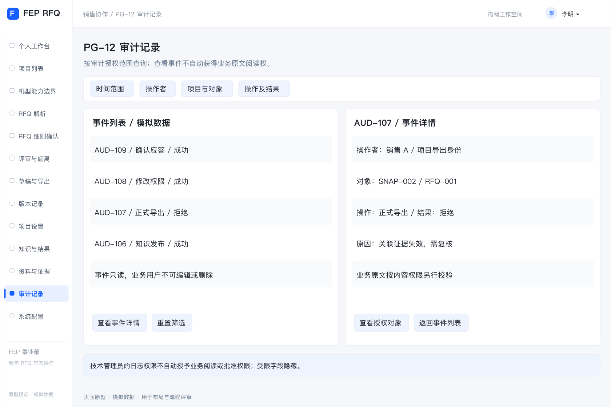

- **入口与对象**：项目内“操作记录”及管理区“审计记录”。项目负责人查看其授权项目记录，获审计授权人员按范围查询；管理员的技术日志权限不自动包含业务内容阅读权限。
- **布局**：按时间、操作者、项目、对象类型、操作及成功／失败筛选；列表显示事件编号、对象及版本、操作时间、实际职责、结果及原因。详情显示可访问的变更前后内容、相关审批／导出快照及来源事件。
- **记录范围**：资料访问、上传与替换、解析修订、匹配及人工采纳、确认、分派、批准／退回、知识发布／撤销、权限变更、生成及导出均有可追溯记录；失败或拒绝事件不伪装为成功。
- **约束**：业务用户不能编辑或删除审计事件。越权字段隐藏；即使有权检索事件，也须另行具备业务内容权限才能展开原文。首期支持查询与定位，不增加通用业务数据批量导出入口。

### PG-13 系统配置与运维

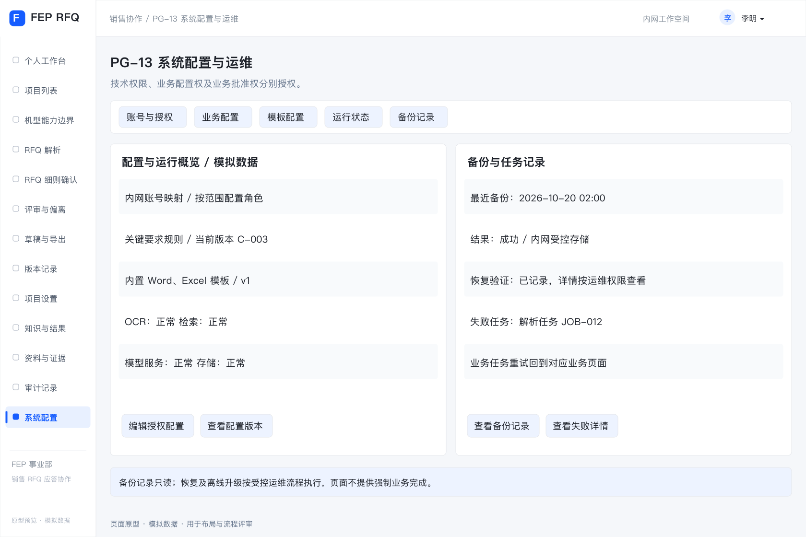

- **入口与对象**：仅对获技术管理授权人员显示管理区；业务配置按对应管理授权开放。系统管理员维护账号、授权策略及技术配置，不因该身份获得项目阅读或业务批准权；授权变更记录实际操作者。
- **布局**：账号与授权、业务配置、模板配置、运行状态、备份记录五个标签页。业务配置包含专业职责、关键要求规则及试点设备范围；模板配置展示首期内置模板版本和列映射默认值；运行状态包含 OCR、检索、模型、存储及任务失败状态。
- **账号与授权**：维护内网身份映射、生效状态、角色及数据范围；项目成员分派仍在 PG-09 完成。技术角色、知识维护／批准及业务批准分别授权，缺少配置不得默认放行；权限回收后重新校验访问与任务。
- **配置变更**：有权人员可维护业务配置及模板映射，保存前校验必填项、适用范围和版本，展示受影响范围并记录原因。项目所用配置和模板版本须可追溯；影响既有结论、条件或证据有效性的变更按 BR-09 处理。审批中及已批准快照不被新配置改写。
- **运行与恢复**：显示失败阶段、最近成功时间及可访问的错误摘要；业务任务重试回到 PG-02／PG-03／PG-05 对应任务，不提供绕过业务校验的强制完成操作。备份页只读展示备份时间、范围、结果及最近恢复验证记录，恢复由获授权运维人员按受控流程执行，记录审计。
- **首期边界**：离线模型／依赖升级由运维流程完成，页面仅显示当前版本及健康状态；不包含公网下载、任意模型编排、模板可视化设计器或在线恢复按钮。

### PG-14 机型能力边界

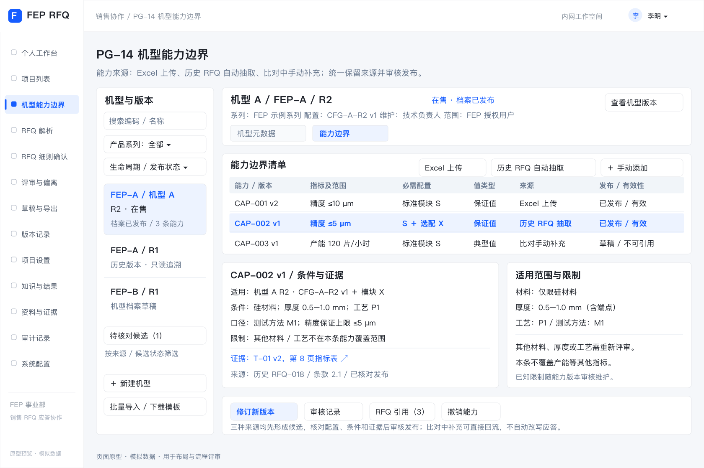

- **入口与对象**：全局“机型能力边界”，项目设置和 RFQ 细则确认提供关联入口。统一模块内仅设置“机型元数据”和“能力边界”两个横向标签页。“机型元数据”维护机型编码、名称、系列、版本、生命周期、标配／选配及配置定义；“能力边界”维护指标范围、配置要求、适用条件、限制与证据，版本、审核及引用记录在能力详情或操作入口中查看；不另设一级标签。
- **列表与详情**：左侧按产品系列、机型、版本、生命周期及发布状态筛选；右侧展示机型资料、标配／选配和能力清单。选中能力后展开指标、范围、适用条件、证据、审核记录及有权查看的项目引用。示例数据不能作为实际设备能力。
- **维护操作**：获授权维护人新建、修订机型和能力、关联 PG-10 证据、保存草稿及提交审核；指定能力批准人批准发布、退回或撤销，同一版本不得自审。机型与能力均保留版本，已发布内容修订产生新草稿，不覆盖旧版。
- **RFQ 使用**：从项目进入时带入设备项及配置基线，按权限展示适用能力；切换查看其他机型不修改项目配置。应用不同机型／配置须回 PG-09 明确修改、填写原因并触发相关复核。
- **能力来源**：能力边界标签页提供“Excel 上传”“历史 RFQ 自动抽取”“手动添加”入口，清单增加来源列，并可按来源和候选状态筛选。比对中的手动补充从 PG-03 发起，自动回流本模块候选，不要求离开当前条目重复录入；具体规则见 4.9.4。
- **导入与错误**：Excel 上传支持固定模板及字段预检、逐行错误与成功记录；历史抽取显示任务进度、候选及出处、缺项和失败重试。三种来源均先形成候选草稿，重试不重复建档；缺条件、证据或批准人时列出原因并阻止发布。
- **状态与影响**：草稿、待审核、已发布及退回意见清楚展示；有效性另列有效、过期、撤销、被替代。发布、替代或撤销前展示可访问的影响及原因；按 4.9 处理受影响引用，保留历史版本。无权限引用不披露名称或摘要。

### 4.3.2 详情、标签页与子视图

| 编号 | 所属页面／入口 | 承载形式 | 必须展示与支持的操作 |
| --- | --- | --- | --- |
| SV-01 | PG-01 新建／项目摘要 | 新建弹窗；摘要区 | 录入客户及必填项；创建成功仅生成一个项目；摘要显示缺项与流程入口，配置进入 PG-09 |
| SV-02 | PG-02 文件行 | 文件详情及版本标签页 | 原件预览、文件用途、解析状态／错误、附件关系、缺页或低可信标记；替换和重试保留历史版本 |
| SV-03 | PG-02 补录要求 | 补录抽屉 | 异常内容补录并保留条件、来源和原因；保存后自动导入工作台 |
| SV-04 | PG-03 历史候选 | 候选详情抽屉 | 历史原文／答复、条件差异、批准与验证结果、证据及来源；继续查看候选按实际权限加载 |
| SV-05 | PG-03 原文／证据链接 | 定位预览侧栏 | 回到页码、工作表或单元格；资料详情进入 PG-10，返回保留当前要求及未保存内容 |
| SV-06 | PG-04 事项行或 PG-08 待办 | 事项详情子页 | 要求与差距、方案、成本／交期／质量影响、证据、分派与沟通记录；提交、退回、批准关闭及条件变化后重开 |
| SV-07 | PG-05 生成草稿 | 模板与映射标签页 | 内置模板选择、必要列映射、条目预览、条件／附件清单及分标检查，缺项定位回业务页面 |
| SV-08 | PG-05 审批任务 | 只读快照审批子页 | 固定快照编号、内容、关键承诺专业批准、附件及变更记录；批准／退回意见；与当前工作版本明确区分 |
| SV-09 | PG-05 导出记录 | 文件包详情 | 快照、生成时间、模板版本、文件及附件清单、失败原因、有效性提示；允许时下载或重试 |
| SV-10 | PG-06 批量导入 | 导入任务子视图 | 下载固定模板、上传、字段预检、逐行错误、成功候选及重试；修正重试不重复创建已成功记录 |
| SV-11 | PG-06 知识行／待办 | 知识详情及审核子页 | 来源、要求／答复、适用范围、证据、可见范围、版本、审核意见；修订、提交、批准发布、退回、撤销，不允许同版本自审 |
| SV-12 | PG-06 项目结果 | 反馈与验收标签页 | 沟通结果、接受条件、实际交付／验收、日期、录入人及依据；未知单列，修改已发布知识产生新版本候选 |
| SV-13 | PG-09 成员及审批配置 | 成员编辑抽屉／配置标签页 | 人员、职责、数据及确认范围、导出权、批准角色；配置缺项与独立性校验 |
| SV-14 | PG-10 资料行 | 资料详情及引用标签页 | 预览、条件与有效性、版本、可见范围、可访问引用；有效性变更展示影响及复核入口 |
| SV-15 | PG-11 版本行 | 内容查看与人工核对标签页 | 旧版／新版原文、人工影响标记、核对结论及处理记录；首期不要求自动生成差异 |
| SV-16 | PG-12 事件行 | 只读详情抽屉 | 事件、身份、对象版本、可访问变更及结果，跳转有权查看的业务对象 |
| SV-17 | PG-13 配置／运行记录 | 配置编辑抽屉／只读任务详情 | 必填校验、适用范围、配置版本；错误摘要、备份及恢复验证结果，不展示密钥或连接口令 |
| SV-18 | PG-14 机型／能力行 | 机型元数据、能力边界两个横向标签页；能力详情及记录入口 | 机型与能力字段、配置适用性、证据定位、版本、状态及授权引用；新建、修订、提交、批准、退回、撤销及影响确认 |
| SV-19 | PG-14 Excel 上传／历史 RFQ 自动抽取 | 导入／抽取任务子视图 | 选文件或授权历史范围、预检、任务状态、候选与原文对照、来源定位、逐行错误及去重重试；成功项仅为草稿 |
| SV-20 | PG-03 补充能力边界／PG-14 手动添加 | 补充抽屉及候选详情 | 预填机型、配置、要求来源；录入实际能力、适用条件与证据，保存关联候选并返回原条目；不自动改写当前结论 |

详情子页支持由待办或对象链接直接打开；每次打开均校验权限。抽屉／侧栏保留所属列表及筛选上下文，独立子页提供明确返回入口。

### 4.3.3 弹窗与操作确认

| 编号 | 触发位置／动作 | 内容与校验 | 提交结果与取消行为 |
| --- | --- | --- | --- |
| DL-01 | PG-01 新建项目 | 项目名称、客户、产品线／设备范围、负责人、截止时间；名称、范围、负责人及截止时间必填 | 成功进入 PG-02；失败保留输入；取消不创建 |
| DL-02 | PG-02／PG-10 上传或替换资料 | 用途、版本、关联对象及可见范围；重复文件提示，替换填写原因 | 分文件显示结果；失败可重试；取消未提交任务不影响已存资料 |
| DL-03 | PG-02 补录要求 | 填写条目、来源定位、条件和补录原因 | 保存后自动进入工作台；取消不改变条目 |
| DL-04 | PG-03 转评审／PG-04 分派、改派 | 问题类型、说明、责任人、截止时间、证据；改派填写原因 | 创建或更新同一事项及待办；重复提交不重复建单 |
| DL-05 | PG-03 单条确认／修改后确认 | 展示最终结论、答复、条件、依据；按 BR-04 校验，修改后确认填写原因 | 成功绑定条目版本；失败保留草稿并列原因 |
| DL-06 | PG-03 批量确认 | 展示明确选中范围、可处理数、排除项及原因；提交时再次校验 BR-05 | 逐条反馈成功／失败，不隐式包含其他页；取消不确认任何条目 |
| DL-07 | PG-04／PG-05／PG-06 提交、批准、退回 | 展示对象与版本、操作类型、检查结果及意见；退回必填理由，审批校验独立性 | 保存处理记录并更新待办；失败不能进入批准／发布状态 |
| DL-08 | PG-05 正式导出 | 展示批准快照、对外字段、条件、附件及分标检查结果，执行 BR-08、BR-11 | 成功生成可追溯文件包；失败列原因和修正入口，不生成成功记录 |
| DL-09 | PG-06 发布／撤销；PG-10 停用／替换证据 | 展示对象版本、范围、原因和可访问影响；发布校验证据及知识批准权 | 保留旧版与审计，必要时触发待复核；取消不改变有效性 |
| DL-10 | PG-09／PG-13 权限、责任或配置变更 | 展示变更前后、适用范围及受影响任务；原因必填，校验可分配权限 | 成功后按新权限生效并刷新任务，保留既有记录；失败保留原配置 |
| DL-11 | 离开有未保存内容的页面／条目 | 保存、放弃、取消离开三选一；保存时执行正常校验 | 保存成功才离开；失败留在原处；放弃只丢弃本次未保存编辑 |
| DL-12 | 保存、确认、批准或发布发生版本冲突 | 展示本人输入及可访问的最新版本／变更，提供返回核对入口 | 拒绝过期覆盖；人工核对后基于最新版本重提，不提供强制覆盖批准 |
| DL-13 | PG-11 新版影响核对 | 展示新版资料、受影响条目选择、选择原因及未核对范围；确认核对结论 | 建立复核范围并保留记录；未完成核对时阻止新版批准 |
| DL-14 | PG-04 条件变化重开事项 | 展示原关闭结果、新条件、重开原因及责任人 | 保留原关闭记录并重新进入评审，相关应答按 BR-09 复核 |
| DL-15 | PG-14 提交、批准发布、退回、替代或撤销 | 展示机型／能力版本、配置条件、证据、意见与可访问影响；发布校验字段、证据有效性及独立批准权，退回／替代／撤销必填原因 | 失败保留草稿及原有效状态；成功保留审核与审计，按 4.9 触发相关复核；取消不改变发布状态 |

| DL-16 | PG-03 补充能力边界／PG-14 手动添加 | 展示当前条目及机型配置，实际能力值与客户要求分开；必填能力描述、适用范围及来源，缺项允许保存但提示待补齐；校验候选提交权限 | 保存关联候选并保留当前应答；失败保留输入，取消不创建；重复保存不重复建档 |

### 4.3.5 所有页面的通用状态与交互

- **加载与空态**：加载中、无数据、筛选无结果、无权限、服务失败分别展示；无数据时按权限提供创建／上传入口，筛选无结果提供清除筛选，服务失败提供重试，不把失败显示成空列表或零待办。
- **保存与重复提交**：表单明确显示未保存、保存中、已保存或保存失败；提交期间防止重复操作，后台重试不得重复产生项目、条目、事项、知识候选或导出成功记录。
- **离开与中断**：正常切换时执行 DL-11。会话失效或临时故障时，页面尚保留的未保存内容在重新认证及权限、版本校验后允许继续核对保存；权限撤销时不继续展示受限业务内容。浏览器关闭／崩溃不承诺恢复未保存输入，已保存草稿及后台成功任务可重新进入查看。
- **错误定位**：字段错误定位到字段；业务门槛失败列出对象、原因及获授权修正入口；长任务显示排队、处理中、成功或失败，并保留任务编号及最近状态。刷新页面仍可查询后台任务结果。
- **并发与权限**：任何保存、确认、批准、发布及导出均重新校验版本与权限；导航隐藏不能替代服务端校验。权限变化后列表、计数、详情和附件同步按最新范围返回。
- **返回与只读**：详情返回保留筛选、分页及选中对象；已冻结快照、历史版本及审计记录明确标识只读，修改进入对应工作版本，不在只读页直接改写。
