# FEP 销售 RFQ 提效 Agent 交互设计

> 2026-10-23 交互重梳：结合完整页面设计、合同系统参考及现有原型，新增[《交互设计 V0.3 评审稿》](FEP销售RFQ提效Agent_交互设计_v0.3.md)，统一五个一级入口、原 Word 处理页、任务办结、批注评审及导出规则。本文件保留原版本，V0.3 尚待交互评审。

> 2026-10-22 解析更新：每份 RFQ 保留原始章节、不统一分类；条款标题直达对应细则比对，支持返回解析定位。

> 2026-10-22 原型优化：新增条目差距与依据、条目内偏离处理、条件审批路径、新版 RFQ 变更影响检查。实现与参考对应关系见[《RFQ原型优化说明》](../archive/validation/RFQ原型优化说明_2026-10-22.md)。解析仍自动导入；RFQ细则比对名称与已精简入口保持当前约定。

本文件承接 [产品需求文档](FEP销售RFQ提效Agent_PRD_v0.2.md) 原 4.3 节，集中维护页面、线框图、导航、详情、弹窗与通用交互。保留原 4.3 及子节编号，便于与需求及验收用例对应；文中的 4.4、4.9、第 5 章及 BR／FR 编号均指向主 PRD。

### 4.3 页面与操作定义

本节定义首期 13 个页面级界面及其详情、标签页、弹窗与通用状态；完整清单见 4.3.1。线框图用于表达页面布局、主要按钮和状态；均为模拟数据，不是已实现界面。按钮是否可用取决于用户权限、条目状态及 4.4 的规则，具体交互以图下文字为准。

#### PG-01 项目列表

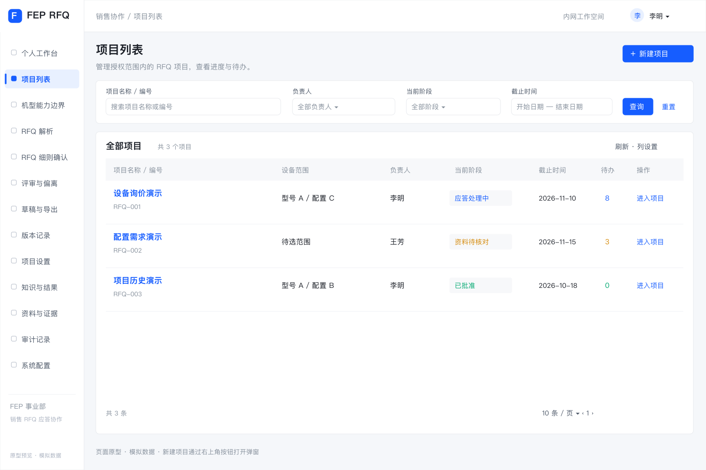

[查看可缩放 SVG](wireframes/pg01-projects.svg)

**新建项目弹窗（点击列表右上角“新建项目”后显示）**

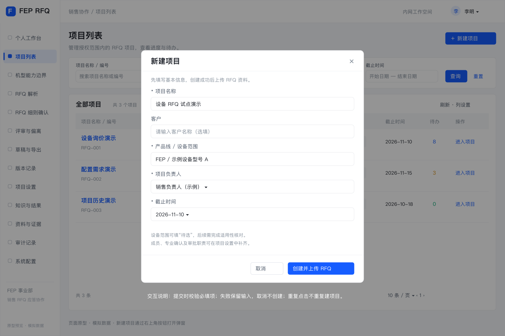

[查看弹窗 SVG](wireframes/pg01-create-project.svg)

列表默认占满内容区，不常驻显示新建表单。点击“新建项目”打开居中弹窗；客户选填，其他四项必填。取消或关闭不创建；提交失败保留输入，必填错误定位字段，重复提交不重复建项目；创建成功进入 PG-02 上传资料。

- 列表显示有权访问项目的编号、名称、设备范围、负责人、截止时间、当前阶段及待办数；支持按负责人、状态和截止时间筛选。
- “新建项目”必填项目名称、产品线或设备范围、负责人、截止时间；范围不明确可填写“待选”，但后续适用性核对不能据此假定型号相同。
- 项目可关联一个或多个设备项，每个设备项选择机型、机型版本及配置基线；选配区分已选、未选和待确认。尚未选型可保存项目，但依赖机型的技术条目不能确认或无条件推荐 Comply。
- 创建后进入资料页。项目负责人可配置成员及职责；未分派专业责任人的要求可以保存，但不能确认或完成审批。

#### PG-02 RFQ解析

2026-10-21 调整：解析取消人工比对，PG-03 与 PG-04 合并为同一工作台。以下历史线框仅供布局参考，流程以本节最新文字及 React 原型为准。

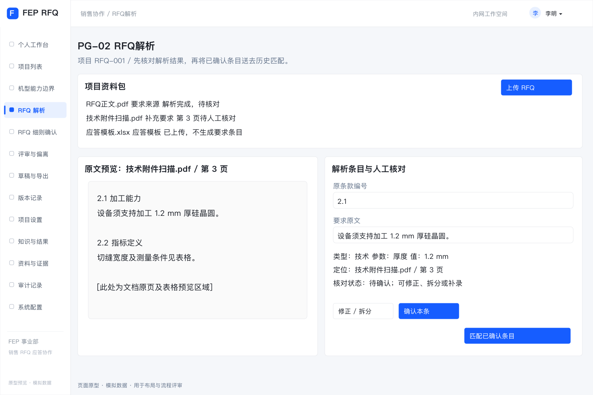

[查看可缩放 SVG](wireframes/pg02-documents.svg)

- 上传以 DOC／DOCX 为主，兼容既有 PDF／Excel 等资料；显示排队、处理中、完成／部分异常／失败，明确转换、段落或表格读取失败原因及重试／补录入口。原型仅使用模拟解析，实际文件内容不读取。
- 每份 RFQ 有独立目录。页面采用“原始章节导航 + 文档原文摘录 + 本章条款清单”；沿用该客户的原始标题、层级、编号及顺序，不设置统一要求类别筛选。Safety／Facility 与反应模块／中转模块分别作为两份 Word 示例。
- 点击章节筛选该章及下级条款；搜索覆盖当前文件的章节、编号、标题及原文；切换文件清空搜索／章节筛选，不混入其他文件。无可靠章节时显示“未识别章节”，不伪造目录。
- **点击条款标题：** 按条目稳定内部 ID 跳转 PG-03，选中正确条目并切到其所在分页，显示该条原文、依据与应答；原编号重复或为空也不串项。同步中条目暂不可跳转，避免落到默认第一条。
- **定位原文：** 条款卡片的辅助按钮定位并高亮左侧对应原文；来源可为段落／表格锚点，Word 页码只作辅助。PG-03 提供“返回解析定位本条”，恢复对应文件、位置和高亮。未保存编辑沿用离开保护。
- 成功条目自动导入细则比对，无需勾选、确认或手动导入；异常内容单独提示，保留已完成结果与已有人工应答。修正原文／编号须填写原因并使相关确认待复核，不改变稳定 ID；编号可空或重复。文件用途仍区分要求来源、补充附件和应答模板，仅要求来源生成条款。
- 原型包含两份固定 Word 结果示例，覆盖嵌套章节、重复编号和无编号；上传任意文件仅保存元数据，不推断其真实章节，不可将模拟演示当作真实解析验收。

#### PG-03 RFQ细则比对：细则比对（三栏视图）

项目导航仅保留“RFQ细则比对”一个入口，包含“细则比对”和“偏离处理”两个页签。前者覆盖全部要求及应答，后者处理关联条目的差距、澄清及专业评审；共用要求编号与处理记录。

比对结论及处理路径见 4.2，历史知识匹配规则见 4.6。

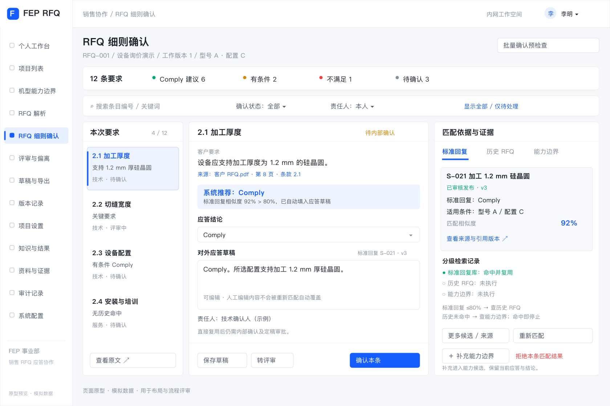

[查看可缩放 SVG](wireframes/pg03-response-workbench.svg)

| 区域 | 默认显示 | 用户操作与系统响应 |
| --- | --- | --- |
| 顶部 | 项目及版本、总条目数、各类结论及处理状态计数 | 按来源文件的原文章节、责任人、状态、无历史命中、条件差异或关键要求筛选；计数与条目明细一致 |
| 左栏：本次要求 | 原条款编号（可空／重复）、原文章节路径、原文摘要、关键标记及处理状态 | 选择条目，联动刷新中、右栏；查看原文；有权限时修正要求，触发受影响建议及确认失效 |
| 中栏：分级比对结果 | 顶部显示“标准回复库 → 历史 RFQ → 能力边界”检索进度，各级标记查询中、命中、未命中、未执行或失败；默认展开最终命中来源 | 标准回复显示相似度、80% 阈值、回复及版本，>80% 直接填入应答；否则查询历史 RFQ，有匹配即返回原文、已审核答复及条件；仍无匹配才展开能力边界对照。历史候选默认前 3 条并提供更多入口；前一级命中时后续级标记未执行；切换候选不覆盖人工编辑 |
| 右栏：结论与应答 | 系统推荐及依据、条件差异、证据、可编辑答复、责任人及最终确认状态 | 采纳建议、修改后确认、保存草稿或转评审；系统推荐和人工结论分开展示 |
| 底部／侧栏 | 当前条目的偏离、附件、操作记录及确认版本 | 查看变更者、时间、理由，打开评审任务；确认后可跳转下一未处理项 |

关键交互规则：

1. 切换条目前若存在未保存内容，提示保存、放弃或取消切换，不静默丢失。
2. 标准回复相似度 >80% 时自动填入应答，无需再点击采纳；历史 RFQ 命中时返回答复供采用，能力边界结果供生成建议。自动填入及“采纳建议”均不等于确认；确认时校验权限、必要依据和条件。
3. “修改后确认”要求填写修改原因；结论为不适用时填写范围依据；有条件 Comply 必须填写适用条件。
4. “重新匹配”从标准回复库重新按三级顺序执行，只刷新命中结果与系统建议；保留人工答复并提示差异，不直接覆盖确认结果。来源失效等情况按 BR-09 转待复核。
5. “转评审”必选问题类别、责任人和问题说明，可附证据；任务提交后显示跟踪入口。
6. 批量确认先显示选中范围、符合条件及被排除条目和原因，执行后逐条反馈结果。禁止将当前页以外的条目隐式加入批次。
7. 各级未命中、未执行、无权限和检索失败分别显示；权限不足不展示受限来源名称或摘要。
   知识库无可用知识、用户明确拒绝本条匹配结果或置信度低于阈值时，建立关联偏离项并展示来源及跟踪入口；明确拒绝时填写原因。仅未点击采纳、尚未确认或拒绝某个候选不等于拒绝本条匹配结果。
8. 仅当前两级均未命中时自动查询能力边界；前一级已命中时，能力级显示“未执行”。用户仍可手动查看中栏“机型能力”标签页：显示条目所属设备项、机型／配置基线、能力范围、值类型、条件、限制、证据及引用版本；与客户要求并排比较，可按权限进入 PG-14。无历史命中仍可使用有效能力；商务等非机型条目按对应资料评审。

9. 比对时提供“补充能力边界”入口，打开预填当前机型、配置和条目来源的抽屉；用户补充实际能力、条件及依据，保存为候选并显示关联编号。保存不覆盖当前应答、不自动改变 Comply 结论；发布后明确重新比对或采用，按 BR-07、BR-09 复核。无维护权限的项目成员可按授权提交候选，由维护人接续处理。

##### 历史参考卡片与候选详情

承接 PRD 4.6.2 的历史参考信息要求。PG-03 中栏展示候选摘要，点击历史候选打开 SV-04 详情抽屉；每条要求的历史参考须展示：

- 参考项目、时间、设备型号和配置。
- 历史要求、最终答复及审核状态。
- 本次与历史案例在材料、厚度、工艺条件、指标或验收方式上的差异。
- 历史处理方案、适用条件及证据。
- 客户接受、拒绝、待确认或实际验收结果。
- 建议动作：复用、修改后复用、发起专家评审或向客户澄清。

结果未知时标记“未记录”；客户接受结果与实际验收结果分开显示。

卡片上的“复用／修改后复用”将所选答复带入右栏，保留来源版本及原有条件；已有人工编辑时提示差异，由用户决定采用，不能静默覆盖。“发起专家评审／向客户澄清”进入关联 PG-04 事项并带入当前要求、候选及问题。采用历史答复不等于最终确认。

#### PG-04 RFQ细则比对：偏离处理

本视图合并到 PG-03 工作台的“偏离处理”页签，不再提供独立项目导航。处理结果回填关联要求，可定位回“细则比对”继续确认应答。

偏离与待确认事项的业务处理规则见 4.7。

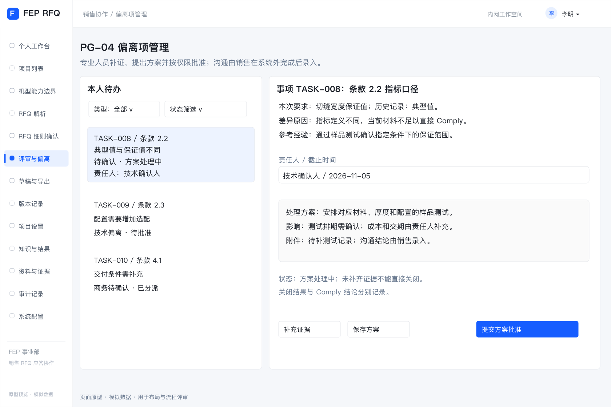

[查看可缩放 SVG](wireframes/pg04-reviews.svg)

- 列表显示条目、偏离来源（知识库中没有／用户未接受／置信度低）、事项类型、影响、责任人、截止时间、状态及批准条件；支持按本人待办、来源、类别、状态筛选。同一条目可显示多个来源。
- 详情展示本次要求、差距、证据、历史处理经验、处理方案、成本／交期／质量影响及沟通记录。
- 责任人可补证据、修改方案、提交批准；批准人可退回或批准关闭，退回填写理由。重新分派保留原责任人和原因，原处理记录不得删除。
- 沟通结果由销售录入；沟通接受与验收通过使用不同字段。“用户未接受”指内部使用者未接受匹配结果，与客户拒绝应答分开记录。偏离项经补证或评审后可更新结论并按规则关闭，不强制判定不满足。

#### PG-05 导出文档

应答审核与定稿规则见 4.8，提交与导出门槛见 BR-08。

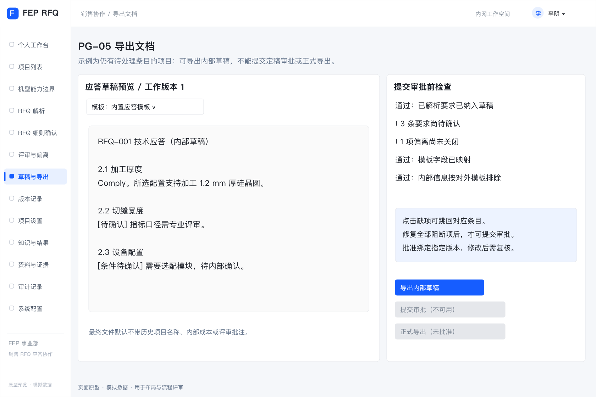

[查看可缩放 SVG](wireframes/pg05-export.svg)

- 销售选择内置模板，核对字段映射，生成前预览将包含的条目及缺项。
- 可随时生成内部草稿，未确认内容显式标记；导出草稿与“批准定稿”使用不同按钮和状态。
- “提交审批”运行 BR-08 检查，失败逐条列出原因及跳转入口；通过后冻结待审批快照。
- 审批人查看具体快照及变更记录，批准或退回并填写意见；源数据后续修改产生新工作版本，不改变既有快照。
- 正式导出只读取已批准且通过当前有效性检查的快照，生成文件包及附件清单；审批中不允许正式导出。
- 默认对外文件只包含本次要求、最终答复、必要条件及批准附件；历史项目名称、内部评审、成本、批注与内部检索引用不自动带出。内部证据与对外附件分别管理。

#### PG-06 知识与结果维护

知识使用及复用规则见 4.6。此模块仅保留“标准回复库”和“历史 RFQ 知识”，移除“客户反馈与验收”页签及录入入口。

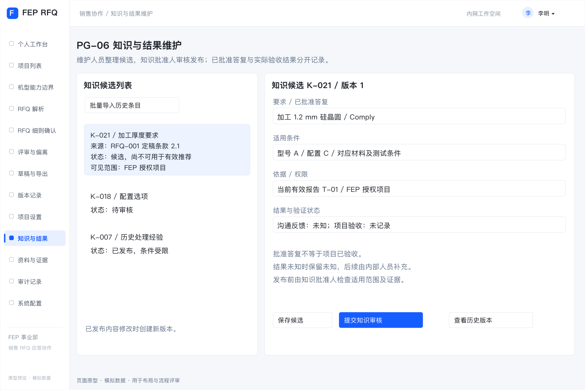

[查看可缩放 SVG](wireframes/pg06-knowledge.svg)

- 历史知识可通过首期固定 Excel 模板批量导入，必填历史要求、最终答复、来源、审核信息、产品范围及访问范围；缺失数据进入候选区，逐行反馈导入错误，不默认发布。
- 项目定稿生成知识候选；维护人员去重、修订适用条件并提交审核。
- 知识发布或撤销由指定知识审批人操作；系统管理员不因技术管理身份获得业务批准权。
- 已经发布的知识不得直接覆盖，修改产生新版本，经审核再发布。

##### 历史知识匹配与回流交互流程

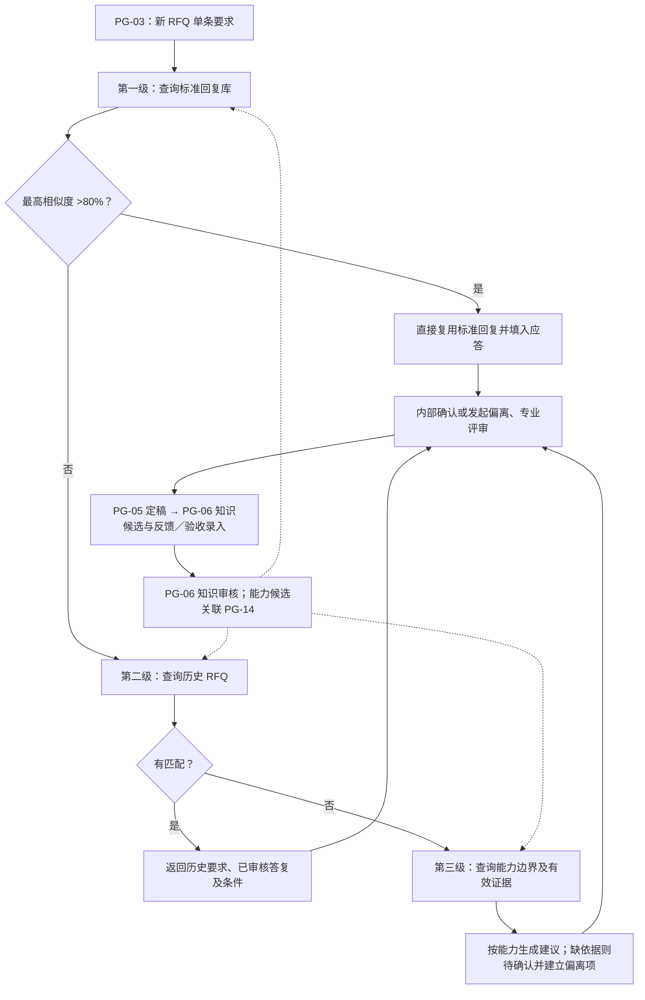

#### PG-08 个人工作台与待办

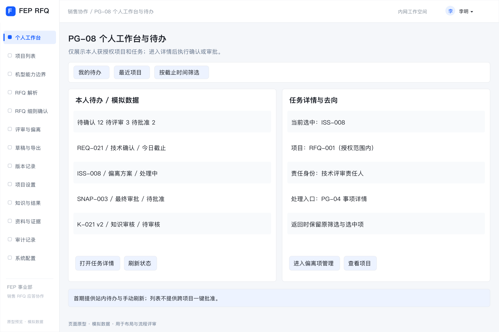

[查看可缩放 SVG](wireframes/pg08-workbench.svg)

- **入口与对象**：系统默认落地页、全局“我的待办”；所有业务角色按本人权限访问。
- **布局**：顶部为待确认、待评审、待批准、待复核数量；中间为本人待办列表，包含类型、授权项目、对象编号、责任身份、截止时间、状态和最近更新时间；侧栏为最近访问的授权项目。
- **筛选与跳转**：按项目、任务类型、状态及截止时间筛选。要求确认／复核进入 PG-03；事项处理／专业批准进入 PG-04；最终审批进入 PG-05 的具体快照；知识审核进入 PG-06 的具体知识版本。保留返回待办及原筛选条件的入口。
- **操作规则**：列表不提供跨项目一键批准；进入详情后重新核对权限和版本。任务随业务对象状态更新，同一任务不因刷新或重试重复生成；任务失效显示已处理或权限变化。
- **边界**：首期采用站内待办与手动刷新；邮件、即时通信推送、自动催办及高级统计属于 P1。待办为空仅表示本人当前无待处理任务。

#### PG-09 项目设置、成员与审批配置

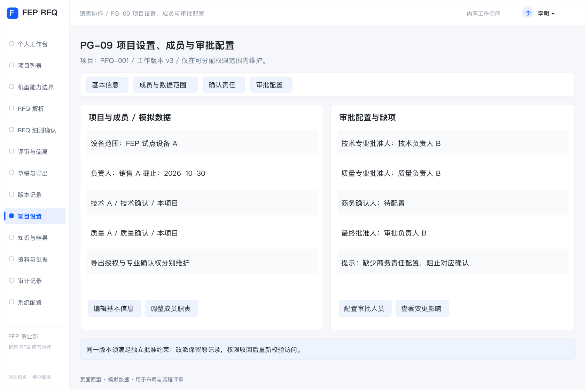

[查看可缩放 SVG](wireframes/pg09-project-settings.svg)

- **入口与对象**：PG-01 项目行及项目内“项目设置”；项目负责人按项目管理授权维护，其他成员按权限只读。全局账号与授权策略从 PG-13 管理，项目负责人不能突破其可分配范围。
- **布局**：基本信息、成员与数据范围、确认责任、审批配置四个标签页。基本信息包含名称、客户、产品线／设备范围、设备项及其机型版本／配置基线、负责人、截止时间及项目工作版本；成员表包含身份、职责、可访问范围、确认／导出授权及生效状态。
- **确认与审批配置**：按技术、质量、商务等类别明确确认人、关键承诺专业批准人及项目最终批准人；知识批准人由知识授权配置，不因项目批准身份自动获得。允许一人兼任角色，但必须满足 5.1 的同版本独立审批约束。
- **操作与反馈**：新增／调整／移除成员、改派职责和配置审批人均先展示影响范围，填写原因并保留变更记录；必填项或责任配置缺失逐项提示，允许保存未完成配置，阻止对应确认、批量确认或审批。
- **影响处理**：设备范围或适用配置变化按 BR-09 触发相关复核；权限收回按 BR-11 立即重新校验访问和后续操作；负责人／审批人改派保留原处理记录，未完成任务转给新责任人，不伪造其确认或批准。

#### PG-10 资料与证据管理

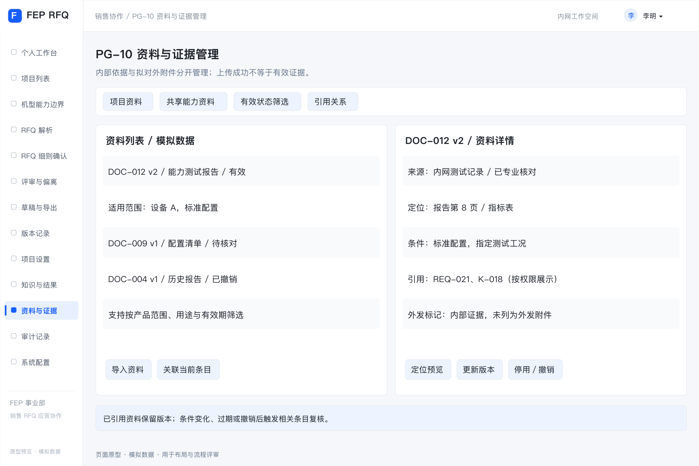

[查看可缩放 SVG](wireframes/pg10-evidence.svg)

- **入口与对象**：全局“资料与证据”及 PG-02、PG-03、PG-04、PG-06 的关联资料入口。项目资料受项目授权控制，共享能力资料受其独立数据范围控制；页面只显示用户可访问的记录。
- **布局**：资料列表与详情预览，按项目资料／共享能力资料、用途、产品范围、有效状态及是否被引用筛选。列表包含编号、名称、版本、用途、维护人、来源日期、有效期及可见范围。
- **资料详情**：展示原件及页码／工作表定位、型号配置、工艺或适用条件、来源与确认记录、关联要求／知识及版本；无法预览时显示文件信息并在有权时下载原件，不把无法预览等同于无内容。
- **操作与用途**：项目上传沿用 PG-02 的要求来源、补充附件、应答模板分类；共享资料由获授权维护人导入。关联、替换、更新版本、停用／撤销均记录原因。上传成功仅代表存储成功，须由获授权专业人员核对来源、条件和有效性后才能作为有效证据；不新增独立的资料审批流程。
- **引用与外发**：内部证据与拟对外附件使用不同标记；标为对外附件不等于获准发送，仍须 PG-05 的附件分标检查及快照批准。已引用资料不能直接物理删除或覆盖版本，替换保留旧版追溯。
- **有效性影响**：过期、撤销、条件修订或权限变化列出操作者可访问的受影响对象，按 BR-09 触发复核；无法访问的对象不披露名称或摘要，其处理由对应获授权责任人完成。确认或正式导出时再次校验证据。

#### PG-11 项目版本、变更与快照记录

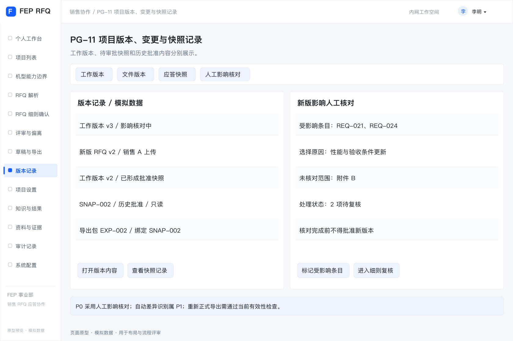

[查看可缩放 SVG](wireframes/pg11-versions.svg)

- **入口与对象**：项目顶部版本入口，以及 PG-02 的文件版本、PG-03 的变更记录、PG-05 的快照历史；仅限授权项目。
- **布局**：工作版本、文件版本、应答快照三个标签页。记录编号、来源、创建人／时间、状态、关联条目、审批人及导出记录；选中后展示只读内容和事件时间线。审批与导出记录绑定实际版本。
- **首期新版处理**：上传新版要求或修改范围后建立新工作版本，负责人手工选择受影响条目，记录原因、未识别范围及核对结果；未完成影响核对不得批准新版本。可查看旧版／新版内容供人工对照，自动差异识别与影响推荐仍属 P1。
- **复核与跳转**：查看受影响条目及复核进度，跳转 PG-03／PG-04 处理；工作版本变更不覆盖已冻结的待审批快照及历史批准内容，旧批准不得沿用为新工作版本批准。旧快照的当前可导出性需独立展示，不用“已批准”替代有效性检查。
- **历史文件**：有权查看、下载已生成历史文件用于追溯时，显示其版本及当前失效／影响提示；重新生成正式文件必须经 PG-05 当前有效性检查。对于已对外发送内容，负责人记录是否需重新发送及处理结果，系统不自动向客户发送。

#### PG-12 审计记录

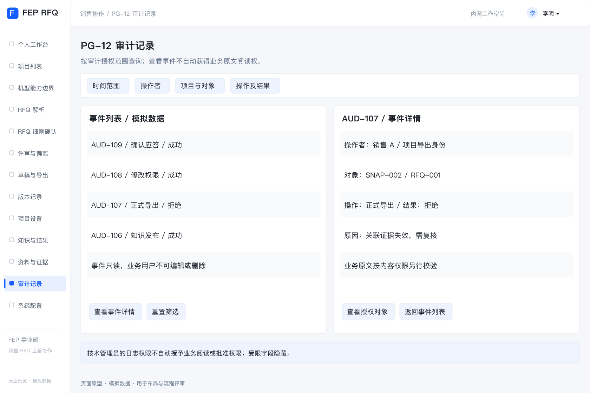

[查看可缩放 SVG](wireframes/pg12-audit.svg)

- **入口与对象**：项目内“操作记录”及管理区“审计记录”。项目负责人查看其授权项目记录，获审计授权人员按范围查询；管理员的技术日志权限不自动包含业务内容阅读权限。
- **布局**：按时间、操作者、项目、对象类型、操作及成功／失败筛选；列表显示事件编号、对象及版本、操作时间、实际职责、结果及原因。详情显示可访问的变更前后内容、相关审批／导出快照及来源事件。
- **记录范围**：资料访问、上传与替换、解析修订、匹配及人工采纳、确认、分派、批准／退回、知识发布／撤销、权限变更、生成及导出均有可追溯记录；失败或拒绝事件不伪装为成功。
- **约束**：业务用户不能编辑或删除审计事件。越权字段隐藏；即使有权检索事件，也须另行具备业务内容权限才能展开原文。首期支持查询与定位，不增加通用业务数据批量导出入口。

#### PG-13 系统配置与运维

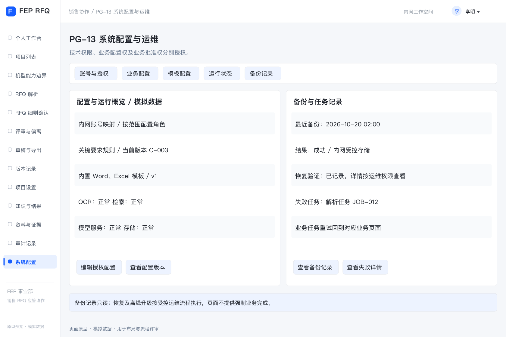

[查看可缩放 SVG](wireframes/pg13-admin.svg)

- **入口与对象**：仅对获技术管理授权人员显示管理区；业务配置按对应管理授权开放。系统管理员维护账号、授权策略及技术配置，不因该身份获得项目阅读或业务批准权；授权变更记录实际操作者。
- **布局**：账号与授权、业务配置、模板配置、运行状态、备份记录五个标签页。业务配置包含专业职责、关键要求规则及试点设备范围；模板配置展示首期内置模板版本和列映射默认值；运行状态包含 OCR、检索、模型、存储及任务失败状态。
- **账号与授权**：维护内网身份映射、生效状态、角色及数据范围；项目成员分派仍在 PG-09 完成。技术角色、知识维护／批准及业务批准分别授权，缺少配置不得默认放行；权限回收后重新校验访问与任务。
- **配置变更**：有权人员可维护业务配置及模板映射，保存前校验必填项、适用范围和版本，展示受影响范围并记录原因。项目所用配置和模板版本须可追溯；影响既有结论、条件或证据有效性的变更按 BR-09 处理。审批中及已批准快照不被新配置改写。
- **运行与恢复**：显示失败阶段、最近成功时间及可访问的错误摘要；业务任务重试回到 PG-02／PG-03／PG-05 对应任务，不提供绕过业务校验的强制完成操作。备份页只读展示备份时间、范围、结果及最近恢复验证记录，恢复由获授权运维人员按受控流程执行，记录审计。
- **首期边界**：离线模型／依赖升级由运维流程完成，页面仅显示当前版本及健康状态；不包含公网下载、任意模型编排、模板可视化设计器或在线恢复按钮。

#### PG-14 机型能力边界

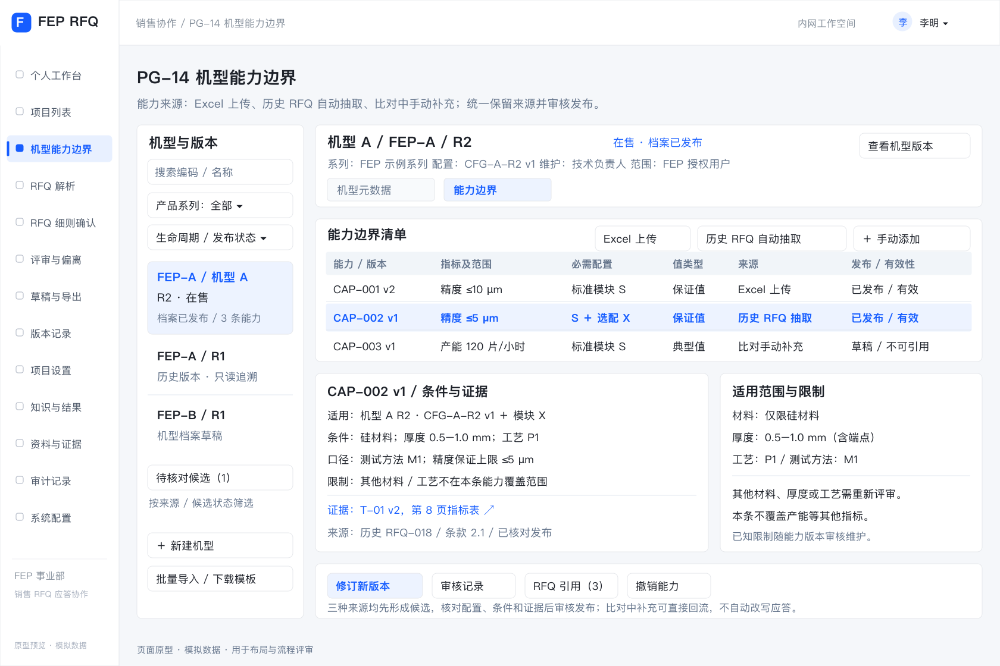

[查看可缩放 SVG](wireframes/pg14-model-capabilities.svg)

- **入口与对象**：全局“机型能力边界”，项目设置和 RFQ 细则确认提供关联入口。统一模块内仅设置“机型元数据”和“能力边界”两个横向标签页。“机型元数据”维护机型编码、名称、系列、版本、生命周期、标配／选配及配置定义；“能力边界”维护指标范围、配置要求、适用条件、限制与证据，版本、审核及引用记录在能力详情或操作入口中查看；不另设一级标签。
- **列表与详情**：左侧按产品系列、机型、版本、生命周期及发布状态筛选；右侧展示机型资料、标配／选配和能力清单。选中能力后展开指标、范围、适用条件、证据、审核记录及有权查看的项目引用。示例数据不能作为实际设备能力。
- **维护操作**：获授权维护人新建、修订机型和能力、关联 PG-10 证据、保存草稿及提交审核；指定能力批准人批准发布、退回或撤销，同一版本不得自审。机型与能力均保留版本，已发布内容修订产生新草稿，不覆盖旧版。
- **RFQ 使用**：从项目进入时带入设备项及配置基线，按权限展示适用能力；切换查看其他机型不修改项目配置。应用不同机型／配置须回 PG-09 明确修改、填写原因并触发相关复核。
- **能力来源**：能力边界标签页提供“Excel 上传”“历史 RFQ 自动抽取”“手动添加”入口，清单增加来源列，并可按来源和候选状态筛选。比对中的手动补充从 PG-03 发起，自动回流本模块候选，不要求离开当前条目重复录入；具体规则见 4.9.4。
- **导入与错误**：Excel 上传支持固定模板及字段预检、逐行错误与成功记录；历史抽取显示任务进度、候选及出处、缺项和失败重试。三种来源均先形成候选草稿，重试不重复建档；缺条件、证据或批准人时列出原因并阻止发布。
- **状态与影响**：草稿、待审核、已发布及退回意见清楚展示；有效性另列有效、过期、撤销、被替代。发布、替代或撤销前展示可访问的影响及原因；按 4.9 处理受影响引用，保留历史版本。无权限引用不披露名称或摘要。

#### 4.3.1 页面清单、层级与导航

PG-01～06 为核心业务页面，PG-08～13 补齐协同、资料及管理界面，PG-14 承载机型能力边界。以下为本版 P0 的完整页面级清单；各页内的详情、标签页及弹窗按 4.3.2～4.3.3 实现，不再另计独立一级页面。线框为代表状态，未逐张绘制所有详情与弹窗；PG-14 线框展示“机型元数据”和“能力边界”两个横向标签，默认选中“能力边界”，展示能力清单、条件、证据及限制；具体 RFQ 比对在 PG-03 完成，完整操作要求以本节文字为准。

| 编号 | 页面 | 所属层级／入口 | 主要访问者与去向 |
| --- | --- | --- | --- |
| PG-08 | 个人工作台与待办 | 全局导航 | 全部业务角色；跳转本人有权处理的对象详情 |
| PG-01 | 项目列表 | 全局导航 | 授权项目用户；新建后 PG-02，继续处理进入项目业务页 |
| PG-02 | RFQ解析 | 项目导航 | 条目自动导入；点击条款按 ID 直达对应比对项，可返回来源 |
| PG-03 | RFQ细则比对 · 细则比对 | 项目导航 | 销售、专业确认人；转 PG-04 或 PG-05 |
| PG-04 | RFQ细则比对 · 偏离处理 | 工作台内页签 | 事项责任人及批准人；回到关联条目或 PG-05 |
| PG-05 | 导出文档 | 项目导航 | 销售及独立最终批准人；定稿后可进入 PG-06 回流 |
| PG-06 | 知识与结果维护 | 全局导航，支持项目筛选 | 知识维护／批准人及有反馈权限的项目成员 |
| PG-09 | 项目设置、成员与审批配置 | 项目导航 | 项目负责人；成员按权限只读 |
| PG-10 | 资料与证据管理 | 全局导航，支持项目筛选 | 授权资料使用者、维护人及专业确认人 |
| PG-11 | 项目版本、变更与快照记录 | 项目导航／版本入口 | 授权项目用户；跳转对应条目、审批或导出 |
| PG-12 | 审计记录 | 项目操作记录／管理区 | 获相应范围审计权限者 |
| PG-13 | 系统配置与运维 | 管理区 | 获技术管理或对应业务配置权限者 |
| PG-14 | 机型能力边界 | 全局导航；PG-09／PG-03 关联入口 | 授权销售及专业人员查询；机型／能力维护人和指定能力批准人维护、审核 |

- 全局导航包含个人工作台、项目列表、机型能力边界、知识与结果、资料与证据；管理区按权限显示。项目内固定显示项目名称及工作版本，提供解析、RFQ细则比对、导出文档、版本记录及项目设置入口。
- 原 PG-01～06 线框保留其业务布局；全局入口及新增导航统一按本表补齐，不以旧图中未显示某入口理解为没有该功能。
- 全局进入知识／资料页时仅展示授权范围；从项目进入时默认带入项目筛选，切换项目后重新校验权限。待办计数、列表和详情使用相同权限与状态口径。
- 首期不新增独立统计大屏、客户门户、自动报价页或系统集成中心。身份认证由内网统一入口承接，不单独设计登录页面；业务页面仍执行权限校验。

#### 4.3.2 详情、标签页与子视图

| 编号 | 所属页面／入口 | 承载形式 | 必须展示与支持的操作 |
| --- | --- | --- | --- |
| SV-01 | PG-01 新建／项目摘要 | 新建弹窗；摘要区 | 录入客户及必填项；创建成功仅生成一个项目；摘要显示缺项与流程入口，配置进入 PG-09 |
| SV-02 | PG-02 文件行 | 文件详情及版本标签页 | 原件预览、文件用途、解析状态／错误、附件关系、缺页或低可信标记；替换和重试保留历史版本 |
| SV-03 | PG-02 补录要求 | 补录抽屉 | 异常内容补录并保留条件、来源和原因；保存后自动导入工作台 |
| SV-04 | PG-03 历史候选 | 候选详情抽屉 | 历史原文／答复、条件差异、批准与验证结果、证据及来源；继续查看候选按实际权限加载 |
| SV-05 | PG-03 原文／证据链接 | 定位预览侧栏 | 回到页码、工作表或单元格；资料详情进入 PG-10，返回保留当前要求及未保存内容 |
| SV-06 | PG-04 事项行或 PG-08 待办 | 事项详情子页 | 要求与差距、方案、成本／交期／质量影响、证据、分派与沟通记录；提交、退回、批准关闭及条件变化后重开 |
| SV-07 | PG-05 生成草稿 | 模板与映射标签页 | 内置模板选择、必要列映射、条目预览、条件／附件清单及分标检查，缺项定位回业务页面 |
| SV-08 | PG-05 审批任务 | 只读快照审批子页 | 固定快照编号、内容、关键承诺专业批准、附件及变更记录；批准／退回意见；与当前工作版本明确区分 |
| SV-09 | PG-05 导出记录 | 文件包详情 | 快照、生成时间、模板版本、文件及附件清单、失败原因、有效性提示；允许时下载或重试 |
| SV-10 | PG-06 批量导入 | 导入任务子视图 | 下载固定模板、上传、字段预检、逐行错误、成功候选及重试；修正重试不重复创建已成功记录 |
| SV-11 | PG-06 知识行／待办 | 知识详情及审核子页 | 来源、要求／答复、适用范围、证据、可见范围、版本、审核意见；修订、提交、批准发布、退回、撤销，不允许同版本自审 |
| SV-12 | PG-06 项目结果 | 反馈与验收标签页 | 沟通结果、接受条件、实际交付／验收、日期、录入人及依据；未知单列，修改已发布知识产生新版本候选 |
| SV-13 | PG-09 成员及审批配置 | 成员编辑抽屉／配置标签页 | 人员、职责、数据及确认范围、导出权、批准角色；配置缺项与独立性校验 |
| SV-14 | PG-10 资料行 | 资料详情及引用标签页 | 预览、条件与有效性、版本、可见范围、可访问引用；有效性变更展示影响及复核入口 |
| SV-15 | PG-11 版本行 | 内容查看与人工核对标签页 | 旧版／新版原文、人工影响标记、核对结论及处理记录；首期不要求自动生成差异 |
| SV-16 | PG-12 事件行 | 只读详情抽屉 | 事件、身份、对象版本、可访问变更及结果，跳转有权查看的业务对象 |
| SV-17 | PG-13 配置／运行记录 | 配置编辑抽屉／只读任务详情 | 必填校验、适用范围、配置版本；错误摘要、备份及恢复验证结果，不展示密钥或连接口令 |
| SV-18 | PG-14 机型／能力行 | 机型元数据、能力边界两个横向标签页；能力详情及记录入口 | 机型与能力字段、配置适用性、证据定位、版本、状态及授权引用；新建、修订、提交、批准、退回、撤销及影响确认 |
| SV-19 | PG-14 Excel 上传／历史 RFQ 自动抽取 | 导入／抽取任务子视图 | 选文件或授权历史范围、预检、任务状态、候选与原文对照、来源定位、逐行错误及去重重试；成功项仅为草稿 |
| SV-20 | PG-03 补充能力边界／PG-14 手动添加 | 补充抽屉及候选详情 | 预填机型、配置、要求来源；录入实际能力、适用条件与证据，保存关联候选并返回原条目；不自动改写当前结论 |

详情子页支持由待办或对象链接直接打开；每次打开均校验权限。抽屉／侧栏保留所属列表及筛选上下文，独立子页提供明确返回入口。

#### 4.3.3 弹窗与操作确认

| 编号 | 触发位置／动作 | 内容与校验 | 提交结果与取消行为 |
| --- | --- | --- | --- |
| DL-01 | PG-01 新建项目 | 项目名称、客户、产品线／设备范围、负责人、截止时间；名称、范围、负责人及截止时间必填 | 成功进入 PG-02；失败保留输入；取消不创建 |
| DL-02 | PG-02／PG-10 上传或替换资料 | 用途、版本、关联对象及可见范围；重复文件提示，替换填写原因 | 分文件显示结果；失败可重试；取消未提交任务不影响已存资料 |
| DL-03 | PG-02 补录要求 | 填写条目、来源定位、条件和补录原因 | 保存后自动进入工作台；取消不改变条目 |
| DL-04 | PG-03 转评审／PG-04 分派、改派 | 问题类型、说明、责任人、截止时间、证据；改派填写原因 | 创建或更新同一事项及待办；重复提交不重复建单 |
| DL-05 | PG-03 单条确认／修改后确认 | 展示最终结论、答复、条件、依据；按 BR-04 校验，修改后确认填写原因 | 成功绑定条目版本；失败保留草稿并列原因 |
| DL-06 | PG-03 批量确认 | 展示明确选中范围、可处理数、排除项及原因；提交时再次校验 BR-05 | 逐条反馈成功／失败，不隐式包含其他页；取消不确认任何条目 |
| DL-07 | PG-04／PG-05／PG-06 提交、批准、退回 | 展示对象与版本、操作类型、检查结果及意见；退回必填理由，审批校验独立性 | 保存处理记录并更新待办；失败不能进入批准／发布状态 |
| DL-08 | PG-05 正式导出 | 展示批准快照、对外字段、条件、附件及分标检查结果，执行 BR-08、BR-11 | 成功生成可追溯文件包；失败列原因和修正入口，不生成成功记录 |
| DL-09 | PG-06 发布／撤销；PG-10 停用／替换证据 | 展示对象版本、范围、原因和可访问影响；发布校验证据及知识批准权 | 保留旧版与审计，必要时触发待复核；取消不改变有效性 |
| DL-10 | PG-09／PG-13 权限、责任或配置变更 | 展示变更前后、适用范围及受影响任务；原因必填，校验可分配权限 | 成功后按新权限生效并刷新任务，保留既有记录；失败保留原配置 |
| DL-11 | 离开有未保存内容的页面／条目 | 保存、放弃、取消离开三选一；保存时执行正常校验 | 保存成功才离开；失败留在原处；放弃只丢弃本次未保存编辑 |
| DL-12 | 保存、确认、批准或发布发生版本冲突 | 展示本人输入及可访问的最新版本／变更，提供返回核对入口 | 拒绝过期覆盖；人工核对后基于最新版本重提，不提供强制覆盖批准 |
| DL-13 | PG-11 新版影响核对 | 展示新版资料、受影响条目选择、选择原因及未核对范围；确认核对结论 | 建立复核范围并保留记录；未完成核对时阻止新版批准 |
| DL-14 | PG-04 条件变化重开事项 | 展示原关闭结果、新条件、重开原因及责任人 | 保留原关闭记录并重新进入评审，相关应答按 BR-09 复核 |
| DL-15 | PG-14 提交、批准发布、退回、替代或撤销 | 展示机型／能力版本、配置条件、证据、意见与可访问影响；发布校验字段、证据有效性及独立批准权，退回／替代／撤销必填原因 | 失败保留草稿及原有效状态；成功保留审核与审计，按 4.9 触发相关复核；取消不改变发布状态 |

| DL-16 | PG-03 补充能力边界／PG-14 手动添加 | 展示当前条目及机型配置，实际能力值与客户要求分开；必填能力描述、适用范围及来源，缺项允许保存但提示待补齐；校验候选提交权限 | 保存关联候选并保留当前应答；失败保留输入，取消不创建；重复保存不重复建档 |

#### 4.3.4 首期功能与页面覆盖

| 已有需求 | 页面与子视图 | 页面验收重点 |
| --- | --- | --- |
| FR-01 项目与资料 | PG-01、PG-02、PG-09、PG-10、PG-11 | 创建、文件用途与版本、成员分派、原件追溯 |
| FR-02 自动解析 | PG-02、SV-02～03 | 原始章节层级、DOC／DOCX、按 ID 精确跳转与返回、自动导入、失败补录及重试 |
| FR-03 冲突与澄清 | PG-03、PG-04、SV-06 | 冲突双方与出处、待澄清事项及责任人，缺资料不判不满足 |
| FR-04 三级顺序比对与应答 | PG-03、PG-10、SV-04～05 | 候选与条件、当前证据、系统建议与人工确认分开 |
| FR-05 偏离项管理 | PG-04、PG-08、SV-06 | 分派、方案、专业批准、沟通结果及重开 |
| FR-06 草稿与定稿 | PG-05、PG-11、SV-07～09 | 映射、缺项检查、只读快照、独立审批及正式导出 |
| FR-07 知识沉淀 | PG-06、PG-10、SV-10～12 | 导入、结果录入、去重修订、审核发布与撤销 |
| FR-09 机型能力边界 | PG-14、PG-09、PG-03、SV-18～20、DL-15～16 | 三种能力来源、来源追溯与去重、机型配置关联、条件化能力、证据审核、RFQ 比较及变更复核 |
| P0 权限、版本、审计及运维 | PG-08～13 | 授权、待办、人工影响核对、审计及恢复记录 |
| FR-08 自动版本影响分析 | PG-11 的 P1 扩展 | 不纳入首期；P0 以人工影响核对完成相应闭环 |

#### 4.3.5 所有页面的通用状态与交互

- **加载与空态**：加载中、无数据、筛选无结果、无权限、服务失败分别展示；无数据时按权限提供创建／上传入口，筛选无结果提供清除筛选，服务失败提供重试，不把失败显示成空列表或零待办。
- **保存与重复提交**：表单明确显示未保存、保存中、已保存或保存失败；提交期间防止重复操作，后台重试不得重复产生项目、条目、事项、知识候选或导出成功记录。
- **离开与中断**：正常切换时执行 DL-11。会话失效或临时故障时，页面尚保留的未保存内容在重新认证及权限、版本校验后允许继续核对保存；权限撤销时不继续展示受限业务内容。浏览器关闭／崩溃不承诺恢复未保存输入，已保存草稿及后台成功任务可重新进入查看。
- **错误定位**：字段错误定位到字段；业务门槛失败列出对象、原因及获授权修正入口；长任务显示排队、处理中、成功或失败，并保留任务编号及最近状态。刷新页面仍可查询后台任务结果。
- **并发与权限**：任何保存、确认、批准、发布及导出均重新校验版本与权限；导航隐藏不能替代服务端校验。权限变化后列表、计数、详情和附件同步按最新范围返回。
- **返回与只读**：详情返回保留筛选、分页及选中对象；已冻结快照、历史版本及审计记录明确标识只读，修改进入对应工作版本，不在只读页直接改写。

