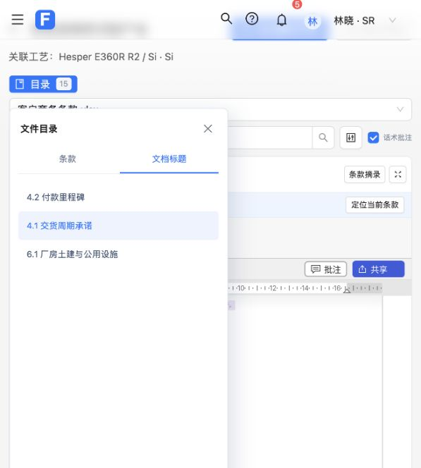

# 统一目录验收（第 1 项）

用户已确认单一“目录”入口，面板内切换“条款／文档标题”，默认条款；保留状态、筛选、勾选和批量确认。只实施本项，其他精简项继续逐项确认。

结果：移除原文件标题行的重复目录按钮；沿用宿主目录面板，新增真实 Word 标题层级及编号；读取或点击标题不修改正文，不产生撤销步骤、文档修订、未保存状态或保存请求。会话与正文修订校验拒绝过期目标，同名标题按结构位置区分。

验证：

- 前端基线 428 项；完成后 430 项全部通过，其中目录组件与原文桥相关 18 项通过。
- Word 原生目录 5 项通过，覆盖只读、同名标题、层级、旧版本、无标题，以及正文/修订/撤销/dirty 不变；宿主相关测试结果见执行日志。
- 固定源码归档实际应用补丁，26 个文件逐字节匹配测试与构建输入。
- Word WASM 重编译及前端生产构建成功。仍有既有的第三方分块体积提示。
- 实际浏览器验收：默认条款、无标题提示、商务文件真实标题及点击跳转、切换文件清除旧目录、切换视图保留搜索与勾选、批量确认计数；未执行条款确认或文档保存，验收筛选与勾选已还原。页面无 error 级控制台日志。
- 独立代码复查未发现需处理的问题。原有未提交修改保留，当前改动留在本地分支；未发布或制作 ZIP。

后续交付：用户随后明确授权统一目录随本次界面精简一并合并推送 `master` 并制作 Windows 资源包，因此上面的“留在本地、未发布”是实现完成时的历史状态。Windows 安装步骤见 [启动说明](../windows-craft-startup.md)，资源包清单记录实际对应的提交。
