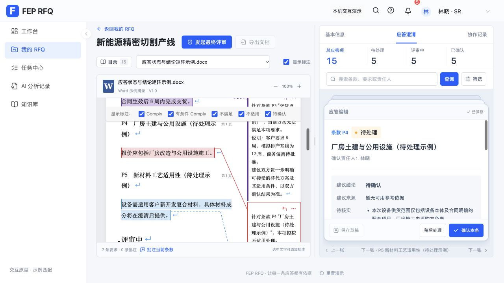

# RFQ 轻过渡

用户在对话中确认“切换生硬”，并批准执行已提出的轻过渡方案：页面主体约 150ms 淡入，标签与条款只过渡内容区域，选中态约 100ms，连续点击跟随最后一次操作。

采用现有 React 组件上的短时透明度动画，保持导航、容器尺寸、表单实例和原文定位稳定。新切换取消上一段动画，无退场等待或动画队列；首次进入不播放额外动画。尊重系统减少动态效果设置。不引入依赖，不改数据与权限。

方案取舍：单纯 CSS 入场依赖重建节点，容易重置表单；整页退出再进入会延迟连续点击。选择通过稳定 DOM 引用播放可取消的轻淡入。手动上一张／下一张直接选择条款；已有确认完成后的业务卡片反馈保留。

验收：页面导航、卡片/列表、项目标签、任务标签、详情分区和手动条款切换；快速连续点击最终内容正确；无未保存草稿丢失、原文标注错位或新增横向滚动。测试与生产构建通过。

## 验证结果

- 316 项既有及并行更新的测试通过，生产构建通过，`git diff --check` 通过。
- 浏览器观察到列表和详情内容的入场透明度为 0.72；左侧原文透明度保持 1、transform 为 none。
- 连续点击任务标签后最终回到“待办”；搜索输入保持，内容透明度保持 1，不重复播放过渡。
- 手动“下一张”立即显示下一条，aria-busy 保持 false；连续“下一张、下一张、上一张”最终条款正确。
- 修改结论后内容透明度保持 1，切下一条仍弹出未保存提示；放弃修改后可继续浏览，未保存测试修改未写入数据。
- 独立代码审查未发现范围内问题；确认减少动态效果分支与既有 CSS 规则生效路径。最终页面无控制台 error/warn。
- 原有依赖块体积警告仍存在，本次未新增依赖。

